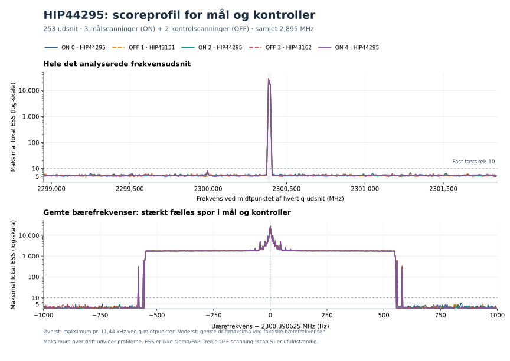

# BV — alle resterende sikre HIP44295-udsnit analyseret

31. oktober 2026. **221 nye frekvensudsnit er færdiganalyseret. Ingen fundrækker passerer den fastlagte tre-ON/tilgængelige-OFF-udvælgelse.**

Fortsættelsen blev gennemført autonomt i 28 faste portioner på 27 minutter og 29 sekunder. Alle søgninger og separate efterkontroller bestod. Den omfatter første detektorsøgning i q33–253 i fem tidligere hentede scanninger fra HIP44295-besøget den 29. september 2016. Rådataene var allerede dekodet og normaliseret; der er ikke foretaget nye observationer.

## Dækning

| Omfang | Nye BV-resultater | BU og BV samlet |
|---|---:|---:|
| Sikre bærefrekvensudsnit | 221, q33–253 | 253, q1–253 |
| Kanalernes samlede binbredde | 2,529144287109375 MHz | 2,895355224609375 MHz |
| Scan/q-søgninger | 1.105 | 1.265 |
| Korrelerede sporberegninger | 9.968.125.440 | 11.411.473.920 |

Det samlede interval er 2298,9486722275615–2301,844024658203 MHz. Beregningerne er korrelerede og må ikke fortolkes som uafhængige statistiske forsøg. De tre randudsnit q0, q254 og q255 er uden for den fastlagte sikre scope.

Metoden er uændret: fem komplette scanninger med 16 tidsrækker; fuld native AC-normalisering; 839 driftshastigheder fra −4 til +4 Hz/s; bredder 1/3/9/33 kanaler og strides 1/1/2/8. Lokal ESS-grænse 10 og tilgængelig OFF-grænse 5. ESS er et deskriptivt søgemål, ikke sigma eller en kalibreret falsk-alarm-sandsynlighed.

## Fund og frasortering

Der er 175.557 korrelerede katalogrækker i alle fem scanninger, heraf 105.482 i ON-scanningerne. Samtlige tærskeloverskridelser ligger i q127–128; de øvrige undersøgte q har ingen katalogfund.

| Klassifikation af ON-fundrækker | Antal |
|---|---:|
| Opfylder ikke tre-ON-kravet | 105.415 |
| Opfylder tre-ON, men afvises af tilgængelig OFF | 67 |
| Opfylder tre-ON uden tilgængeligt OFF-veto | 0 |
| Utilstrækkelig støtte i de fem tilgængelige scanninger | 0 |

De 67 tre-ON-rækker ligger i ét snævert, overlappende område: 2300,3905802965164–2300,3906697034836 MHz, cirka ±44,7 Hz omkring **2300,390625 MHz**. De er ikke 67 uafhængige kandidater. Alle fem scanninger har deres største score i samme native kanal, 524288, ved denne frekvens.

| Scanning | Rolle/mål | Katalogrækker | Største lokale ESS |
|---|---|---:|---:|
| 0 | ON HIP44295 | 35.235 | 26531,244 |
| 1 | OFF HIP43151 | 34.830 | 27913,247 |
| 2 | ON HIP44295 | 35.137 | 26537,661 |
| 3 | OFF HIP43162 | 35.245 | 27636,481 |
| 4 | ON HIP44295 | 35.110 | 27239,565 |

Strukturen ses i både mål- og kontrolretningerne. OFF-vetoet afgør frasorteringen under de fastlagte regler; det fastslår ikke en bestemt fysisk eller instrumentel årsag. Gemte driftværdier er repræsentanter fra søgegitteret og kan dele samme maksimum, ikke selvstændige driftmålinger.

Øverste panel viser maksimum pr. q-udsnit ved intervallets midtpunkt. Nederste panel bruger gemte, faktiske bærefrekvenser. Maksimering over drift udvider profilen; plateauets bredde er ikke en måling af en fysisk linjebredde. Figuren er efterfølgende beskrivende diagnostik og ændrer ingen klassifikationer.

## Kontrol af resultaterne

Plan og kode blev offentliggjort og læst tilbage før den nye scoring: [freeze 8d6058f](https://github.com/andersenmartin-blip/setisearch/commit/8d6058ff54b4485796da09a27c5504f90b935791). Alle 28 produktionskørsler og 28 uafhængige kontrolkørsler har faktisk exitkode 0 og naturlig stdout-EOF. Kode- og inputhashes er uændrede. Aktiv evidens blev skrevet i isoleret tmpfs, og alle lukkede arkiver blev verificeret før og efter eksport. Ingen automatisk genkørsel eller justering efter observerede resultater fandt sted.

Den løbende separate kontrol omfattede 39.780 udvalgte direkte skalarsummer, 13.260 kalibreringsvektorer og 1.290 udvalgte tvungne målinger på tværs af scanninger. Første portion omfattede desuden 20.480 native median/MAD-ankerpar og rekonstruktion af 3.276.800 normaliserede støtteværdier. Der blev ikke observeret numeriske forskelle i de kontrollerede værdier. Det er afgrænset kontrol, ikke en anden fuld søgning.

Den afsluttende gennemgang verificerede alle 28 arkiver, 11.880.960 endelige gemte maksimumværdier og samtlige katalogrækker. Derudover blev **alle 67 tre-ON-rækker** genberegnet separat: 335 scan-målinger, 180 fulde valgte kalibreringsvektorer og 1.969 direkte skalarsummer. Alle OFF-afvisninger blev reproduceret uden numerisk forskel. Dette er eksplicit efterfølgende validering af allerede fundne rækker, ikke nye data eller en ny søgning.

## Begrænsning og næste skridt

Den tredje OFF-scanning, scan5, er stadig ufuldstændig og blev ikke anvendt. Fuld besøgsbedømmelse er derfor fortsat `NOT_EVALUABLE_MISSING_OFF5`. Der er ingen kvalificeret SETI-kandidat, global FAP, astronomisk følsomhedsgrænse eller fuld seks-scanningskonklusion.

BU og BV har nu tilsammen gennemgået alle 253 forud fastlagte sikre bærefrekvensudsnit i de fem komplette gemte scanninger. Videre arbejde med et fuldt besøg kræver den manglende kontrolscanning, gentagelsen og den komplette oprindelige inputdokumentation via normal tilladt arkivadgang. De næste kømål er HIP58684/65193 og HIP59280/65205; ny hentning er ikke udført her.

De oprindelige ufuldstændige forløb og historiske fejl er bevaret. BA-autoriteten er uændret: 486 unikke arkiv-ID'er og 268,50128173828125 tekniske MHz-besøg; BV giver nul ny fuld-besøgsdækning og flytter ikke køen. Alle processer er afsluttet.

Maskinlæsbar status: [SUMMARY_BV.json](work_bv/SUMMARY_BV.json). Kontrol: [afsluttende gennemgang](work_bv/review/FINAL_CLOSURE_REVIEW_BV.json), [alle 67 tre-ON-rækker](work_bv/review/THREE_ON_REVIEW_BV.json) og [bindingskontrol af sammendraget](work_bv/review/SUMMARY_BINDING_REVIEW_BV.json). Fuld reproduktionsdata og inputreferencer følger den gemte levering.

