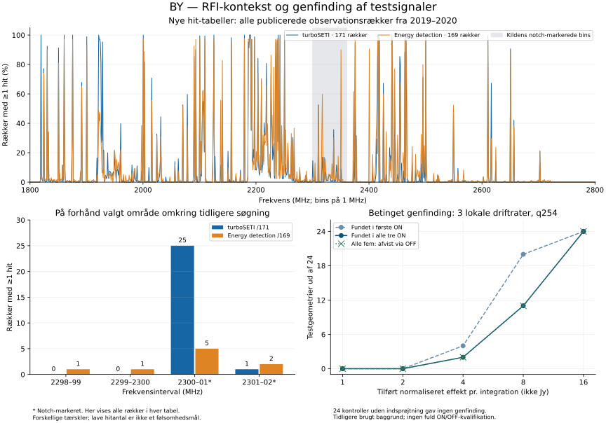

# BY — nye RFI-tabeller og målt genfinding af testsignaler

31. oktober 2026, Europe/Copenhagen. BX er fulgt op med analyse af to nye, oprindeligt publicerede GBT-hit-tabeller samt en afgrænset test af søgekodens genfinding. **Ved den højeste tilførte teststyrke blev alle 24 signalgeometrier genfundet i de tre ON-scanninger. Alle 24 blev afvist via OFF, når signalet også var tilføjet de tilgængelige OFF-scanninger.** Det er simulerede kontrolsignaler på tidligere analyseret baggrund, ikke nye kandidater.

## Nye data: eksisterende detektorers hit-tabeller

De to CSV-filer kommer fra [forfatterens fastlåste datasæt](https://github.com/dbautista98/Breakthrough_Listen/tree/de774a274fd2dfe44e31ba88178c9dd8305de3a0/TESS_statistics). Ifølge beskrivelsen stammer observationerne fra GBT i perioden 18. september 2019–26. marts 2020. Filerne indeholder hitantal i 1 MHz-bins; de indeholder ikke originale teleskopeffekter eller tilstrækkelige data til at kvalificere et bestemt signal. Filstørrelse, Git-blob-hash og SHA-256 er kontrolleret.

| Publiceret tabel | Observationsrækker | Frekvensbins | Kontrollerede tællefelter | Samlet hitantal |
|---|---:|---:|---:|---:|
| turboSETI | 171 | 1.001 | 171.171 | 120.413 |
| Energy detection | 169 | 1.001 | 169.169 | 741.117 |

Alle **340.340 tællefelter** er kontrolleret med en separat implementering, inklusive medianer, andele og identitetslister. Rækkerne er ikke dokumenteret som uafhængige observationer med samme effektive eksponering. De to detektorer har forskellige algoritmer og tærskler. Forfatteren valgte energy-tærsklen 4096 for at opnå omtrent samme spektrale hitforekomst som turboSETI; lighed mellem tabellerne er derfor ikke en uafhængig validering, og hitantal kan ikke rangordne detektorerne.

Den oprindelige, på forhånd fastlagte navne-regel gav nul fælles ID'er. En efterfølgende diagnose viste, at turboSETI-navnene havde yderligere behandlingsendelser. Den oprindelige analyse er bevaret. En særskilt offentliggjort V2-regel fjerner alene de to præcist angivne endelser `.gpuspec.0000.datnew.dat` og `.rawspec.0000.datnew.dat`, afviser dubletter og ukendte formater og anvender derefter eksakt lighed. V2 er deklareret efter, at de oprindelige tabeller var analyseret. Den etablerer lighed mellem navnestammer, ikke en uafhængig kontrol af rå observationers headers.

V2 fandt **169 fælles navnestammer**, to uparrede turboSETI-rækker og ingen uparrede energy-rækker. Alle 1.001 parrede frekvensbins er kontrolleret uafhængigt. Reglen blev [offentliggjort særskilt før den nye parrede beregning](https://github.com/andersenmartin-blip/setisearch/commit/8f080290d0de9d2c2bc0aa0d7d3dc05921b1d46b). I 2300–2301 MHz havde turboSETI hit i 25/169 matchede rækker og energy-metoden i 5/169; fire rækker havde hit med begge metoder. Det er en forskel i de publicerede detektorudfald, ikke en måling af, hvilken metode der er bedst.

Området 2298–2302 MHz blev valgt ud fra projektets eksisterende søgefrekvenser, før de nye tællefelter blev læst. De samlede, uparrede tabeller viser:

| Frekvensinterval | turboSETI: rækker med hit | Energy: rækker med hit | Notch-markering i kildekoden |
|---|---:|---:|---|
| 2298–2299 MHz | 0/171 | 1/169 | Nej |
| 2299–2300 MHz | 0/171 | 1/169 | Nej |
| 2300–2301 MHz | 25/171 | 5/169 | Ja |
| 2301–2302 MHz | 1/171 | 2/169 | Ja |

Kildens kode markerer bins med nedre kant 2300–2360 MHz som notch-område. Alle bins er bevaret i analysen. Lave hitantal kan skyldes modtagerrespons, manglende dækning eller forbehandling; de dokumenterer ikke ren himmel eller en bestemt følsomhed. Den konkrete historiske afvikling af producentens kode og dens valg er ikke rekonstrueret. Disse senere, groft inddelte statistikker kan heller ikke bruges til at bekræfte eller afvise et bestemt signal i vores observationer fra 2016.

## Genfinding på den bevarede q254-baggrund

Testen består af **264 situationer**: 24 faste geometrier, fem positive styrker, to mønstre for tilstedeværelse samt 24 kontroller uden tilført signal. Et signal findes enten kun i ON-scanningerne eller i alle fem tilgængelige scanninger. Den anvendte model fordeler en trekantformet kanalrespons over hele integrationstiden på 18,253611008 sekunder og tager dermed højde for frekvensdrift under integrationen.

Den oprindelige kerne, kanalbredder, strides, ESS-tærskler på 10 for ON og 5 for OFF samt projektion af faktiske fundne spor er bevaret. Lokal median/MAD over hele den faste 4.096-kanals kerne genberegnes efter hver indsprøjtning. Signalet tilføres efter normaliseringen. Styrken er samlet tilført normaliseret effekt pr. integration, **ikke Jy eller en kalibreret signal/støj-ratio**.

| Tilført styrke | Fundet i første ON | Fundet i alle tre ON | Afvist via OFF, når tilført alle fem |
|---:|---:|---:|---:|
| 1 | 0/24 | 0/24 | 0/24 |
| 2 | 0/24 | 0/24 | 0/24 |
| 4 | 4/24 | 2/24 | 2/24 |
| 8 | 20/24 | 11/24 | 11/24 |
| 16 | 24/24 | 24/24 | 24/24 |

Ingen af de 24 kontroller uden tilført signal gav genfinding. Alle signaler tilført alle fem scanninger, som opfyldte alle tre ON-krav, blev afvist af den tilgængelige OFF-kontrol. For ON-only-signalerne var der ingen OFF-afvisning. De ON-only-signaler, der opfyldte alle tre ON-krav, har fortsat betegnelsen `INCOMPLETE_OFF_COVERAGE`, fordi OFF5 mangler.

Der blev beregnet **42.577.920 korrelerede sporkombinationer**. Den uafhængige kontrol rekonstruerede alle 1.320 indsprøjtede matricer, 15.840 fulde kalibreringsvektorer og 22.816 projicerede spor med skalarsummer. Maksimal forskel i kalibrering og ESS var 0; maksimal forskel i skalarsum var højst 2,85×10⁻¹⁴. NPY-dekoder, NumPy-lagring og konstruktion af driftrategitter er fælles primitiver; beregningerne og reduktionerne er separat implementeret.

Testen bruger kun tre driftrater omkring den kendte indsprøjtede rate og én tidligere undersøgt baggrund. De 24 geometrier er et deterministisk testgitter. Derfor er resultatet **betinget lokal genfinding**, ikke blind survey-komplethed, global falsk-alarm-sandsynlighed eller astronomisk følsomhed. Normaliseringens respons på et fysisk tilført signal og teleskopets fulde kanalrespons er ikke testet.

En tydeligt markeret efterfølgende diagnose viser, at tabet ved styrke 8 fra 20 fund i første ON til 11 i alle tre ON skyldes kravene til samme projicerede spor på tværs af scanningerne. Otte geometrier har mindst én senere ON under tærsklen for samtlige tilknyttede spor; i ét tilfælde passerer scanningerne hver for sig, men ikke med ét fælles spor. En finere driftrateopdeling over hele tidssekvensen er derfor en relevant fremtidig kontrol, men er ikke påvist som hele årsagen til tabene.

## Bevisstatus og fortsættelse

Den oprindelige metode blev [offentliggjort før analyse](https://github.com/andersenmartin-blip/setisearch/commit/7e7284942b48075d6993aacbb874cd3751338f69). Alle afsluttede kørsler og uafhængige audits har naturlig afslutning og exitkode 0. Bevisarkiverne er kontrolleret med CRC, størrelse og SHA-256 før og efter eksport. Ingen oprindelige resultater er overskrevet.

BY tilføjer to analyserede, afledte datatabeller, men **ingen nye rå SETI-søgninger eller tekniske MHz-besøg**. Den oprindelige autoritet er uændret: 486 arkiv-ID'er, 268,50128173828125 tekniske MHz-besøg og ingen kvalificeret astronomisk følsomhed. Fuld ON/OFF-status er fortsat `NOT_EVALUABLE_MISSING_OFF5`; køen er ikke rykket frem, og ingen beregningsjob kører i baggrunden.

Første prioritet er et egnet komplet ON/OFF-datasæt eller normal adgang til den manglende oprindelige OFF-scanning med de eksisterende BB/BC/BE-kontroller. Seks yderligere kilderepositorier er undersøgt i BY; denne afgrænsede gennemgang fandt ingen ny komplet rå sekvens. De nye RFI-tabeller og genfindingstesten giver metodeviden, men erstatter ikke den manglende observationsadgang.

Figurens RFI-paneler viser alle rækker i hver oprindelig tabel; V2-parringen er opgjort særskilt ovenfor. Maskinlæsbare resultater og permanente bevisreferencer findes i `work_by/FINAL_SUMMARY_BY.json` og `work_by/DELIVERY_BY.json`.
