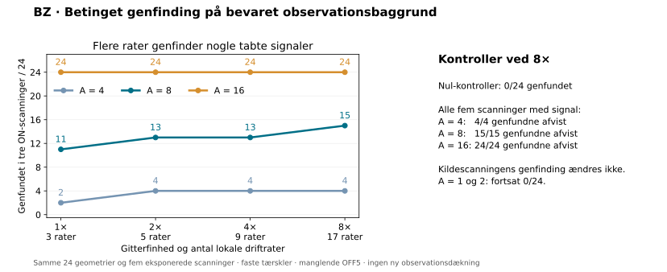

# BZ: finere driftrate-gitter giver en begrænset forbedring

**31. oktober 2026 · Afsluttet · Uafhængig numerisk kontrol bestået**

Ved den mellemste relevante signalstyrke A=8 steg genfinding i alle tre
ON-scanninger fra **11/24 til 15/24 geometrier**, når det lokale gitter blev
otte gange finere. Det er fire ekstra geometrier, svarende til 16,7 procentpoint.
Genfinding i selve kildescanningen var uændret på 20/24. Et finere gitter løser
dermed en del af tabet mellem scanninger, men ikke hele problemet.

Dette er en kontrolleret metodeundersøgelse på de samme allerede eksponerede
observationsbaggrunde og testsignaler som BY. **Der er ingen nye observationer,
SETI-kandidater eller kvalificeret astronomisk følsomhed.**

## Resultat

Alle tal er antal geometrier ud af 24 med genfinding i tre ON-scanninger for
signaler, som kun er tilført ON-scanningerne. A er tilført total normaliseret
overskud pr. integration før float32-konvertering; A er hverken Jy eller SNR.

| Tilført A | BY: 1×, 3 rater | 2×, 5 rater | 4×, 9 rater | 8×, 17 rater | Kildescanning, alle gitterfinheder |
|---:|---:|---:|---:|---:|---:|
| 1 | 0 | 0 | 0 | 0 | 0 |
| 2 | 0 | 0 | 0 | 0 | 0 |
| 4 | 2 | 4 | 4 | 4 | 4 |
| 8 | 11 | 13 | 13 | 15 | 20 |
| 16 | 24 | 24 | 24 | 24 | 24 |

Ingen ON-only-genfinding blev afvist af de tilgængelige OFF-scanninger.
De 24 nul-kontroller gav ingen genfinding ved nogen gitterfinhed. For signaler
tilført alle fem tilgængelige scanninger blev alle tre-ON-genfindinger afvist
af OFF-kontrollen: ved 8× var det 4/4 ved A=4, 15/15 ved A=8 og 24/24 ved A=16.
Ingen tilfælde havde både bevarede og afviste spor, men regnskabet tillader
denne mulighed og gør ikke de to hændelser kunstigt gensidigt udelukkende.

Ved A=8 genfinder 8× fire af de ni BY-geometrier, der havde et kildespor, men
manglede et fælles spor gennem alle ON-scanninger. De øvrige ni af 24 geometrier
består af fire uden kildespor og fem med kildespor, som stadig ikke består
tre-ON-kravet. De svageste tilførte signaler genfindes fortsat ikke.

## Hvad testen ændrede

Planen blev fastlåst på GitHub og alle 11 nye filer læst tilbage bytepræcist
før BZ's numeriske dataadgang:
[`ef5f88fabb7b1c0ca8f6fcf2ed06683ec048843d`](https://github.com/andersenmartin-blip/setisearch/commit/ef5f88fabb7b1c0ca8f6fcf2ed06683ec048843d).
[Plan](work_bz/PLAN_BZ.json), [omfang](work_bz/SCOPE_BZ.md) og
[læsekvittering](work_bz/PUBLIC_FREEZE_BZ.json) fastholder de konkrete bindinger.

264 tilfælde deler 24 geometrier på fem bevarede q254-baggrunde. De oprindelige
tre lokale driftrater og deres resultater blev genbrugt fra afsluttet BY.
Faktorerne 2, 4 og 8 er indlejrede delmængder af 17 rater inden for præcis samme
interval. Kun 14 nye rater blev beregnet. Alle 1.320 indsprøjtede matricer
matcher de oprindelige BY-hashes præcist.

Eksponeringsintegreret trekantrespons, signalstyrker, frekvens- og driftratefaser,
kernebredder 1/3/9/33, strides 1/1/2/8, hele kernens median/MAD, ON-tærskel 10,
OFF-tærskel 5 og den oprindelige OFF-associationsradius er uændrede. Alle
sandhedsmatchede lokale toppe i første ON-scanning indgår; der vælges ikke
efterfølgende et gunstigt enkeltspor. Samme spor skal bestå alle tre ON-scanninger.

## Kontrol og beregningsregnskab

| Størrelse | Kontrolleret resultat |
|---|---:|
| Nye korrelerede sporsummer | 198.696.960 |
| Genbrugte BY-sporsummer | 42.577.920 |
| Nye fulde kalibreringsvektorer | 73.920 |
| Genbrugte kalibreringsvektorer | 15.840 |
| Nye / genbrugte / samlede kildespor | 3.666 / 736 / 4.402 |
| Uafhængigt genberegnede skalare spor | 113.646 |
| Maksimal kalibrerings- og scoreforskel | 0 |
| Maksimal forskel i skalar sporsum | 2,8422 × 10⁻¹⁴ |
| Hovedanalyse / uafhængig kontrol | 21,73 s / 135,60 s |

17 syntetiske tests bestod før fastlåsningen. Begge videnskabelige processer
afsluttede naturligt med exitkode 0 inden for deres på forhånd fastsatte
600-sekunders grænser. Kilde-, input- og outputbindinger blev kontrolleret før,
efter og ved eksport. De lukkede arkiver er verificeret med CRC, størrelser og
SHA-256. Ingen kørsler blev gentaget. Den uafhængige kontrol rekonstruerede
indsprøjtninger, direkte sporsummer, kalibreringer, kildetoppe, projektioner,
klassifikation og samtlige gruppetal. BY-resultaterne blev verificeret mod
deres allerede kontrollerede bytes uden at gentage den oprindelige søgning.

[Samlet resultat](work_bz/FINAL_SUMMARY_BZ.json) ·
[Numerisk audit](work_bz/REVIEW_BZ.json) ·
[Leverance og gendannelse](work_bz/DELIVERY_BZ.json)

Det fulde caseregnskab `work_bz/GRID_SUMMARY_BZ.json` og de numeriske arrays
findes i det lukkede bevisarkiv, som leveranceoversigten identificerer.

## Fortolkning og begrænsninger

Hypotesen blev valgt efter BY's resultater. Dette er udvikling på kendte
baggrunde og geometrier, ikke en uafhængig validering. Det lokale rateinterval
og kildematch bruger den kendte signalposition. Indlejring af de gamle spor
sikrer i sig selv, at any-seed-genfinding ikke falder; det er størrelsen af
gevinsten og kontroludfaldene, som er målt.

Flere skabeloner øger antallet af korrelerede forsøg. Faste ESS-tærskler betyder
ikke samme globale falsk-alarm-sandsynlighed. Nul-kontrollerne er de samme 24
geometrier ved hvert gitter og må ikke tælles som 96 uafhængige observationer.
Resultatet kvalificerer hverken blind survey-komplethed, følsomhed i Jy eller
normaliseringens respons på et fysisk signal tilført før databehandlingen.

## Nye data og næste skridt

Seks yderligere GitHub-repositorier blev gennemgået for originale rå ON/OFF-data.
De indeholdt kode, modeller, afledte data eller henvisninger til ikke medleverede
observationsfiler. **Ingen ny egnet rå datasekvens blev fundet eller hentet.**
Den afgrænsede gennemgang og de præcise commits findes i
[datakildeoversigten](work_bz/DATA_SOURCE_SEARCH_BZ.json). Den udtømmer ikke alle
mulige offentlige datakilder.

Prioriteten er fortsat en komplet ny original ON/OFF-sekvens eller normal,
tilladt adgang til manglende **HIP43223/65143 OFF5**, med de eksisterende
BB/BC/BE-kontroller. Gendannelsesplanen er
`work_bw/recovery/RESUME_SPEC_BW.json`; næste friske mål er HIP58684/65193 og
HIP59280/65205. Ingen alternativ netværksrute eller adgangsomgåelse er anvendt.

Original surveyautoritet er uændret: **486 arkiv-ID'er**, **268,50128173828125
tekniske MHz-besøg**, kvalificeret astronomisk følsomhed **0**.
BU/BV/BW dækker q1–254 svarende til 2,90679931640625 MHz på de fem komplette
HIP44295-scanninger. Hele kadencen er fortsat `NOT_EVALUABLE_MISSING_OFF5`;
køen er ikke avanceret. Ingen beregningsjob kører i baggrunden.

En særskilt mærket [efteranalyse af de lukkede resultater](work_bz/POSTHOC_RECOVERY_DIAGNOSTIC_BZ.json)
viser, at blandt de fem tilbageværende A=8-tab med kildespor mangler fire et
bestået spor i den anden ON-scanning og tre i den tredje; grupperne overlapper.
Ingen af de fem består alle ON-scanninger enkeltvis uden et fælles bestået spor.
De tre testede driftrategrupper ændres fra 0→0/8, 7→8/8 og 4→7/8. Det understøtter
en målrettet undersøgelse af det tilbageværende tab; det dokumenterer ikke en
generel rateafhængig følsomhed. Efteranalysen bruger kun de gemte scores og
genberegner ingen spor. Enhver ny metodetest kræver sit eget afgrænsede omfang
og fastlåsning; BZ-kørslen er afsluttet og skal ikke gentages.
