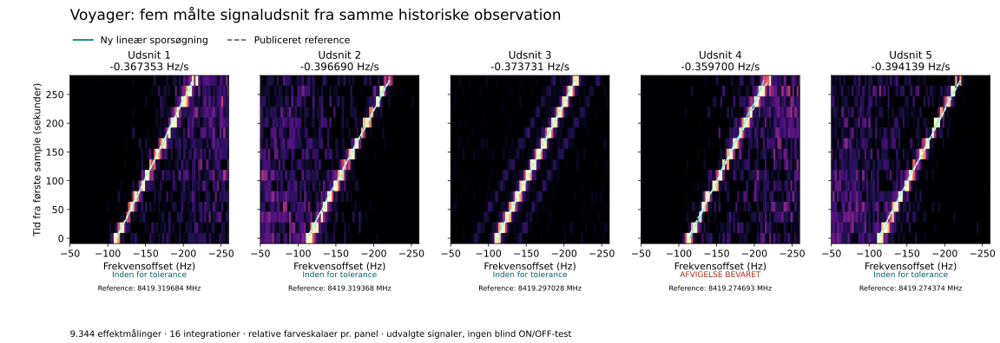

# CA: nye målte Voyager-udsnit analyseret

**1. november 2026 · Fortsættelse efter BZ**

Vi har hentet og analyseret en hidtil ubrugt original `voyager.hits`-fil fra
seticore-forfatterens offentlige repository. Filen indeholder **fem udvalgte
signaludsnit med 9.344 effektmålinger** fra samme historiske observation mærket
`Voyager1`. En ny, afgrænset lineær sporsøgning er gennemført på alle fem udsnit.
**Fire af fem passer til de gemte referenceværdier inden for den fastsatte
tolerance. Afvigelsen i udsnit 4 er bevaret.**

Dette er en nyttig kontrol med et kendt menneskeskabt radiosignal. Det er ikke
en ny ukendt SETI-kandidat, en komplet ON/OFF-sekvens eller fem uafhængige
observationer. Original survey-dækning er uændret.

## Målt resultat

Udsnittene indeholder hver 16 integrationer med 18,253611008 sekunders
integrationstid og 2,793967724 Hz kanalbredde. Samlet integrationstid for den
ene observation er **292,057776128 sekunder**; afstanden mellem første og sidste
sampletid er 273,80416512 sekunder. Alle værdier er endelige og positive.

| Udsnit | Måleværdier | Gemt reference, Hz/s | Ny lineær søgning, Hz/s | Forskel i samlet drift, kanaler | Referencekontrol |
|---:|---:|---:|---:|---:|---|
| 1 | 1.840 | −0,367353 | −0,367353 | 0,000 | Bestået |
| 2 | 1.888 | −0,397966 | −0,396690 | −0,125 | Bestået |
| 3 | 1.856 | −0,377557 | −0,373731 | −0,375 | Bestået |
| 4 | 1.872 | −0,387762 | −0,359700 | −2,750 | **Ikke bestået** |
| 5 | 1.888 | −0,397966 | −0,394139 | −0,375 | Bestået |

Søgningen gennemgik **391.044 forskellige spor med fuld støtte i de lagrede
udsnit**. Alle heltallige startkanaler indgik; slutpunktsforskydninger havde
trin på 1/8 kanal. Identiske afrundede spor blev kun talt én gang. Kun spor
inden for ±4 Hz/s og inden for udsnittet i alle 16 rækker indgik. Statistikken
er summen af de oprindelige float32-effekter beregnet i float64, fratrukket
summen af rækkernes medianer. Den er hverken SNR, sigma eller FAP.

Referencekontrollen krævede højst to kanalers forskel i startposition og højst
to kanalers forskel i samlet drift. Kriteriet blev gemt lokalt efter læsning af
metadata og før inspektion af effektværdier; det var ikke en offentlig eller
uafhængig forhåndsregistrering. I udsnit 4 er startforskellen én kanal, men
driftforskellen 2,75 kanaler. Dette resultat ændres ikke efterfølgende til PASS.
Alle fem valgte maksimale spor ligger over egen rækkemedian i alle 16 rækker;
den observation er beskrivende og er ikke en statistisk detektionstest.

Den nye lineære søgning og forfatterens dedoppler-metode er forskellige.
De gemte referencer er derfor sammenligningsværdier, ikke uafhængig fysisk
sandhed. Årsagen til afvigelsen i udsnit 4 er ikke afgjort her.

## Oprindelse og kontrol

Den originale fil er bevaret uændret: 38.176 bytes, SHA-256
`a272009ac00ebc4b3775e2253a1f762963e984d6c83349a3c3104e1fbdd17a08`.
Git-objektets SHA er `d1eb0703218be2287ec7a61a83e27e700b72271c`.

Primære kilder:

- [Original fil ved fast commit](https://github.com/lacker/seticore/blob/2e6781827ca78d9c1f3238fb101f956882df0c46/data/voyager.hits).
- [Forfatterens filskema](https://github.com/lacker/seticore/blob/2e6781827ca78d9c1f3238fb101f956882df0c46/hit.capnp) beskriver gemte effektudsnit i tids-/kanalrækkefølge.
- [Forfatterens oprindelige eksempel](https://github.com/lacker/seticore/blob/bdba3b70c058304f948b133f361a7e17a74b1de8/example.ipynb) læser samme fil og viser de fem gemte frekvenser, driftrater og SNR-værdier.

Dette dokumenterer den publicerede, Voyager-mærkede datakilde. Det er ikke en
uafhængig rekonstruktion af den oprindelige komplette teleskopfil eller dens
signaludvælgelse. Udsnittene er allerede valgt af kildens software.

En separat kontrol har afkodet de binære bytes med en selvstændig, begrænset
Cap'n Proto-parser og genberegnet samtlige spor med skalare summer og
heltalsbaseret afrunding. Den verificerer også den bevarede afvigelse.
Parseren er kontrolleret for netop denne hashbundne fil, ikke som en generel
adapter til vilkårlige Cap'n Proto-filer.

Den afsluttende kontrol bestod med **præcis overensstemmelse for alle 391.044
sporsummer og alle 9.344 måleværdier**. Et tidligere kontrolforsøg blev afbrudt
af en ufuldstændig fillæsning, mens produktionens proveniensopdatering stadig
skrev filer. Forsøget er bevaret i
[kontrolhistorikken](work_ca/review/VOYAGER_REVIEW_ATTEMPTS.json). Den endelige
kontrol blev kørt efter afsluttet skrivning og verificerede uændrede input- og
outputbytes før og efter. Den afbrudte kørsel tæller ikke som en bestået audit.

[Produktionsresultat](work_ca/new_data/RESULT_CA_VOYAGER.json) ·
[Uafhængig Voyager-kontrol](work_ca/review/VOYAGER_REVIEW_CA.json) ·
[Datakilder og oprindelse](work_ca/DATA_SOURCE_SEARCH_CA.json)

## Hvorfor nogle tidligere testsignaler blev overset

En særskilt **efteranalyse af BZ** opdeler 60 allerede valgte ON-scores i
baggrundsbidrag og tilført signalbidrag, med de gemte medianer og MAD-skalaer
fastholdt. Alle 60 scores reproduceres præcist. I de undersøgte negative
driftspor ligger selve signalleddet ofte lige over tærsklen 10; negativ lokal
baggrund trækker syv af otte fejlede spor under tærsklen.

Spejling af frekvensaksen med modsat driftrate viser ingen fortegnsfejl i den
afprøvede signal- og sporsumsalgebra. Resultatet forklarer en del af den
tidligere asymmetri, men er ikke bevis for generelt ens følsomhed ved positive
og negative driftrater. Geometrierne deler kun to carrierpositioner pr.
rategruppe. Fire tilfælde uden et gemt kildespor kan ikke opdeles på samme
grundlag og er eksplicit udeladt.

[Detaljeret diagnose](work_ca/diagnosis/DIAGNOSIS_CA.md) ·
[Uafhængig kontrol](work_ca/review/DIAGNOSIS_REVIEW_CA.json)

## Status og næste trin

CA tilføjer nye **målte kontroludsnit til projektet**, men ingen ny blind
stjernesøgning, observationsdækning, fuld ON/OFF-vurdering eller følsomhed i Jy.
BA's autoritet er fortsat **486 arkiv-ID'er og 268,50128173828125 tekniske
MHz-besøg**. HIP44295-kadencen mangler stadig OFF5; de historiske fejlstatusser
og BZ-resultater er uændrede.

Fortsat førsteprioritet er en ny komplet original ON/OFF-sekvens eller normal
tilladt adgang til manglende HIP43223/65143 OFF5. Voyager-kontrollen giver nu
et lille bevaret datasæt til at undersøge forskellen mellem lineære spor og
seticore-spor, især udsnit 4, uden at være afhængig af den utilgængelige
arkivvært. En senere metodeændring skal vurderes særskilt med kontrol af
falske alarmer; ingen detektor er taget i brug på baggrund af CA.

Alle CA-analyser afsluttes i denne leverance. Ingen beregningsjob fortsætter
i baggrunden. Se [gendannelse og præcist fortsættelsespunkt](work_ca/RESTORE_CA.md).
