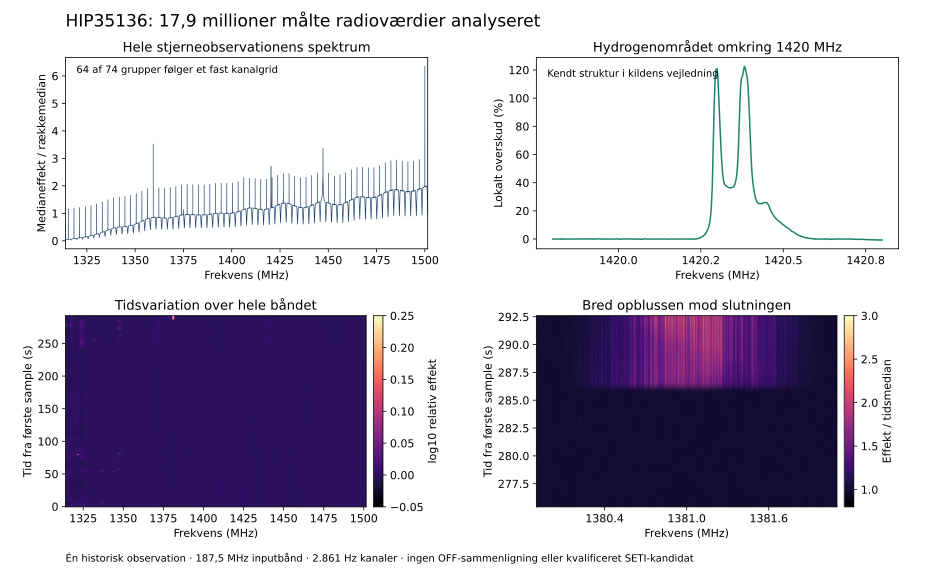

# CB: stjerneobservation af HIP35136 analyseret

**1. november 2026 · Faktiske stjernedata · Analyse og uafhængig kontrol afsluttet**

Vi har hentet og gennemgået **17.891.328 målte radioeffekter** fra en observation
af HIP35136 med Green Bank-teleskopet. Det er nye data i denne fortsættelse;
en afgrænset gennemgang af projektets tidligere oversigter fandt ingen brug
af denne target/epoke. Originalmålingen er fra **24. juni 2016 kl. 19:24:22 UTC**.

Analysen finder den kendte struktur i hydrogenområdet nær 1420 MHz, et
regelmæssigt instrumentmønster og tidslige opblusninger. **Der er ingen
kvalificeret SETI-kandidat.** Dette er en reel analyse af stjernedata, men
datasættets grove opløsning og manglende OFF-scanning begrænser konklusionerne.

## Datagrundlag

| Størrelse | Værdi |
|---|---:|
| Integrationer × frekvenskanaler | 273 × 65.536 |
| Samlet integrationstid | 293,131518 s |
| Sampleafstand i tid | 1,073742 s |
| Native kanalbredde | 2.861,022949 Hz |
| Nominelt inputbånd | 187,5 MHz |
| Båndets kanalkanter | 1313,964844–1501,464844 MHz |
| Spektralkanaler med fuld støtte til de lokale filtre | 64.768 / 185,302734 MHz |
| Negative, nul eller ikke-endelige effektværdier | 0 |
| Tilhørende OFF-scanninger | 0 |

Ved 4 Hz/s ville et signal kun flytte sig **0,408 kanal** mellem første og
sidste sample. En almindelig finopløst Doppler-søgning ville derfor ikke kunne
udnytte disse data på samme måde som vores tidligere få-Hz-kanaler. Vi har i
stedet udført en afgrænset søgning efter spektrale overskud og tidsvariationer
ved filens oprindelige opløsning.

## Hvad der blev målt

Den fastlagte spektrale søgning markerer **269 kanaler i 74 sammenhængende
grupper**. Den tidslige søgning markerer **4.964 tids-/frekvensceller i 310
sammenhængende grupper**. Det er strukturer over deskriptive kontrasttærskler,
ikke uafhængige kandidater, sigma-værdier eller sandsynligheder for fremmed liv.

En særskilt efterfølgende beskrivelse af spektralgrupperne giver denne
ikke-overlappende opdeling:

| Spektralgruppe | Antal | Fortolkning |
|---|---:|---|
| Top præcis på kanal 512 + 1024·k | 64 | Regelmæssigt kanalgrid med 2,9296875 MHz afstand; følger det instrumentmønster, kildens vejledning beskriver |
| Gruppe uden for kanalgridet i hydrogenvinduet | 1 | Bred struktur omkring 1420 MHz; hydrogenområdet er allerede identificeret i kildens vejledning |
| Øvrige spektralgrupper | 9 | Smalle ved denne opløsning; ophav ikke fastslået uden kontrolobservation |

Hydrogenvinduet indeholder også én af de 64 gridgrupper; den tælles kun i
første række. Dette er en beskrivelse efter analysen og ændrer ingen
tærskler, masker eller oprindelige kataloger. Hydrogenområdet er ikke en ny
opdagelse og identificerer ikke emission som kommende fra selve HIP35136.

Den tidsgruppe med størst kontrast har maksimum ved **1380,894184 MHz** og
omfatter de sidste seks integrationer. Dens frekvensafgrænsning er cirka
**1,122 MHz**, og den ses over **6,442 sekunders integrationstid**. Den når
filens slutning, så vi kender ikke dens fulde varighed eller ophav. Dens brede,
pludselige karakter giver grund til at undersøge radiointerferens eller
instrumentpåvirkning; data alene afgør ikke forklaringen.

[Alle spektralgrupper](work_cb/results/SPECTRAL_FEATURES_CB.csv) ·
[Alle tidsgrupper](work_cb/results/TEMPORAL_FEATURES_CB.csv) ·
[Efterfølgende beskrivelse](work_cb/POSTHOC_DESCRIPTION_CB.json)

## Metode og kontrol

Scope og kode blev offentliggjort og læst tilbage præcist før første
inspektion af effektværdier:
[`f30cd342f4b66fc2975296d38aca677d17253fac`](https://github.com/andersenmartin-blip/setisearch/commit/f30cd342f4b66fc2975296d38aca677d17253fac).
Header og den officielle vejledning var allerede læst; dette er ikke en
blind analyse af en ukendt datakilde.

Hver tidsrække divideres med sin median over frekvens. Det tidsmedianerede
spektrum sammenlignes med et 257-kanalers lokalt medianforløb. En lokalt
beregnet residualskala giver en beskrivende tærskel på 10. De sammensatte
filtre kræver 384 native kanaler på hver side; de tilsvarende kanter udelades
fra spektrale flag. Tidslige afvigelser beregnes i hver kanal omkring dens
egen tidsmedian og MAD, med tærskel 12 og otte-nabo-sammenhæng. Nul eller
ugyldige skalaer giver ingen understøttet score. Rå rækkemedianer bevares,
fordi normaliseringen ellers skjuler brede variationer.

Den eneste produktionskørsel afsluttede med exit 0. En uafhængig headerlæser,
sorterede medianer og en separat gruppering kontrollerede **alle 17.891.328
værdier, samtlige statistikarrays, alle maskebits og alle katalogfelter**.
Der var præcis numerisk overensstemmelse. Den lukkede resultatpakke og alle
input-/kodebindinger blev også kontrolleret. Kontrollen deler NumPy's
float64-aritmetik, men ikke produktionens medianfiltre eller grupperingskode.

[Produktionsresultat](work_cb/results/RESULT_CB.json) ·
[Numerisk kontrol](work_cb/review/NUMERICAL_REVIEW_CB.json) ·
[Fil- og kildekontrol](work_cb/review/BINDING_REVIEW_CB.json)

## Kilde, begrænsninger og fortsættelse

Filen kommer fra [Breakthrough Listens officielle repository](https://github.com/UCBerkeleySETI/breakthrough/blob/9fbb457da1c1404495927c2527542b25d788a616/GBT/filterbank_tutorial/blc04_guppi_57563_69862_HIP35136_0011.gpuspec.0002.fil).
Dens 71.565.694 bytes matcher Git-objekt
`6fd2b196909eb35099eb07b7ba6d551bbf445725` og SHA-256
`d0b41cf5d38b4128cf569f8c3d7d053ca923c7f5a1537a534b4a475e348dc688`.
Samme fil fandtes allerede i forfatterens introduktionscommit fra 2016.
[Proveniens](work_cb/new_data_discovery/PROVENANCE_CB.md) og
[den afgrænsede historikkontrol](work_cb/inventory/UNSEARCHED_DATA_INVENTORY_CB.json)
er bevaret. Ingen syntetiske signaler er tilført denne observation.

Dette udvider projektets faktisk analyserede stjernedata med en separat
grovopløst observation. Det ændrer ikke BA's smalbåndsregnskab på 486 arkiv-ID'er
og 268,50128173828125 tekniske MHz-besøg. En hel ON/OFF-serie og finere kanaler
er fortsat nødvendige for den oprindelige kandidatvurdering og eventuelle
følsomhedsgrænser. HIP44295's manglende OFF5 er stadig uafklaret.

**Næste prioritet er en anden tilgængelig stjerneobservation med finere
opløsning og helst komplette ON/OFF-data.** De ni øvrige spektralgrupper og
tidskataloget er bevaret til eventuel sammenligning, men er ikke i sig selv
grundlag for at udpege en SETI-kandidat. Ingen nye Voyager- eller syntetiske
metodeforsøg er udført i CB. Ingen beregningsjob fortsætter i baggrunden.
