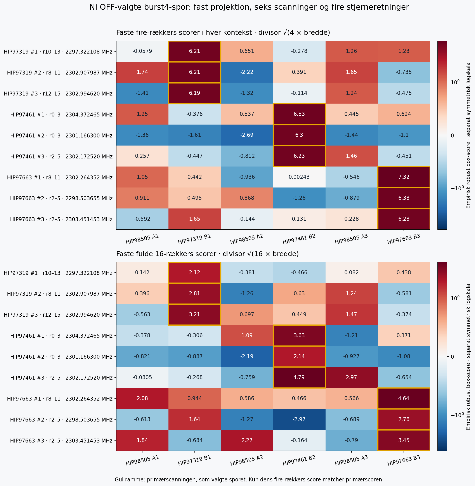
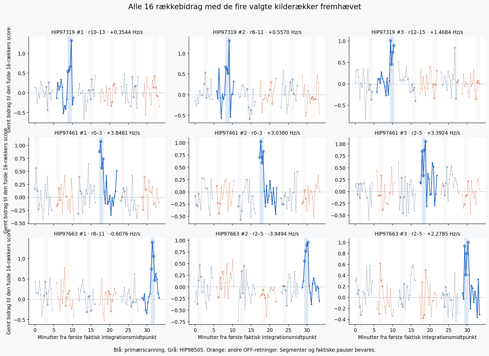

# SETI: fire-rækkers søgning i gemte radiospektre, 11. oktober 2026

Det stærkeste valgte spor har en empirisk fire-rækkers score på 7.315816. Tallet er ikke et sigma-niveau; denne søgning etablerer intet kvalificeret SETI-fund.

**288 kombinerede søgekort er færdige og uafhængigt kontrolleret.** Tre oprindelige OFF-scanninger har hver 96 faste referencefelter: native udsnit 170, 171 og 172 med q = 4 + 8k, k = 0–31. Søgefamilien har syv overlappende fire-rækkers vinduer med første kilderække 0, 2, 4, 6, 8, 10 eller 12, 159 lineære drifthastigheder fra −4 til +4 Hz/s og bredde 1 eller 3 kanaler. Forbehandlingen bruger alle 16 rækker.

De tre højest rangerede spor pr. OFF-scanning er efter søgningen udvalgt på tværs af dens 96 felter. De ni spor er derefter projiceret uændret i alle seks scanninger med faktiske starttider og pauser. Denne analyse af kortvarige spor giver ingen ny frekvensdækning og ingen ny observation.

Hvert vindue dækker 73,014444032 sekunders fysisk eksponering; første til sidste integrationsmidtpunkt er adskilt med 54,760833024 sekunder. Et spors frekvensreference er dets eget valgte vindues første integrationsmidtpunkt. Spor med forskellige første rækker har derfor forskellige referenceøjeblikke, selv inden for samme scanning.

Der er **intet etableret kvalificeret SETI-fund**. Scorerne er empiriske robuste box-scorer, uden kalibreret SNR, falskalarmrate, flux, EIRP eller følsomhed.

| Stjerne | Rang | Native / q | Kilderækker | Frekvens ved vinduets reference (MHz) | Drift (Hz/s) | Bredde | Primær fire-rækkers score | Egen fuld 16-rækkers score |
|---|---:|---|---|---:|---:|---:|---:|---:|
| HIP97319 | 1 | 172 / 140 | 10–13 | 2297.322108038 | +0.354430 | 3 | 6.21442 | 2.11719 |
| HIP97319 | 2 | 170 / 164 | 8–11 | 2302.907987125 | +0.556962 | 1 | 6.20935 | 2.80999 |
| HIP97319 | 3 | 170 / 156 | 12–15 | 2302.994619682 | +1.468354 | 1 | 6.19399 | 3.20637 |
| HIP97461 | 1 | 170 / 36 | 0–3 | 2304.372464865 | +3.848101 | 1 | 6.52816 | 3.62674 |
| HIP97461 | 2 | 171 / 60 | 0–3 | 2301.166300289 | +3.037975 | 1 | 6.30076 | 2.13506 |
| HIP97461 | 3 | 170 / 228 | 2–5 | 2302.172519825 | +3.392405 | 1 | 6.2264 | 4.78903 |
| HIP97663 | 1 | 170 / 220 | 8–11 | 2302.264351957 | -0.607595 | 1 | 7.31582 | 4.63683 |
| HIP97663 | 2 | 172 / 36 | 2–5 | 2298.503654636 | -3.949367 | 3 | 6.37706 | 2.75779 |
| HIP97663 | 3 | 170 / 116 | 2–5 | 2303.451452963 | +2.278481 | 1 | 6.28417 | 3.44751 |

Kontekstens fire-rækkers score bruger de samme fire rækkeindeks i hver scanning og divisor √(4 × bredde). Den separate fulde score bruger alle 16 rækker og divisor √(16 × bredde). Kun primærscanningens egen fire-rækkers score sammenholdes med den oprindelige primærscore. De to scorer er forskellige størrelser; en forlængelse over 16 rækker er ingen ny tilpasning.

| Stjerne / rang | Største rækkes andel af positive fire-rækkers bidrag | Dominerende kilderække | Største rækkes andel af positive fulde bidrag | Dominerende fulde kilderække |
|---|---:|---:|---:|---:|
| HIP97319 / 1 | 42.64% | 13 | 32.44% | 13 |
| HIP97319 / 2 | 42.17% | 11 | 31.33% | 11 |
| HIP97319 / 3 | 32.59% | 12 | 25.30% | 12 |
| HIP97461 / 1 | 33.01% | 1 | 24.16% | 1 |
| HIP97461 / 2 | 32.65% | 1 | 27.93% | 1 |
| HIP97461 / 3 | 33.88% | 5 | 18.92% | 5 |
| HIP97663 / 1 | 38.27% | 9 | 26.27% | 9 |
| HIP97663 / 2 | 30.11% | 5 | 26.03% | 5 |
| HIP97663 / 3 | 31.89% | 5 | 22.51% | 5 |

Andelene og rækkenumrene er gemte beskrivelser af de positive bidrag, betinget af sporvalget. Uden positive bidrag er andelen og den dominerende række ikke defineret. Der bruges ingen signalafhængig grænse eller efterfølgende optimering i rapporten.

Driftgridet er tilpasset fire-rækkers vinduer. Uændret forlængelse gennem hele besøget og lave scorer i andre scanninger udelukker hverken nærliggende struktur eller andre oprindelser til kontekstens svar. Ingen OFF-veto eller klassifikation er anvendt.

De seks scanninger peger i fire forskellige stjerneretninger: HIP98505 i tre ON-scanninger og HIP97319, HIP97461 samt HIP97663 én gang hver i de oprindelige OFF-scanninger. Alle er fra besøget 28. april 2017. Der er ingen uafhængig genobservation af en OFF-primærstjerne, og udvælgelsen er ikke blind validering. Hypoteser, overlappende vinduer og udvalgte spor er afhængige.

Rapporten læser kun de hashbundne JSON-resultater efter bestået primær- og kontekstkontrol. De gemte 54 profiler har alle 16 række-tider og bidrag. Kontrollen rekonstruerer lokale 501-kanals medianer og rækkesummer samt kernernes rå medianer; den er betinget af gemte fuldkerne-MAD/skaler og winsoriserede lokationer, som ikke er uafhængigt fuldt refiltreret. Rapporten genkører ingen søgning, normalisering, profilberegning eller kildecellekontrol. A/B forbliver FAIL_CLOSED; gamle holdouts og beskyttede udsnit forbliver lukkede.

