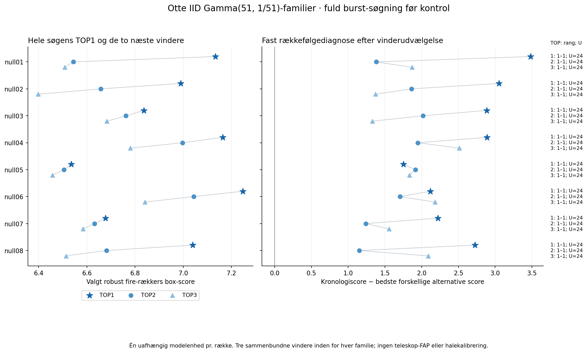
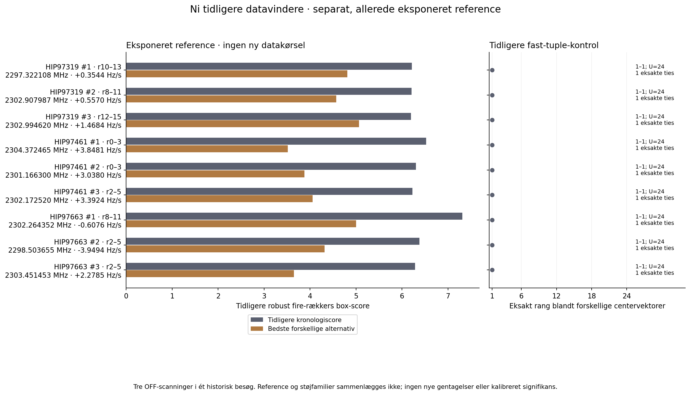

# Fuld burst-vinderudvælgelse i en fast Gamma-støjmodel · 12. oktober 2026

**Otte uafhængige modelrealiseringer af hele den fastlåste 96-kerne burst-pilot er afsluttet og QA-kontrolleret.** Det er engineering under en angivet støjmodel, uden nye teleskopobservationer eller teleskop-FAP.

Omfanget er 768 nye syntetiske kombinerede kort, 3.145.728 carrier-maksima og 7.002.390.528 korrelerede skabelonforekomster. Der er 3.096 faste scoreaudits. De 24 globale model-TOP3 får 384 fysiske række/center-matrixled og 576 permutationsscoreforekomster. Antal beregninger er ikke antal uafhængige tests.

De otte familiers valgte TOP1-score har minimum 6.53484, median 7.0147 og maksimum 7.24762. I 8 af de otte familier ligger TOP1-kronologien strengt over alle forskellige alternative centervektorer. 0 deler den bedste alternative score, 0 ligger under et alternativ, og 0 har kun identitetens vektor. Dette er modelbetingede forekomstoptællinger, ikke sandsynligheder eller signifikans.

## Otte familier som analyse-enheder

| Familie | Valgt TOP1-score | Rekonstrueret kronologi | Bedste forskellige alternativ | Forskel | Eksakt rang | U | Eksakte ties |
|---|---:|---:|---:|---:|---|---:|---:|
| null01 | 7.13362 | 7.13362 | 3.65264 | 3.48098 | 1–1 | 24 | 1 |
| null02 | 6.98955 | 6.98955 | 3.93828 | 3.05127 | 1–1 | 24 | 1 |
| null03 | 6.83617 | 6.83617 | 3.95116 | 2.885 | 1–1 | 24 | 1 |
| null04 | 7.16392 | 7.16392 | 4.27353 | 2.89039 | 1–1 | 24 | 1 |
| null05 | 6.53484 | 6.53484 | 4.78456 | 1.75027 | 1–1 | 24 | 1 |
| null06 | 7.24762 | 7.24762 | 5.13027 | 2.11735 | 1–1 | 24 | 1 |
| null07 | 6.67723 | 6.67723 | 4.45517 | 2.22205 | 1–1 | 24 | 1 |
| null08 | 7.03985 | 7.03985 | 4.31315 | 2.7267 | 1–1 | 24 | 1 |

TOP2 og TOP3 er sammenbundne vindere inden for samme familie. Figuren viser alle tre for hver af de otte rækker; den reducerer dem ikke til 24 uafhængige replikater. Alle vindende tuples, scorer, gaps, geometrityper, U og ties er bevaret i SYNTHETIC_TOP24.csv.

Blandt de 24 sammenbundne TOP3-forekomster ligger kronologien strengt over alle forskellige alternativer i 24, deler den største alternative score i 0 og ligger under et alternativ i 0. 0 forekomster er degenererede. Disse optællinger er beskrivende inden for otte familier.

## Hvad der er gentaget under modellen

Råeffektcellerne genereres IID Gamma med formparameter 51, skala 1/51 og middelværdi 1. Modellen og frøene er fastlagt før nye værdier og er ikke tilpasset de eksisterende datavindere. Tidssampling gange absolut kanalbredde er numerisk 51 i den kopierede geometri; det fastslår hverken teleskopets frihedsgrader eller modellens gyldighed. Instrumentrespons, spektrale og tidslige korrelationer, radioforstyrrelser og kildevariabilitet modelleres ikke.

Hver familie har 96 særskilte domæner i native170–172, q = 4 + 8k, k = 0…31. SeedSequence(20261012, spawn_key=(familieindeks, domæneindeks)) med PCG64 bestemmer ét Gamma-kald pr. domæne: 16×12096 float64-værdier og derefter én little-endian float32-konvertering. Der er ingen redraw, klipning, fravalg eller ændring af frø efter udfald. Hele råcroppens SHA256, starttilstand og alle 16 rækkehashes bevares. Koordinaterne er kopieret søgegeometri og er mærket SYNTHETIC_ENGINEERING, uden lånt observationstidspunkt.

Full16-rækkemedianer, median501-residual, MAD og winsoriseret lokation genestimeres efter float32-konverteringen én gang pr. modelkerne. Søgningen bevarer 4096 carriers, 4000 halo-kanaler på hver side, syv fire-rækkers vinduer med start 0,2,…,12, 159 driftsværdier −4…+4 Hz/s og bredder 1/3. Hver carrier får sit kombinerede maksimum, og de globale TOP3 vælges som de første tre i TOP20 med den oprindelige rangering og afstand større end tre kanaler. Hele den eksisterende 96-kerne burst-pilot gentages; dette er ikke hele den bredere ordinary16-søgning eller ny astronomisk frekvensdækning.

Først efter denne udvælgelse afprøves alle 24 centerkanaltilordninger inklusive identiteten. Fysiske rækker og deres normalisering holdes fast. Faktiske afrundede centervektorer deduplikeres med første leksikografiske repræsentant. Identitetens hele vektorklasse udelades fra alternative maksimum og median. U = 1 giver ingen rækkefølgeinformation og udefinerede alternative scorer/gaps. Rangen bruger eksakt lighed uden epsilon blandt forskellige vektorer; antal eksakte ties omfatter identiteten. Rang og U vises hver for sig og er ikke en pseudo-p-værdi. Bredde 3 kan give korrelerede, overlappende boxe.

## Separat, allerede eksponeret datareference

De ni tidligere datavindere vises i en særskilt figur og REAL_REFERENCE_TOP9.csv. De kommer fra tre OFF-scanninger mod HIP97319, HIP97461 og HIP97663 i ét historisk besøg, én scanning pr. target. Referencens scorer og rækkefølgediagnoser læses fra de autentificerede tidligere JSON/CSV-resultater; de beregnes ikke igen. Disse ni var allerede eksponeret og udvalgt over drift, vindue, bredde, carrier og global rang. De er hverken nye gentagelser, modelreplikater eller en kalibreret testmængde. Referenceværdier og syntetiske familier sammenlægges ikke.

Den tidligere fast-tuple-kontrol sammenlignede kronologien med alternative tilordninger efter udvælgelsen. Denne engineeringfase gentager også hele vinderudvælgelsen med ny full16-normalisering under den erklærede Gamma-model. Dermed bliver udvælgelsesfordelen synlig under modellen. Kronologien var optimeret over drift, vindue og bredde, mens de fleste alternative tilordninger ikke følger lineære frekvensbaner. En god ordensrang er fortsat ikke uafhængig støtte for en lineær himmelkilde.

## QA og bevaring

Der er 24 forskellige TOP3-vindende modelkerner. Deres fulde råcrop er gemt. QA rekonstruerer median501, full16-MAD og lokation uafhængigt for hver af disse vindende kerner fra råcroppen og kontrollerer de 24 valgte scorer. Alle 3096 scoreauditforekomster kontrolleres fra deres lokale råkapsler. I auditkerner uden for de gemte TOP3-vindende domæner genbruges de hashbundne kernetermer; fuld MAD/lokation er betinget for disse auditkerner. Modelstreamen kan afspilles fra det samme fastlåste frø for hash- og råmedianverifikation. Sådan byteverifikation giver ingen ekstra replikater.

QA kontrollerer alle kortidentiteter, carrier-rækker, geometri, gyldighedstællere og den globale TOP20/TOP3-rangering. Den genmaksimerer ikke hele søgegitteret og hævder ikke uafhængig genberegning af alle syv milliarder skabelonscorer. Pakken bevarer alle nye kort, normaliseringer, audit- og ordenskapsler, vindende råcrop, kode, scope, reviews og receipts. Øvrige fulde modelcroppes bytes er frø-/versionsreproducerbare, men er ikke alle gemt. Gamle referencearrays og H5-kilder indgår ikke.

QA: `PASS_8_IID_GAMMA_FAMILIES768_MAPS3096_AUDITS24_ORDER_QUERIES576_PERMUTATION_SCORES`. Scope SHA256: `91578ba6dbc6ab815ef04408aaa58374019ca216aa07b88b2e91735d3af2ff74`. QA-receipt SHA256: `7e3a0f99cb13b5bfafc1505db06a0b40bc85b8dfe4146a25d95babd9f30c2563`.

## Videnskabelige grænser

Otte uafhængige familier kan ikke kalibrere ekstreme haler. Selv en større modelbank ville kun kalibrere den dokumenterede model, ikke bevise at teleskopets støj eller radioforstyrrelser følger den. Ingen score, gap, rang, forekomstoptælling eller sammenligning med de ni referencer omregnes til teleskop-p, FAP, kalibreret SNR, sigma eller signifikans. Ingen ny tærskel, veto, kildeklassifikation eller SETI-kvalifikation etableres. Original A/B forbliver FAIL_CLOSED; beskyttede 2016-paneler og lukkede 2019-transportforløb åbnes ikke.

Grænserne er 600 CPU-s, 900 wall-s og 2 GiB pr. primærfamilie; højst to samtidig og 4 GiB samlet. QA har 600 CPU-s; rapport og pakning ligger inden for hver sin 200 CPU-s-allokering. Primæroutput er højst 40 MiB pr. familie og 320 MiB samlet, arbejdsplads 8 GiB og ZIP 200 MiB. Faseallokeringen på 6000 CPU-s er en konservativ arbejdsreservation, ikke en abonnementsgrænse eller nulstilling af gamle reservationer. Receipt-målte proceskomponenter bevares; sessions-, API- og reviewforbrug hævdes ikke komplet målt. Ingen nye teleskoprequests og 0 DKK. Planen 7.–20. oktober og slutcheckpointet den 20. oktober består.

