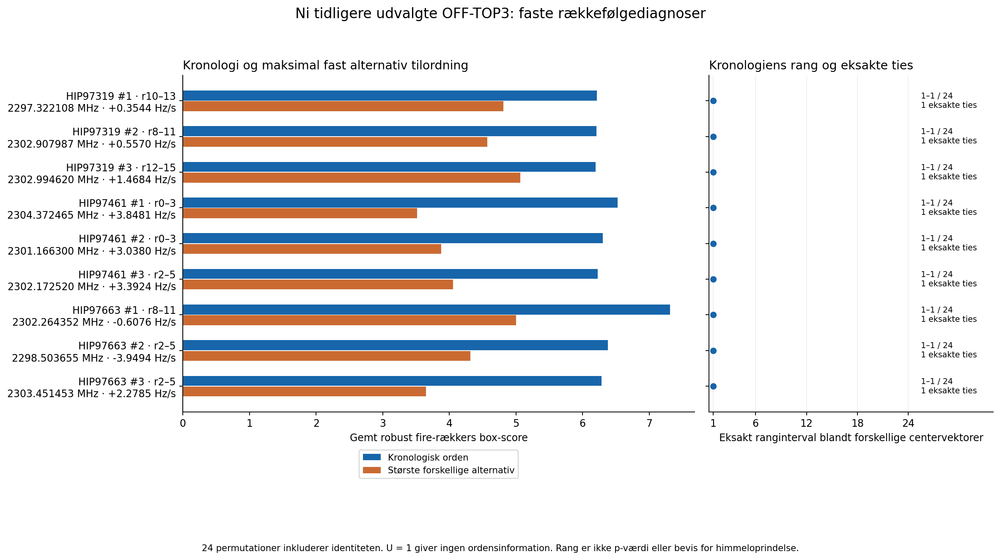
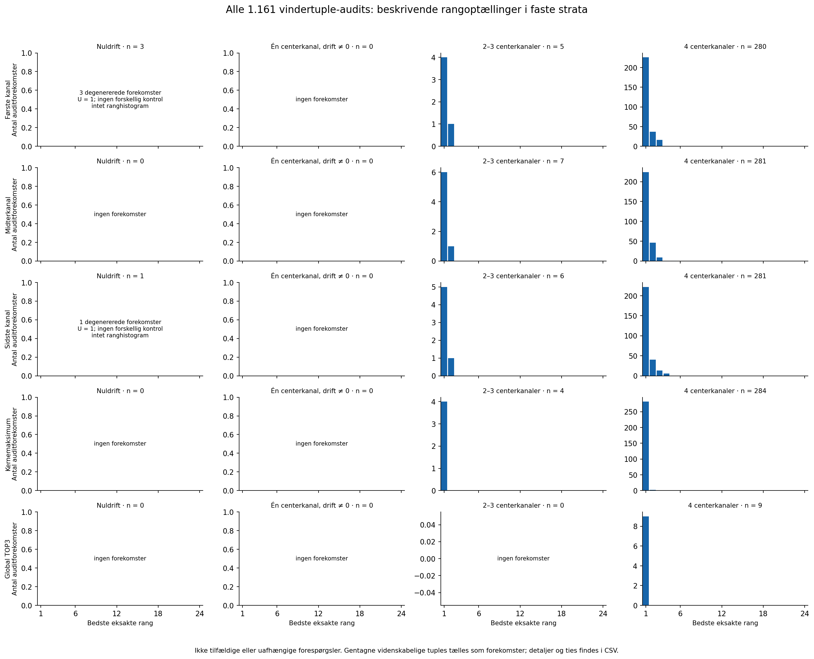

# Faste rækkefølgekontroller af SETI-burst4-piloten — 11. oktober 2026

Der er beregnet **18,576 nye rækkecenter-boxforekomster**, **1,161 faste 4×4-diagnosematricer** og **27,864 permutationsscore-forekomster**. Optællingerne er beregningsforekomster; gentagne centerkanaler og tuples betyder, at de ikke er så mange forskellige eller uafhængige målinger.

Blandt de ni tidligere valgte OFF-TOP3 har 9 mindst én forskellig alternativ centervektor. Kronologien ligger strengt over alle forskellige alternativer i 9, deler den største score i 0 og ligger under et alternativ i 0. De resterende 0 er degenererede med U = 1 og giver ingen rækkefølgeinformation. Dette kvalificerer ikke et SETI-fund og giver ingen kalibreret signifikans.

Alle 24 leksikografiske permutationer inklusive identiteten er gemt. Den fysiske rækkefølge af de fire eksponeringer og deres normalisering holdes fast; kun de fire tidligere afrundede centerkanalers tilordning til rækkerne ændres. Samme centervektor tælles én gang i kontrolmaksimum, median og rang, med første leksikografiske repræsentant. Hele identitetens vektorklasse udelades fra de forskellige alternativer.

## Ni oprindelige TOP3

| OFF-target / rang | Frekvens ved vinduets første midtpunkt (MHz) | Rækker / drift (Hz/s) / bredde | Kronologi | Største forskellige alternativ | Forskel | Eksakt rang / U | Eksakte ties | Geometri |
|---|---:|---|---:|---:|---:|---|---:|---|
| HIP97319 #1 | 2297.322108038 | 10–13 / +0.354430 / 3 | 6.21442 | 4.81006 | 1.40436 | 1–1 / 24 | 1 | 4 centerkanaler |
| HIP97319 #2 | 2302.907987125 | 8–11 / +0.556962 / 1 | 6.20935 | 4.57082 | 1.63853 | 1–1 / 24 | 1 | 4 centerkanaler |
| HIP97319 #3 | 2302.994619682 | 12–15 / +1.468354 / 1 | 6.19399 | 5.06441 | 1.12958 | 1–1 / 24 | 1 | 4 centerkanaler |
| HIP97461 #1 | 2304.372464865 | 0–3 / +3.848101 / 1 | 6.52816 | 3.51523 | 3.01293 | 1–1 / 24 | 1 | 4 centerkanaler |
| HIP97461 #2 | 2301.166300289 | 0–3 / +3.037975 / 1 | 6.30076 | 3.8745 | 2.42625 | 1–1 / 24 | 1 | 4 centerkanaler |
| HIP97461 #3 | 2302.172519825 | 2–5 / +3.392405 / 1 | 6.2264 | 4.05456 | 2.17184 | 1–1 / 24 | 1 | 4 centerkanaler |
| HIP97663 #1 | 2302.264351957 | 8–11 / -0.607595 / 1 | 7.31582 | 4.99834 | 2.31748 | 1–1 / 24 | 1 | 4 centerkanaler |
| HIP97663 #2 | 2298.503654636 | 2–5 / -3.949367 / 3 | 6.37706 | 4.31344 | 2.06362 | 1–1 / 24 | 1 | 4 centerkanaler |
| HIP97663 #3 | 2303.451452963 | 2–5 / +2.278481 / 1 | 6.28417 | 3.64844 | 2.63572 | 1–1 / 24 | 1 | 4 centerkanaler |

Rangen beregnes fra den gemte, rekonstruerede kronologiscore blandt forskellige faktiske centervektorer: bedste rang = 1 + antal strengt større scorer; værste rang = antal større + antal præcis ens scorer. Ties bruger eksakt numerisk lighed uden epsilon. Den oprindelige søgescore og dens afrundingsforskel er bevaret i CSV; de bruges ikke som rangens reference. U = 1 giver mekanisk rang 1, men maksimum, median og forskelle er udefinerede.

## Hele den gemte audit

De 1,161 forespørgselsforekomster repræsenterer 1,152 forskellige videnskabelige tuples. 9 tuplegrupper gentages, med 9 ekstra forekomster. Tupleidentiteten er scan, native-bånd, q, carrier, vinduestart, driftindeks og bredde. Alle forekomster beholdes; de er hverken tilfældigt udvalgte eller uafhængige.

| Fast auditstratum | Nuldrift | Én centerkanal, drift ≠ 0 | 2–3 centerkanaler | 4 centerkanaler | I alt |
|---|---:|---:|---:|---:|---:|
| Første kanal | 3 | 0 | 5 | 280 | 288 |
| Midterkanal | 0 | 0 | 7 | 281 | 288 |
| Sidste kanal | 1 | 0 | 6 | 281 | 288 |
| Kernemaksimum | 0 | 0 | 4 | 284 | 288 |
| Global TOP3 | 0 | 0 | 0 | 9 | 9 |

Hvert target bidrager med 96 første-, midter-, sidste- og kernemaksimumforespørgsler samt tre globale TOP3. Også de faste auditcarriers har tidligere vundet over vinduer, drift og bredde. Stratafiguren viser bedste eksakte rang for forekomster med en forskellig alternativ vektor; nuldrift og afrundet stationær drift vises særskilt uden ranghistogram. CSV bevarer targetstrata, værste rang, ties, U og tuplemultiplicitet.

## Fortolkning og datagrænser

Kontrollerne er betingede diagnoser af eksponerede, tidligere valgte vindere. Rækkerne er ikke udskiftelige under en dokumenteret nulmodel, og normalisering, kildedata og oprindelig udvælgelse genbruges. Kronologien har allerede haft fordel af drift-, vindue- og breddeudvælgelsen; de fleste alternative tilordninger danner ikke lineære frekvensbaner. En god rang er derfor ikke uafhængig støtte for en lineær himmelkilde. Bredde 3 kan give overlappende boxe, så også forskellige centervektorer er korrelerede. Ingen score, rang eller histogram omregnes til p-værdi, FAP, kalibreret SNR eller signifikans; ingen bruges som himmelkildeklassifikation eller til at afvise radioforstyrrelser.

Der er ingen ny observation eller ny søgecoverage. De tre OFF-targets har hver ét besøg. Kontrollen bruger de ni allerede autentificerede OFF-kompakter (tre native-bånd pr. target, 144 dekodede kilderækker); de 18 eksisterende fulde H5-kildefiler for seks scans forbliver eksterne. Ingen nye masker, vetoer, driftfit eller søgegrid er indført. Beskyttede 2016-holdouts og de oprindelige A/B-grænser forbliver lukkede.

Full16-normaliseringen er uændret og følger den fysiske række: gemte rækkemedianer, winsoriseret residual-location og MAD. QA kontrollerer kildebytes, alle 144 kilderækker, raw-identity mod de oprindelige kapsler, de lokale 501-kanalfiltre, alle 4×4-boxbidrag, alle 24 scorer, deduplikering, rang og ties. QA genberegner rækkernes rå kernemedianer, men genfiltrerer ikke hele kernens MAD/location; den del af valideringen er betinget på de autentificerede full16-termer.

QA: `PASS_1161_FIXED_TEMPORAL_ORDER_QUERIES18576_ROW_CENTER_BOXES27864_PERMUTATION_SCORES9_TOP3`. Scope SHA256: `409481159d4c66fc7c3e37f4b4b85ed5cd54fb26fe5cfc9302c92a393fd1523d`. QA-receipt SHA256: `23d692f76a1e9dbdf638b58c0187b9359a1181abffaaef40230861baf813b8ed`. Største QA-afvigelse for matrix/scorer/oprindelig identity-score: 0 / 0 / 2.70894e-14.

Prospektive grænser pr. numerisk job og QA: 600 CPU-sekunder, 900 vægsekunder og 2 GiB RAM; højst to primærjob samtidig, samlet 4 GiB. Ingen nye teleskop-HTTP-anmodninger eller betalte tjenester. Denne renderer læser gemt JSON og tekst og tegner figurer efter QA; den åbner ingen kildearrays.

