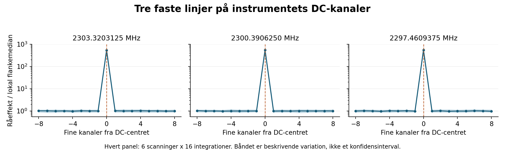

# SETI: DC-kanaler forklarer de dominerende stationære spor - 12. oktober 2026

**Tre stærke linjer ligger præcis i instrumentets dokumenterede DC-bins.** For alle 18 tidligere valgte TOP3-skabeloner i deres egne primærscanninger kommer mindst **99,906437 %** af den positive standardiserede cellemasse fra netop DC-binnen. Alle **120 gemte TOP20-poster** rammer en af de tre bins i mindst én tidsrække. Originale scorer og rangordener er bevaret.

Der er **ingen kvalificeret SETI-detektion**. Kombinationen af den præcise kanalgeometri, rå spektralform og officiel dokumentation støtter stærkt en instrumental DC-fortolkning. Den konkrete hardwareårsag er ikke direkte bevist.

| Native | Fast linjefrekvens MHz | Absolut kildekanal | Offset fra DC |
|---|---:|---:|---:|
| 170 | 2303,3203125 | 178782208 | 0 |
| 171 | 2300,3906250 | 179830784 | 0 |
| 172 | 2297,4609375 | 180879360 | 0 |

Alle tre source-indeks er `native * 1048576 + 524288`. Filens 343 grove kanaler og 2,793967724-Hz fine opløsning stemmer med GBT Revision 2A. Linjerne er adskilt præcis 2,9296875 MHz. Filens start er også et helt antal grove kanaler fra den publicerede standard-S-båndstuning. Officiel blimpy-kode angiver de samme DC-indeks; de bevarede snapshots matcher officielle Git-blobhashes.

## Rå spektralform og præcis enkeltcelle-attribution

18 forskellige DC/scanning-udsnit giver 288 fysiske rækkespektre og 37.152 originale råceller. DC-centret er strengt størst blandt alle 129 faste bins i **288/288** spektre. Effekten i centret er 492,553-688,538 gange medianen af de 98 flanker ved afstand 16-64 bins; medianforholdet er **543,898**. Det er beskrivende mål i ét historisk besøg, ikke 288 uafhængige bekræftelser.

108 gemte kontekstprofiler er rekonstrueret fra rå503-kapsler. Hver af de oprindelige width-1/3-celler får sin fulde median501 rekonstrueret, med de tidligere gemte full16-median/MAD/lokationskonstanter. DC-cellen og øvrige celler deles algebraisk med den oprindelige nævner. Der er ingen ny normalisering, maske, veto, driftfit, detektorsøgning eller omrangering. Den signerede øvrige score ligger -1,633745 til +1,059637 i de 18 egne primærscanninger; de oprindelige scorer er 2.980-21.687. Små driftsskabeloner får deres høje værdier ved at ramme den samme stationære bin i 4, 7, 8 eller 16 rækker.

120-poster-annotationens tomme DC-uberørte underliste beviser ikke, at svagere rene spor mangler. En dominerende DC-maksimumskabelon kan have skjult en anden skabelon; dette er ikke en ny DC-behandlet søgning. De særskilte kortvarige burst4-vindere klassificeres ikke af denne fase.

## Uafhængig kontrol og reproduktion

Uafhængig QA bestod uden videnskabelige mismatch: 108 profiler, 4.032 lokale median501-beregninger, 120 poster og 1.920 centerkanaler. 869.184 råcelleforekomster reduceres til 153.559 forskellige celler; 715.625 gentagelser stemmer bit-for-bit. Alle 18 faste råpatches og de 288 fysiske rækker matcher; de 12 geometri-inputhashes og officielle kildeblobhashes er verificeret. Score-rekonstruktionen mod gemte profiler afviger højst 1,82e-12; kontrollen mod oprindelige vinder-scorer afviger højst 3,64e-12. Positiv cellemasse afviger højst 2,91e-11 inden for den forudfastlagte numeriske tolerance. Tidligere fuldkerne-normalisering er en betinget forudsætning, ikke uafhængigt fuldt refiltreret her.

Scope og rankingkode blev offentliggjort før nye annotationer ved `239058b7758ce590ed848ed608231a84744dca88`; scope og rå-attributionskode før nye numeriske udfald ved `44b549aabe2042b667ee61696d14eadd21989b2e`. Metadata- og recording-interfacekorrektioner er dokumenteret i QA; ingen detektor blev genkørt for dem.

Se [18 egne primærscanninger](PRIMARY18.csv), [alle 120 gemte poster](../ranking/ANNOTATED_TOP120.csv), [primærreproduktion](REPRODUCTION.md) og [uafhængig QA](QA_SUMMARY.json). Hele pakken bevarer rå503-inputkapsler, deres full16-termer, patches, resultater, kode og alle hashbindinger. Kode i denne mappe bruger det selvstændige pakkelayout beskrevet i reproduktionen.

## Kilder og plan

- [Lebofsky et al., Public Data, Formats, Reduction and Archiving](https://seti.berkeley.edu/listen2019/BLdata2019.pdf): tabel 4-5, figur 10 og afsnit 2.5.2; afsnit 2.4 beskriver historiske headerkorrektioner.
- [Officiel blimpy DC-dokumentation](https://blimpy.readthedocs.io/en/latest/blimpy.html#blimpy.waterfall.Waterfall.blank_dc).
- [Original kanal- og softwaregeometri](../geometry/GEOMETRY_RESULT.json).

Original A/B er fortsat **FAIL_CLOSED**; beskyttede 2016-holdouts og den lukkede 2019-adgangsrute er uændrede. Ingen ny observation eller frekvensdækning; nul nye teleskoprequests; **0 DKK**. Planen 7.-20. oktober beholder checkpoint 20. oktober. Det næste relevante metodearbejde er en på forhånd fastlagt behandling af DC-bins med signalgenfindingstest; det er ikke gennemført i denne fase.

[PDF-rapport](SETI_DC_RESULTAT_2026-10-12.pdf). Den komplette QA-kvittering er i den selvstændige resultatpakke.
