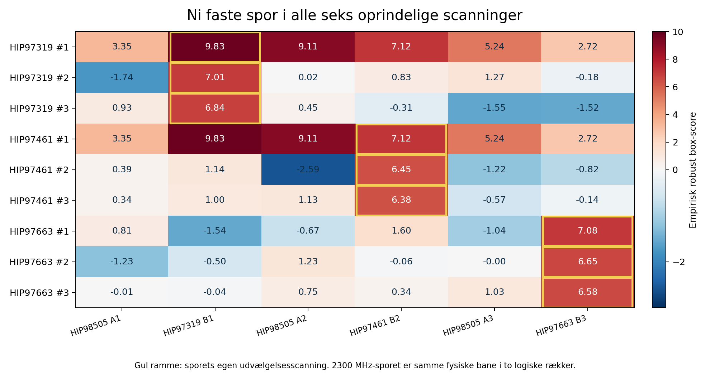
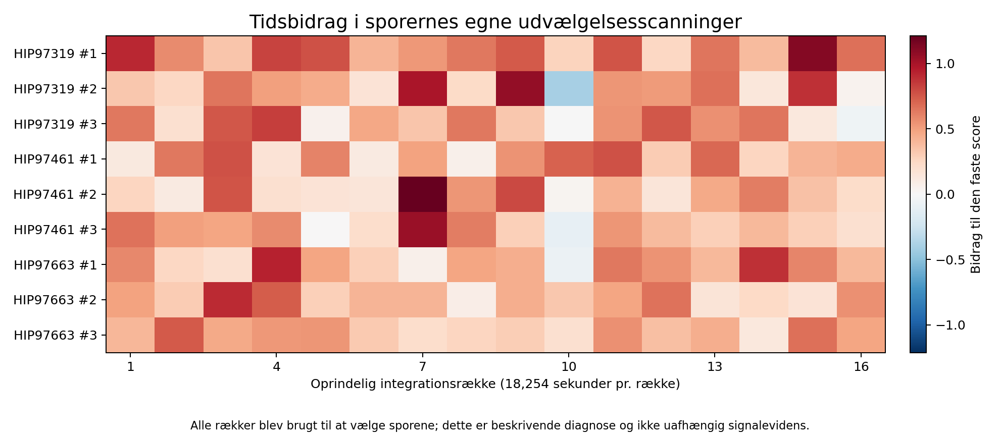

# SETI: ni DC-uberørte spor fulgt i alle seks scanninger - 12. oktober 2026

**2.289 eksisterende kernemaksima er gennemgået.** 15 havde kontakt med de tre fastlåste DC-bins; 2.274 var uden kontakt. En separat, på forhånd fastlagt eksplorativ regel valgte de tre stærkeste adskilte referencekanaler pr. OFF-stjerne. Ingen detektorsøgning er gentaget. Scope og kode blev offentliggjort før udfald ved `e417328b5747b5fa56c5fced5d5598a40d411e6b`.

De ni logiske valg er derefter målt uændret i alle seks historiske scanninger fra 28. april 2017: **54 profiler, 48 forskellige fysiske boksgeometrier**. Der er otte forskellige måleskabeloner; den stationære 2300-MHz-bane blev valgt i to primærscanninger. De seks ekstra logiske profiler er dubletter af samme fysisk forespurgte bane, ikke ny evidens. Den faste opfølgning blev offentliggjort før råmålingerne ved `d54034cba520e17995c069577c3285b243f24741`.

## Den fælles stationære komponent

Ved **2300,000000373 MHz** er de seks faste scorer i kronologisk ON/OFF-rækkefølge:

| Scanning | Stjerneretning | Fast empirisk box-score |
|---|---|---:|
| A1 / ON | HIP98505 | 3,34918 |
| B1 / OFF | HIP97319 | 9,82731 |
| A2 / ON | HIP98505 | 9,10759 |
| B2 / OFF | HIP97461 | 7,12081 |
| A3 / ON | HIP98505 | 5,23780 |
| B3 / OFF | HIP97663 | 2,72254 |

Dette er foreneligt med en fælles interferens- eller instrumentkomponent og etablerer ingen stjerneeksklusivitet. Oprindelsen er ikke fysisk bevist. Det er en anden frekvens end de tre tidligere identificerede DC-spidser.

## Syv andre spor forbliver uafklarede

De øvrige syv skabeloner har egne scorer **6,37713-7,07870**. De 35 faste målinger i andre scanninger ligger **-2,58739 til +1,60495**. Egenscanningerne har allerede valgt sporene over frekvens, drift og bredde, så forskellen giver ikke uafhængig signifikans eller gentagelsesevidens. En svag score langs en uændret bane i en anden scanning fastslår ikke generelt signalfravær.

I alle ni egne profiler er 14-16 rækkebidrag positive. Største positive række bærer 10,8951-18,7946 % af den positive rækkemasse. Det viser, at de fulde 16-række-scorer ikke blot domineres af én integration; det er stadig en betinget diagnose af tidligere udvalgte vindere. Alle 54 transporterede bokse er uden kontakt med de tre faste DC-bins. Der er ingen ny maske, OFF-veto eller drift/bredde-refit i den faste opfølgning.

## Rådata, fuld kontrol og reproduktion

Alle 18 tidligere bevarede råkompakter blev gendannet fra gemte arkiver, med oprindelige filhashes og 288 afkodede rækkehashes. Der var ingen ny teleskoprequest. De nye profiler bruger faktiske starttider og pauser, den samme 4096-kanals normaliseringskerne, 4000 kanalers halo og median501. 24 ON-normaliseringer blev nødvendigvis beregnet med den uændrede oprindelige forbehandling; 24 OFF-normaliseringer var tidligere bevaret.

Uafhængig QA genberegnede **alle 48 fulde normaliseringer** fra rådata med medianberegninger i NumPy, herunder 3.145.728 lokale median501-positioner. Rå kernemedian, residualmedian og MAD matcher præcist; winsoriseret lokation afviger højst 3,38e-17. Alle 54 profiler og oprindelige egne scorer stemmer; største afvigelse mod oprindelig score er **1,24e-14**. Ni egne rå503-profiler er bit-identiske med deres tidligere gemte auditkapsler.

48 komplette rå normaliseringscrops med formen 16 x 12096, i alt **37.247.328 bytes**, er bevaret sammen med de 54 rå503-kapsler, full16-termer og kilde-/rækkehashes. En separat **NumPy-only reproduktion** fra disse crops har også bestået uden HDF5-kilder eller plugins. Denne begrænsede numeriske reproduktion kræver ikke kopiering af cirka 0,9 GB fulde råkompakter; den erstatter ikke den oprindelige fuld-HDF5-kildeautentifikation.

Se [ni spor og 54 faste scorer](SELECTED9_AND_CONTEXT54.csv), [resultatoversigt](SUMMARY.json), [fuld rå-QA](../qa/context/QA_RECEIPT.json), [udvælgelses-QA](../qa/selection/QA_RECEIPT.json), [reproduktion](REPRODUCTION.md) og [videnskabelig gennemgang](../science_review/FINAL_REVIEW.json). [PDF-rapport](SETI_DCFRIE_SPOR_2026-10-12.pdf).

## Grænser og næste prioritet

Det er en tidligere eksponeret shortlist af kernemaksima. Fravalgte kerner kan indeholde rene alternative carriers; denne fase har ikke søgt deres skjulte hypoteser. Scorer, morfologi og matrix er ikke kalibreret SNR, sigma, FAP, følsomhed eller kildeklassifikation. Et historisk besøg på flere stjerneretninger er ikke uafhængige genobservationer af samme mål. **Ingen kvalificeret SETI-detektion**.

Original A/B er fortsat **FAIL_CLOSED**; beskyttede 2016-kontroller og den lukkede 2019-adgangsrute forbliver uændrede. Ingen ny observation eller frekvensdækning, nul nye teleskoprequests, **0 DKK**. Planens checkpoint er fortsat **20. oktober 2026**. Den næste relevante prioritet er en separat fastlåst gennemgang af alle **9.375.744 gemte kanalmaksima**, så nyttige spor skjult af kernemaksima kan undersøges uden en ny detektorsøgning.
