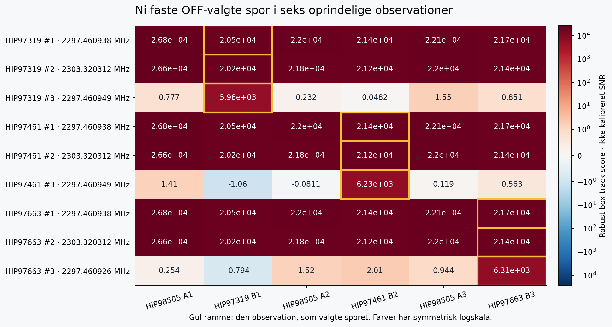
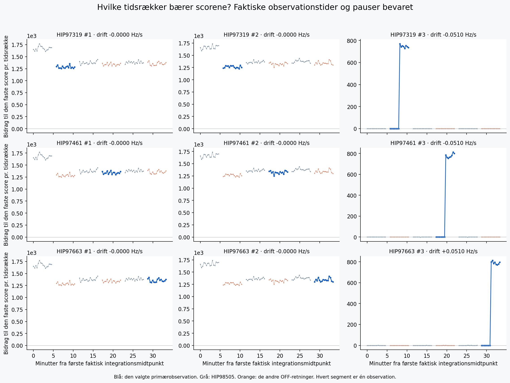

# SETI: afsluttet udvidet signalanalyse, 11. oktober 2026

Søgningen har undersøgt 512 nye frekvenskerner i hver af de oprindelige OFF-observationer af HIP97319, HIP97461 og HIP97663: 1536 nye kort og 6.291.456 referencekanalmaksima i alt. De tre stjerner har hver fået 5,859375 MHz ekstra frekvensdækning. Uafhængig QA har godkendt alle kort, rangeringerne og 6153 gemte råscorekontroller. Ni udvalgte spor er derefter målt uændret i alle seks observationer; alle 54 kontekstscorer og de ni primærscore-match har bestået separat QA.

De to højest rangerede svar ligger ved **2297,4609375 og 2303,3203125 MHz**, med praktisk talt nul drift. Begge optræder stærkt i alle seks scanninger på fire forskellige stjerneretninger. Det peger på fælles smalle spektralkomponenter frem for signaler isoleret til en primærstjerne. De tredjepladser, som har lille positiv eller negativ drift, rammer den første stationære komponent i deres sidste otte tidsrækker. Disse rækker bærer mindst 99,976% af deres positive box-bidrag; mønstret er foreneligt med alternative søgeskabeloner omkring samme linje. Den fysiske årsag er endnu ikke fastslået.

**Der er intet kvalificeret SETI-fund.** De høje scorer er ikke kalibreret SNR eller falsk-alarm-sandsynligheder. Alle data er fra det historiske besøg 28. april 2017; sammenligningsretningerne er ikke uafhængige genobservationer af de tre primærstjerner. Der er ingen ny driftstilpasning, kildeklassifikation eller gentagelse af detektorgridet i QA. Rå profiler, tidsbidrag, tabeller og figurer er bevaret til efterprøvning.

Begge uafhængige numeriske kontroller har bestået. Primærkontrollen omfatter alle 1536 kort, 24.576 rå kernemedianer, 6153 rå503-scorequeries og 288 decoded kilde-rækkehashes. Største kontrollerede scoreafvigelse er 3,64 × 10⁻¹². Kontekstkontrollen omfatter alle 54 profiler, 864 rækkesummer, ni primærscore-match samt bidrags- og overlapdiagnostik; kontekstscore-aritmetikken stemmer præcist. Den lokale kontrol er betinget af de gemte, hashbundne fuldkerne-MAD- og lokationsparametre; disse er ikke uafhængigt fuldt refiltreret.

De to stationære frekvenser ligger præcist 2,9296875 MHz på hver sin side af den tidligere undersøgte 2300,390625 MHz-komponent. Det er observeret frekvensgeometri, som motiverer undersøgelse af et fælles instrumentelt mønster; årsagen er ikke klassificeret. Otte-række-overlappet for tredjepladserne er en beskrivelse efter udvælgelsen ud fra de gemte kanalcentre. Bidragsandelene gælder hele rækkebokse og fastslår ikke, at al effekten kommer fra én enkelt kildecelle.

| Stjerne | Rang | Frekvens ved første midtpunkt (MHz) | Drift (Hz/s) | Bredde (kanaler) | Primær score | Største tidsrækkes andel af positive bidrag |
|---|---:|---:|---:|---:|---:|---:|
| HIP97319 | 1 | 2297.460937500 | -0.000000 | 1 | 20540.2 | 6.6% |
| HIP97319 | 2 | 2303.320312500 | -0.000000 | 1 | 20213.1 | 6.4% |
| HIP97319 | 3 | 2297.460948676 | -0.051020 | 3 | 5976.94 | 12.9% |
| HIP97461 | 1 | 2297.460937500 | -0.000000 | 1 | 21440 | 6.5% |
| HIP97461 | 2 | 2303.320312500 | -0.000000 | 1 | 21153.8 | 6.4% |
| HIP97461 | 3 | 2297.460948676 | -0.051020 | 3 | 6233.21 | 13.1% |
| HIP97663 | 1 | 2297.460937500 | -0.000000 | 1 | 21687.1 | 6.5% |
| HIP97663 | 2 | 2303.320312500 | -0.000000 | 1 | 21427.9 | 6.6% |
| HIP97663 | 3 | 2297.460926324 | +0.051020 | 3 | 6309.52 | 12.9% |

Den største enkelte tidsrække leverer 6.4–13.1% af de positive bidrag i de primære spor med positive bidrag. Det er en direkte beskrivelse af, hvor svaret kommer fra; andelen er ikke et mål for falsk-alarm-sandsynlighed. Ved ingen positive bidrag er andelen ikke defineret. De øvrige observationers svar fremgår af figuren og CONTEXT54.csv.

Alle ni primærscorer er reproduceret med samme faste 4096-kanals normalisering, 501-kanals medianfilter og 4000-kanals margin. Der er gemt 54 rå profiler med 16×503 kildeceller samt hvert tidsbidrag. De oprindelige float32-rækker er verificeret i alle 18 frekvensdele.

Den fulde nye søgning omfatter 9.877.585.920 korrelerede kombinationer af frekvens, drift og bredde. Det er ikke så mange uafhængige forsøg. 6.153 rå scorekontroller er gemt fra de nye kort; den separate kontrol har rekonstrueret deres valgte scorer uden at gentage søgningen.

De tre primærstjerner har hver én historisk observation fra 28. april 2017. HIP98505-observationerne og de andre OFF-retninger giver sammenligningskontekst, men er ikke nye eller uafhængige genobservationer af primærstjernerne. Driftens trin er valgt til én 16-rækkers observation; den faste forlængelse gennem hele sekvensen er ikke en ny tilpasning.

[Alle 1536 kernemaksima](CORE_MAX1536.csv) · [Ni primære udvalg](TOP9.csv) · [54 kontekstscorer](CONTEXT54.csv) · [Kompakt QA-evidens](QA_SUMMARY.json) · [Beskrivende overlapgeometri](NEARBY_STATIONARY_GEOMETRY.json)

Resultatpakken indeholder alle gemte kort, rå scoreudsnit, komplette receipts, koden og SHA256-manifestet. De 18 oprindelige rå H5-dele ligger i de tidligere rådatapakker; REPRODUCTION_AND_DATA_AVAILABILITY.md angiver deres identitet og kørerækkefølgen. Der er foretaget nul nye teleskopforespørgsler. Pris: 0 DKK.
