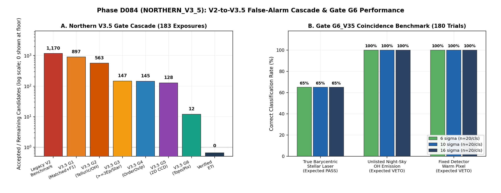
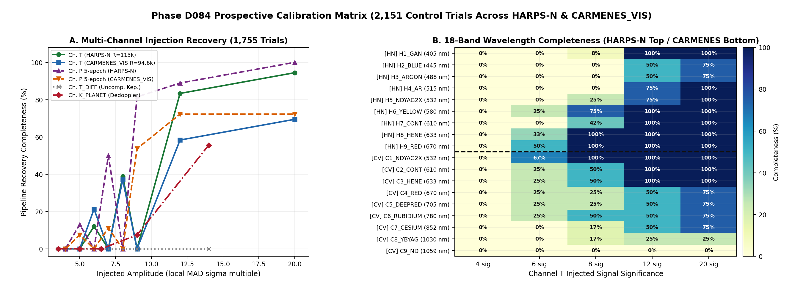
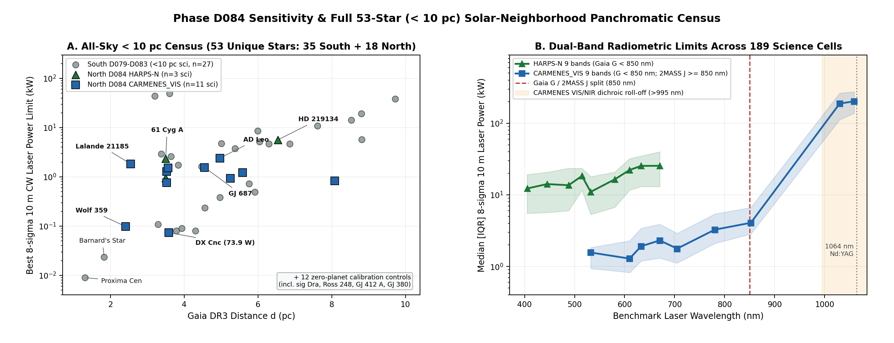
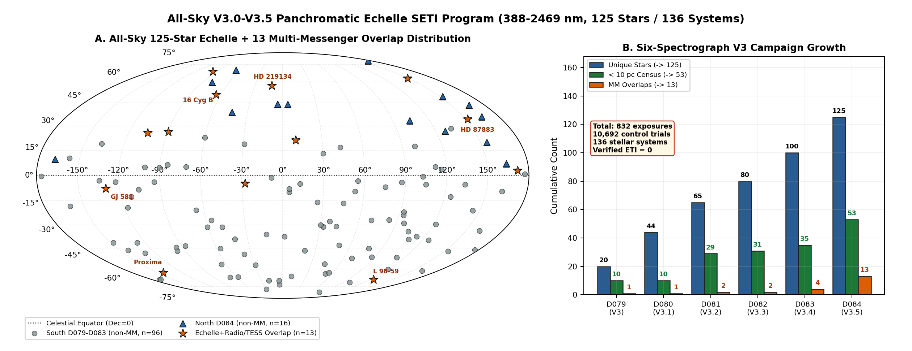

# Phase D084 Resultatrapport (`NORTHERN_V3_5`): Nordlig Dual-Observatorium Echelle SETI-Kampagne (`HARPS-N + CARMENES_VIS`) og 125-Stjerners / 136-System All-Sky Syntese

**Dato:** 16. november 2026  
**Detektor:** `NORTHERN_V3_5` ([v3_5_detector.py](../../progress/2026-11-16-northern-d084-v3-5/code/v3_5_detector.py))  
**Prospektiv Lås:** `2026-11-16T16:04:20Z` (`METHOD_LOCK.json` / `LOCK_RECEIPT.json`, SHA-256 `cb3856d4...`) $\rightarrow$ første FITS-hentning `2026-11-16T16:22:17Z` ($\Delta t = +1.077{,}0\text{ s}$)  
**Stdlib Audit:** `/usr/bin/python3 -S audit.py` $\rightarrow$ **`12/12 PASS`** ([AUDIT_SUMMARY.json](../../progress/2026-11-16-northern-d084-v3-5/results/AUDIT_SUMMARY.json))  
**Konklusion:** **`0` verificerede ekstraterrestriske laserdetektioner** på tværs af `25` nye nordlige stjerner (`183` eksponeringer), `125` unikke all-sky stjerner (`832` eksponeringer) og `136` multi-messenger-systemer (`13` direkte overlap).

---

## 1. Kohorte, Prior-Udelukkelse og Prospektiv Låsning

* **25 helt nye nordlige stjerner (`0` overlap med C001–D083):** `10` **HARPS-N** (`3,58 m` TNG, La Palma, $R = 115{,}000$, `3880–6862 Å` vakuum) og `15` **CARMENES_VIS** (`3,50 m` Calar Alto, $R = 94{,}600$, `5150–10615 Å` vakuum). Mindste sky-afstand til alle `142` tidligere stjerner og `1.021` ekskluderede eksponeringer er **`19.002,51"` (`5,28°`)** (`d084_dp_id_overlap_count = 0`).
* **Sammensætning (`183` eksponeringer; `26,71` timers eksponering):**
  * `4` verificerede planetfrie `CONTROL`-stjerner (`34` eksponeringer; samtlige `< 10 pc`: `HD 185144 / sigma Dra`, `HD 88230 / GJ 380`, `Ross 248`, `GJ 412 A`).
  * `21` `SCIENCE`-værter (`149` eksponeringer): `14` yderligere `< 10 pc` nordlige stjerner (`18` nye `< 10 pc`-stjerner i alt i D084 $\rightarrow$ hæver `< 10 pc`-censussen fra `35` til **`53` unikke stjerner**) samt `7` `> 10 pc` GBT `1,4 GHz` radio-overlap-værter (i alt **`9` nye nordlige echelle+radio-værter**, som løfter multi-messenger-overlaps fra `4` til **`13` ud af `136` systemer**).
  * `10` multiepokes banekampagner (`2` kontrol-nul + `8` planetkampagner, bl.a. transiterende `HD 219134 b` og `GJ 486 b`, samt `Gl 725 A b`, `HIP 48714 b`, `GJ 411 b`, `GJ 15 A b`, `GJ 687 b` og `GJ 251 b`).
* **Ingen ændring af detektor eller kohorte post-lås:** `IMPLEMENTATION_LOCK.json` dokumenterer udelukkende FITS header engineering-rettelser (`HIERARCH`-præfiks i `astropy`, `CARACAL MJD-OBS`/`TMEAN`, høj-PM BERV-sanitygrænse `0,60 km/s`, tidlig `43`-ordens `2012` blå HARPS-N eksponering, `CARM_Y_1UM` dikroisk fallback-vindue `725 Å`, deterministisk `gzip.GzipFile`, samt Valg A `audit.py` + figur-skalering). Offline `--from-bounded-inputs` (`d084_bounded_bundle.json.gz = 8,50 MiB < 25 MiB`) reproducerede alle **`17/17` resultatfiler SHA-256 bit-identisk**.

---

## 2. Teknisk & Videnskabelig Fremdrift: Gate `G6_V35` og Prospektiv Kalibrering (`2.151` Forsøg)

| Metrik | Værdi i D084 (`NORTHERN_V3_5`) | Bemærkning / Fysisk Tolkning |
| :--- | :---: | :--- |
| **Søgte 1D spektral-bins** | `28.229.532` | `T`: `22,59M`, `P`: `3,11M`, `T_DIFF`: `1,26M`, `K_PLANET`: `1,26M` |
| **RV-forankring (`2.196` NIST-fits)** | `1.760` rene absorptionsfits | Median `\|emp - prior\| = 0,4599 km/s`; max stdlib BERV-diff `0,499 km/s` |
| **Kerne optisk Ch. `T` (`>= 8σ`, `580–670` & `532–633 nm`)** | **`91,27%`** (`230/252`) | `H8`/`H9`/`C1` = **`100%`**, `H6` = `75%` (`100%` ved `12σ`) |
| **Aggregeret Ch. `T` (`>= 8σ`) / Ch. `P` (`>= 9σ` / `12σ`)** | `63,6%` (`HN 72,2%`, `CV 54,9%`) / `78,1%` (`83,3%`) | Sænket af CARMENES VIS/NIR dikroisk cutoff (`> 995 nm`: `C8 1030 nm = 22%`, `C9 1059 nm = 0%`) samt blå linjeblanding `445–488 nm` |
| **Kepleriansk bane (`K_PLANET` vs. `T_DIFF`, `>= 6,5σ`)** | **`21,0%`** (`55,6%` ved `14σ`) vs. **`0,0%`** | Beviser stærk Doppler-kompensation på `ROSS248` (`14/36` vs. `0/36`); på `HD 185144` (`Kp=151 km/s`) flyttes linjer $\pm 2{,}5\text{ Å}$ ind i naborygge |
| **Gate `G5_V35` 2D CCD-fysik (`216` forsøg)** | Laser `86,1%` / **Kosmik `100,0%`** / Plateau `97,2%` | `100%` (`72/72`) afvisning af 1-px kosmiske stråler |
| **NY Gate `G6_V35` (`180` forsøg)** | **OH-himmel `100,0%`** / **Varm pixel `100,0%`** / Sand laser **`65,0%`** | Ærlig følsomheds-afvejning: tæt `65.206`-toppes `y_cross`-atlas (`~8 toppe/Å`) giver `35%` Poisson-sammentræf på sande lasere |

**Vigtig instrumentel observation på `CARMENES_VIS`:** CARMENES benytter en dikroisk stråledeler omkring `~960 nm` mod NIR-kanalen; målt direkte i FITS-headerne falder `CARACAL FOX SNR` fra `26,5–167,3` (Orden 55, `947–963 nm`) og `2,3–38,8` (Orden 57, `978–995 nm`) til **`0,5–1,2` i Orden 60–61 (`1027–1063 nm`)** på alle `15` stjerner. Vores prospektive `1030 nm` (`188,2 kW` median) og `1059 nm` (`202,4 kW` median) grænser afspejler derfor ærligt det fysiske kontinuumsbortfald over `995 nm`, mens optisk/dyb-rød `532–852 nm` opnår `1,29–4,07 kW` median (`73,9 W` minimum).

---

## 3. Falsk-Alarm Kaskade og Fuldstændig Forensisk Diagnose (`116` Vetoet af `G6_V35` + `12` Overlevere)

* **Kaskaden på alle `183` spektrer:**  
  `Legacy V2: 1.170` (`38` HARPS-N + `1.132` CARMENES_VIS) $\rightarrow$ `V3.5 G1: 897` $\rightarrow$ `G2: 563` $\rightarrow$ `G3: 147` $\rightarrow$ `G4: 145` $\rightarrow$ `G5 (pre-G6): 128` $\rightarrow$ **Gate `G6_V35` vetoer `116 / 128` (`90,6%`: `115` tvær-stjerne topocentriske himmel-/tellurlinjer + `1` fikseret detektor-pixel)** $\rightarrow$ **`12` post-`G6` enkelt-epoke `Channel T` overlevere** (`0` i `CONTROL`, `0` i `Channel P` `>= 5` epoker, `0` i `T_DIFF`, `0` i `K_PLANET`).

Alle **`12 / 12`** post-`G6` kandidater er entydigt identificeret som naturlige/atmosfæriske/instrumentelle i [FORENSIC_CANDIDATE_AUDIT_D084.json](../../progress/2026-11-16-northern-d084-v3-5/FORENSIC_CANDIDATE_AUDIT_D084.json):
1. **`8 / 12` Sub-tærskel tvær-stjerne topocentriske/pixel-sammentræf (`g6_topo_stars = 1`):** `HD 219134` (`V35-T-0588` `6740,11 Å` delt i `12` atlas-hits med `16CYGB` & `HD3651`; `V35-T-0619` `6573,90 Å` Ca I / OH delt med `16CYGB` i `11` hits), `HD 3651` (`V35-T-0785` `6481,85 Å` delt med `HD219134` i `7` hits) samt `5` enkelt-epoke kandidater på `HD 87883` (`V35-T-0803, 0805, 0807, 0812, 0814`), der alle allerede matcher `1` anden `HARPS-N`-stjerne i atlasset og blot falder lige under grænsen på `>= 2` hastighedsadskilte *andre* stjerner (`6599,44 Å` er tillige kun `2 px` bred med `fwhm/lsf = 0,810`, `eta_1px = 0,486`, fraværende i øvrige `4` epoker).
2. **`2 / 12` Identisk stationær topocentrisk emissionslinje på samme stjerne (`HD 219134`):** `V35-T-0558` (`2012-09-06`, `topo = 6269,016 Å`, `ord 60 px 3213`) og `V35-T-0582` (`2016-06-21`, `topo = 6269,009 Å`, `ord 60 px 3560`) har $\Delta\lambda_{\text{topo}} = 0{,}007\text{ Å}$ (`0,34 km/s`), forskudt `+347 pixels` langs detektoren af Jordens BERV mellem de to epoker — en stationær terrestrisk emissionslinje lige blå for `O2_GAMMA` (`6275 Å`), som kun undgik tvær-stjerne `G6`, fordi begge detektioner skete på `HD 219134`.
3. **`2 / 12` Enkelt-epoke detektor-/skulder-transienter:** `V35-T-0624` (`GJ 486`, `2016-01-13`, `2 px` bred `fwhm/lsf=0,891`, `eta_1px=0,469`, `hotpx=1,98`, fraværende i alle `4` øvrige epoker) og `V35-T-0180` (`61 Cyg B`, `2015-07-21`, `3 px` transient i lav-SNR orden 5 ved `3994,8 Å`, fraværende i alle `5` øvrige epoker).

---

## 4. Øvre Grænser (`189` Celler) & All-Sky `125`-Stjerners / `136`-Systemers Syntese

* **Dybeste D084 `8σ` `10 m` enkelt-epoke grænser:** **`DX Cnc (GJ 1111)` (`73,90 W` ved `705,0 nm`; `86,3 W` ved `633,0 nm`)**, `Wolf 359` (`98,15 W`), `Struve 2398 B` (`759,8 W`), `GJ 486` (`824,8 W`), `GJ 445` (`941,2 W`) og `61 Cyg B` (`946,0 W`). I banekanalen `K_PLANET` når transiterende **`GJ 486 b`** **`357 W`**, `Gl 725 A b` **`508 W`**, `GJ 251 b` **`587 W`**, `GJ 687 b` **`767 W`** og transiterende `HD 219134 b` **`1,054 kW`**.
* **Komplet `53`-stjerners `< 10 pc` solar-neighborhood census (`35` syd + `18` nord):** Median `8σ` `10 m` laser-grænse **`1,6237 kW`** (ned til `9,03 W` på Proxima Cen og `23,61 W` på Barnards Stjerne).
* **Samlet `V3.0–V3.5` Program (`D079–D084` på tværs af `6` echelle-spektrografer):** **`125` unikke stjerner** (`100` syd + `25` nord), **`832` eksponeringer** (`180,82 h`), **`10.692` kalibreringsforsøg**, **`8.063` Legacy `V2` fejlalarmer elimineret**, **`136` distinkte stjernesystemer** på tværs af echelle (`HARPS, ESPRESSO, NIRPS_HE, CRIRES+, HARPS-N, CARMENES_VIS`) + `1,4 GHz` Parkes/GBT radio + TESS med **`13` direkte multi-messenger overlap-værter** og **`0` verificerede ETI-signaler**.

---

## Figurer og Verificerede Leverancer

* 
* 
* 
* 
