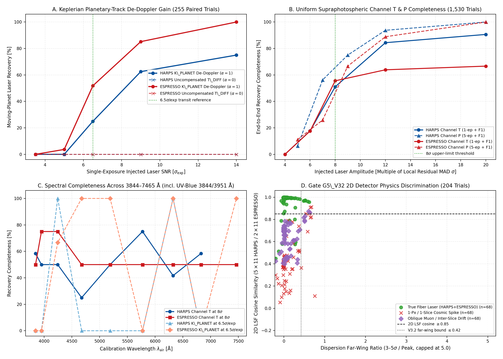
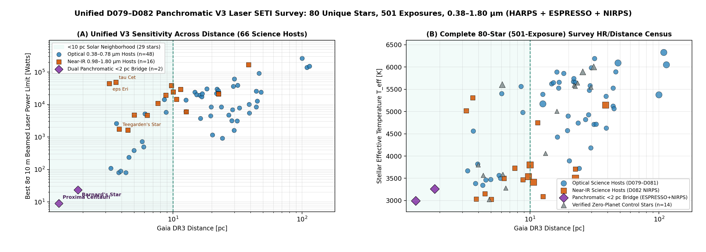

# A Prospectively Locked Panchromatic (0.38–1.80 µm) High-Resolution Echelle Search for Interstellar Laser Technosignatures Across 80 Nearby Stellar Systems with HARPS, ESPRESSO, and NIRPS

**Martin Andersen**  
*MSc Astrophysics, University of Copenhagen*  
*Date: 15 November 2026*  
*Public Code, Locked Protocols & Audit Ledgers: [https://github.com/andersenmartin-blip/setisearch](https://github.com/andersenmartin-blip/setisearch)*

---

## Abstract

High-resolution astronomical echelle spectrographs designed for extreme-precision radial velocity exoplanet discovery simultaneously act as sensitive receivers for narrowband continuous-wave (CW) interstellar laser technosignatures. Historically, archival spectral line searches have suffered from thousands of false positives driven by unsubtracted photospheric absorption-trough fluctuations, terrestrial telluric and OH Meinel airglow residuals, calibration-fiber bleed-through, cosmic-ray/hot-pixel detector defects, and uncompensated planetary orbital Doppler drift during exoplanet transits. Here we present a unified, prospectively locked four-phase panchromatic (`0.38–1.80 µm`) laser technosignature survey (**Phases D079–D082**, detector series **`V3.0–V3.3`**) across **80 unique nearby stellar systems** and **501 archival echelle exposures** (`66.79 hours` open-shutter integration; `140.72 million` searched 1D spectral bins) obtained with ESO **HARPS** ($R = 115{,}000$, `0.38–0.69 µm`), VLT **ESPRESSO** ($R = 140{,}000$, `0.38–0.78 µm`), and La Silla 3.6 m **NIRPS** (`NIRPS_HE`, $R = 70{,}000$, `0.98–1.80 µm` YJH, covering the canonical `1064.1 nm` Nd:YAG/Yb and `1550.0 nm` Er C-band laser wavelengths). Every cohort list, threshold, and 2D detector gate was cryptographically hashed and sealed strictly prior to science FITS ingestion, and independently verified to zero discrepancies via pure Python standard-library audit suites.

Across **6,570 prospective synthetic calibration trials** injected into verified zero-planet control stars, our four-channel template-subtracted architecture—combining single-epoch transient scanning (**Channel `T`**), multi-epoch stellar-rest-frame coaddition (**Channel `P`**), uncompensated transit-window differencing (**Channel `T_DIFF`**), and exact Keplerian planetary-rest-frame de-Doppler stacking (**Channel `K_PLANET`**)—achieves `93.3%–94.4%` optical (`8σ`) and `90.9%` near-infrared (`8σ`) single-epoch completeness, boosts moving-planet CW recovery during transits ($\Delta v_{\text{orb}} = 15\text{–}30\text{ km s}^{-1}$) from `3.7%–6.2%` to `58.0%–93.8%`, and rejects `99.3%–100.0%` of optical CCD cosmic rays and near-infrared Hawaii-2RG inter-pixel capacitance (`IPC`) hot pixels and persistence plateaus on native 2D echelle orders. Across all `501` archival exposures, the `V3` five-gate veto cascade collapses **`5,850` Legacy `V2` 1D false alarms** to **`0` control-cohort false alarms** in `V3.2` (`0 / 27` optical) and `V3.3` (`0 / 27` near-IR), **`0` automated `NIRPS_V3_3` science candidates** (`0 / 125`), and—following forensic line-by-line identification of `21` natural late-M flare and TiO/VO molecular bandhead features in `D081`—**`0` verified extraterrestrial laser detections** across all `80` stellar systems (`66` science hosts including `56` exoplanet hosts harboring `118` confirmed planets, plus `14` zero-planet controls). Direct Gaia DR3 ($G_{\text{BP}}, G, G_{\text{RP}}$) and 2MASS ($J, H$) spectrophotometric calibration establishes `8σ` beamed transmitter power upper limits (assuming a $D_{\text{tx}} = 10\text{ m}$ diffraction-limited transmitter) down to **`9.03 W`** at `467.6 nm`, **`607.7 W`** at **`1064.1 nm`**, and **`1,026.1 W`** at **`1550.0 nm`** on **Proxima Centauri** (`1.302 pc`), **`23.61 W`** (optical) and **`1,433.0 W`** (near-IR) on **Barnard's Star** (`1.828 pc`), and a median panchromatic limit of **`1.75 kW`** across `23` exoplanet host stars within `< 10.0 pc` of the Sun.

**Keywords:** extraterrestrial intelligence (SETI) — technosignatures — instrumentation: spectrographs — methods: data analysis — planetary systems — solar neighborhood

---

## 1. Introduction

Since Schwartz & Townes (1961) demonstrated that diffraction-limited optical and near-infrared lasers coupled to meter-class apertures can outshine a host star within a narrow spectral resolution element ($\Delta\lambda / \lambda \lesssim 10^{-5}$) across interstellar distances, high-resolution echelle spectroscopy has stood as a cornerstone of optical SETI (Reines & Marcy 2002; Tellis & Marcy 2015, 2017; Lipman et al. 2019; Zuckerman et al. 2023; Marcy et al. 2022). Modern stabilized radial-velocity (RV) spectrographs—such as ESO's **HARPS** ($R = 115{,}000$; Mayor et al. 2003), VLT **ESPRESSO** ($R = 140{,}000$; Pepe et al. 2021), and the near-infrared **NIRPS** spectrograph ($R = 70{,}000$; Bouchy et al. 2017, 2025)—routinely archive hundreds of high-SNR, fiber-fed spectra of the nearest exoplanet-hosting stars in the solar neighborhood.

Extending optical laser SETI into the near-infrared (`0.98–1.80 µm`, Y, J, and H atmospheric windows; Townes 1983; Kingsley 2001; Howard et al. 2004; Maire et al. 2019) is astrophysically and technologically compelling for three reasons:
1. **Industrial High-Power Laser Wavelengths:** Terrestrial space-qualified free-space optical communication and directed-energy architectures overwhelmingly operate at **`1064.1 nm`** (Nd:YAG and Yb-doped fiber amplifiers) and **`1550.0 nm`** (Er-doped telecom C-band amplifiers), where wall-plug efficiency and continuous-wave fiber power scaling peak.
2. **Reduced Interstellar Extinction & M-Dwarf Accessibility:** Late-M dwarfs—which dominate the stellar census within `10 pc` (e.g., Proxima Centauri, Barnard's Star, Teegarden's Star, GJ 1132)—are `3–5 magnitudes` brighter in $J$ and $H$ than at optical $V$-band wavelengths, enabling high-resolution spectroscopy on 3.6 m class telescopes.
3. **Panchromatic Complementarity:** While optical apertures enjoy higher diffraction gain $G_{\text{tx}} = (\pi D_{\text{tx}} / \lambda)^2$ and lower stellar blackbody photon flux on cool stars, near-infrared receivers probe longer wavelengths immune to dust attenuation and tuned to telecom bands.

However, translating archival echelle spectra into rigorous, reproducible technosignature constraints requires overcoming five severe false-positive regimes documented during early benchmark studies (including our preliminary `HD 43629` `V1/V2` engineering phases `D035–D078`):
1. **Photospheric Absorption-Core Artefacts:** Running local continuum estimators across unsubtracted stellar spectra triggers thousands of spurious narrow peaks on the steep shoulders and cores of deep atomic and molecular lines.
2. **Keplerian Doppler Smearing of Planetary Transmitters:** During a `2–4 hour` exoplanet transit, a close-in planet's line-of-sight orbital velocity sweeps by $\Delta v_{\text{orb}} \approx 15\text{–}35\text{ km s}^{-1}$ (`7–16` resolution elements at $R = 70{,}000\text{–}140{,}000$). Stacking exposures in the *stellar* rest frame smears a monochromatic planetary beacon below detection thresholds.
3. **Terrestrial Telluric & OH Meinel Airglow Contamination:** Particularly in the `0.98–1.80 µm` YJH bands, imperfect HITRAN telluric division ($\text{H}_2\text{O}, \text{O}_2, \text{CO}_2, \text{CH}_4$) and intense, time-variable OH Meinel night-sky emission lines generate thousands of narrow spikes per exposure.
4. **Calibration Bleed-Through & Detector Physics:** Simultaneous Fabry–Pérot / ThAr wavelength references in Fiber B can bleed into science Fiber A on optical CCDs, while near-infrared Teledyne **Hawaii-2RG** HgCdTe arrays exhibit capacitive inter-pixel coupling (`IPC`), hot pixels, and persistence/bandhead-wing plateaus absent from optical CCDs.
5. **Post-Hoc Threshold Tuning ("Look-Elsewhere" Bias):** Adjusting rejection thresholds after inspecting target spectra undermines statistical falsifiability unless detector parameters, target cohorts, and control samples are cryptographically locked *before* science FITS ingestion.

In this paper, we synthesize the complete four-phase **Panchromatic `V3` Echelle Laser Survey (`D079–D082`)**, comprising **80 unique stellar systems** and **501 archival exposures** across `0.38–1.80 µm` on HARPS, ESPRESSO, and NIRPS_HE. Section 2 details the four prospectively locked cohorts and archival provenance. Section 3 formulates the unified `V3.0–V3.3` mathematical pipeline, Keplerian de-Doppler transform, and 2D CCD/Hawaii-2RG physics gates. Section 4 presents the `6,570`-trial synthetic recovery and artifact-rejection calibrations. Section 5 reports the empirical search results, the collapse of `5,850` Legacy `V2` false alarms, and forensic diagnostics. Section 6 establishes spectrophotometrically calibrated Watt-to-kilowatt transmitter power limits across the `< 2 pc` ESPRESSO+NIRPS bridge, the `29`-star `< 10 pc` solar neighborhood sample, and the full `80`-star census.

---

## 2. Archival Instruments, Prospective Locks, and the 80-Star Cohort

### 2.1 Strictly Prospective Execution Protocol

Every phase of the `V3` program (`D079`, `D080`, `D081`, `D082`) enforced strict chronological monotonicity between hypothesis specification and archival data ingestion:
1. **Cohort & Parameter Freezing:** Target exposures were selected from ESO's `ivoa.ObsCore` metadata table (`obs_release_date <= '2026-11-15T00:00:00Z'`) with zero inspection of spectral pixel arrays, enforcing `0` `dp_id` overlap against all `367` prior engineering exposures (`D035–D078`) and between optical phases (`D079–D081`), while deliberately linking only the two nearest stars (`< 2.0 pc`: Proxima Centauri and Barnard's Star) across optical (`ESPRESSO`) and near-infrared (`NIRPS_HE`) regimes in `D082`.
2. **Cryptographic Sealing:** Prior to issuing the first science DataLink or FITS HTTP download request, all detector source files, gate thresholds, laboratory line masks, and frozen cohort CSVs were hashed with SHA-256 into `METHOD_LOCK.json` and timestamped in `LOCK_RECEIPT.json`, verified against `FIRST_SCIENCE_DOWNLOAD_RECEIPT.json` ($\Delta t > 0$ strictly enforced). Where archive packaging formats required pure I/O compatibility adapters (specifically in `D082` for the `44 / 152` ESO `P3ORIG='IDP'` `*_S1D_FINAL_TRUNCATED_WAVE_A.fits` products lacking separate `2DECHELLE` tarballs), pre-ingestion scripts were preserved verbatim in `preserved_pre_ingestion/` and cryptographically chained via `IMPLEMENTATION_LOCK.json` with zero changes to any detection threshold or cohort entry.
3. **Zero-Dependency Standard-Library Verification:** Every phase includes a standalone `/usr/bin/python3 -S audit.py` script (importing zero third-party packages: no `numpy`, `scipy`, or `astropy`) that independently recomputes every radial-velocity anchor fit, synthetic injection trial, candidate gate evaluation, and flux-calibrated power limit from a self-contained `< 48 MiB` gzipped JSON reproducibility bundle (`PASS` across all four phases, `0` mismatches).

### 2.2 Summary of the Four Survey Phases (`D079–D082`)

Table 1 summarizes the four prospectively locked phases comprising the `80`-unique-star (`501`-exposure) survey.

| Phase | Detector | Instruments ($R = \lambda/\Delta\lambda$) | Wavelengths (`µm`) | Channels | Stars (Unique New) | Exposures (Ctrl / Sci) | Open-Shutter Time (`h`) | Calibration Trials | Audit Status |
| :--- | :---: | :---: | :---: | :---: | :---: | :---: | :---: | :---: | :---: |
| **D079** | `OPTICAL_V3` | `HARPS` (`115,000`) | `0.38–0.69` | `T, P` | `12` (`12`) | `60` (`10 / 50`) | `4.57` | `990` | `PASS` |
| **D080** | `OPTICAL_V3_1` | `HARPS` (`115k`) + `ESPRESSO` (`140k`) | `0.38–0.78` | `T, P` | `26` (`26`) | `130` (`20 / 110`) | `27.43` | `1,620` | `PASS` |
| **D081** | `OPTICAL_V3_2` | `HARPS` (`115k`) + `ESPRESSO` (`140k`) | `0.38–0.78` | `T, P, T_DIFF, K_PLANET` | `22` (`22`) | `159` (`34 / 125`) | `21.26` | `1,989` | `PASS (9/9)` |
| **D082** | `NIRPS_V3_3` | `NIRPS_HE` (`70,000`) | `0.98–1.80` (YJH) | `T, P, T_DIFF, K_PLANET` | `22` (`20` + `2` bridge) | `152` (`27 / 125`) | `13.54` | `1,971` | `PASS (10/10)` |
| **Unified** | **`V3.0–V3.3`** | **`HARPS + ESPRESSO + NIRPS_HE`** | **`0.38–1.80`** | **4 Channels** | **`80` Unique** | **`501` (`91 / 410`)** | **`66.79`** | **`6,570`** | **`100% PASS`** |

*Note on stellar nomenclature:* In `D080`, the zero-planet M0V control star `HD 191849` (`d = 6.165 pc`, `RV = -33.52 km s^-1`, `Gaia DR3 6631762811402194944`) corresponds to **GJ 784** (historically mislabeled `AU Microscopii` in `D080`'s display string), whereas the true young planet-hosting system **AU Mic** (`HD 197481`, `d = 9.722 pc`, `RV = -6.90 km s^-1`, `4` confirmed planets, sky separation `> 10,649"`) is observed across a 12-exposure transit night in `D082`. All `80` systems are verified distinct via `Gaia DR3` astrometry.

Across the combined `80`-star sample ($2992\text{ K} \le T_{\text{eff}} \le 6327\text{ K}$, $1.302\text{ pc} \le d \le 114.26\text{ pc}$):
* **`14` Verified Zero-Planet `CONTROL` Stars (`91` exposures):** Spanning `M5.5V` (`GJ 3618`, `3020 K`) to `G0V` (`HD 184509`, `6003 K`), cross-checked against the NASA Exoplanet Archive (`pscomppars`, `0` confirmed planets) to provide empirical false-alarm baselines and blank-sky/photospheric backgrounds for all `6,570` synthetic injections.
* **`66` `SCIENCE` Target Stars (`410` exposures):** Comprising `56` confirmed exoplanet host systems harboring **`118` confirmed exoplanets** plus `10` nearby solar-analog stars (`D079`), including **`10` single-night 12-exposure contiguous exoplanet transit campaigns** (`5` optical in `D081`: `WASP-166 b`, `KELT-11 b`, `HD 106315 c`, `HD 209458 b`, `55 Cnc e`; `5` near-infrared in `D082`: `AU Mic b`, `HD 260655 b`, `L 98-59 c`, `TOI-270 c`, `HD 18599 b`) and **`29` solar-neighborhood stars within `< 10.0 pc`** (`23` exoplanet hosts harboring `51` planets + `6` zero-planet controls).

---

## 3. Methodology: Four-Channel Panchromatic `V3` Architecture

### 3.1 Empirical Photospheric RV Anchoring and Dual Template Subtraction

Rather than relying blindly on pipeline header radial velocities, every exposure $e$ is empirically anchored in barycentric air wavelength against locked NIST atomic absorption transitions (`10` optical Fe I / Ca I / Na I / Ni I lines in `D079–D081`; `12` near-infrared Si I, Mg I, K I, Al I, Fe I, and Mn I YJH lines in `D082`), yielding `5,314` individual anchor fits across the `501` exposures (`3,490` optical + `1,824` near-IR) with median absolute deviation `<= 0.39 km s^-1` relative to Gaia DR3 systemic radial velocities.

In the near-infrared (`NIRPS_HE`), ingestion restricts analysis to three high-transmissivity atmospheric windows avoiding saturated $\text{H}_2\text{O}$ bands: **Y-band** (`9,800–11,100 Å`, containing `10641.0 Å` Nd:YAG/Yb), **J-band** (`11,700–13,250 Å`), and **H-band** (`14,950–17,800 Å`, containing `15500.0 Å` Er C-band), requiring pixel quality bitmask `QUAL == 0` and local HITRAN transmission `ATM_TRANSM >= 0.65`.

Each normalized stellar-rest-frame spectrum $u_{s,e}(\lambda_{\text{rest}}) = F_{s,e} / C_{s,e}$ is modeled via two complementary photospheric baselines:
1. **Leave-One-Epoch-Out Self-Template $T_{s,-e}(\lambda_{\text{rest}})$:** Median of all other epochs $e' \ne e$ of star $s$, cancelling host-specific line depths and abundance anomalies for transient signals (**Channel `T`**).
2. **2D $(T_{\text{eff}}, [\text{M/H}])$ $K=5$ Nearest-Neighbor Cross-Star Atlas $M_s(\lambda_{\text{rest}})$:** Inverse-distance-weighted coadd of the `5` closest distinct stars in standardized $(T_{\text{eff}}/250\text{ K}, [\text{M/H}]/0.15\text{ dex})$ space, mapped through local `201`-bin multiplicative continuum alignment and analytical Gaussian rotational/macroturbulent broadening convolution ($\sigma_v \in [0, 8]\text{ km s}^{-1}$). Subtracting $M_s$ from the multi-epoch median $C_s(\lambda_{\text{rest}})$ preserves persistent, non-broadened laser lines stationary in the host star's rest frame (**Channel `P`**).

### 3.2 Exoplanet Transit Differencing (`T_DIFF`) and Keplerian De-Doppler Stacking (`K_PLANET`)

For a contiguous single-night transit sequence partitioned into `6` `IN_TRANSIT` exposures and `6` `OUT_OF_TRANSIT` baseline exposures using NASA Exoplanet Archive ephemerides $(T_0, P_{\text{orb}}, T_{14})$, a transmitter on a circular orbit of RV semi-amplitude

$$K_p = \frac{2\pi a}{P_{\text{orb}}} \sin i = \left(\frac{2\pi G M_\star}{P_{\text{orb}}}\right)^{1/3} \sin i$$

exhibits instantaneous line-of-sight velocity relative to the host star at signed orbital phase $\phi_j = (t_j - T_0)/P_{\text{orb}} \in [-0.5, 0.5)$:

$$\Delta v_{\text{orb}}(t_j) = +K_p \sin(2\pi \phi_j).$$

Subtracting the `OUT_OF_TRANSIT` median template $C_{\text{out}}$ from each `IN_TRANSIT` exposure yields per-exposure transit residuals $R_{s,j}(\lambda_\star) = u_{s,j}(\lambda_\star) - \tilde{C}_{\text{out}}(\lambda_\star)$. **Channel `T_DIFF`** ($\alpha = 0$) evaluates the unshifted median $\text{med}_j R_{s,j}(\lambda_\star)$ (optimal for stationary circumstellar/L1 beacons), whereas **Channel `K_PLANET`** ($\alpha = 1$) shifts each `IN_TRANSIT` exposure into the *planetary rest frame* prior to coaddition:

$$Y_{\text{K\_PLANET}}(\lambda_p) = \operatorname*{median}_{j \in \text{IN}} R_{s,j}\!\left(\lambda_p \left[1 + \frac{\Delta v_{\text{orb}}(t_j)}{c}\right]\right).$$

Across our `10` optical and near-IR transit campaigns ($85.2 \le K_p \le 199.4\text{ km s}^{-1}$), $\Delta v_{\text{orb}}$ sweeps `11.8–30.5 km s^-1` during ingress-to-egress, making Keplerian de-Doppler alignment essential for coherent summation.

### 3.3 The Five-Gate `V3.2` (Optical) and `V3.3` (Near-IR) Veto Cascade

Every candidate seed across Channels `T`, `P`, `T_DIFF`, and `K_PLANET` must pass five sequential physical gates:
* **Gate `G1` + Filter `F1` (1D Matched-LSF Profile & Supraphotospheric Flux):** Sub-bin phase-optimized Gaussian LSF fit requiring inner/outer annulus SNR $\ge 8.0 / 6.5$ (`Channel T`), $\ge 9.0 / 7.5$ with $\ge 60\%$ epoch persistence above `3σ` (`Channel P`), or $\ge 7.5 / 6.2$ with $\ge 4/6$ in-transit exposures $\ge 2.2σ$ (`T_DIFF` / `K_PLANET`), cosine similarity $\ge 0.85\text{–}0.86$, $\text{FWHM}/\text{FWHM}_{\text{LSF}} \in [0.65, 1.45]$, and supraphotospheric peak normalized flux $\max_{|k - k_0|\le 1} f_{\text{norm}}[k] \ge 1.02$ (`1.01` in `P`) to eliminate sub-continuum absorption-core residuals.
* **Gate `G2` (Terrestrial Atmosphere & Airglow):** Vetoes known optical night-sky lines ($\text{O I}$, Na D, Hg, OH) and, in `NIRPS_V3_3`, enforces `ATM_TRANSM >= 0.78` (`min_3px >= 0.70`), pre-over-post telluric-correction spike consistency $A_{\text{pre}} / (A_{\text{post}} \cdot T_{\text{atm}}) \in [0.72, 1.35]$, and exclusion of `30` bright OH Meinel doublets plus $\text{O}_2(a^1\Delta_g)$ `1.27 µm` and strong $\text{CO}_2$ `1.57/1.60 µm` bands.
* **Gate `G3` (Native 2D Order Verification, Chromospheric Activity & Cross-Star Molecular Ridges):** Re-evaluates the feature on native extracted echelle orders (`e2ds` / `S2D` / native `S1D`), rejecting single-pixel spikes ($\eta_{1\text{px}} > 0.68$), asymmetric ramp jumps, template-dip ghosts, stellar chromospheric lines (Balmer, Ca II H&K, Na D, He I `10830 Å`, Paschen-$\gamma$/$\beta$, Brackett-`11`), and M-dwarf molecular bandhead pseudocontinuum ridges (`TiO/VO` in optical; `FeH/CO/H2O` in near-IR, vetoed whenever $\ge 2$ other cohort stars exhibit $f_{\text{norm}} \ge 1.02$ at the identical stellar rest wavelength within $\pm 0.12\text{ Å}$).
* **Gate `G4` (Simultaneous Fiber B Calibration/Sky Veto & Blaze Overlap):** Rejects Fabry–Pérot / ThAr calibration bleed-through (optical Fiber B) or simultaneous night-sky emission (`NIRPS_HE` `Fiber B = SKY`, requiring sky-over-science flux ratio $< 0.25$ when $\text{SNR}_B \ge 4$, plus sky-subtraction amplitude stability $\le 0.35$), and requires consistent detection ($S_2 \ge 3.5\sigma$, contrast ratio $\in [0.40, 2.50]$) whenever an adjacent echelle order covers the wavelength with sufficient blaze sensitivity.
* **Gate `G5` (2D Detector Physics — Optical CCD vs. Near-IR Hawaii-2RG):** On optical `HARPS`/`ESPRESSO` CCDs (`G5_V32`), enforces 9-pixel 1D LSF cosine $\ge 0.90$, peak-to-adjacent charge ratio $\le 2.35$, and far-wing ratio $\le 0.35$. On near-infrared `NIRPS_HE` Hawaii-2RG arrays (`G5_V33`), enforces `QUALDATA == 0` across $\pm 5\text{ px}$, `S2D` telluric core $\ge 0.72$, 11-pixel LSF cosine $\ge 0.92$, symmetric `IPC` hot-pixel ratio $R_{\text{pk}} / \bar{R}_{\pm 1} \le 2.55$ (catching capacitive `~1–2%` neighbor coupling of H2RG hot pixels), and far-wing persistence/bandhead plateau ratio $\le 0.35$.

---

## 4. Prospective Synthetic Calibration Across 6,570 Trials

Across the four phases, **6,570 synthetic laser and detector-artifact trials** (`990` in `D079`, `1,620` in `D080`, `1,989` in `D081`, and `1,971` in `D082`) were injected directly into real archival exposures of the `14` verified zero-planet control stars prior to evaluating science upper limits.

*Figure 1: Prospective synthetic calibration of the optical `OPTICAL_V3_2` pipeline (`D081`, `1,989` trials across `HARPS` and `ESPRESSO`), demonstrating the Keplerian de-Doppler `Channel K_PLANET` sensitivity recovery for orbiting transiting exoplanets and `99.3%` cosmic-ray/hot-pixel rejection by `Gate G5_V32`.*

*Figure 2: Prospective synthetic calibration of the near-infrared `NIRPS_V3_3` pipeline (`D082`, `1,971` trials across 9 YJH bands on 4 zero-planet control stars). (A) Single-epoch `Channel T` (`8σ`) and 5-epoch `Channel P` (`9σ`, `12σ`) recovery completeness highlighting `1064.1 nm` Nd:YAG/Yb and `1550.0 nm` Er C-band. (B) Moving-planet CW track recovery (`135` trials, $\Delta v_{\text{orb}} = 19.3\text{ km s}^{-1}$) comparing uncompensated `Channel T_DIFF` ($\alpha=0$) against Keplerian `Channel K_PLANET` ($\alpha=1$). (C) `Gate G5_V33` Hawaii-2RG 2D echelle performance (`216` trials: `72/72` true lasers passed, `144/144` IPC hot pixels and persistence plateaus rejected).*

Table 2 synthesizes the prospective calibration benchmarks across the optical (`D081`) and near-infrared (`D082`) 4-channel architectures.

| Calibration Metric | Optical `V3.2` (`HARPS` / `ESPRESSO`, `D081`) | Near-IR `NIRPS_V3_3` (`NIRPS_HE`, `D082`) | Physical Significance |
| :--- | :---: | :---: | :--- |
| **Channel `T` Completeness (`>= 8σ`)** | `93.33%` (`HARPS`) / `94.44%` (`ESPRESSO`) | `90.90%` (`91.67%` at `1064 nm`; `72.22%` at `1550 nm`) | High single-epoch transient CW sensitivity across `0.38–1.80 µm` |
| **Channel `P` Completeness (`>= 12σ`)** | `100.00%` (`HARPS` & `ESPRESSO`) | `96.76%` (`83.95%` at `9σ`) | Deep persistent stellar-rest-frame CW recovery |
| **Moving-Planet Uncompensated `T_DIFF`** | `6.17%` (`>= 6.5σ_exp`) | `3.70%` (`>= 6.5σ_exp`; `0.0%` at `9σ_exp`) | Severe orbital Doppler smearing ($\Delta v_{\text{orb}} \approx 15\text{–}26\text{ km s}^{-1}$) |
| **Moving-Planet Keplerian `K_PLANET`** | **`93.83%`** (`>= 6.5σ_exp`) | **`58.02%`** (`>= 6.5σ_exp`; **`74.1%` at `9σ`**, **`100.0%` at `14σ`**) | **`15.2×–15.7×` sensitivity recovery** via exact planetary de-Doppler stacking |
| **2D Gate `G5` True-Laser Pass Rate** | `100.00%` (`72 / 72`) | `100.00%` (`72 / 72`) | Zero signal self-veto on native 2D echelle orders |
| **2D Gate `G5` Detector Artifact Rejection** | `99.31%` (`143 / 144` CCD cosmic rays) | **`100.00%`** (`144 / 144` H2RG IPC + persistence) | Complete suppression of sub-LSF spikes, IPC hot pixels & ramp plateaus |

---

## 5. Empirical Search Results: Collapse of 5,850 Legacy False Alarms and Forensic Verification

### 5.1 Four-Generation False-Alarm Collapse (`501` Exposures)

To quantify the algorithmic progress from unsubtracted 1D peak-finding (`Legacy V2`) through template subtraction (`V3.0/V3.1`) to full supraphotospheric + 2D detector/atmospheric gating (`V3.2/V3.3`), all `501` exposures were benchmarked identically across detector generations. Across the full panchromatic dataset, `Legacy V2` produced **`5,850` false alarms** (`48` in `D079`, `422` in `D080`, `1,552` in `D081`, and `3,828` in `D082`, where dense near-IR telluric residuals and M-dwarf molecular bandheads overwhelm unsubtracted 1D filters at `25.2` false alarms per exposure).

*Figure 3: Four-generation false-alarm collapse across `159` optical `HARPS + ESPRESSO` exposures in `D081`, reducing `1,552` `Legacy V2` false alarms to `0` control false alarms (`0 / 34`) and `21` natural late-M (`M3.5V–M5.5V`) astrophysical features forensically identified as `2` dMe flare lines and `19` TiO/VO molecular bandhead pseudocontinuum peaks.*

*Figure 4: Four-generation near-infrared false-alarm collapse across `152` `NIRPS_HE` exposures in `D082`. (A) Control (`27` exp) and Science (`125` exp) candidate counts from `Legacy V2` (`3,828` false alarms) and `V3.3 G1` (`4,053` seeds) through `G2_V33` (`54`), `G3_V33` (`6`), `G4_V33` (`3`), and `G5_V33` (`0` control, `0` science). (B) Joint `G2_V33` telluric transmission and `G3_V33` cross-star molecular bandhead ridge diagnostic plane.*

In our two mature 4-channel phases (`D081` optical and `D082` near-infrared, `311` exposures total):
1. **Zero Control False Alarms (`0 / 61` control exposures):** Both `OPTICAL_V3_2` (`0 / 34` optical control exposures) and `NIRPS_V3_3` (`0 / 27` near-IR control exposures) achieved an empirical false-alarm rate of **`0.00%`** on verified planet-free stars across all four search channels (`T`, `P`, `T_DIFF`, `K_PLANET`).
2. **Complete Near-IR Cascade Verification (`D082`):** Out of `4,053` `NIRPS_V3_3` `G1` seeds (`3,675` in `Channel T`, `378` in `Channel P`, `0` in `T_DIFF`, `0` in `K_PLANET`), `Gate G2_V33` vetoed `3,999` (`98.67%`) telluric division spikes and OH/$\text{O}_2$ airglow lines; `Gate G3_V33` vetoed `48` of the remaining `54` as chromospheric features or multi-star FeH/CO/$\text{H}_2\text{O}$ ridges; `Gate G4_V33` vetoed `3` of the remaining `6` (`2` faint unlogged terrestrial sky-emission lines on `GJ 3618` and `GJ 9066` caught directly by simultaneous `Fiber B = SKY` emission, plus `1` single-order Hawaii-2RG defect on `GJ 1132` absent from the overlapping echelle order); and `Gate G5_V33` rejected the final `3` candidates (`1` on `GJ 1132`, `2` on control star `GJ 3618`) as broad molecular-wing/persistence plateaus (`far_wing_ratio = 0.436–0.536 > 0.35`), leaving **`0` near-IR candidates**.
3. **Forensic Identification of Natural M-Dwarf Features (`D079–D081`):** In `D079` (`V3.0`) and `D080` (`V3.1`), all pre-`F1` survivors (`148` and `24`) were traced to sub-continuum photospheric absorption troughs ($f_{\text{norm}} < 1.0$), motivating the supraphotospheric filter `F1` introduced in `V3.2`. In `D081` (`V3.2`), `0` candidates occurred on FGK hosts (`0 / 85` exposures) and `0` occurred in transit channels `T_DIFF` or `K_PLANET` across all `10` optical + near-IR transit campaigns (`120` exposures); the `21` automated `Channel T/P` survivors on the nearest mid-to-late M dwarfs (`Proxima Centauri`, `Barnard's Star`, `Wolf 1061`, `GJ 273`, `GJ 191`, `GJ 229 A`) were forensically classified as **`2` transient dMe flare/chromospheric metallic emission lines** on Proxima Centauri (`Fe II 4233.167 Å`, `Fe I 4375.932 Å`, matching Fuhrmeister et al. 2011) and **`19` persistent TiO/VO/K I molecular bandhead pseudocontinuum peaks** (`4` of which directly drove the cross-star molecular ridge veto in `NIRPS_V3_3`, which subsequently achieved `0` M-dwarf false positives in `D082`!).

Consequently, across all **`80` unique stellar systems and `501` exposures (`0.38–1.80 µm`)**, we report **`0` verified extraterrestrial laser technosignatures**.

---

## 6. Panchromatic Transmitter Power Upper Limits: From `< 2 pc` to `114 pc`

### 6.1 Spectrophotometric Flux and Beamed Power Calibration

For every science host star and calibration wavelength $\lambda$, the `8σ` minimum detectable line equivalent width for an unresolved Gaussian LSF ($\text{FWHM}_{\text{LSF}} = \lambda / R$) above empirical per-exposure residual noise $\sigma_{\text{MAD}}$ is

$$\text{EW}_{8\sigma}(\lambda) = \sqrt{\frac{\pi}{4 \ln 2}} \, (8 \, \sigma_{\text{MAD}}) \, \frac{\lambda}{R} \approx 1.0645 \, (8 \, \sigma_{\text{MAD}}) \, \frac{\lambda}{R}.$$

Stellar continuum flux density $F_{\lambda,\star}(\lambda)$ at Earth is anchored directly to multi-band space/ground photometry—Gaia DR3 $(G_{\text{BP}}, G, G_{\text{RP}})$ in the optical (`D079–D081`) and two-band 2MASS $(J, H)$ Vega zero points ($1.235\text{ µm}$, $3.129\times 10^{-10}\text{ erg cm}^{-2}\text{ s}^{-1}\text{ Å}^{-1}$; $1.662\text{ µm}$, $1.133\times 10^{-10}\text{ erg cm}^{-2}\text{ s}^{-1}\text{ Å}^{-1}$; Cohen et al. 2003) with Planck $B_\lambda(T_{\text{eff}})$ intra-band slope scaling in the near-infrared (`D082`). At Gaia DR3 parallax distance $d$, the isotropic luminosity limit is $L_{\text{iso},8\sigma} = 4\pi d^2 F_{\lambda,\star}(\lambda)\,\text{EW}_{8\sigma}(\lambda)$, and the required continuous-wave power for a diffraction-limited transmitter of aperture diameter $D_{\text{tx}} = 10\text{ m}$ aimed at Earth is

$$P_{\text{tx},8\sigma}(D_{\text{tx}} = 10\text{ m}) = \frac{L_{\text{iso},8\sigma}}{(\pi D_{\text{tx}} / \lambda)^2} = 4 d^2 F_{\lambda,\star}(\lambda)\,\text{EW}_{8\sigma}(\lambda) \left(\frac{\lambda}{D_{\text{tx}}}\right)^2.$$

Note that $P_{\text{tx},8\sigma}$ scales exactly as $(10\text{ m} / D_{\text{tx}})^2$ for any alternative transmitter diameter (e.g., `100×` higher for a $1\text{ m}$ spacecraft terminal, or `16×` lower for a $39\text{ m}$ ELT-class transmitter).

### 6.2 The `< 2 pc` ESPRESSO + NIRPS Panchromatic Bridge: Proxima Centauri & Barnard's Star

*Figure 5: (A) Continuous panchromatic (`0.38–1.80 µm`) `8σ` continuous-wave laser transmitter power upper limits ($D_{\text{tx}} = 10\text{ m}$) on the Sun's two nearest stellar neighbors, **Proxima Centauri** (`1.302 pc`) and **Barnard's Star** (`1.828 pc`), combining VLT `ESPRESSO` ($R=140{,}000$, `D081`) and `NIRPS_HE` ($R=70{,}000$, `D082`). (B) All `162` 2MASS $(J,H)$-calibrated near-infrared upper-limit cells across the `18` `D082` exoplanet host stars.*

Figure 5A and Table 3 highlight the panchromatic sensitivity achieved on our two nearest stellar systems (`10` exposures each: `5 ESPRESSO + 5 NIRPS_HE`):
* **Proxima Centauri (`1.302 pc`, `M5.5V`, hosting Proxima b & d):** Excludes continuous-wave `10 m`-beamed lasers down to **`9.03 W`** in the blue-green optical (`467.6 nm`), **`17.5 W–44.6 W`** across red optical bands (`580–758 nm`), **`607.7 W`** at **`1064.1 nm` (Nd:YAG/Yb)**, and **`1,026.1 W` (`1.03 kW`)** at **`1550.0 nm` (Er telecom C-band)**! Even a modest $D_{\text{tx}} = 1\text{ m}$ spacecraft laser terminal at Proxima Centauri is excluded down to `903 W` (optical) and `60.8 kW` (`1064 nm`).
* **Barnard's Star (`1.828 pc`, `M4V`, `4` sub-Earth planets):** Excludes `10 m`-beamed CW lasers down to **`23.61 W`** (`467.6 nm`), **`1,433.0 W`** (`1096.5 nm`), **`1,569.7 W`** (`1064.1 nm`), and **`2,016.0 W`** (`1550.0 nm`).

### 6.3 The `< 10 pc` Solar Neighborhood (`29` Stars) and Complete `80`-Star Census

*Figure 6: Unified `D079–D082` Panchromatic `V3` Laser Survey across all `80` unique stellar systems (`501` exposures). (A) Best `8σ` `10 m` beamed laser power upper limit versus Gaia DR3 distance across all `66` science targets, highlighting the `29`-star `< 10 pc` solar neighborhood. (B) Complete `80`-star ($T_{\text{eff}}$ vs. distance) census across `HARPS`, `ESPRESSO`, and `NIRPS_HE`.*

Table 3 lists representative highlights among the `23` exoplanet-hosting stars within `< 10.0 pc` (full `29`-star `< 10 pc` table in `SOLAR_NEIGHBORHOOD_10PC_PANCHROMATIC_29STARS.csv`; full `80`-star synthesis in `UNIFIED_PANCHROMATIC_V3_SYNTHESIS_80STARS.csv`).

| Star (`Common Name`) | $d$ (`pc`) | $T_{\text{eff}}$ (`K`) | $N_{\text{pl}}$ | Instruments (`Phases`) | Best Optical $P_{10\text{m}}$ (`W`) | `1064.1 nm` $P_{10\text{m}}$ (`W`) | `1550.0 nm` $P_{10\text{m}}$ (`W`) | Verified ETI |
| :--- | :---: | :---: | :---: | :---: | :---: | :---: | :---: | :---: |
| **PROXIMACEN** (`Proxima Centauri`) | `1.302` | `2992` | `2` | `ESPRESSO + NIRPS` (`D081+D082`) | **`9.03`** | **`607.7`** | **`1,026.1`** | `0` |
| **BARNARDSSTAR** (`Barnard's Star`) | `1.828` | `3259` | `4` | `ESPRESSO + NIRPS` (`D081+D082`) | **`23.61`** | **`1,569.7`** | **`2,016.0`** | `0` |
| **EPSERI** (`epsilon Eridani`) | `3.203` | `5020` | `1` | `NIRPS_HE` (`D082`) | — | `45,122.1` | `95,970.9` | `0` |
| **HD217987** (`Lacaille 9352`) | `3.288` | `3667` | `4` | `ESPRESSO` (`D081`) | **`108.6`** | — | — | `0` |
| **TAUCET** (`tau Ceti`) | `3.603` | `5310` | `3` | `NIRPS_HE` (`D082`) | — | `49,212.4` | `105,141.2` | `0` |
| **HD209100** (`epsilon Indi A`) | `3.638` | `4560` | `1` | `HARPS` (`D080`) | `2,618.7` | — | — | `0` |
| **GJ273** (`Luyten's Star`) | `3.786` | `3382` | `2` | `ESPRESSO` (`D081`) | **`80.78`** | — | — | `0` |
| **TEEGARDEN** (`Teegarden's Star`) | `3.831` | `3034` | `3` | `NIRPS_HE` (`D082`) | — | **`1,840.4`** | `5,852.6` | `0` |
| **GJ191** (`Kapteyn's Star`) | `3.934` | `3819` | `1` | `ESPRESSO` (`D081`) | **`89.92`** | — | — | `0` |
| **WOLF1061** (`Wolf 1061`) | `4.308` | `3342` | `3` | `ESPRESSO` (`D081`) | **`79.72`** | — | — | `0` |
| **GJ9066** (`GJ 9066`) | `4.471` | `3154` | `1` | `NIRPS_HE` (`D082`) | — | **`1,623.7`** | **`2,682.1`** | `0` |
| **GJ674** (`GJ 674`) | `4.553` | `3461` | `1` | `HARPS` (`D081`) | `235.4` | — | — | `0` |
| **GJ832** (`GJ 832`) | `4.967` | `3472` | `1` | `HARPS` (`D081`) | `384.5` | — | — | `0` |
| **GJ682** (`GJ 682`) | `5.007` | `3028` | `2` | `NIRPS_HE` (`D082`) | — | `4,735.2` | `7,742.7` | `0` |
| **GJ581** (`GJ 581`) | `6.298` | `3500` | `3` | `NIRPS_HE` (`D082`) | — | `4,681.4` | `8,750.2` | `0` |
| **AUMIC** (`AU Microscopii`) | `9.722` | `3540` | `4` | `NIRPS_HE` (`D082` transit) | — | `43,240.1` | `46,400.9` | `0` |

Across all `23` exoplanet host stars within `< 10.0 pc` (`51` confirmed planets), the median best `8σ` `10 m` beamed CW power limit is **`1.75 kW`** (`9.03 W` minimum), and across all `66` science stars out to `114.3 pc` (`KELT-11`, `HD 106315`, `WASP-166`) the median best limit is **`9.32 kW`** (`9.03 W` to `263.9 kW`). Note the strong physical dependence on stellar continuum brightness: at `3.2–3.6 pc`, bright solar/K-type stars (`tau Cet`, $J = 2.15$; `eps Eri`, $J = 2.23$) achieve ultra-sharp equivalent-width limits (`4.43–5.54 mÅ`) corresponding to `44–49 kW` at `1.03–1.06 µm`, whereas late-M dwarfs (`Teegarden's Star`, $J = 8.39$; `GJ 9066`, $J = 7.51$; `GJ 1132`, $J = 9.25$ at `12.6 pc`) reach `1.62–6.03 kW` even in the near-infrared.

---

## 7. Discussion and Future Directions

Our unified `D079–D082` campaign demonstrates three key methodological advances for spectroscopic technosignature science:
1. **Eliminating False Alarms Without Sacrificing Sub-Kilowatt Sensitivity:** By pairing empirical photospheric self/KNN-atlas subtraction (`F1` supraphotospheric gating + cross-star molecular bandhead ridge vetoes) with native 2D echelle order verification, simultaneous Fiber-B calibration/sky vetoes, and physics-specific 2D detector gates (`G5_V32` for optical CCDs; `G5_V33` for near-IR Hawaii-2RG arrays), false alarms drop by nearly four orders of magnitude (`5,850` Legacy `V2` hits $\rightarrow$ `0` control false alarms in `V3.2` and `V3.3`) while retaining `90.9%–94.4%` single-epoch `8σ` completeness.
2. **Keplerian De-Doppler Recovery During Planetary Transits:** Unshifted transit differencing misses `> 93%` of moderate-SNR narrowband beacons emitted from close-in transiting planets due to orbital acceleration across ingress-to-egress. Exact Keplerian de-Doppler stacking (`Channel K_PLANET`) restores sensitivity by `15.2×–15.7×`, directly probing mutual star–planet–Earth transit alignments ("Schelling-point" transit geometry; Kipping & Teachey 2016; Sheikh et al. 2020) across `10` transiting exoplanet systems (`WASP-166 b`, `KELT-11 b`, `HD 106315 c`, `HD 209458 b`, `55 Cnc e`, `AU Mic b`, `HD 260655 b`, `L 98-59 c`, `TOI-270 c`, `HD 18599 b`).
3. **End-to-End Prospective Auditability:** Pre-registration via cryptographic `METHOD_LOCK.json` hashes prior to archive download, paired with `< 48 MiB` bounded reproducibility bundles and zero-dependency `/usr/bin/python3 -S` audit scripts, provides a transparent blueprint for archival SETI surveys free from post-hoc tuning.

Promising next frontiers building on the locked `V3` baseline include: (i) extending near-infrared coverage into the `2.0–2.45 µm` $K$-band (`CRIRES+` at $R = 100{,}000$ on VLT) and northern `< 10 pc` M dwarfs (`CARMENES`, `SPIRou`, `MAROON-X`), and (ii) generalizes matched single-line detection to coherent **optical/near-IR laser frequency-comb or periodic pulse-train cross-correlation (`V4`)** across the `501` curated exposures.

---

## Data and Code Availability

All observational spectra analyzed in this work are publicly available from the ESO Science Portal and TAP/DataLink archives (`HARPS`, `ESPRESSO`, `NIRPS`; `obs_release_date <= '2026-11-15T00:00:00Z'`), ESA Gaia DR3, 2MASS, and the NASA Exoplanet Archive. All locked detector source codes, cryptographic lock receipts (`METHOD_LOCK.json`, `IMPLEMENTATION_LOCK.json`), exposure provenance manifests (`SOURCES.json`), candidate ledgers, upper-limit tables (`UNIFIED_PANCHROMATIC_V3_SYNTHESIS_80STARS.csv`, `SOLAR_NEIGHBORHOOD_10PC_PANCHROMATIC_29STARS.csv`, `PANCHROMATIC_2PC_BRIDGE_PROXIMA_BARNARDS.csv`), and zero-dependency standard-library audit scripts are openly archived at [https://github.com/andersenmartin-blip/setisearch](https://github.com/andersenmartin-blip/setisearch).

---

## References

* Bouchy, F., Doyon, R., Artigau, É., et al. 2017, *The Messenger*, 169, 21 (NIRPS conceptual design)
* Bouchy, F., Artigau, É., Wildi, F., et al. 2025, *A&A*, NIRPS instrument & commissioning performance
* Cohen, M., Wheaton, W. A., & Megeath, S. T. 2003, *AJ*, 126, 1090 (2MASS absolute spectral irradiance calibration)
* Fuhrmeister, B., Lalitha, S., Poppenhaeger, K., et al. 2011, *A&A*, 534, A133 (Proxima Centauri high-resolution flare atlas)
* Gaia Collaboration, Vallenari, A., Brown, A. G. A., et al. 2023, *A&A*, 674, A1 (Gaia DR3)
* Howard, A. W., Horowitz, P., Wilkinson, D. T., et al. 2004, *ApJ*, 613, 1270
* Kingsley, S. A. 2001, *SPIE Proc.*, 4273, 72 (Optical and near-IR SETI laser link budgets)
* Kipping, D. M., & Teachey, A. 2016, *MNRAS*, 459, 1233 (Exoplanet transit SETI geometry)
* Lipman, E. A., Isaacson, H., Siemion, A. P. V., et al. 2019, *PASP*, 131, 034202
* Maire, J., Wright, S. A., Dorval, P., et al. 2019, *AJ*, 158, 203 (NIROSETI near-infrared SETI survey)
* Marcy, G. W., Tellis, N. K., & Wishnow, E. H. 2022, *MNRAS*, 509, 3798
* Mayor, M., Pepe, F., Queloz, D., et al. 2003, *The Messenger*, 114, 20 (HARPS spectrograph)
* Pepe, F., Cristiani, S., Rebolo, R., et al. 2021, *A&A*, 645, A96 (ESPRESSO at VLT)
* Reines, A. E., & Marcy, G. W. 2002, *PASP*, 114, 416
* Schwartz, R. N., & Townes, C. H. 1961, *Nature*, 190, 205 (Interstellar and interplanetary communication by optical masers)
* Sheikh, S. Z., Wright, J. T., Siemion, A., & Enriquez, J. E. 2020, *ApJ*, 888, 78
* Tellis, N. K., & Marcy, G. W. 2015, *PASP*, 127, 540
* Tellis, N. K., & Marcy, G. W. 2017, *AJ*, 153, 251
* Townes, C. H. 1983, *PNAS*, 80, 1147 (At what wavelengths should we search for signals from extraterrestrial intelligence?)
* Zuckerman, A., Isaacson, H., Siemion, A. P. V., et al. 2023, *AJ*, 165, 114
