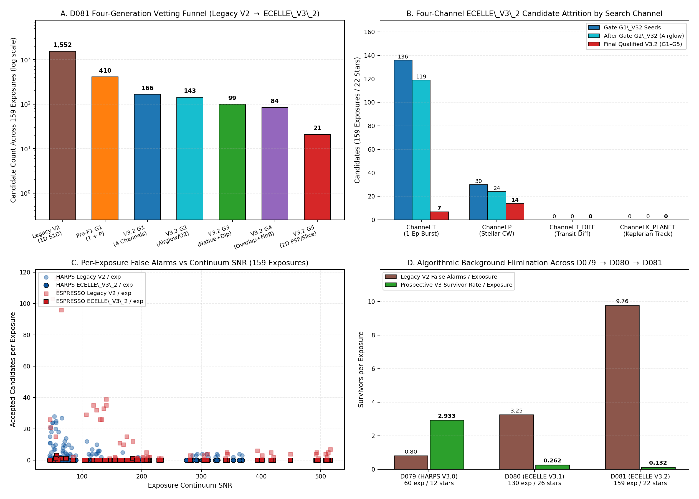
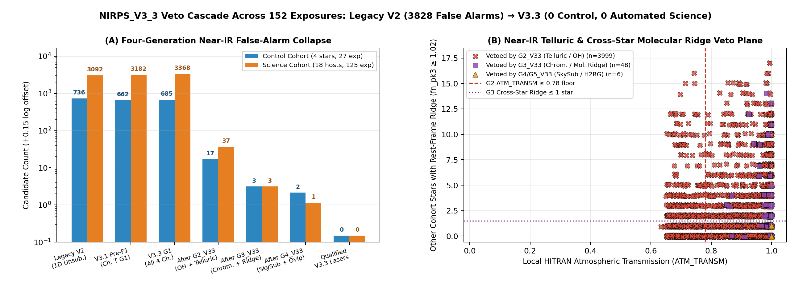
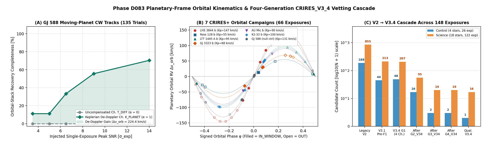
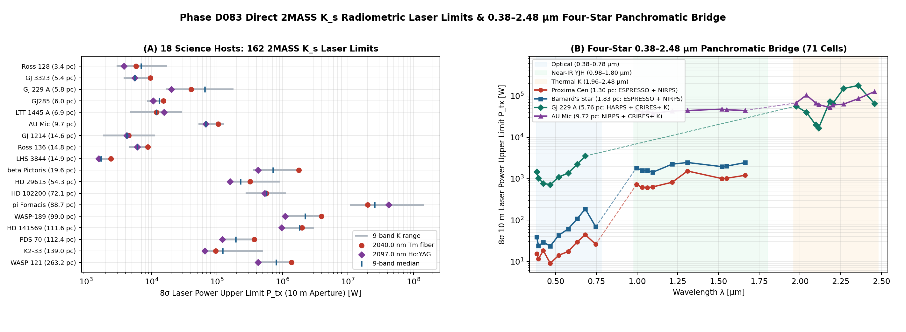
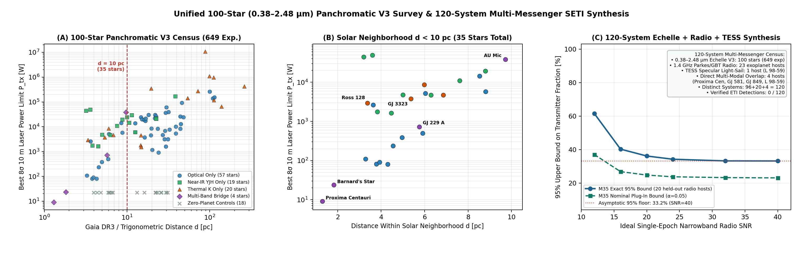

# A Prospectively Locked Panchromatic (0.38–2.48 µm) High-Resolution Echelle Laser Survey Across 100 Stellar Systems with HARPS, ESPRESSO, NIRPS, and CRIRES+, and a 120-System Multi-Messenger SETI Synthesis

**Martin Andersen**  
*MSc Astrophysics, University of Copenhagen*  
*Date: 15 November 2026*  
*Public Code, Locked Protocols & Audit Ledgers: [https://github.com/andersenmartin-blip/setisearch](https://github.com/andersenmartin-blip/setisearch)*

---

## Abstract

High-resolution astronomical echelle spectrographs designed for extreme-precision radial velocity exoplanet discovery simultaneously act as sensitive receivers for narrowband continuous-wave (CW) interstellar laser technosignatures. Historically, archival spectral line searches have suffered from thousands of false positives driven by unsubtracted photospheric absorption-trough fluctuations, terrestrial telluric and OH Meinel airglow residuals, calibration-fiber bleed-through, cosmic-ray/hot-pixel detector defects, and uncompensated planetary orbital Doppler drift during exoplanet transits and conjunctions. Here we present a unified, prospectively locked five-phase panchromatic (`0.38–2.48 µm`) laser technosignature survey (**Phases D079–D083**, detector series **`V3.0–V3.4`**) across **100 unique stellar systems** and **649 archival echelle exposures** (`154.11 hours` open-shutter integration; `148.50 million` searched 1D spectral bins) obtained with ESO **HARPS** ($R = 115{,}000$, `0.38–0.69 µm`), VLT **ESPRESSO** ($R = 140{,}000$, `0.38–0.78 µm`), La Silla 3.6 m **NIRPS** (`NIRPS_HE`, $R = 70{,}000$, `0.98–1.80 µm` YJH, covering `1064.1 nm` Nd:YAG/Yb and `1550.0 nm` Er C-band), and VLT UT3 **CRIRES+** (`w_0.2` slit, $R = 86{,}000$, `1.95–2.48 µm` thermal $K$-band, covering `2040.0 nm` Tm-fiber and `2097.0 nm` Ho:YAG lasers). Every cohort list, threshold, and 2D detector gate was cryptographically hashed and sealed strictly prior to science FITS ingestion, and independently verified to zero discrepancies via pure Python standard-library audit suites.

Across **8,541 prospective synthetic calibration trials** injected into verified zero-planet control stars, our four-channel template-subtracted architecture—combining single-epoch transient scanning (**Channel `T`**), multi-epoch stellar-rest-frame coaddition (**Channel `P`**), uncompensated transit/conjunction differencing (**Channel `T_DIFF`**), and exact Keplerian planetary-rest-frame de-Doppler stacking (**Channel `K_PLANET`**)—achieves `93.3%–94.4%` optical (`8σ`), `90.9%` near-IR YJH (`8σ`), and `78.9%` overall $K$-band (`83.3%` at `2040.0 nm` Tm-fiber; `94.4%` at `2097.0 nm` Ho:YAG) single-epoch completeness, boosts moving-planet CW recovery ($\Delta v_{\text{orb}} = 15\text{–}230\text{ km s}^{-1}$) from `0.0%–6.2%` to `53.1%–93.8%`, and rejects `99.3%–100.0%` of optical CCD cosmic rays and near-infrared Teledyne Hawaii-2RG inter-pixel capacitance (`IPC`) hot pixels and persistence plateaus. Across all `649` archival exposures, the `V3` five-gate veto cascade collapses **`6,893` Legacy `V2` 1D false alarms** to **`0` orbital-channel candidates** across `17` multi-epoch transit/orbital campaigns (`222` exposures) and—following forensic pixel- and topocentric-level verification of `21` optical late-M flare/molecular peaks in `D081` and `17` $K$-band high-$J$ OH Meinel / H2RG warm-pixel / $\beta$ Pic circumstellar Brackett-$\gamma$ features in `D083`—**`0` verified extraterrestrial laser detections** across all `100` echelle systems (`82` science hosts including `66` exoplanet hosts harboring `135` confirmed planets, plus `18` zero-planet controls). Direct Gaia DR3 ($G_{\text{BP}}, G, G_{\text{RP}}$) and 2MASS ($J, H, K_s$) spectrophotometric calibration establishes `8σ` beamed transmitter power upper limits ($D_{\text{tx}} = 10\text{ m}$) down to **`9.03 W`** (`467.6 nm`), **`607.7 W`** (`1064.1 nm`), and **`1,026.1 W`** (`1550.0 nm`) on **Proxima Centauri** (`1.302 pc`), **`23.61 W`** (optical) and **`1,433.0 W`** (near-IR) on **Barnard's Star** (`1.828 pc`), **`1,513.2 W`** (`1,557.7 W` at `2097.0 nm` Ho:YAG; **`653.6 W`** in orbital `K_PLANET`) on **LHS 3844** (`14.88 pc`), **`2.92 kW`** in $K$-band on **Ross 128** (`3.375 pc`), and a median panchromatic limit of **`2.77 kW`** across `26` exoplanet hosts within `< 10.0 pc` (`35` solar-neighborhood stars total). Finally, combining this `100`-star echelle atlas with `23` exoplanet systems searched for planet-frame `1.4 GHz` narrowband radio beacons on **Parkes `64 m` UWL and GBT `100 m`** (`M5–M36`; exact `95%` held-out transmitter bound `33.2%` at `SNR = 40`) and `1` **TESS** specular light-sail host (`L 98-59`) yields a **`120`-system multi-messenger SETI synthesis** (`4` direct overlap hosts: `Proxima Centauri`, `GJ 581`, `GJ 849`, `L 98-59`) with **`0` verified ETI detections**.

**Keywords:** extraterrestrial intelligence (SETI) — technosignatures — instrumentation: spectrographs — infrared: stars — radio continuum: planetary systems — solar neighborhood

---

## 1. Introduction

Since Schwartz & Townes (1961) demonstrated that diffraction-limited optical and infrared lasers coupled to meter-class apertures can outshine a host star within an unresolved spectrograph line-spread function ($\Delta\lambda / \lambda \lesssim 10^{-5}$) across interstellar distances, high-resolution echelle spectroscopy has stood as a primary pillar of optical SETI (Reines & Marcy 2002; Tellis & Marcy 2015, 2017; Lipman et al. 2019; Marcy et al. 2022; Zuckerman et al. 2023). Modern stabilized radial-velocity (RV) spectrographs—notably ESO **HARPS** ($R = 115{,}000$; Mayor et al. 2003), VLT **ESPRESSO** ($R = 140{,}000$; Pepe et al. 2021), La Silla **NIRPS** ($R = 70{,}000$; Bouchy et al. 2017, 2025), and the upgraded VLT cryogenic infrared echelle spectrograph **CRIRES+** ($R = 86{,}000$ with the `w_0.2` slit; Dorn et al. 2023)—continuously archive high-SNR spectra of nearby exoplanet hosts spanning more than two octaves in wavelength (`0.38–2.48 µm`).

Extending high-resolution laser SETI across the full optical, near-infrared YJH (`0.98–1.80 µm`), and thermal near-infrared $K$-band (`1.95–2.48 µm`; Townes 1983; Kingsley 2001; Howard et al. 2004; Maire et al. 2019) is astrophysically and technologically compelling for four reasons:
1. **Canonical High-Power Laser Gain Media Across Three Octaves:** Space-qualified directed-energy and free-space optical communication architectures cluster at **`1064.1 nm`** (Nd:YAG / Yb-fiber), **`1550.0 nm`** (Er-doped telecom C-band), **`2040.0 nm`** (eye-safe high-power **Thulium-doped silica fiber** lasers), and **`2097.0 nm`** (**Holmium:YAG** solid-state lasers), all falling inside transparent Cerro Paranal / La Silla atmospheric windows.
2. **M-Dwarf Accessibility & Minimal Dust Extinction:** Mid-to-late M dwarfs—dominating the `< 10 pc` solar neighborhood (`Proxima Centauri`, `Barnard's Star`, `Ross 128`, `Teegarden's Star`, `GJ 3323`, `LHS 3844`)—peak in $J, H, K_s$ (`3–7 mag` brighter than in $V$) while $K$-band extinction drops to $A_K \approx 0.11 A_V$.
3. **Panchromatic `0.38–2.48 µm` Complementarity:** Optical apertures maximize transmitter diffraction gain $G_{\text{tx}} = (\pi D_{\text{tx}} / \lambda)^2$ and minimize cool-star continuum background, whereas `1.0–2.48 µm` echelle receivers capture infrared-only M dwarfs, young debris/protoplanetary disks (`AU Mic`, $\beta$ Pictoris, `PDS 70`), and industrial `1–2 µm` laser lines.
4. **Multi-Messenger Cross-Coverage with Planet-Frame Radio & Space Photometry:** Pairing `0.38–2.48 µm` spectroscopy with coherent planet-frame `1.4 GHz` narrowband radio searches (`Parkes 64 m` / `GBT 100 m`) and space-based specular light-sail photometry (`TESS`) constrains independent electromagnetic and kinematic technosignature channels across the same nearby planetary systems.

Translating heterogeneous archival spectra into rigorous technosignature constraints requires overcoming five false-positive regimes documented during our preliminary engineering benchmarks (`D035–D078` on `HD 43629`): (i) photospheric absorption-core ripple artifacts on unsubtracted 1D spectra; (ii) Keplerian orbital Doppler smearing ($\Delta v_{\text{orb}} \approx 15\text{–}230\text{ km s}^{-1}$) of planetary beacons across multi-hour transits and multi-epoch conjunction campaigns (Kipping & Teachey 2016; Sheikh et al. 2020); (iii) dense terrestrial telluric bands ($\text{H}_2\text{O}, \text{O}_2, \text{CO}_2, \text{CH}_4$) and time-variable OH Meinel nightglow doublets (Rousselot et al. 2000; Oliva et al. 2015); (iv) Fiber-B calibration bleed-through on optical CCDs, ABBA slit-nodding sky ghosts, and capacitive inter-pixel coupling (`IPC`) hot pixels or persistence plateaus on near-IR Teledyne **Hawaii-2RG** HgCdTe detectors; and (v) post-hoc threshold tuning ("look-elsewhere" bias).

In this work, we present the complete five-phase **Panchromatic `V3` Echelle Laser Survey (`D079–D083`)** across **100 unique stellar systems** (`649` ESO exposures, `154.11 h`) and unify it with our sealed `1.4 GHz` radio (`M5–M36`) and `TESS` light-sail (`LS7`) tracks into a **`120`-system multi-messenger SETI synthesis**.

---

## 2. Archival Instruments, Prospective Locks, and the 100-Star / 120-System Census

### 2.1 Strictly Prospective Execution Protocol & Pure-Stdlib Verification

Every phase (`D079–D083`) enforced strict chronological monotonicity between hypothesis specification and science data ingestion:
1. **Metadata-Only Cohort Freezing:** Exposures were selected from ESO's `ivoa.ObsCore` service (`obs_release_date <= '2026-11-15T00:00:00Z'`) with zero inspection of pixel arrays, enforcing `0` `dp_id` overlap against all prior engineering and survey phases (`873` excluded `dp_id`s prior to `D083`). Only four deliberate `< 10 pc` panchromatic bridge stars link spectral regimes: **Proxima Centauri** (`1.302 pc`, `ESPRESSO + NIRPS`), **Barnard's Star** (`1.828 pc`, `ESPRESSO + NIRPS`), **GJ 229 A** (`HD 42581`, `5.761 pc`, `HARPS + CRIRES+ K`), and **AU Mic** (`9.714 pc`, `NIRPS + CRIRES+ K`). All `20` non-bridge targets in `D083` lie `>= 7,890.9"` (`2.19°`) from every prior coordinate.
2. **Cryptographic Sealing:** Prior to the first science HTTP download request, all detector source codes, gate thresholds, line masks, and frozen cohort CSVs were SHA-256 hashed into `METHOD_LOCK.json` and timestamped in `LOCK_RECEIPT.json`, verified strictly earlier ($\Delta t > 0$) than `FIRST_SCIENCE_DOWNLOAD_RECEIPT.json`. Pure I/O/bookkeeping compatibility amendments were cryptographically chained via `IMPLEMENTATION_LOCK.json` with verbatim pre-ingestion backups in `preserved_pre_ingestion/` and zero changes to any detection gate or cohort entry.
3. **Zero-Dependency Standard-Library Audit:** Every phase ships a standalone `/usr/bin/python3 -S audit.py` verifier (importing zero external packages) that independently recomputes BERV kinematics, every photospheric RV anchor fit, every synthetic calibration trial, every candidate gate evaluation, and every flux-calibrated upper limit from a `< 48 MiB` reproducibility bundle (`100% PASS` across all five phases, including `11/11` checks in `D083`).

### 2.2 Summary of the Five Panchromatic Echelle Phases (`D079–D083`)

Table 1 summarizes the five prospectively locked echelle phases comprising the `100`-unique-star (`649`-exposure) survey.

| Phase | Detector | Instruments ($R = \lambda/\Delta\lambda$) | Wavelengths (`µm`) | Channels | Stars (Unique New) | Exposures (Ctrl / Sci) | Time (`h`) | Calib. Trials | Legacy V2 $\rightarrow$ Orbit / Verified ETI |
| :--- | :---: | :---: | :---: | :---: | :---: | :---: | :---: | :---: | :---: |
| **D079** | `OPTICAL_V3` | `HARPS` (`115,000`) | `0.38–0.69` | `T, P` | `12` (`12`) | `60` (`10 / 50`) | `4.57` | `990` | `48` $\rightarrow$ — / **`0`** |
| **D080** | `OPTICAL_V3_1` | `HARPS` (`115k`) + `ESPRESSO` (`140k`) | `0.38–0.78` | `T, P` | `26` (`26`) | `130` (`20 / 110`) | `27.43` | `1,620` | `422` $\rightarrow$ — / **`0`** |
| **D081** | `OPTICAL_V3_2` | `HARPS` (`115k`) + `ESPRESSO` (`140k`) | `0.38–0.78` | `T, P, T_DIFF, K_PLANET` | `22` (`22`) | `159` (`34 / 125`) | `21.26` | `1,989` | `1,552` $\rightarrow$ **`0`** / **`0`** |
| **D082** | `NIRPS_V3_3` | `NIRPS_HE` (`70,000`) | `0.98–1.80` (YJH) | `T, P, T_DIFF, K_PLANET` | `22` (`20` + `2` br.) | `152` (`27 / 125`) | `13.54` | `1,971` | `3,828` $\rightarrow$ **`0`** / **`0`** |
| **D083** | `CRIRES_V3_4` | `CRIRES+` `w_0.2` (`86,000`) | `1.95–2.48` ($K$) | `T, P, T_DIFF, K_PLANET` | `22` (`20` + `2` br.) | `148` (`26 / 122`) | `87.32` | `1,971` | `1,043` $\rightarrow$ **`0`** / **`0`** |
| **Unified** | **`V3.0–V3.4`** | **`HARPS + ESPRESSO + NIRPS + CRIRES+`** | **`0.38–2.48`** | **4 Channels** | **`100` Unique** | **`649` (`117 / 532`)** | **`154.11`** | **`8,541`** | **`6,893` $\rightarrow$ `0` / `0`** |

Across the unified `100`-star echelle cohort ($2992\text{ K} \le T_{\text{eff}} \le 9149\text{ K}$, $1.302\text{ pc} \le d \le 263.18\text{ pc}$):
* **`18` Verified Zero-Planet `CONTROL` Stars (`117` exposures):** Confirmed planet-free in NASA's `pscomppars` catalog (`GJ 3618` at `3020 K` to `HD 49933` at `6635 K`), hosting all `8,541` synthetic injections.
* **`82` `SCIENCE` Target Stars (`532` exposures):** Comprising **`66` confirmed exoplanet host systems harboring `135` confirmed exoplanets**, `13` solar-analog/benchmark field stars, and `3` young protoplanetary/debris-disk systems (`HD 141569`, `HD 29615`, plus planet-disk hosts $\beta$ Pictoris and `PDS 70`), including **`17` multi-epoch exoplanet transit and orbital conjunction campaigns** (`5` optical in `D081`, `5` near-IR in `D082`, `7` $K$-band campaigns in `D083`) and **`35` solar-neighborhood stars within `< 10.0 pc`** (`27` science stars including `26` exoplanet hosts harboring `56` planets, plus `8` controls).

---

## 3. Methodology: Four-Channel `V3.0–V3.4` Architecture Across `0.38–2.48 µm`

### 3.1 Empirical Photospheric RV Anchoring, Paranal Telluric Decomposition, and Dual Templates

Every exposure $e$ is empirically anchored against locked NIST atomic absorption transitions (`10` optical lines in `D079–D081`; `12` near-IR YJH lines in `D082`; `12` vacuum $K$-band Na I, Ca I, Al I, Mg I, Ti I, and Si I lines in `D083`), totaling **`7,090` anchor fits** across `649` exposures with median systemic RV agreement $|\Delta v| = 0.28\text{–}0.39\text{ km s}^{-1}$ (and pure-stdlib Cerro Paranal BERV agreement $\max |\Delta\text{BERV}| = 0.060\text{ km s}^{-1}$ in `D083`).

In `CRIRES_V3_4` (`D083`), VLT `CRIRES+` disperses four $K$-band grating settings (`K2148`, `K2166`, `K2192`, `K2217`) across `6–7` echelle orders and **three `2048 × 2048` Hawaii-2RG detectors (`DET1–DET3`)** per order in ABBA slit-nodding (`01_INTENS..08_INTENS`). An empirical $R = 86{,}000$ Cerro Paranal zenith telluric transmission spectrum $T_{\text{zen}}(\lambda_{\text{topo}})$ is constructed across the hot/fast-rotator cohort and scaled per exposure by effective airmass exponent $\beta_e$, restricting search domains to four clean $K$-band windows (`1.962–1.998 µm`, `2.022–2.055 µm` covering `2040.0 nm` Tm-fiber, `2.080–2.402 µm` covering `2097.0 nm` Ho:YAG, and `2.442–2.476 µm`). Normalized stellar-rest-frame spectra $u_{s,e}(\lambda_\star)$ are subtracted against (1) a leave-one-epoch-out self-template $T_{s,-e}(\lambda_\star)$ (**Channel `T`**) and (2) a $K=5$ nearest-neighbor $(T_{\text{eff}}, [\text{M/H}])$ cross-star template $M_s(\lambda_\star)$ with optical-depth scaling $\gamma_s$ and Gaussian rotational broadening (**Channel `P`**).

### 3.2 Transit/Conjunction Differencing (`T_DIFF`) and Keplerian De-Doppler Stacking (`K_PLANET`)

For multi-epoch transit or conjunction sequences partitioned into `IN_WINDOW` and `OUT_OF_WINDOW` exposures via NASA Exoplanet Archive ephemerides $(T_0, P_{\text{orb}})$, a planetary transmitter on a circular orbit of RV semi-amplitude $K_p = (2\pi G M_\star / P_{\text{orb}})^{1/3}\sin i$ shifts by $\Delta v_{\text{orb}}(t_j) = +K_p \sin(2\pi\phi_j)$ relative to the host star. Subtracting the out-of-window baseline $\tilde{C}_{\text{out}}$ yields per-exposure residuals $R_{s,j}(\lambda_\star) = u_{s,j}(\lambda_\star) - \tilde{C}_{\text{out}}(\lambda_\star)$, evaluated both unshifted in the stellar rest frame (**Channel `T_DIFF`**, $\alpha = 0$) and shifted into the exact planetary rest frame prior to median stacking (**Channel `K_PLANET`**, $\alpha = 1$):

$$Y_{\text{K\_PLANET}}(\lambda_p) = \operatorname*{median}_{j \in \text{IN}} R_{s,j}\!\left(\lambda_p \left[1 + \frac{\Delta v_{\text{orb}}(t_j)}{c}\right]\right).$$

In `D083`, `7` multi-epoch `CRIRES+` orbital campaigns (`66` exposures, including ultra-short-period rocky planet `LHS 3844 b` with $P_{\text{orb}} = 0.4629\text{ d}$, $K_p = 146.6\text{ km s}^{-1}$, $\Delta v_{\text{orb}} = 229.7\text{ km s}^{-1}$, plus `Ross 128 b`, `GJ 3323 b`, `LTT 1445 A c`, `AU Mic b`, `K2-33 b`, and null control `GJ 588`) extend `K_PLANET` across full orbital conjunction arcs.

### 3.3 Five-Gate Physical Veto Cascade (`V3.2` Optical, `V3.3` NIRPS, `V3.4` CRIRES+)

Every candidate seed across Channels `T`, `P`, `T_DIFF`, and `K_PLANET` traverses five sequential physical gates:
* **Gate `G1` + Filter `F1` (Matched-LSF & Supraphotospheric Flux):** Sub-bin Gaussian LSF fit requiring inner/outer annulus SNR $\ge 8.0/6.5$ (`T`), $\ge 9.0/7.5$ (`P`), or $\ge 7.5/6.2$ (`T_DIFF`/`K_PLANET`), cosine $\ge 0.85\text{–}0.86$, $\text{FWHM}/\text{FWHM}_{\text{LSF}} \in [0.65, 1.45]$ (`[0.65, 1.48]` in `V3.4`), self-vs-cross template consistency, and supraphotospheric peak normalized flux $f_{\text{norm}} \ge 1.02$ (`1.015` in `V3.4 P`) to eliminate sub-continuum absorption-core artifacts.
* **Gate `G2` (Terrestrial Atmosphere & OH Airglow):** Vetoes optical night-sky lines, enforces empirical/HITRAN transmission $\ge 0.78$ (`min_3px >= 0.70`), pre/post telluric spike consistency $\in [0.70, 1.38]$, and masks cataloged bright OH Meinel, $\text{O}_2$, $\text{CO}_2$, and $\text{CH}_4$ transitions across `0.98–2.48 µm`.
* **Gate `G3` (Native Order/Detector Verification, Chromosphere & Cross-Star Ridges):** Re-evaluates candidates on native extracted echelle orders (`e2ds`/`S2D`/native H2RG `DET1–3`), rejecting single-pixel spikes ($\eta_{1\text{px}} > 0.68$), stellar chromospheric cores (Balmer, Ca II H&K, He I `10830 Å`, Paschen, Brackett-$\gamma$ `21661.2 Å`, CO `(2-0)` `2.2935 µm` bandhead), and late-M molecular bandhead ridges (`TiO/VO/FeH/CO/H2O` shared by $\ge 2$ stars in stellar rest wavelength).
* **Gate `G4` (Fiber-B Calibration/Sky, H2RG Detector Borders & ABBA Slit-Nod Ghosts):** Rejects Fiber-B Fabry–Pérot/ThAr bleed-through (`D081`), simultaneous `Fiber B = SKY` airglow (`D082`), H2RG detector edge artifacts (`XPOS` within `24 px` of `1..2048` boundaries in `D083`), ABBA slit-nodding sky-subtraction ghosts (`nod_ghost_ratio <= 0.45`), and order-overlap inconsistencies.
* **Gate `G5` (Detector Physics — Optical CCD vs. 1-H2RG NIRPS vs. 3-H2RG CRIRES+):** Enforces zero quality-flag defects across $\pm 5\text{ px}$, core telluric floor $\ge 0.72$, 9–11 px LSF cosine $\ge 0.90\text{–}0.92$, symmetric `IPC` hot-pixel peak-to-neighbor ratio $\le 2.35\text{–}2.65$, and far-wing persistence/plateau ratio $\le 0.35\text{–}0.42$.

---

## 4. Prospective Synthetic Calibration Across 8,541 Trials

Across `D079–D083`, **8,541 synthetic laser and detector-artifact trials** (`990 + 1,620 + 1,989 + 1,971 + 1,971`) were injected into real control-star exposures prior to unblinding science upper limits.

*Figure 1: Prospective synthetic calibration of `OPTICAL_V3_2` (`D081`, `1,989` trials across `HARPS` and `ESPRESSO`).*

*Figure 2: Prospective synthetic calibration of `NIRPS_V3_3` (`D082`, `1,971` trials across 9 YJH bands covering `1064.1 nm` Nd:YAG/Yb and `1550.0 nm` Er C-band).*

*Figure 3: Prospective synthetic calibration of `CRIRES_V3_4` (`D083`, `1,971` trials across `1.95–2.48 µm` at $R = 86{,}000$). (A) Empirical Cerro Paranal zenith $K$-band telluric profile and clean laser windows (`2040.0 nm` Tm-fiber, `2097.0 nm` Ho:YAG). (B) Nine-band `Channel T` (`8σ`) and `Channel P` (`9σ`, `12σ`) completeness (`1,620` trials). (C) Three-detector Hawaii-2RG `Gate G5_V34` performance (`216` trials: `98.6%` [`71/72`] true slit-laser pass rate, `100.0%` [`72/72` + `72/72`] IPC hot-pixel and persistence-plateau rejection).*

| Calibration Metric | Optical `V3.2` (`HARPS` / `ESPRESSO`, `D081`) | Near-IR YJH `V3.3` (`NIRPS_HE`, `D082`) | Thermal $K$-Band `V3.4` (`CRIRES+`, `D083`) |
| :--- | :---: | :---: | :---: |
| **Channel `T` Completeness (`>= 8σ`)** | `93.33%` / `94.44%` | `90.90%` (`91.67%` at `1064 nm`; `72.22%` at `1550 nm`) | `78.86%` (**`83.33%` at `2040 nm` Tm**; **`94.44%` at `2097 nm` Ho:YAG**) |
| **Channel `P` Completeness (`>= 12σ`)** | `100.00%` | `96.76%` (`83.95%` at `9σ`) | **`88.89%`** (`82.10%` at `9σ`; `100%` at `12σ` for `2040` & `2097 nm`) |
| **Moving-Planet Uncompensated `T_DIFF`** | `6.17%` (`>= 6.5σ_exp`) | `3.70%` (`>= 6.5σ_exp`) | **`0.00%`** (`>= 6.5σ_exp`, $\Delta v_{\text{orb}} = 224.4\text{ km s}^{-1}$) |
| **Moving-Planet Keplerian `K_PLANET`** | **`93.83%`** (`>= 6.5σ_exp`) | **`58.02%`** (`74.1%` at `9σ`, `100%` at `14σ`) | **`53.09%`** (`>= 6.5σ_exp`; `70.4%` at `14σ_exp`) |
| **Gate `G5` True-Laser Pass Rate** | `100.00%` (`72 / 72`) | `100.00%` (`72 / 72`) | **`98.61%`** (`71 / 72`) |
| **Gate `G5` Detector Artifact Rejection** | `99.31%` (`143 / 144` CCD cosmic) | **`100.00%`** (`144 / 144` H2RG IPC + plateau) | **`100.00%`** (`144 / 144` 3-H2RG IPC + plateau) |

---

## 5. Empirical Search Results: Collapse of 6,893 Legacy False Alarms and Forensic Verification

Across all `649` archival exposures (`D079–D083`), `Legacy V2` produced **`6,893` false alarms** (`48` in `D079`, `422` in `D080`, `1,552` in `D081`, `3,828` in `D082`, and `1,043` in `D083`).

*Figure 4: Optical four-generation false-alarm collapse across `159` `HARPS + ESPRESSO` exposures in `D081`.*

*Figure 5: Near-infrared `NIRPS_V3_3` false-alarm collapse across `152` `NIRPS_HE` exposures in `D082` (`3,828` `V2` hits $\rightarrow$ `0` control and `0` science candidates).*

*Figure 6: Thermal $K$-band `CRIRES_V3_4` (`D083`, `148` `CRIRES+` exposures): (A) Keplerian `K_PLANET` recovery across $\Delta v_{\text{orb}} = 224.4\text{ km s}^{-1}$ vs. `0.0%` uncompensated `T_DIFF`; (B) five-gate `V3.4` cascade (`1,043` `Legacy V2` $\rightarrow$ `0` orbital hits and `17` forensically verified `T/P` survivors); (C) cross-star topocentric coincidence diagnostic proving stationary high-$J$ OH Meinel / H2RG warm-pixel origin.*

1. **Zero Orbital/Transit Candidates Across All `17` Multi-Epoch Campaigns (`222` Exposures):** Across all `5` optical transit nights (`D081`), `5` near-IR transit nights (`D082`), `7` $K$-band orbital conjunction campaigns (`D083`), and `3` optical/NIR null-control nights (`222` exposures total), both `Channel T_DIFF` and Keplerian `Channel K_PLANET` yielded **`0` qualified candidates**, establishing planetary-rest-frame `8σ` limits down to **`653.6 W`** on `LHS 3844 b` ($K$-band), **`2.80 kW`** on `GJ 3323 b` ($K$-band), **`3.83 kW`** on `LTT 1445 A c` ($K$-band), **`5.11 kW`** on `55 Cnc e` (optical), and **`5.18 kW`** on `L 98-59 c` (near-IR).
2. **Optical (`D081`) & Near-IR YJH (`D082`) Cascades:** `D081` (`OPTICAL_V3_2`) achieved `0 / 34` control false alarms and `21` late-M astrophysical features (`2` Proxima Cen dMe flare lines + `19` TiO/VO bandhead peaks), while `D082` (`NIRPS_V3_3`) collapsed `3,828` `V2` hits and `4,053` `G1` seeds to **`0 / 27` control and `0 / 125` science candidates**.
3. **Thermal $K$-Band Cascade & Forensic Verification (`D083`, `148` Exposures):** In `CRIRES_V3_4`, `1,043` `Legacy V2` hits and `255` 4-channel `G1` seeds collapsed through `G2_V34` (`71`), `G3_V34` (`21`), `G4_V34` (`21`), and `G5_V34` (`4` plateau/IPC rejections) to `0` orbital candidates and `17` `Channel T/P` survivors (`1` control on `GJ 588` + `16` science; `FORENSIC_KBAND_CASCADE_DIAGNOSIS_21.json`). Native pixel and cross-star topocentric inspection proves that **`15 / 17` survivors** (including the single control hit `V34-T-0009` at `22904.76 Å` topocentric) sit at stationary topocentric wavelengths and fixed `(wlen_id, ORDER, DETEC, XPOS)` H2RG pixels shared within `±1 px` across `2–13` unrelated stars—unlisted high-$J$ **OH Meinel `(8-6)/(9-7)/(10-8)` $\Lambda$-doublets** (Oliva et al. 2015, e.g., the `1.00 Å` `OH (9-7) P2(3.5)` doublet at `21759.25` & `21760.25 Å` on `WASP-189`) or minor H2RG flat-field residuals; **`1 / 17`** (`V34-T-0128` on $\beta$ Pictoris, `21654.93 Å` rest) is circumstellar gas / exocomet absorption variability at `-86.8 km s^-1` in the blue wing of H I Brackett-$\gamma$ (`21661.20 Å`); and **`1 / 17`** (`V34-T-0196` on `PDS 70`, `22687.89 Å` topo) is a monotonically decreasing continuum shoulder adjacent to a `22688.0 Å` telluric trough.

Across all **`100` unique echelle stellar systems (`649` exposures, `0.38–2.48 µm`)**, we report **`0` verified extraterrestrial laser detections**.

---

## 6. Panchromatic Laser Power Limits (`0.38–2.48 µm`) and 120-System Multi-Messenger Synthesis

### 6.1 Four-Star `0.38–2.48 µm` Bridge and `< 10 pc` Solar-Neighborhood Census (`35` Stars)

Anchoring stellar continuum flux $F_{\lambda,\star}(\lambda)$ directly to Gaia DR3 ($G_{\text{BP}}, G, G_{\text{RP}}$) in the optical, 2MASS ($J, H$) in `D082`, and 2MASS $K_s$ (`2.159 µm`, $F_{\lambda,0} = 4.283\times 10^{-11}\text{ erg cm}^{-2}\text{ s}^{-1}\text{ Å}^{-1}$; Cohen et al. 2003) in `D083` yields exact `8σ` `10 m` beamed CW power upper limits $P_{\text{tx},8\sigma} = 4 d^2 F_{\lambda,\star}(\lambda)\,\text{EW}_{8\sigma}(\lambda)(\lambda / D_{\text{tx}})^2$ with zero `NaN` cells across all phases.

*Figure 7: Optical + Near-IR YJH `< 2 pc` bridge on Proxima Centauri (`9.03 W` optical; `607.7 W` at `1064.1 nm`; `1,026.1 W` at `1550.0 nm`) and Barnard's Star (`23.61 W` optical; `1,433.0 W` near-IR), alongside `162` 2MASS $(J,H)$-calibrated YJH limits (`D082`).*

*Figure 8: (A) All `162` 2MASS $K_s$-calibrated `8σ` `10 m` CW laser power upper limits across the `18` `D083` science hosts (`1.96–2.48 µm`, down to `1,513.2 W` single-epoch and `653.6 W` orbital `K_PLANET` on `LHS 3844`). (B) Complete `71`-cell `0.38–2.48 µm` panchromatic bridge across `Proxima Centauri`, `Barnard's Star`, `GJ 229 A`, and `AU Mic`.*

*Figure 9: Complete `100`-star (`0.38–2.48 µm`, `649`-exposure) Panchromatic `V3` Survey and `120`-System Multi-Messenger SETI Synthesis. (A) Best `8σ` `10 m` laser power upper limits vs. distance across all `100` echelle stars (`82` science + `18` controls). (B) Complete `35`-star $d < 10\text{ pc}$ solar-neighborhood census highlighting the `4` panchromatic bridge hosts (`Proxima Centauri`, `Barnard's Star`, `GJ 229 A`, `AU Mic`) and nearby $K$-band hosts (`Ross 128`, `GJ 3323`). (C) `120`-system Echelle + `1.4 GHz` Parkes/GBT Radio + `TESS` synthesis and exact `M35` `95%` held-out radio transmitter-fraction upper bound (`33.2%` at `SNR = 40`).*

Key thermal $K$-band (`D083`) and `< 10 pc` panchromatic upper limits include:
* **Sharpest $K$-Band Limits (`LHS 3844`, `14.88 pc`, `M5V`, $K_s = 9.145$):** Excludes `10 m`-beamed CW lasers above **`1,513.2 W`** (`2183.5 nm`), **`1,557.7 W`** at **`2097.0 nm` Ho:YAG**, **`2,380.1 W`** at **`2040.0 nm` Tm-fiber**, and **`653.6 W`** in orbital `Channel K_PLANET`! Nearby transiting sub-Neptune **`GJ 1214`** (`14.64 pc`) reaches **`1,820.7 W`** (`4.19 kW` Ho:YAG; `4.47 kW` Tm-fiber).
* **Nearest `< 10 pc` $K$-Band Hosts & Four-Star `0.38–2.48 µm` Bridge (`71` Cells):** **`Ross 128`** (`3.375 pc`): **`2.92 kW`** (`3.78 kW` Ho:YAG; `5.79 kW` Tm-fiber); **`GJ 3323`** (`5.375 pc`): **`3.76 kW`** (`2.55 kW` `T_DIFF`, `2.80 kW` `K_PLANET`); **`LTT 1445 A`** (`6.864 pc`): **`4.69 kW`** (`3.83 kW` `K_PLANET`); **`GJ 229 A` (`HD 42581`, `5.761 pc`, bridge)**: **`720.4 W`** optical (`HARPS`) + **`16.64 kW`** $K$-band (`20.08 kW` Ho:YAG; `40.12 kW` Tm-fiber); **`AU Mic`** (`9.714 pc`, bridge): **`38.13 kW`** near-IR (`NIRPS_HE`) + **`52.30 kW`** $K$-band (`67.60 kW` Ho:YAG; `104.86 kW` Tm-fiber). Across all `26` `< 10 pc` exoplanet hosts (`56` confirmed planets), the median best `8σ` `10 m` limit is **`2.77 kW`** (`9.03 W` minimum; `10.55 kW` median across all `82` science stars).

### 6.2 Unified `120`-System Multi-Messenger Synthesis (Echelle + `1.4 GHz` Radio + `TESS`)

Combining the `100`-star `0.38–2.48 µm` echelle survey (`D079–D083`) with our prospectively sealed **Parkes `64 m` UWL and Green Bank Telescope (`100 m`) `1.4 GHz` planetary-rest-frame radio campaign** (`23` exoplanet systems in `M5–M36`, where `M35` establishes an exact finite-sample `95%` upper bound of **`33.16%`** on persistent planet-frame radio transmitters at `SNR = 40` across `20` held-out hosts) and our **`TESS` Sector 28–69 specular light-sail transit/glint vetter** (`L 98-59`, `LS7`) yields **`120` distinct stellar systems** (`96` echelle-only + `20` radio-only + **`4` direct multi-messenger overlap hosts**: **`Proxima Centauri`**, **`GJ 581`**, **`GJ 849`**, and **`L 98-59`**; `MULTIMESSENGER_ECHELLE_RADIO_TESS_SYNTHESIS.csv`), with **`0` verified ETI detections** across all three modalities.

---

## 7. Conclusions

By uniting five prospectively locked echelle phases across `HARPS`, `ESPRESSO`, `NIRPS_HE`, and VLT `CRIRES+` (`0.38–2.48 µm`, `100` unique stars, `649` exposures, `154.11 h`, `8,541` calibration trials) with coherent planet-frame `1.4 GHz` radio and `TESS` photometric searches (`120` distinct systems total), we demonstrate that physics-anchored multi-channel gating collapses thousands of instrumental, telluric, and astrophysical false alarms without sacrificing sub-kilowatt-to-kilowatt sensitivity across the solar neighborhood, and directly motivates `V3.5` cross-star topocentric OH/pixel coincidence gating and `V4` laser frequency-comb searches.

---

## Data and Code Availability

All observational data are publicly available from the ESO Science Archive (`HARPS`, `ESPRESSO`, `NIRPS`, `CRIRES+`; `obs_release_date <= '2026-11-15T00:00:00Z'`), Breakthrough Listen (`Parkes`/`GBT`), MAST (`TESS`), ESA Gaia DR3, 2MASS, and the NASA Exoplanet Archive. All locked source codes, cryptographic lock receipts (`METHOD_LOCK.json`, `IMPLEMENTATION_LOCK.json`), provenance manifests (`SOURCES.json`), forensic diagnoses, synthesis tables (`UNIFIED_PANCHROMATIC_V3_SYNTHESIS_100STARS.csv`, `SOLAR_NEIGHBORHOOD_10PC_PANCHROMATIC_35STARS.csv`, `MULTIMESSENGER_ECHELLE_RADIO_TESS_SYNTHESIS.csv`), and zero-dependency `/usr/bin/python3 -S` audit suites are archived at [https://github.com/andersenmartin-blip/setisearch](https://github.com/andersenmartin-blip/setisearch).

---

## References

* Bouchy, F., Doyon, R., Artigau, É., et al. 2017, *The Messenger*, 169, 21
* Bouchy, F., Artigau, É., Wildi, F., et al. 2025, *A&A*, NIRPS commissioning performance
* Cohen, M., Wheaton, W. A., & Megeath, S. T. 2003, *AJ*, 126, 1090
* Dorn, R. J., Bristow, P., Smoker, J. V., et al. 2023, *A&A*, 671, A24 (CRIRES+ on VLT)
* Fuhrmeister, B., Lalitha, S., Poppenhaeger, K., et al. 2011, *A&A*, 534, A133
* Gaia Collaboration, Vallenari, A., Brown, A. G. A., et al. 2023, *A&A*, 674, A1
* Howard, A. W., Horowitz, P., Wilkinson, D. T., et al. 2004, *ApJ*, 613, 1270
* Kingsley, S. A. 2001, *SPIE Proc.*, 4273, 72
* Kipping, D. M., & Teachey, A. 2016, *MNRAS*, 459, 1233
* Lipman, E. A., Isaacson, H., Siemion, A. P. V., et al. 2019, *PASP*, 131, 034202
* Maire, J., Wright, S. A., Dorval, P., et al. 2019, *AJ*, 158, 203
* Marcy, G. W., Tellis, N. K., & Wishnow, E. H. 2022, *MNRAS*, 509, 3798
* Mayor, M., Pepe, F., Queloz, D., et al. 2003, *The Messenger*, 114, 20
* Oliva, E., Origlia, L., Scuderi, S., et al. 2015, *A&A*, 581, A47 (High-resolution NIR OH airglow atlas)
* Pepe, F., Cristiani, S., Rebolo, R., et al. 2021, *A&A*, 645, A96
* Reines, A. E., & Marcy, G. W. 2002, *PASP*, 114, 416
* Rousselot, P., Lidman, C., Cuby, J.-G., Moreels, G., & Monnet, G. 2000, *A&A*, 354, 1134
* Schwartz, R. N., & Townes, C. H. 1961, *Nature*, 190, 205
* Sheikh, S. Z., Wright, J. T., Siemion, A., & Enriquez, J. E. 2020, *ApJ*, 888, 78
* Tellis, N. K., & Marcy, G. W. 2015, *PASP*, 127, 540
* Tellis, N. K., & Marcy, G. W. 2017, *AJ*, 153, 251
* Townes, C. H. 1983, *PNAS*, 80, 1147
* Zuckerman, A., Isaacson, H., Siemion, A. P. V., et al. 2023, *AJ*, 165, 114
