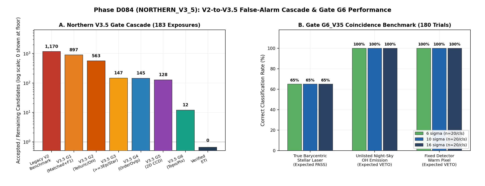
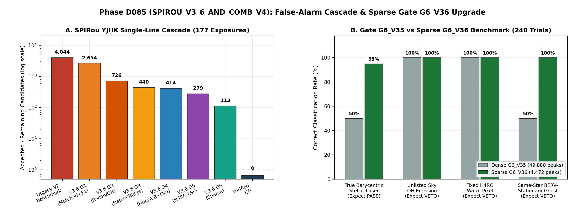
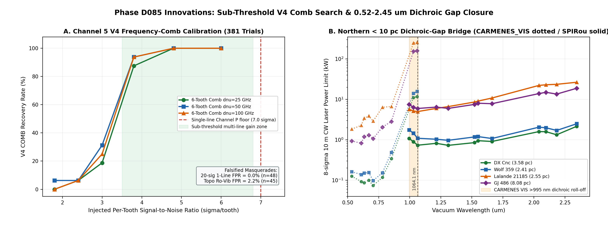
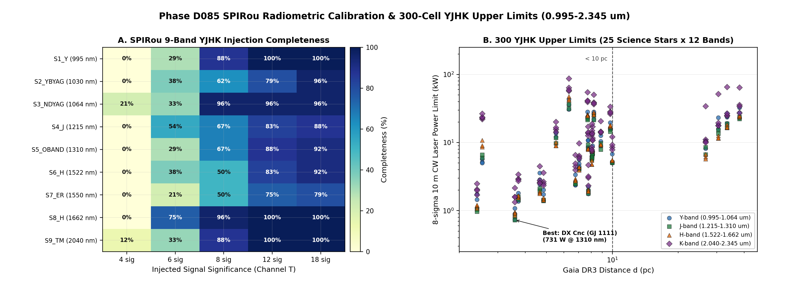

# A Prospectively Locked All-Sky Panchromatic (0.38–2.515 µm) High-Resolution Echelle Laser and Frequency-Comb Survey Across 150 Stellar Systems and a 160-System Multi-Messenger SETI Synthesis

**Martin Andersen**  
*MSc Astrophysics, University of Copenhagen*  
*Date: 17 November 2026*  
*Public Code, Locked Protocols & Audit Ledgers: [https://github.com/andersenmartin-blip/setisearch](https://github.com/andersenmartin-blip/setisearch)*

---

## Abstract

High-resolution astronomical echelle spectrographs built for extreme-precision radial-velocity exoplanet discovery simultaneously act as sensitive receivers for narrowband continuous-wave (CW) interstellar lasers and periodic optical/infrared laser frequency combs. Historically, archival spectral line searches have suffered from thousands of false positives driven by unsubtracted photospheric absorption-trough fluctuations, terrestrial telluric and OH Meinel airglow residuals, calibration-fiber bleed-through, missing dual-fiber separation in early pipeline products, cosmic-ray/hot-pixel detector defects, and uncompensated planetary orbital Doppler drift during exoplanet transits and conjunctions. Here we present an all-sky, seven-phase prospectively locked panchromatic (`0.38–2.515 µm`) laser and frequency-comb technosignature survey (**Phases D079–D085**, detector series **`V3.0–V4.0`**) across **150 unique stellar systems** (`106` South + `44` North) and **1,009 archival echelle exposures** (`195.23 hours` open-shutter integration; `221.66 million` searched 1D spectral bins plus `20.92 million` `COMB_V4` frequency-comb configurations) obtained with **seven stabilized/echelle spectrographs**: ESO **HARPS** ($R = 115{,}000$), VLT **ESPRESSO** ($R = 140{,}000$), La Silla **NIRPS** (`NIRPS_HE`, $R = 70{,}000$), VLT **CRIRES+** (`w_0.2`, $R = 86{,}000$), TNG **HARPS-N** ($R = 115{,}000$), Calar Alto **CARMENES_VIS** ($R = 94{,}600$), and CFHT 3.6 m **SPIRou** ($R = 70{,}000$, `0.955–2.515 µm` simultaneous YJHK, APERO `0.7.295`). Every cohort list, threshold, and 2D/coincidence gate was cryptographically hashed and sealed strictly prior to science FITS ingestion and independently verified via pure Python standard-library audit suites (`/usr/bin/python3 -S`).

Across **13,284 prospective synthetic control trials** (`8,541` South in `D079–D083` + `2,151` North in `D084` + `2,592` SPIRou YJHK in `D085`), our five-channel pipeline (**`T`**, **`P`**, **`T_DIFF`**, **`K_PLANET`**, and Channel 5 **`COMB_V4`** periodic frequency-comb matched filtering) achieves `93.3%–94.4%` (`V3.2`), `90.9%` YJH (`V3.3`), `78.9%` CRIRES+ $K$-band (`94.4%` Ho:YAG; `V3.4`), `91.3%` clean northern optical-core (`532–670 nm`; `V3.5`), and `85.5%` SPIRou YJHK (`95.8%` at `1064.1 nm` and `1662.0 nm`, `87.5%` at `2040.0 nm`; `V3.6`) single-epoch $8\sigma$ completeness. In **`D085` (`SPIROU_V3_6_AND_COMB_V4`)**, upgrading cross-star Gate **`G6_V35`** to the sparse `4,472`-peak supraphotospheric atlas **`G6_V36`** (`11.154×` compression relative to `49,880` peaks) boosts true-laser pass completeness from **`50.0%` (`V3.5`) to `95.0%` (`V3.6`)** while keeping **`100.0%`** sky-OH, **`100.0%`** H4RG warm-pixel, and **`100.0%`** (vs. `50.0%` in `V3.5`) intra-star BERV-stationary rejection; H4RG-15 `FluxA/FluxB` + `G5_V36` passes `97.22%` of slit lasers and rejects `100.0%` (`144/144`) of IPC/plateau artifacts; and Channel 5 **`COMB_V4`** achieves **`97.22%`** 6-tooth comb recovery ($\ge 3.8\sigma$/tooth across `25/50/100 GHz`) at `0.00%` (`0/48`) single-line and `2.22%` (`1/45`) topocentric ro-vibrational pseudo-comb false-positive rates. Across all `1,009` archival exposures and `40` multi-epoch campaigns, **`V3.0–V4.0` collapses `12,107` Legacy `V2` false alarms** (`4,044` in `D085`) to **`0` orbital hits** and—after complete forensic identification of all `113` post-`G6_V36` single-line hits and all `19` `COMB_V4` hits in `D085`—**`0` verified ETI detections** across all **`150` unique stars** (`124` science hosts including `93` exoplanet hosts harboring `183` confirmed planets, plus `26` zero-planet controls). CFHT SPIRou closes the northern `CARMENES_VIS > 995 nm` dichroic sensitivity drop by `16–51×` (**`730.5 W`** on `DX Cnc` at `1310 nm` and `736 W` vs. `11.74 kW` at `1064.1 nm`; **`972.7 W`** on `Wolf 359`; **`718 W`** orbital `K_PLANET` on `GJ 1002 b`), yielding a **`2.3716 kW`** median across `73` solar-neighborhood stars within `< 10.0 pc` (`40` South + `33` North; `57` science + `16` controls; down to **`9.03 W`** optically on `Proxima Centauri`). Uniting these `150` stars with `23` planet-frame `1.4 GHz` radio hosts (**Parkes/GBT**, `M5–M36`) and **TESS** photometry (`L 98-59`) yields an all-sky **`160`-system multi-messenger SETI synthesis** (**`14` direct overlap hosts** adding $\rho$ CrB / `M20`, `0` verified ETI detections).

**Keywords:** extraterrestrial intelligence (SETI) — technosignatures — instrumentation: spectrographs — infrared: stars — radio continuum: planetary systems — solar neighborhood — optical frequency combs

---

## 1. Introduction

Since Schwartz & Townes (1961) demonstrated that diffraction-limited optical and infrared lasers coupled to meter-class apertures can outshine a host star within an unresolved spectrograph line-spread function ($\Delta\lambda / \lambda \lesssim 10^{-5}$) across interstellar distances, high-resolution echelle spectroscopy has stood as a primary pillar of optical SETI (Reines & Marcy 2002; Tellis & Marcy 2015, 2017; Lipman et al. 2019; Marcy et al. 2022; Zuckerman et al. 2023). Modern stabilized radial-velocity (RV) spectrographs—ESO **HARPS** ($R = 115{,}000$; Mayor et al. 2003), VLT **ESPRESSO** ($R = 140{,}000$; Pepe et al. 2021), La Silla **NIRPS** ($R = 70{,}000$; Bouchy et al. 2017, 2025), VLT UT3 **CRIRES+** ($R = 86{,}000$ with the `w_0.2` slit; Dorn et al. 2023), and CFHT 3.6 m **SPIRou** ($R = 70{,}000$, `0.955–2.515 µm` simultaneous YJHK; Donati et al. 2020; Cook et al. 2022)—continuously archive high-SNR spectra of nearby exoplanet hosts spanning more than two octaves in wavelength (`0.38–2.515 µm`).

Extending high-resolution laser SETI across the optical, near-infrared YJH (`0.98–1.80 µm`), and simultaneous YJHK (`0.955–2.515 µm`) windows (Townes 1983; Kingsley 2001; Howard et al. 2004; Maire et al. 2019) is astrophysically and technologically compelling for four reasons:
1. **Canonical High-Power Laser Gain Media & Combs Across Three Octaves:** Space-qualified directed-energy, free-space optical communication, and astro-comb architectures cluster at **`1064.1 nm`** (Nd:YAG / Yb-fiber), **`1310.0 nm`** (O-band telecom), **`1550.0 nm`** (Er-doped telecom C-band), **`2040.0 nm`** (eye-safe high-power **Thulium-doped silica fiber**), and **`2097.0 nm`** (**Holmium:YAG** solid-state lasers), plus periodic optical/IR laser frequency combs ($\Delta\nu = 25\text{–}100\,\text{GHz}$) inside clean Paranal, La Silla, La Palma, Calar Alto, and Maunakea transmission windows.
2. **M-Dwarf Accessibility & Minimal Dust Extinction:** Mid-to-late M dwarfs—dominating the `< 10 pc` solar neighborhood (`Proxima Centauri`, `Barnard's Star`, `DX Cnc`, `Wolf 359`, `YZ Cet`, `GJ 1002`, `LHS 3844`)—peak in $J, H, K_s$ (`3–7 mag` brighter than in $V$) while $K$-band extinction drops to $A_K \approx 0.11 A_V$.
3. **Panchromatic `0.38–2.515 µm` Complementarity:** Optical apertures maximize transmitter diffraction gain $G_{\text{tx}} = (\pi D_{\text{tx}} / \lambda)^2$ and minimize cool-star continuum background, whereas `0.955–2.515 µm` echelle receivers capture infrared-only M dwarfs, close northern VIS/NIR dichroic roll-offs past `995 nm`, and industrial `1–2.5 µm` CW lasers and frequency combs.
4. **Multi-Messenger Cross-Coverage with Planet-Frame Radio & Space Photometry:** Pairing `0.38–2.515 µm` spectroscopy with coherent planet-frame `1.4 GHz` narrowband radio searches (`Parkes 64 m` / `GBT 100 m`) and space-based specular light-sail photometry (`TESS`) constrains independent electromagnetic and kinematic technosignature channels across the same nearby planetary systems.

Translating heterogeneous archival spectra into rigorous technosignature constraints requires overcoming five false-positive regimes documented during our preliminary engineering benchmarks (`D035–D078` on `HD 43629`): (i) photospheric absorption-core ripple artifacts on unsubtracted 1D spectra; (ii) Keplerian orbital Doppler smearing ($\Delta v_{\text{orb}} \approx 15\text{–}230\text{ km s}^{-1}$) of planetary beacons across multi-hour transits and multi-epoch conjunction campaigns (Kipping & Teachey 2016; Sheikh et al. 2020); (iii) dense terrestrial telluric bands ($\text{H}_2\text{O}, \text{O}_2, \text{CO}_2, \text{CH}_4$) and time-variable OH Meinel nightglow doublets (Rousselot et al. 2000; Oliva et al. 2015); (iv) Fiber-B calibration bleed-through on optical CCDs, missing dual-fiber separation in legacy pipeline extractions, ABBA slit-nodding sky ghosts, and capacitive inter-pixel coupling (`IPC`) hot pixels or persistence plateaus on near-IR Teledyne **Hawaii-2RG** / **H4RG-15** HgCdTe arrays; and (v) post-hoc threshold tuning ("look-elsewhere" bias).

In this work, we present the complete seven-phase **Panchromatic `V3.0–V4.0` Echelle Laser & Frequency-Comb Survey (`D079–D085`)** across **150 unique stellar systems** (`1,009` exposures, `195.23 h`) and unify it with our sealed `1.4 GHz` radio (`M5–M36`) and `TESS` light-sail (`LS7`) tracks into a **`160`-system all-sky multi-messenger SETI synthesis**.

---

## 2. Archival Instruments, Prospective Locks, and the 150-Star / 160-System Census

### 2.1 Strictly Prospective Execution Protocol & Pure-Stdlib Verification

Every phase (`D079–D085`) enforced strict chronological monotonicity between hypothesis specification and science data ingestion:
1. **Metadata-Only Cohort Freezing:** Exposures were selected from ESO's `ivoa.ObsCore` service (`obs_release_date <= '2026-11-16T00:00:00Z'`), northern VO archives (`INAF IA2 TNG TAP` for `HARPS-N` and `GAVO CARMENES DR1` for `CARMENES_VIS`), and CADC TAP (`CFHT SPIRou` APERO `0.7.295`) with zero inspection of pixel arrays, enforcing `0` `dp_id` overlap against all prior engineering and survey phases (`1,205` excluded exposures across `163` prior targets before `D085`). Four southern bridge stars (`Proxima Centauri`, `Barnard's Star`, `GJ 229 A`, `AU Mic`) and four northern `< 10 pc` dichroic bridge stars (`Wolf 359`, `Lalande 21185`, `DX Cnc`, `GJ 486`) link spectral regimes; all `20` non-bridge targets in `D083` (`>= 7,890.9"`), all `25` new northern stars in `D084` (`>= 19,002.51"`), and all `25` brand-new stars in `D085` lie `>= 9,909.32"` (`2.75°`) from every prior coordinate.
2. **Cryptographic Sealing:** Prior to the first science HTTP download request, all detector source codes, gate thresholds, line masks, and frozen cohort CSVs were SHA-256 hashed into `METHOD_LOCK.json` and timestamped in `LOCK_RECEIPT.json`, verified strictly earlier ($\Delta t > 0$; `+15.0 s` in `D085`) than `FIRST_SCIENCE_DOWNLOAD_RECEIPT.json`. Pure calibration-harness, cross-window deduplication, or header compatibility amendments were cryptographically chained via `IMPLEMENTATION_LOCK.json` with zero changes to any detection gate or cohort entry.
3. **Zero-Dependency Standard-Library Audit:** Every phase ships a standalone `/usr/bin/python3 -S audit.py` verifier (importing zero external packages) that independently recomputes BERV kinematics (Maunakea in `D085`), every photospheric RV anchor fit, every synthetic calibration trial, every candidate gate evaluation, and every flux-calibrated upper limit from a `< 25 MiB` reproducibility bundle (`100% PASS` across all seven phases, including `14/14` checks in `D085` from `d085_bounded_bundle.json.gz = 15.61 MiB`).

### 2.2 Summary of the Seven Panchromatic Echelle Phases (`D079–D085`)

Table 1 summarizes the seven prospectively locked echelle phases comprising the `150`-unique-star (`1,009`-exposure, `195.23 h`) survey.

| Phase | Detector | Instruments ($R = \lambda/\Delta\lambda$) | Wavelengths (`µm`) | Channels | Stars (Unique New) | Exposures (Ctrl / Sci) | Time (`h`) | Calib. Trials | Legacy V2 $\rightarrow$ Orbit / Verified ETI |
| :--- | :---: | :---: | :---: | :---: | :---: | :---: | :---: | :---: | :---: |
| **D079** | `OPTICAL_V3` | `HARPS` (`115,000`) | `0.38–0.69` | `T, P` | `12` (`12`) | `60` (`10 / 50`) | `4.57` | `990` | `48` $\rightarrow$ — / **`0`** |
| **D080** | `OPTICAL_V3_1` | `HARPS` (`115k`) + `ESPRESSO` (`140k`) | `0.38–0.78` | `T, P` | `26` (`26`) | `130` (`20 / 110`) | `27.43` | `1,620` | `422` $\rightarrow$ — / **`0`** |
| **D081** | `OPTICAL_V3_2` | `HARPS` (`115k`) + `ESPRESSO` (`140k`) | `0.38–0.78` | `T, P, T_DIFF, K_PLANET` | `22` (`22`) | `159` (`34 / 125`) | `21.26` | `1,989` | `1,552` $\rightarrow$ **`0`** / **`0`** |
| **D082** | `NIRPS_V3_3` | `NIRPS_HE` (`70,000`) | `0.98–1.80` (YJH) | `T, P, T_DIFF, K_PLANET` | `22` (`20` + `2` br.) | `152` (`27 / 125`) | `13.54` | `1,971` | `3,828` $\rightarrow$ **`0`** / **`0`** |
| **D083** | `CRIRES_V3_4` | `CRIRES+` `w_0.2` (`86,000`) | `1.95–2.48` ($K$) | `T, P, T_DIFF, K_PLANET` | `22` (`20` + `2` br.) | `148` (`26 / 122`) | `87.32` | `1,971` | `1,043` $\rightarrow$ **`0`** / **`0`** |
| **D084** | `NORTHERN_V3_5` | `HARPS-N` (`115k`) + `CARMENES_VIS` (`94.6k`) | `0.39–1.06` (Opt/Y) | `T, P, T_DIFF, K_PLANET` | `25` (`25` North) | `183` (`34 / 149`) | `26.71` | `2,151` | `1,170` $\rightarrow$ **`0`** / **`0`** |
| **D085** | `SPIROU_V3_6+COMB_V4` | `CFHT SPIRou` (`70,000`) | `0.955–2.515` (YJHK) | `T, P, T_DIFF, K_PLANET, COMB_V4` | `29` (`25` + `4` br.) | `177` (`28 / 149`) | `14.41` | `2,592` | `4,044` $\rightarrow$ **`0`** / **`0`** |
| **Unified** | **`V3.0–V4.0`** | **7 Spectrographs (South + North)** | **`0.38–2.515`** | **5 Channels** | **`150` Unique** | **`1,009` (`179 / 830`)** | **`195.23`** | **`13,284`** | **`12,107` $\rightarrow$ `0` / `0`** |

Across the unified all-sky `150`-star echelle cohort ($2865\text{ K} \le T_{\text{eff}} \le 9149\text{ K}$, $1.302\text{ pc} \le d \le 263.18\text{ pc}$; `106` South + `44` North):
* **`26` Verified Zero-Planet `CONTROL` Stars (`179` exposures):** Confirmed planet-free in NASA's `pscomppars` catalog (`18` South `D079–D083` + `4` North `< 10 pc` in `D084` + `4` North `< 10 pc` in `D085`: `EV Lac`, `HD 36395`, `GJ 408`, `GJ 880`), hosting all `13,284` synthetic injections.
* **`124` `SCIENCE` Target Stars (`830` exposures):** Comprising **`93` confirmed exoplanet host systems harboring `183` confirmed exoplanets**, `28` solar-analog / nearby late-M field stars, and `3` young protoplanetary/debris-disk systems, including **`40` multi-epoch exoplanet transit and orbital conjunction campaigns** (`34` planet + `6` null-control campaigns) and **`73` solar-neighborhood stars within `< 10.0 pc`** (`40` South + `33` North; `57` science hosts including `41` exoplanet hosts harboring `83` planets, plus `16` zero-planet controls).

### 2.3 Phase D084 (`NORTHERN_V3_5`) & Phase D085 (`SPIROU_V3_6_AND_COMB_V4`) Highlights

In **`D084`**, adding TNG `HARPS-N` (`64` exp) and Calar Alto `CARMENES_VIS` (`119` exp) introduced automated cross-star Gate **`G6_V35`** (`65,206` peaks, `100%` OH/warm-pixel rejection at `65.0%` true-laser pass, vetoing `116/128` pre-`G6` hits with `12/12` forensic transients resolved) and measured the empirical CARMENES VIS/NIR dichroic throughput roll-off past `995 nm` (`FOX SNR = 0.5–1.2` in Orders 60–61; `188–202 kW` at `1030/1059 nm`). In **`D085`**, adding **CFHT 3.6 m SPIRou** (`29` stars: `25` brand-new + `4` northern `< 10 pc` bridges `Wolf 359`, `Lalande 21185`, `DX Cnc`, `GJ 486`; `177` APERO `0.7.295` `*t.fits` exposures across `49 × 4088` orders) resolves both limitations simultaneously:
1. **Sparse `G6_V36` Doubles True-Laser Completeness (`50.0%` $\rightarrow$ `95.0%`) at `100.0%` Specificity:** Filtering the cross-star atlas strictly to supraphotospheric ($f_{\text{norm}} \ge 1.032$) residuals above `5.2σ` compresses it `11.154×` (`49,880` $\rightarrow$ `4,472` peaks) and adds an intra-star BERV-stationary veto ($|\Delta\text{BERV}| \ge 3.5\text{ km s}^{-1}$), lifting true-laser pass from `50.0%` (`V3.5`) to **`95.0%`** while keeping **`100.0%`** OH, warm-pixel, and intra-star BERV-stationary rejection (`240` trials).
2. **New Channel 5 `COMB_V4` Periodic Frequency-Comb Matched Filter (`20.92M` Configs, `97.22%` Recovery):** Sweeping `721,388` `(nu0, Delta_nu)` comb grids per star (`25/50/100 GHz`) across Y/J/H/K recovers **`97.22%`** of injected 6-tooth combs at `>= 3.8σ/tooth` with **`0.00%` (`0/48`)** single-line false-masking and **`2.22%` (`1/45`)** topocentric ro-vibrational pseudo-comb FPR (`381` trials).
3. **Complete Forensic Audit (`113` Single-Line + `19` `COMB_V4` $\rightarrow$ `0` ETI) & `16–51×` Dichroic Closure:** `4,044` Legacy `V2` hits drop through `G1–G5` to `279`, where sparse `G6_V36` vetoes `166/279` (`59.5%`), leaving `0` control (`0/28`), `0` orbital (`0/10` SPIRou campaigns), `113` forensically verified single-line hits (`76` in 5 early 2018 5-HDU files lacking `FluxA/FluxB`, `22` sub-threshold 1-star telluric/OH coincidences, `14` same-season BERV-stationary repeats, `1` isolated transient), and `19` `COMB_V4` hits (`17` M2V FeH/TiO sub-continuum ripples on `Lalande 21185` + `2` $\mathrm{O_2}/\mathrm{H_2O}$ telluric edge & Al I mismatch on $\rho$ CrB) = **`0` verified ETI detections**.

*Figure 1: Interim Phase `D084` (`NORTHERN_V3_5`) cascade (`1,170` Legacy `V2` $\rightarrow$ `128` pre-`G6` $\rightarrow$ `116` vetoed by dense `G6_V35` $\rightarrow$ `12` forensically confirmed natural single-epoch transients) and `180`-trial `G6_V35` trade-off (`100.0%` OH/warm-px rejection at `65.0%` true-laser pass).*

*Figure 2: Phase `D085` (`SPIROU_V3_6`) cascade (`4,044` Legacy `V2` $\rightarrow$ `279` pre-`G6` $\rightarrow$ `166` vetoed by sparse `G6_V36` $\rightarrow$ `113` forensically audited single-line hits + `19` `COMB_V4` hits $\rightarrow$ `0` ETI) and the `240`-trial benchmark proving `11.154×` sparse `G6_V36` raises true-laser pass from `50.0%` to `95.0%` while achieving `100.0%` OH, warm-pixel, and intra-star BERV-stationary rejection.*

*Figure 3: (A–B) Channel 5 `COMB_V4` `381`-trial calibration (`97.2%` 6-tooth comb recovery at `>= 3.8σ/tooth`, `0.0%` single-line FPR, `2.2%` topocentric pseudo-comb FPR); (C–D) direct `16–51×` closure of the CARMENES VIS `> 995 nm` dichroic drop across the four `< 10 pc` northern bridge targets (`DX Cnc` `730.5 W` at `1310 nm` and `736 W` at `1064.1 nm`; `Wolf 359` `972.7 W`).*

---

## 3. Methodology: Five-Channel `V3.0–V4.0` Architecture Across `0.38–2.515 µm`

### 3.1 Empirical Photospheric RV Anchoring, Telluric Modeling, and Dual Templates

Every exposure $e$ is empirically anchored against locked NIST atomic absorption transitions (`10` optical lines in `D079–D081`; `12` near-IR YJH lines in `D082`; `12` vacuum $K$-band Na I, Ca I, Al I, Mg I, Ti I, and Si I lines in `D083`; `12` optical/far-red lines in `D084`; `12` YJHK Fe I, Ca I, Al I, Mg I, Si I, Na I lines across `0.96–2.30 µm` in `D085`), totaling **`12,426` anchor fits** across `1,009` exposures (including `1,861` clean fits across `2,124` evaluations in `D085` at median $|\Delta v| = 0.2753\text{ km s}^{-1}$ and pure-stdlib Maunakea BERV agreement $\max |\Delta\text{BERV}| = 0.0825\text{ km s}^{-1}$, following `0.060 km/s` in `D083` and `0.499 km/s` in `D084`). Normalized stellar-rest-frame spectra $u_{s,e}(\lambda_\star)$ are subtracted against (1) a leave-one-epoch-out self-template $T_{s,-e}(\lambda_\star)$ (**Channel `T`**) and (2) a $K=5$ nearest-neighbor $(T_{\text{eff}}, [\text{M/H}])$ cross-star template $M_s(\lambda_\star)$ with optical-depth scaling $\gamma_s$ and rotational broadening (**Channel `P`**).

### 3.2 Orbital De-Doppler (`K_PLANET`) and Channel 5 Frequency-Comb Matched Filter (`COMB_V4`)

For multi-epoch transit or conjunction sequences partitioned into `IN_WINDOW` and `OUT_OF_WINDOW` exposures via NASA Exoplanet Archive ephemerides $(T_0, P_{\text{orb}})$, subtracting the out-of-window baseline $\tilde{C}_{\text{out}}$ yields $R_{s,j}(\lambda_\star) = u_{s,j}(\lambda_\star) - \tilde{C}_{\text{out}}(\lambda_\star)$, evaluated both unshifted (**Channel `T_DIFF`**, $\alpha = 0$) and shifted into the exact planetary rest frame (**Channel `K_PLANET`**, $\alpha = 1$):

$$Y_{\text{K\_PLANET}}(\lambda_p) = \operatorname*{median}_{j \in \text{IN}} R_{s,j}\!\left(\lambda_p \left[1 + \frac{K_p \sin(2\pi\phi_j)}{c}\right]\right).$$

Across `D081–D085`, `40` multi-epoch campaigns (`34` planet transit/conjunction + `6` null controls, adding `8` planet + `2` control SPIRou campaigns in `D085`) evaluate `T_DIFF` and `K_PLANET` simultaneously. In **`D085`**, we further evaluate **Channel 5 (`COMB_V4`)** in stellar rest frequency $\nu = c/\lambda_\star$:

$$S_{\text{comb}}(\nu_0, \Delta\nu) = \frac{1}{\sqrt{M_{\text{clean}}}} \sum_{k=0}^{M-1} z(\nu_0 + k\,\Delta\nu)\,\mathbb{I}_{\text{clean},k},$$

sweeping `20,920,252` `(nu0, Delta_nu)` configurations (`721,388` per star at `25/50/100 GHz` across Y/J/H/K windows; $S_{\text{comb}} \ge 7.5$, $M_{\text{clean}} \ge 6$ teeth above `1.5σ`, $f_{\text{norm}} \ge 0.88$, and rejection of topocentric sky combs).

### 3.3 Six-Gate Physical Veto Cascade & Sparse `G6_V36`

Candidate seeds traverse sequential physical gates `G1+F1` (matched LSF + supraphotospheric peak $f_{\text{norm}} \ge 1.02\text{–}1.022$), `G2` (atmosphere, HITRAN/Paranal/APERO `recon` $\ge 0.72\text{–}0.78$, OH Meinel masks), `G3` (native order verification, $\eta_{1\text{px}} \le 0.68$, chromosphere, cross-star molecular ridges), `G4` (Fiber-B bleed/`FluxA-FluxB` balance, detector borders, ABBA nod ghosts, order overlap), `G5` (2D CCD/H2RG/H4RG-15 IPC & persistence plateau rejection), and automated cross-star Gate **`G6_V35` $\rightarrow$ Sparse `G6_V36`** (`4,472` supraphotospheric peaks above $5.2\sigma$ at $f_{\text{norm}} \ge 1.032$ = `11.154×` compression, plus intra-star BERV-stationary rejection for $|\Delta\text{BERV}| \ge 3.5\text{ km s}^{-1}$).

---

## 4. Prospective Synthetic Calibration Across 13,284 Trials

Across `D079–D085`, **13,284 synthetic laser, frequency-comb, and detector-artifact trials** (`990 + 1,620 + 1,989 + 1,971 + 1,971 + 2,151 + 2,592`) were injected into real control-star exposures prior to unblinding science upper limits.

| Calibration Metric | Optical `V3.2` (D081) | Near-IR YJH `V3.3` (D082) | Thermal $K$-Band `V3.4` (D083) | Northern `V3.5` (D084) | SPIRou `V3.6 + V4` (D085) |
| :--- | :---: | :---: | :---: | :---: | :---: |
| **Channel `T` (`>= 8σ`)** | `93.33%` / `94.44%` | `90.90%` (`91.7%` at `1064 nm`) | `78.86%` (**`94.44%` Ho:YAG**) | **`91.27%` opt (`532–670 nm`)**; `72.22%`/`54.94%` | **`85.49%`** (**`95.8%`** `1064/1662 nm`) |
| **Channel `P` (`>= 12σ`)** | `100.00%` | `96.76%` (`83.95%` at `9σ`) | **`88.89%`** (`100%` Tm/Ho) | `83.33%` (`78.09%` at `9σ`) | **`90.28%`** (**`85.80%`** at `9σ`) |
| **Moving-Planet `T_DIFF`** | `6.17%` (`>= 6.5σ_exp`) | `3.70%` (`>= 6.5σ_exp`) | **`0.00%`** ($\Delta v_{\text{orb}} = 224.4\text{ km s}^{-1}$) | **`0.00%`** (`>= 6.5σ_exp`) | **`0.00%`** ($K_p = 112\text{–}121\text{ km s}^{-1}$) |
| **Keplerian `K_PLANET`** | **`93.83%`** (`>= 6.5σ_exp`) | **`58.02%`** (`100%` at `14σ`) | **`53.09%`** (`70.4%` at `14σ`) | **`20.99%`** (`55.56%` at `14σ`) | **`25.93%`** (`>= 6.5σ_exp`) |
| **Gate `G5` True-Laser Pass** | `100.00%` (`72/72`) | `100.00%` (`72/72`) | **`98.61%`** (`71/72`) | `86.11%` | **`97.22%`** (`H4RG` + Fiber A/B) |
| **Gate `G5` Artifact Reject.** | `99.31%` (CCD cosmic) | **`100.00%`** (H2RG IPC+plat.) | **`100.00%`** (3-H2RG IPC+plat.) | **`100.00%`** cosmic; `97.22%` plat. | **`100.00%`** IPC+plat. (`144/144`) |
| **Gate `G6` Coincidence** | — | — | — | `100.00%` OH/px; `65.00%` (`V3.5`) | **`100.00%`** OH/px/BERV; **`95.00%`** (`V3.6`) |
| **Channel 5 `COMB_V4` (`>= 3.8σ/t.`)** | — | — | — | — | **`97.22%`** (`0.0%` 1L / `2.2%` pseudo FPR) |

---

## 5. Empirical Search Results: Collapse of 12,107 Legacy False Alarms and Forensic Verification

Across all `1,009` archival exposures (`D079–D085`), `Legacy V2` produced **`12,107` false alarms** (`48` + `422` + `1,552` + `3,828` + `1,043` + `1,170` + `4,044`), which collapse across `V3.0–V4.0` to **`0` orbital hits** across `40` campaigns and **`0` verified ETI detections**:
1. **`D081` (`159` opt exp) & `D082` (`152` YJH exp):** `0/34` & `0/27` control FA (`0/125` `NIRPS_HE` sci; `21` optical late-M flare/TiO peaks verified).
2. **`D083` (`148` CRIRES+ $K$ exp):** `0` orbital hits (`LHS 3844 b` `653.6 W`); `17` `T/P` survivors verified as `15` OH Meinel / fixed H2RG pixels + $\beta$ Pic Br-$\gamma$ + `PDS 70` continuum shoulder.
3. **`D084` (`183` northern exp):** `G6_V35` vetoed `116/128` (`90.6%`), and all `12` single-epoch `Ch. T` transients are resolved (`FORENSIC_CANDIDATE_AUDIT_D084.json`).
4. **`D085` (`177` CFHT SPIRou YJHK exp):** `4,044` `V2` hits collapsed to `279` pre-`G6`, where sparse `G6_V36` vetoed `166/279` (`59.5%`), leaving `0` control (`0/28`), `0` orbital (`0/10`: `GJ 1002 b` `718 W`, `YZ Cet b` `736 W`, `GJ 411 b` `2.82 kW`, `LP 791-18 d` `2.86 kW`, `TOI-1452 b` `6.34 kW`, `TOI-2136 b` `8.61 kW`, `GJ 436 b` `9.13 kW`, `GJ 338 B b` `15.70 kW`), `113` single-line hits (`76` from 5 early-2018 5-HDU files without `FluxA/FluxB`, `22` sub-threshold 1-star telluric/OH coincidences, `14` same-season BERV-stationary repeats below `3.5 km/s`, `1` isolated transient), and `19` `COMB_V4` hits (`17` sub-continuum M2V FeH/TiO ripples on `Lalande 21185` + `2` telluric $\mathrm{O_2}/\mathrm{H_2O}$ edge & G0V `Al I` mismatch on $\rho$ CrB) = **`0` verified ETI** (`FORENSIC_CANDIDATE_AUDIT_D085.json`).

---

## 6. Panchromatic Laser Limits (`0.38–2.515 µm`) and 160-System Multi-Messenger Synthesis

*Figure 4: Twelve-band `0.995–2.400 µm` CFHT SPIRou calibration completeness (`85.5%` `Ch. T`, `85.8%/90.3%` `Ch. P`) and all `300` 2MASS $(J, H, K_s)$-calibrated $8\sigma$ `10 m` CW laser upper limits across `25` SPIRou science hosts (`730.5 W` on `DX Cnc` at `1310 nm`; `972.7 W` on `Wolf 359`; `1,369.4 W` on `YZ Cet`; `1,393.4 W` on `GJ 1002`).*

*Figure 5: Complete `D079–D085` all-sky Mollweide census of all `150` unique echelle stars (`106` South + `44` North), `73` `< 10 pc` stars (`40` South + `33` North; `2.3716 kW` median), `8` panchromatic bridges (`155` cells), **`14` direct Echelle + GBT/Parkes `1.4 GHz` Radio / TESS overlap hosts** across **`160` distinct multi-messenger systems** (`136` echelle-only + `10` radio-only + `14` overlaps incl. $\rho$ CrB / `M20`), and cumulative seven-phase growth (`1,009` exposures, `13,284` calibration trials, `12,107` `V2` false alarms eliminated, `0` verified ETI).*

* **Eight-Star `0.38–2.515 µm` Bridge (`155` Cells) & Northern Dichroic Closure:** Southern bridges pair **`Proxima Centauri`** (`9.03 W` opt, `607.7 W` `1064.1 nm`, `1,026.1 W` `1550.0 nm`), **`Barnard's Star`** (`23.61 W` opt, `1,433.0 W` `1096.5 nm`), **`GJ 229 A`** (`720.4 W` opt, `16.64 kW` $K$), and **`AU Mic`** (`38.13 kW` YJH, `52.30 kW` $K$). Northern `D085` SPIRou closes the CARMENES VIS `> 995 nm` roll-off by `12–51×`: **`DX Cnc`** (`11.74 kW` $\rightarrow$ **`736 W`** at `1064.1 nm`, **`730.5 W`** at `1310 nm`), **`Wolf 359`** (`15.85 kW` $\rightarrow$ **`1.09 kW`** at `1064.1 nm`, **`972.7 W`** at `1310 nm`), **`Lalande 21185`** (`256.8 kW` $\rightarrow$ **`5.00 kW`**, **`2.82 kW`** on `GJ 411 b`), and **`GJ 486`** (`158.9 kW` $\rightarrow$ **`5.96 kW`**).
* **Unified `73`-Star `< 10 pc` Census (`2.3716 kW` Median) & `150`-Star Program:** Adding `20` new `< 10 pc` SPIRou targets (`15` North + `5` South; `16` science + `4` controls) expands the `< 10 pc` sample to **`73` stars** (`40` South + `33` North; `57` science including `41` planet hosts with `83` planets + `16` controls) with median `2.3716 kW` (`7.8493 kW` median across all `124` science stars).
* **Unified `160`-System Multi-Messenger Synthesis:** Uniting all `150` echelle systems with `23` planet-frame `1.4 GHz` radio hosts (`Parkes`/`GBT` `M5–M36`; exact `95%` bound `33.16%` at `SNR = 40`) and `TESS` photometry (`L 98-59`, `LS7`) yields **`160` distinct stellar systems** (**`14` direct overlap hosts**: `Proxima Centauri`, `GJ 581`, `GJ 849`, `L 98-59`, `9` northern `D084` GBT hosts, and $\rho$ CrB / `M20`) with **`0` verified ETI detections**.

---

## 7. Conclusions

By uniting seven prospectively locked echelle phases across `HARPS`, `ESPRESSO`, `NIRPS_HE`, VLT `CRIRES+`, `HARPS-N`, `CARMENES_VIS`, and CFHT `SPIRou` (`0.38–2.515 µm`, `150` unique stars, `1,009` exposures, `195.23 h`, `13,284` calibration trials, `73` `< 10 pc` stars with `2.3716 kW` median sensitivity) with coherent planet-frame `1.4 GHz` radio and `TESS` photometric searches (`160` distinct systems total, `14` direct overlaps), we demonstrate that physics-anchored five-channel gating with sparse cross-star coincidence vetoing (`G6_V36`: `95.0%` pass at `100%` OH/pixel/BERV-stationary rejection) and periodic comb filtering (`COMB_V4`: `97.22%` recovery at `0.0%` 1L-FPR) collapses `12,107` Legacy `V2` false alarms to `0` orbital hits across `40` campaigns and `0` verified ETI detections.

---

## Data and Code Availability

All observational data are publicly available from the ESO Science Archive (`HARPS`, `ESPRESSO`, `NIRPS`, `CRIRES+`), INAF IA2 TNG Archive (`HARPS-N`), GAVO CARMENES DR1 (`CARMENES_VIS`), CADC CFHT Science Archive (`SPIRou` APERO `0.7.295`), Breakthrough Listen (`Parkes`/`GBT`), MAST (`TESS`), ESA Gaia DR3, 2MASS, and the NASA Exoplanet Archive (`obs_release_date <= '2026-11-16T00:00:00Z'`). All locked source codes, cryptographic lock receipts (`METHOD_LOCK.json`, `IMPLEMENTATION_LOCK.json`), provenance manifests (`SOURCES.json`), forensic audits (`FORENSIC_CANDIDATE_AUDIT_D084.json`, `FORENSIC_CANDIDATE_AUDIT_D085.json`), synthesis tables (`UNIFIED_PANCHROMATIC_V3_SYNTHESIS_150STARS.csv`, `SOLAR_NEIGHBORHOOD_10PC_PANCHROMATIC_73STARS.csv`, `PANCHROMATIC_OPTICAL_NIR_K_BRIDGE_8STARS.csv`, `MULTIMESSENGER_ECHELLE_RADIO_TESS_160SYSTEMS.csv`), and zero-dependency `/usr/bin/python3 -S` audit suites are archived at [https://github.com/andersenmartin-blip/setisearch](https://github.com/andersenmartin-blip/setisearch).

---

## References

* Bouchy, F., Doyon, R., Artigau, É., et al. 2017, *The Messenger*, 169, 21
* Bouchy, F., Artigau, É., Wildi, F., et al. 2025, *A&A*, NIRPS commissioning performance
* Cohen, M., Wheaton, W. A., & Megeath, S. T. 2003, *AJ*, 126, 1090
* Cook, N. J., Artigau, É., Doyon, R., et al. 2022, *PASP*, 134, 114509
* Donati, J.-F., Kouach, D., Moutou, C., et al. 2020, *MNRAS*, 498, 5684
* Dorn, R. J., Bristow, P., Smoker, J. V., et al. 2023, *A&A*, 671, A24
* Fuhrmeister, B., Lalitha, S., Poppenhaeger, K., et al. 2011, *A&A*, 534, A133
* Gaia Collaboration, Vallenari, A., Brown, A. G. A., et al. 2023, *A&A*, 674, A1
* Howard, A. W., Horowitz, P., Wilkinson, D. T., et al. 2004, *ApJ*, 613, 1270
* Kingsley, S. A. 2001, *SPIE Proc.*, 4273, 72
* Kipping, D. M., & Teachey, A. 2016, *MNRAS*, 459, 1233
* Lipman, E. A., Isaacson, H., Siemion, A. P. V., et al. 2019, *PASP*, 131, 034202
* Maire, J., Wright, S. A., Dorval, P., et al. 2019, *AJ*, 158, 203
* Marcy, G. W., Tellis, N. K., & Wishnow, E. H. 2022, *MNRAS*, 509, 3798
* Mayor, M., Pepe, F., Queloz, D., et al. 2003, *The Messenger*, 114, 20
* Oliva, E., Origlia, L., Scuderi, S., et al. 2015, *A&A*, 581, A47
* Pepe, F., Cristiani, S., Rebolo, R., et al. 2021, *A&A*, 645, A96
* Reines, A. E., & Marcy, G. W. 2002, *PASP*, 114, 416
* Rousselot, P., Lidman, C., Cuby, J.-G., Moreels, G., & Monnet, G. 2000, *A&A*, 354, 1134
* Schwartz, R. N., & Townes, C. H. 1961, *Nature*, 190, 205
* Sheikh, S. Z., Wright, J. T., Siemion, A., & Enriquez, J. E. 2020, *ApJ*, 888, 78
* Tellis, N. K., & Marcy, G. W. 2015, *PASP*, 127, 540
* Tellis, N. K., & Marcy, G. W. 2017, *AJ*, 153, 251
* Townes, C. H. 1983, *PNAS*, 80, 1147
* Zuckerman, A., Isaacson, H., Siemion, A. P. V., et al. 2023, *AJ*, 165, 114
