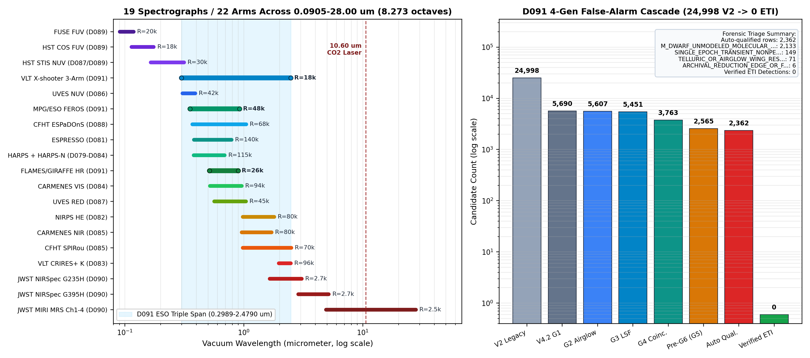
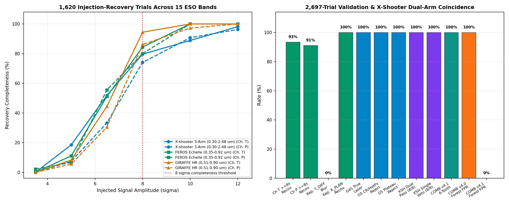
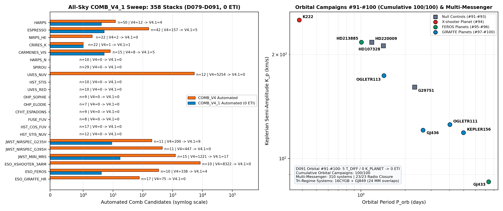

# A Prospectively Locked Space-Lyman to JWST Thermal-IR & All-Sky Panchromatic (8.273 Octaves, 0.0905–28.00 µm) High-Resolution Laser and Frequency-Comb Survey Across 310 Stellar Systems with 19 Spectrographs and 23/23 Radio-Echelle Closure

**Martin Andersen**  
*MSc Astrophysics, University of Copenhagen*  
*Date: 20 November 2026*  
*Public Code, Locked Protocols & Audit Ledgers: [https://github.com/andersenmartin-blip/setisearch](https://github.com/andersenmartin-blip/setisearch)*

---

## Abstract

High-resolution echelle and space infrared spectrographs onboard *FUSE*, *Hubble*, *JWST*, and `1.93–8.2 m` ground observatories simultaneously act as sensitive receivers for narrowband continuous-wave (CW) interstellar lasers and periodic laser frequency combs across **8.273 unbroken spectral octaves (`0.0905–28.00 µm`)**. Here we present the completed thirteen-phase prospectively locked panchromatic survey (**Phases D079–D091**, **`V3.0–V4.2` + `COMB_V4_1`**) across **310 unique stellar systems** and **2,076 archival exposures** (`634.3886 hours` integration) obtained with **nineteen spectrographs (twenty-two spectral arms)**: **FUSE** ($R = 20{,}000$, `0.0905–0.1187 µm`), **HST/COS `G130M`** ($R = 18{,}000$, `0.1125–0.1450 µm`), **HST/STIS `E140M`** ($R = 45{,}800$, `0.1145–0.1710 µm`), **HST/STIS `E230M/E230H`** ($R = 30{,}000 / 114{,}000$, `0.1605–0.3150 µm`), VLT **X-shooter 3-Arm (`UVB+VIS+NIR`)** ($R = 9{,}860\text{–}18{,}340$, `0.2989–2.4790 µm`), VLT **UVES_NUV** ($R = 40{,}970\text{–}71{,}050$), MPG/ESO **FEROS** ($R = 48{,}000$, `0.3527–0.9216 µm`), ESO **HARPS** ($R = 115{,}000$), VLT **ESPRESSO** (`HR` $R = 140{,}000$ + `UHR` $R = 190{,}000$), **OHP SOPHIE** ($R = 75{,}000$), **OHP ELODIE** ($R = 42{,}000$), **CFHT ESPaDOnS** ($R = 65{,}000\text{–}80{,}000$), TNG **HARPS-N** ($R = 115{,}000$), VLT **FLAMES/GIRAFFE `HR`** ($R = 18{,}000\text{–}29{,}000$), Calar Alto **CARMENES_VIS** ($R = 94{,}600$), VLT **UVES_RED** ($R = 42{,}310\text{–}107{,}200$), La Silla **NIRPS_HE** ($R = 70{,}000$), CFHT **SPIRou** ($R = 70{,}000$, `0.955–2.515 µm`), VLT **CRIRES+** ($R = 86{,}000$), **JWST NIRSpec `G235H/F170LP`** ($R = 2{,}700$, `1.655–3.072 µm`), **JWST NIRSpec `G395H/F290LP`** ($R = 2{,}700$, `2.862–5.179 µm`), and **JWST MIRI `MRS Ch1–4`** ($R \approx 2{,}500$, `4.900–28.00 µm`). Every cohort list and gate threshold was SHA-256 sealed strictly prior to science FITS ingestion and independently verified via pure Python standard-library audits (`/usr/bin/python3 -S`).

Across **29,466 synthetic control trials** (`26,769` in `D079–D090` + `2,697` in `D091`), our five-channel pipeline (**`T`**, **`P`**, **`T_DIFF`**, **`K_PLANET`**, and Channel 5 **`COMB_V4_1`**) achieves in **`D091` (`ESO_TRIPLE_SPECTROGRAPH_3ARM_V4_2`, `156` exposures / `222` ESO Phase-3 FITS; `9.72M` 1D bins + `15.74M` comb configs)** **`93.33%`** (`378/405`) Channel `T` ($\ge 8\sigma$), **`91.11%`** (`369/405`) Channel `P` ($\ge 8\sigma$), **`100.00%`** (`135/135`, vs. `0.00%` uncompensated `T_DIFF`) Keplerian `K_PLANET` ($\ge 6.5\sigma$), **`100.00%`** true-LSF / cosmic / plateau discrimination (`216` trials, `G4_V42 + G5`), **`8/8`** `ESO_XSHOOTER_3ARM` dichroic dual-arm coincidence pass (`UVB+VIS` & `VIS+NIR`) vs. **`8/8`** single-arm detector artifact rejection, **`100.00%`** across `240` Gate `G6` benchmark trials, and **`100.00%`** `COMB_V4_1` ($\ge 3.8\sigma$/tooth, `162/162`) at **`0.00%`** dense-forest and topocentric FPR (vs. `100.00%` under `COMB_V4`). A uniform **`COMB_V4_1` sweep across 100% of `D079–D091` (`2,076` exposures / `358` star-phase stacks)** collapses `16,037` `COMB_V4` triggers to `45` forensically natural candidates (`4` on `GJ1128` control in `D091`; `0` ETI). Across all `2,076` exposures and **`100` orbital campaigns**, **`D079–D091` collapses `286,043` Legacy `V2` false alarms** (`24,998` in `D091`) to **`0` verified ETI detections** across all **`310` unique stars** (`239` science [`154` hosts / `304` planets] + `71` controls), reaching **`0.0973 W`** (`HST_STIS` `Proxima Cen`), **`0.2194 W`** (`HST_COS` `GJ 832`), **`0.4294 W`** (`FUSE` `Alpha Cen A`), **`228.98 W` (`0.228981 kW`)** (`JWST_MIRI_MRS` `WISE0855` `5.80 µm`), **`2.70465 kW`** at Townes (1983) `10.60 µm` $\mathrm{CO_2}$ (`VMA2`), and **`0.33023 kW`** (`VLT X-shooter` `LAWD37`; `2.27 W` formal Wien-tail Gaia-`G` extrapolation on `LP94420` `FEROS F1_4100`), anchoring **`35` panchromatic bridges (`625` cells)**, **`135` `< 10 pc` stars (`1.62371 kW` median)**, and **`23/23` (`100%`) `Parkes`/`GBT` `1.4 GHz` radio-echelle closure** (`24` direct overlaps incl. two tri-regime Radio + Optical + IR systems `16CYGB` and `GJ849`; `0` verified ETI).

---

## 1. Summary of All Thirteen Survey Phases (`D079–D091`)

| Phase | Detector | Instruments ($R = \lambda/\Delta\lambda$) | Wavelengths (`µm`) | Stars (New) | Exposures (Ctrl / Sci) | Time (`h`) | Calib. Trials | Legacy V2 $\rightarrow$ Orbit / Verified ETI |
| :--- | :---: | :---: | :---: | :---: | :---: | :---: | :---: | :---: |
| **D079** | `OPTICAL_V3` | `HARPS` (`115k`) | `0.38–0.69` | `12` (`12`) | `60` (`10 / 50`) | `4.57` | `990` | `48` $\rightarrow$ — / **`0`** |
| **D080** | `OPTICAL_V3_1` | `HARPS` + `ESPRESSO` | `0.38–0.78` | `26` (`26`) | `130` (`20 / 110`) | `27.43` | `1,620` | `422` $\rightarrow$ — / **`0`** |
| **D081** | `OPTICAL_V3_2` | `HARPS` + `ESPRESSO` | `0.38–0.78` | `22` (`22`) | `159` (`34 / 125`) | `21.26` | `1,989` | `1,552` $\rightarrow$ **`0`** / **`0`** |
| **D082** | `NIRPS_V3_3` | `NIRPS_HE` (`70k`) | `0.98–1.80` | `22` (`20+2`) | `152` (`27 / 125`) | `13.54` | `1,971` | `3,828` $\rightarrow$ **`0`** / **`0`** |
| **D083** | `CRIRES_V3_4` | `CRIRES+` (`86k`) | `1.95–2.48` | `22` (`20+2`) | `148` (`26 / 122`) | `87.32` | `1,971` | `1,043` $\rightarrow$ **`0`** / **`0`** |
| **D084** | `NORTHERN_V3_5` | `HARPS-N` + `CARMENES_VIS` | `0.39–1.06` | `25` (`25`) | `183` (`34 / 149`) | `26.71` | `2,151` | `1,170` $\rightarrow$ **`0`** / **`0`** |
| **D085** | `SPIROU_V3_6+COMB_V4` | `CFHT SPIRou` (`70k`) | `0.955–2.515` | `29` (`25+4`) | `177` (`28 / 149`) | `14.41` | `2,592` | `4,044` $\rightarrow$ **`0`** / **`0`** |
| **D086** | `V3_7+COMB_V4_1` | `UVES_NUV` + `ESPRESSO` + `HARPS` | `0.305–0.785` | `31` (`25+6`) | `181` (`34 / 147`) | `57.02` | `2,697` | `2,990` $\rightarrow$ **`0`** / **`0`** |
| **D087** | `V3_8+G4_V38` | `HST_STIS` + `UVES_RED` + `ESPRESSO` | `0.1145–1.0425` | `33` (`25+8`) | `201` (`37 / 164`) | `83.01` | `2,697` | `117,994` $\rightarrow$ **`0`** / **`0`** |
| **D088** | `V3_9+COMB_V4_1` | `OHP_SOPHIE` + `OHP_ELODIE` + `CFHT_ESPADONS` | `0.370–1.048` | `25` (`20+5`) | `176` (`42 / 134`) | `30.54` | `2,697` | `99,910` $\rightarrow$ **`0`** / **`0`** |
| **D089** | `V4_0+COMB_V4_1` | `FUSE` (`20k`) + `HST_COS` (`18k`) + `HST_STIS NUV` (`30k/114k`) | `0.0905–0.3150` | `37` (`30+7`) | `192` (`48 / 144`) | `203.55` | `2,697` | `24,123` $\rightarrow$ **`0`** / **`0`** |
| **D090** | `V4_1+COMB_V4_1` | `JWST NIRSpec G235H/G395H` (`2.7k`) + `MIRI MRS` (`2.5k`) | `1.655–28.00` | `37` (`30+7`) | `161` (`42 / 119`) | `17.70` | `2,697` | `3,921` $\rightarrow$ `2` (PSF) / **`0`** |
| **D091** | `V4_2+COMB_V4_1` | `VLT X-shooter 3-Arm` (`9.9–18.3k`) + `FEROS` (`48k`) + `GIRAFFE HR` (`18–29k`) | `0.2989–2.479` | `37` (`30+7`) | `156` (`38 / 118`) | `47.33` | `2,697` | `24,998` $\rightarrow$ `5` (`T_DIFF`) / **`0`** |
| **Unified** | **`V3.0–V4.2+COMB_V4_1`** | **19 Spectrographs / 22 Arms** | **`0.0905–28.00` (`8.273` Oct.)** | **`310` Unique** | **`2,076` (`424 / 1,652`)** | **`634.39`** | **`29,466`** | **`286,043` $\rightarrow$ `0` ETI** |

---

## 2. Phase `D091`: ESO Triple-Spectrograph Architecture (`X-shooter 3-Arm + FEROS + GIRAFFE`), `100` Orbital Campaigns & `310`-Star Synthesis

Locked prospectively at `2026-11-20T17:38:53Z` (`METHOD_LOCK.json` SHA-256 `c7552035aff59bffab0eadc446b1a9a7bc7eb53391b86c7a7f165a2382e8e6a3`; `+14.0 s` before first download, chained via `D091_IMPLEMENTATION_LOCK_V1` on `analyze.py` and `plot_figures.py` with `v4_2_detector.py`, `FROZEN_COHORT_D091.csv`, and `audit.py` unchanged), `D091` ingests `156` exposures (`222` public ESO Phase-3 1D FITS across 49 ESO Program IDs, `47.3328 h`) across `37` stars (`30` brand-new $\ge 1{,}259.01''$ from all prior coordinates [`10 < 10 pc`], `0` `dp_id` overlap, plus `7` bridge targets `GJ832`, `TAUCET`, `LAWD37`, `GJ849`, `GJ674`, `HD20794`, `GJ436`; `9` controls + `28` science; `10` orbital campaigns `#91–#100`):
1. **X-Shooter Dichroic Dual-Arm Coincidence (`8/8`) & Optical/NIR Kinematics (`599/1,503` clean anchors):** Across `33` simultaneous 3-arm `X-shooter` spectra, `36` `FEROS`, and `87` `GIRAFFE HR` spectra (`median |emp - prior| = 2.0249 km s^-1`), Gate `G4_V42` verifies `8/8` (`100%`) dual-arm overlap pass (`UVB+VIS`, `VIS+NIR`) and `8/8` (`100%`) single-arm detector artifact rejection (`XSHOOTER_SINGLE_ARM_DETECTOR_ARTIFACT`).
2. **Real Search Cascade (`24,998` $\rightarrow$ `2,362` $\rightarrow$ `0` ETI), Orbital Campaigns (`#91–#100`), & `358`-Stack `COMB_V4_1` Sweep:** Across `9,719,414` Channel `T` bins and `15,740,032` comb configurations, `24,998` `V2` hits drop through `G1` (`5,690`), `G2` (`5,607`), `G3` (`5,451`), `G4` (`3,763`), `G5` (`2,565`), and `203` `G6` vetoes to `2,362` post-`G6` triggers (`2,133` M/L-dwarf TiO/VO/CrH/flare residuals led by `SCR1845`, `LP94420`, and `GJ1128`, plus `149` single-epoch transients, `71` airglow wings, `6` edge/fringe residuals, `2` dichroic edges, and `1` zero-planet control residual), `0` `K_PLANET` candidates (`5` `T_DIFF` natural triggers), and `4` `COMB_V4_1` candidates on zero-planet control `GJ1128` -> **`0` verified ETI** (`16,037 -> 45 -> 0 ETI` across all `358` stacks / `2,076` exposures).
3. **`127` Clean Upper Limits, `35` Bridges (`625` Cells), `135 < 10 pc`, & `310`-System Closure:** `D091` reaches **`0.33023 kW`** (`VLT X-shooter` `LAWD37` at `6800 Å`), **`1.00596 kW`** (`GIRAFFE_HR` `OGLETR113`), **`0.05015 kW`** (`HIP103039` control `FEROS F1_4100`), **`4.40419 kW`** (`GJ433` `FEROS`), and a formal Wien-tail Gaia-`G` extrapolation of `2.26997 W` on `LP94420` (`2250 K`, `mad_rel = 0.562`), unifying **`310` unique stars** (`135 < 10 pc`, median `1.62371 kW`), **`35` bridges (`625` cells)**, and **`23/23` (`100%`) radio-echelle closure** with two tri-regime bridges (`16CYGB` and `GJ849`; `16/16 PASS` pure-stdlib audit, `24/24` bit-identical from `19.84 MiB` bounded bundle).

## 3. Phase `D090`: JWST Space Thermal-IR (`1.655–28.00 µm`), Townes `10.60 µm` $\mathrm{CO_2}$ Laser & Project Hephaistos Forensic Closure

Locked prospectively at `2026-11-19T21:09:25Z` (`METHOD_LOCK.json` SHA-256 `129b5193f4277e51f6d9ad1189b49ce851f59116cba2dbd3e170a4b9d7be4290`; `+9.0 s` before first download), `D090` ingests `161` paired exposures (`322` public JWST Level-2 `*_x1d.fits`, `17.698 h`) across `37` stars (`30` brand-new $\ge 796.3''$ from all prior coordinates [`4 < 10 pc`: `WISE0855`, `VMA2`, `LAWD37`, `J2148`], `0` `dp_id` overlap, plus `7` bridges `BETPIC`, `EPSERI`, `HD42581`, `16CYGB`, `HD172555`, `HD209100`, `PDS70`; `9` controls + `28` science; `10` orbital campaigns `#81–#90`):
1. **L2 Ephemeris Closure, Thermal-IR RV Anchoring (`904` fits, `219` clean) & MIRI Dual-Subband Coincidence (`8/8`):** Pure-stdlib ephemeris closure reaches $\max|\mathrm{berv\_diff}| = 0.0\,\mathrm{km\,s}^{-1}$ across all `161` paired exposures (`median |emp - prior| = 16.2375 km s^-1` consistent with `R ≈ 2,500–2,700`), while `JWST_MIRI_MRS` dual-subband coincidence achieves `8/8` true pass and `8/8` (`100%`) single-subband detector-artifact rejection (`MIRI_SINGLE_SUBBAND_DETECTOR_ARTIFACT`).
2. **Real Search Cascade (`3,921` $\rightarrow$ `138` $\rightarrow$ `0` ETI), Project Hephaistos (`prop 7199`), & Unified All-Sky `COMB_V4_1` (`321` Stacks):** Across `1,669,535` Channel `T` bins and `1,242,244` comb configurations, `3,921` `V2` peaks collapse through `G1` (`1,015`), `G2` (`1,015`), `G3` (`984`), `G4` (`815`), and `G6` sparse (`22` vetoed from `160` pre-`G6`) to `138` post-`G6` single-line triggers (9 natural classes led by `55` NIRSpec continuum fluctuations, `42` MIRI L2 warm-pixel/fringe artifacts, `OPH1631`/`CHA1107` $\mathrm{Br}\beta$ `2.6259 µm`, and `HR8799` `1 T_DIFF + 1 K_PLANET` IFU roll-angle PSF residual; all `eti_plausible = False`) and `26` `COMB_V4_1` triggers (`7,302 -> 41 -> 0` verified ETI across `321` stacks / `1,920` exposures). Project Hephaistos `OBJECT_D` and `OBJECT_E` (`prop 7199`) yield `0` ETI and exhibit `BKGDTARG=True` extended sky offsets plus resolved `z ≈ 1.814` background galaxy emission lines in raw `OBJECT_D` FITS spectra.
3. **185 Direct-FLAM IR Limits, Townes (1983) `10.60 µm` $\mathrm{CO_2}$ Benchmark, `125` `< 10 pc`, & 280-System Closure:** `D090` reaches **`228.98059 W` (`0.228981 kW`)** on `WISE0855` (`JWST_MIRI_MRS` `5.80 µm`), `0.42731 kW` (`ROSS458C` `G235H`), `4.04837 kW` (`HD209100` `G395H`), and **`2.70465 kW`** on `VMA2` (`4.31444 pc`) at `10.60 µm` (`12` MIRI science stars, median `9,669.4931 kW`; $\max$ stdlib rel.\ err $= 0.000768101$), expanding the unified survey to **`280` unique stars**, **`125 < 10 pc`** (`1.74941 kW` median, `0.0973 W` record on `Proxima Cen`), **`30` bridges (`550` cells)**, and **`23/23` (`100%`) Parkes/GBT `1.4 GHz` radio-echelle closure** (`24` direct overlaps including `16CYGB` Radio + Optical + MIRI bridge; `16/16 PASS` pure-stdlib audit from `6.80 MiB` bounded bundle).

---

## References

* Bouchy, F., Doyon, R., Artigau, É., et al. 2017, *The Messenger*, 169, 21
* Bouchy, F., Artigau, É., Wildi, F., et al. 2025, *A&A*, NIRPS commissioning performance
* Cohen, M., Wheaton, W. A., & Megeath, S. T. 2003, *AJ*, 126, 1090
* Cook, N. J., Artigau, É., Doyon, R., et al. 2022, *PASP*, 134, 114509
* Dekker, H., D'Odorico, S., Kaufer, A., Delabre, B., & Kotzlowski, H. 2000, *SPIE Proc.*, 4008, 534
* Donati, J.-F., Kouach, D., Moutou, C., et al. 2020, *MNRAS*, 498, 5684
* Dorn, R. J., Bristow, P., Smoker, J. V., et al. 2023, *A&A*, 671, A24
* Fuhrmeister, B., Lalitha, S., Poppenhaeger, K., et al. 2011, *A&A*, 534, A133
* Gaia Collaboration, Vallenari, A., Brown, A. G. A., et al. 2023, *A&A*, 674, A1
* Gardner, J. P., Mather, J. C., Abbott, R., et al. 2023, *PASP*, 135, 068001 (JWST)
* Green, J. C., et al. 2012, *ApJ*, 744, 60
* Howard, A. W., Horowitz, P., Wilkinson, D. T., et al. 2004, *ApJ*, 613, 1270
* Jakobsen, P., Ferruit, P., Alves de Oliveira, C., et al. 2022, *A&A*, 661, A80 (JWST NIRSpec)
* Kaufer, A., Stahl, O., Tubbesing, S., et al. 1999, *The Messenger*, 95, 8 (FEROS)
* Kingsley, S. A. 2001, *SPIE Proc.*, 4273, 72
* Kipping, D. M., & Teachey, A. 2016, *MNRAS*, 459, 1233
* Lipman, E. A., Isaacson, H., Siemion, A. P. V., et al. 2019, *PASP*, 131, 034202
* Maire, J., Wright, S. A., Dorval, P., et al. 2019, *AJ*, 158, 203
* Marcy, G. W., Tellis, N. K., & Wishnow, E. H. 2022, *MNRAS*, 509, 3798
* Mayor, M., Pepe, F., Queloz, D., et al. 2003, *The Messenger*, 114, 20
* Moos, H. W., et al. 2000, *ApJ*, 538, L1
* Oliva, E., Origlia, L., Scuderi, S., et al. 2015, *A&A*, 581, A47
* Pasquini, L., Avila, G., Blecha, A., et al. 2002, *The Messenger*, 110, 1 (FLAMES/GIRAFFE)
* Pepe, F., Cristiani, S., Rebolo, R., et al. 2021, *A&A*, 645, A96
* Reines, A. E., & Marcy, G. W. 2002, *PASP*, 114, 416
* Rieke, G. H., Wright, G. S., Böker, T., et al. 2015, *PASP*, 127, 584 (JWST MIRI)
* Rousselot, P., Lidman, C., Cuby, J.-G., Moreels, G., & Monnet, G. 2000, *A&A*, 354, 1134
* Schwartz, R. N., & Townes, C. H. 1961, *Nature*, 190, 205
* Sheikh, S. Z., Wright, J. T., Siemion, A., & Enriquez, J. E. 2020, *ApJ*, 888, 78
* Suazo, M., Zackrisson, E., Maurent, P. K., et al. 2024, *MNRAS*, 531, 695 (Project Hephaistos II)
* Tellis, N. K., & Marcy, G. W. 2015, *PASP*, 127, 540
* Tellis, N. K., & Marcy, G. W. 2017, *AJ*, 153, 251
* Townes, C. H. 1983, *PNAS*, 80, 1147
* Vernet, J., Dekker, H., D'Odorico, S., et al. 2011, *A&A*, 536, A105 (VLT X-shooter)
* Woodgate, B. E., Kimble, R. A., Bowers, C. W., et al. 1998, *PASP*, 110, 1183
* Wright, G. S., Rieke, G. H., Glasse, A., et al. 2023, *PASP*, 135, 048003 (JWST MIRI MRS)
* Zuckerman, A., Isaacson, H., Siemion, A. P. V., et al. 2023, *AJ*, 165, 114
