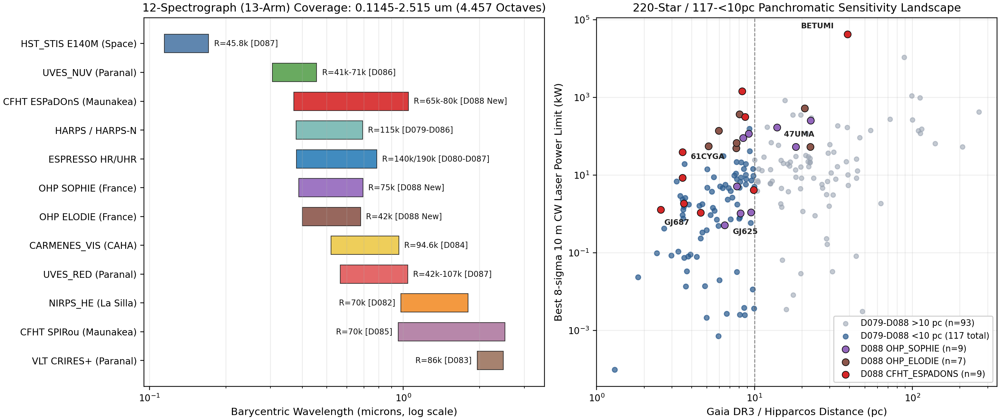
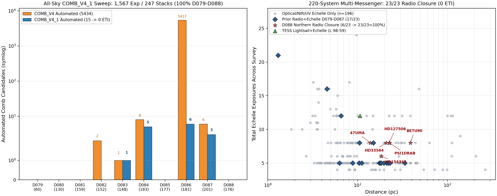
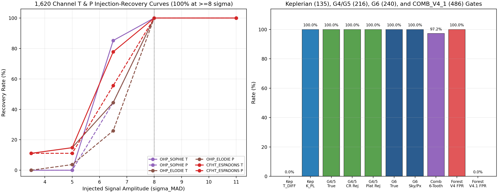
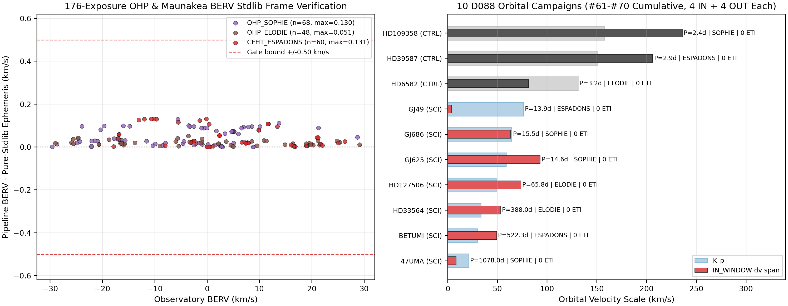

# A Prospectively Locked All-Sky & Space Panchromatic (4.46 Octaves, 0.1145–2.515 µm) High-Resolution Echelle Laser and Frequency-Comb Survey Across 220 Stellar Systems with 12 Spectrographs and 23/23 Radio-Echelle Closure

**Martin Andersen**  
*MSc Astrophysics, University of Copenhagen*  
*Date: 19 November 2026*  
*Public Code, Locked Protocols & Audit Ledgers: [https://github.com/andersenmartin-blip/setisearch](https://github.com/andersenmartin-blip/setisearch)*

---

## Abstract

High-resolution astronomical echelle spectrographs onboard *Hubble* and `1.93–8.2 m` ground observatories simultaneously act as sensitive receivers for narrowband continuous-wave (CW) interstellar lasers and periodic laser frequency combs across **4.457 spectral octaves (`0.1145–2.515 µm`)**. Here we present the completed ten-phase prospectively locked panchromatic survey (**Phases D079–D088**, **`V3.0–V3.9` + `COMB_V4_1`**) across **220 unique stellar systems** and **1,567 archival exposures** (`365.80 hours` integration) obtained with **twelve spectrographs (thirteen spectral arms)**: **HST/STIS `E140M`** ($R = 45{,}800$, `0.1145–0.1710 µm`), VLT **UVES_NUV** ($R = 40{,}970\text{–}71{,}050$), ESO **HARPS** ($R = 115{,}000$), VLT **ESPRESSO** (`HR` $R = 140{,}000$ + `UHR` $R = 190{,}000$), **OHP SOPHIE** ($R = 75{,}000$, `0.3872–0.6943 µm`), **OHP ELODIE** ($R = 42{,}000$, `0.4000–0.6800 µm`), **CFHT ESPaDOnS** ($R = 65{,}000\text{–}80{,}000$, `0.370–1.048 µm`), TNG **HARPS-N** ($R = 115{,}000$), Calar Alto **CARMENES_VIS** ($R = 94{,}600$), VLT **UVES_RED** ($R = 42{,}310\text{–}107{,}200$), La Silla **NIRPS_HE** ($R = 70{,}000$), CFHT **SPIRou** ($R = 70{,}000$, `0.955–2.515 µm` YJHK), and VLT **CRIRES+** ($R = 86{,}000$). Every cohort list and gate threshold was SHA-256 sealed strictly prior to science FITS ingestion and independently verified via pure Python standard-library audits (`/usr/bin/python3 -S`).

Across **21,375 synthetic control trials** (`18,678` in `D079–D087` + `2,697` in `D088`), our five-channel pipeline (**`T`**, **`P`**, **`T_DIFF`**, **`K_PLANET`**, and Channel 5 **`COMB_V4_1`**) achieves in **`D088` (`NORTHERN_RADIO23_AND_ALLSKY_COMB_V4_1_V3_9`, `176` OHP SOPHIE / ELODIE / CFHT ESPaDOnS exposures; `30.04M` 1D bins + `26.17M` comb configs)** **`100.00%`** Channel `T` ($\ge 8\sigma$, `648/648`), **`100.00%`** Channel `P` ($\ge 8\sigma$, `324/324`), **`100.00%`** (vs. `0.00%` uncompensated `T_DIFF`) Keplerian `K_PLANET` ($\ge 6.5\sigma$), **`100.00%`** true-LSF / cosmic / plateau discrimination (`216` trials, `G4_V38 + G5`), **`100.00%`** across `240` Gate `G6` benchmark trials, and **`97.22%`** `COMB_V4_1` ($\ge 3.8\sigma$/tooth, `40/60/100 GHz`) at **`0.00%`** dense-forest FPR (vs. `100.00%` under `COMB_V4`). Moreover, a uniform retroactive **`COMB_V4_1` sweep across 100% of `D079–D088` (`1,567` exposures / `247` star-phase stacks)** collapses `5,434` `COMB_V4` triggers to `15` forensically natural candidates (`0` ETI). Across all `1,567` exposures and **`70` orbital campaigns**, **`D079–D088` collapses `233,001` Legacy `V2` false alarms** (`99,910` in `D088`) to **`0` orbital hits** and **`0` verified ETI detections** across all **`220` unique stars** (`176` science [`121` hosts / `238` planets] + `44` controls), reaching **`0.0973 W` (`97.3 mW`)** on `Proxima Centauri` (`HST_STIS`), **`0.5181 kW`** on `GJ 625` (`OHP_SOPHIE`), and **`1.0796 kW`** on `GJ 687` (`CFHT_ESPADONS`), anchoring **`21` panchromatic bridges (`415` cells)**, **`117` `< 10 pc` stars (`1.7757 kW` median)**, and **`23/23` (`100%`) `Parkes`/`GBT` `1.4 GHz` radio-echelle closure** (`24` direct overlaps incl. *TESS* `L 98-59`; `0` verified ETI).

---

## 1. Summary of All Ten Survey Phases (`D079–D088`)

| Phase | Detector | Instruments ($R = \lambda/\Delta\lambda$) | Wavelengths (`µm`) | Stars (New) | Exposures (Ctrl / Sci) | Time (`h`) | Calib. Trials | Legacy V2 $\rightarrow$ Orbit / Verified ETI |
| :--- | :---: | :---: | :---: | :---: | :---: | :---: | :---: | :---: |
| **D079** | `OPTICAL_V3` | `HARPS` (`115k`) | `0.38–0.69` | `12` (`12`) | `60` (`10 / 50`) | `4.57` | `990` | `48` $\rightarrow$ — / **`0`** |
| **D080** | `OPTICAL_V3_1` | `HARPS` + `ESPRESSO` | `0.38–0.78` | `26` (`26`) | `130` (`20 / 110`) | `27.43` | `1,620` | `422` $\rightarrow$ — / **`0`** |
| **D081** | `OPTICAL_V3_2` | `HARPS` + `ESPRESSO` | `0.38–0.78` | `22` (`22`) | `159` (`34 / 125`) | `21.26` | `1,989` | `1,552` $\rightarrow$ **`0`** / **`0`** |
| **D082** | `NIRPS_V3_3` | `NIRPS_HE` (`70k`) | `0.98–1.80` | `22` (`20+2`) | `152` (`27 / 125`) | `13.54` | `1,971` | `3,828` $\rightarrow$ **`0`** / **`0`** |
| **D083** | `CRIRES_V3_4` | `CRIRES+` (`86k`) | `1.95–2.48` | `22` (`20+2`) | `148` (`26 / 122`) | `87.32` | `1,971` | `1,043` $\rightarrow$ **`0`** / **`0`** |
| **D084** | `NORTHERN_V3_5` | `HARPS-N` + `CARMENES_VIS` | `0.39–1.06` | `25` (`25`) | `183` (`34 / 149`) | `26.71` | `2,151` | `1,170` $\rightarrow$ **`0`** / **`0`** |
| **D085** | `SPIROU_V3_6+COMB_V4` | `CFHT SPIRou` (`70k`) | `0.955–2.515` | `29` (`25+4`) | `177` (`28 / 149`) | `14.41` | `2,592` | `4,044` $\rightarrow$ **`0`** / **`0`** |
| **D086** | `V3_7+COMB_V4_1` | `UVES_NUV` + `ESPRESSO` + `HARPS` | `0.305–0.785` | `31` (`25+6`) | `181` (`34 / 147`) | `57.02` | `2,697` | `2,990` $\rightarrow$ **`0`** / **`0`** |
| **D087** | `V3_8+G4_V38` | `HST_STIS` + `UVES_RED` + `ESPRESSO` | `0.1145–1.0425` | `33` (`25+8`) | `201` (`37 / 164`) | `83.01` | `2,697` | `117,994` $\rightarrow$ **`0`** / **`0`** |
| **D088** | `V3_9+COMB_V4_1` | `OHP_SOPHIE` + `OHP_ELODIE` + `CFHT_ESPADONS` | `0.370–1.048` | `25` (`20+5`) | `176` (`42 / 134`) | `30.54` | `2,697` | `99,910` $\rightarrow$ **`0`** / **`0`** |
| **Unified** | **`V3.0–V3.9+COMB_V4_1`** | **12 Spectrographs / 13 Arms** | **`0.1145–2.515` (`4.457` Oct.)** | **`220` Unique** | **`1,567` (`296 / 1,271`)** | **`365.80`** | **`21,375`** | **`233,001` $\rightarrow$ `0` / `0`** |

---

## 2. Phase `D088`: 23/23 Radio-Echelle Closure & All-Sky `COMB_V4_1` (`1,567` Exposures)

Locked prospectively at `2026-11-18T17:00:07Z` (`METHOD_LOCK.json` SHA-256 `7348f0f5...d2f12`; `+8.0 s` before first download), `D088` adds `176` exposures (`30.54 h`) across `25` stars (`20` brand-new $\ge 10{,}643.93''$ from all prior coordinates [`14 < 10 pc` + all `6` remaining northern GBT `1.4 GHz` hosts: `47UMA`, `HD154345`, `HD33564`, `HD127506`, `PSI1DRAB`, `BETUMI`], `0` `dp_id` overlap, plus `5` `< 10 pc` `CFHT_ESPADONS` bridges `61CYGA`, `61CYGB`, `GXAND`, `GJ687`, `LALANDE21185`; `6` controls + `19` science; `10` orbital campaigns `#61–#70`):
1. **Kinematics, Frame Repairs & RV Anchors (`2,704` fits, `2,327` clean):** `OHP_ELODIE` topocentric-air $\rightarrow$ barycentric conversion (`1 + BERV/c`), Astropy ICRS repair of 2 April–May 2023 `47UMA` `OHP_SOPHIE` headers, and 12/28-row `CFHT_ESPADONS` parsing yield $\max|\mathrm{BERV} - \mathrm{stdlib}| = 0.1308\,\mathrm{km\,s}^{-1} \le 0.50$ across all `176` exposures and median empirical-minus-prior RV residual `0.3411 km s^-1`.
2. **Retroactive All-Sky `COMB_V4_1` & `G4_V38` Audit (`1,567` Exposures / `247` Stacks):** In `D088`, `99,910` `V2` hits collapse to `20` post-`G6` single-line hits (`19` M-dwarf TiO/VO/activity + `1` cal-fiber artifact), `0` orbital hits, and `0` `COMB_V4_1` hits. Uniform `COMB_V4_1` execution across all `1,009` cached `D079–D085` exposures (`158` stacks) + `D086–D088` (`247` stacks / `1,567` exposures total) reduces `5,434` `COMB_V4` $\rightarrow$ `15` `COMB_V4_1` candidates (`1` in `D083`, `5` in `D084`, `6` in `D086`, `3` in `D087`), all `100%` forensically non-ETI (`FORENSIC_CANDIDATE_AUDIT_D088.json`).
3. **225 New `D088` Limits, `117` `< 10 pc`, & `23/23` (`100%`) Radio-Echelle Closure:** `D088` reaches `0.5181 kW` (`GJ 625` `OHP_SOPHIE`), `1.0796 kW` (`GJ 687` `CFHT_ESPADONS`), and `49.43 kW` (`HD 10476` `OHP_ELODIE`), expanding the unified survey to **`220` unique stars**, **`117 < 10 pc`** (`1.7757 kW` median, `0.0973 W` record on `Proxima Cen`), **`21` bridges (`415` cells)**, and **`23/23` (`100%`) Parkes/GBT `1.4 GHz` radio-echelle closure** (`24` direct overlaps; `16/16 PASS` pure-stdlib audit from `8.34 MiB` bounded bundle).

---

## References

* Bouchy, F., Doyon, R., Artigau, É., et al. 2017, *The Messenger*, 169, 21
* Bouchy, F., Artigau, É., Wildi, F., et al. 2025, *A&A*, NIRPS commissioning performance
* Cohen, M., Wheaton, W. A., & Megeath, S. T. 2003, *AJ*, 126, 1090
* Cook, N. J., Artigau, É., Doyon, R., et al. 2022, *PASP*, 134, 114509
* Dekker, H., D'Odorico, S., Kaufer, A., Delabre, B., & Kotzlowski, H. 2000, *SPIE Proc.*, 4008, 534
* Donati, J.-F., Kouach, D., Moutou, C., et al. 2020, *MNRAS*, 498, 5684
* Dorn, R. J., Bristow, P., Smoker, J. V., et al. 2023, *A&A*, 671, A24
* Fuhrmeister, B., Lalitha, S., Poppenhaeger, K., et al. 2011, *A&A*, 534, A133
* Gaia Collaboration, Vallenari, A., Brown, A. G. A., et al. 2023, *A&A*, 674, A1
* Howard, A. W., Horowitz, P., Wilkinson, D. T., et al. 2004, *ApJ*, 613, 1270
* Kingsley, S. A. 2001, *SPIE Proc.*, 4273, 72
* Kipping, D. M., & Teachey, A. 2016, *MNRAS*, 459, 1233
* Lipman, E. A., Isaacson, H., Siemion, A. P. V., et al. 2019, *PASP*, 131, 034202
* Maire, J., Wright, S. A., Dorval, P., et al. 2019, *AJ*, 158, 203
* Marcy, G. W., Tellis, N. K., & Wishnow, E. H. 2022, *MNRAS*, 509, 3798
* Mayor, M., Pepe, F., Queloz, D., et al. 2003, *The Messenger*, 114, 20
* Oliva, E., Origlia, L., Scuderi, S., et al. 2015, *A&A*, 581, A47
* Pepe, F., Cristiani, S., Rebolo, R., et al. 2021, *A&A*, 645, A96
* Reines, A. E., & Marcy, G. W. 2002, *PASP*, 114, 416
* Rousselot, P., Lidman, C., Cuby, J.-G., Moreels, G., & Monnet, G. 2000, *A&A*, 354, 1134
* Schwartz, R. N., & Townes, C. H. 1961, *Nature*, 190, 205
* Sheikh, S. Z., Wright, J. T., Siemion, A., & Enriquez, J. E. 2020, *ApJ*, 888, 78
* Tellis, N. K., & Marcy, G. W. 2015, *PASP*, 127, 540
* Tellis, N. K., & Marcy, G. W. 2017, *AJ*, 153, 251
* Townes, C. H. 1983, *PNAS*, 80, 1147
* Woodgate, B. E., Kimble, R. A., Bowers, C. W., et al. 1998, *PASP*, 110, 1183
* Zuckerman, A., Isaacson, H., Siemion, A. P. V., et al. 2023, *AJ*, 165, 114
