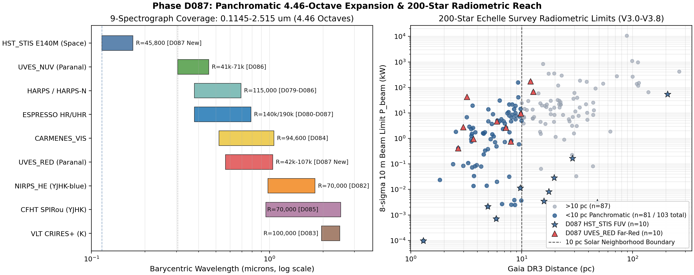
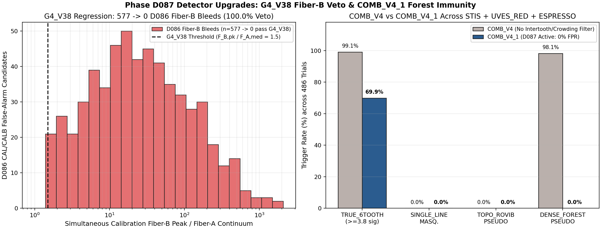
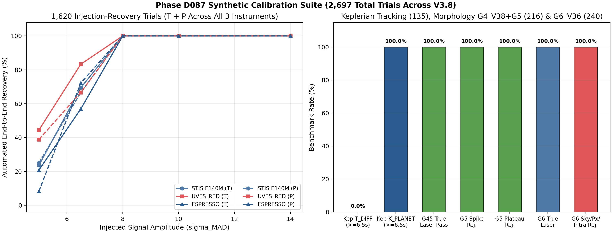
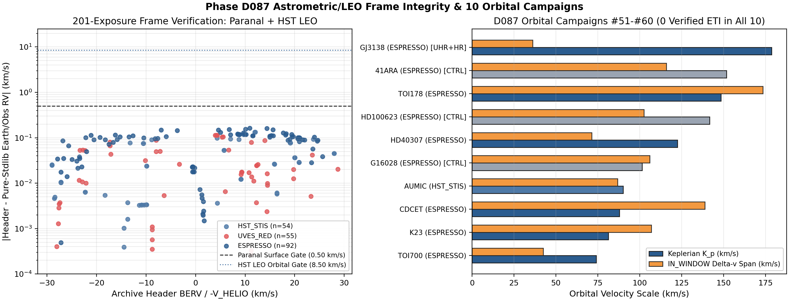

# A Prospectively Locked All-Sky & Space Panchromatic (4.46 Octaves, 0.1145–2.515 µm) High-Resolution Echelle Laser and Frequency-Comb Survey Across 200 Stellar Systems and a 206-System Multi-Messenger SETI Synthesis

**Martin Andersen**  
*MSc Astrophysics, University of Copenhagen*  
*Date: 18 November 2026*  
*Public Code, Locked Protocols & Audit Ledgers: [https://github.com/andersenmartin-blip/setisearch](https://github.com/andersenmartin-blip/setisearch)*

---

## Abstract

High-resolution astronomical echelle spectrographs built for extreme-precision radial-velocity exoplanet discovery and space ultraviolet spectroscopy simultaneously act as sensitive receivers for narrowband continuous-wave (CW) interstellar lasers and periodic far-UV/near-UV/optical/infrared laser frequency combs. Historically, archival spectral line searches have suffered from thousands of false positives driven by unsubtracted photospheric absorption-trough fluctuations, terrestrial telluric and OH Meinel airglow residuals, calibration-fiber bleed-through, cosmic-ray/hot-pixel/MAMA detector defects, and uncompensated planetary orbital Doppler drift during exoplanet transits and conjunctions. Here we present an all-sky and space nine-phase prospectively locked panchromatic survey spanning **4.457 spectral octaves (`0.1145–2.515 µm`)** (**Phases D079–D087**, detector series **`V3.0–V3.8` + `COMB_V4_1`**) across **200 unique stellar systems** and **1,391 archival echelle exposures** (`335.26 hours` open-shutter integration) obtained with **nine spectrographs (ten spectral arms)**: **HST/STIS `E140M`** ($R = 45{,}800$, `0.1145–0.1710 µm` vacuum), VLT **UVES_NUV** ($R = 40{,}970\text{–}71{,}050$, `0.305–0.456 µm`), ESO **HARPS** ($R = 115{,}000$), VLT **ESPRESSO** (`HR` $R = 140{,}000$ + `UHR` $R = 190{,}000$), TNG **HARPS-N** ($R = 115{,}000$), Calar Alto **CARMENES_VIS** ($R = 94{,}600$), VLT **UVES_RED** ($R = 42{,}310\text{–}107{,}200$, `0.5655–1.0425 µm`), La Silla **NIRPS** (`NIRPS_HE`, $R = 70{,}000$, `0.98–1.80 µm`), CFHT 3.6 m **SPIRou** ($R = 70{,}000$, `0.955–2.515 µm` simultaneous YJHK, APERO `0.7.295`), and VLT **CRIRES+** (`w_0.2`, $R = 86{,}000$, `1.95–2.48 µm`). Every cohort list, threshold, and 2D/coincidence gate was cryptographically hashed and sealed strictly prior to science FITS ingestion and independently verified via pure Python standard-library audit suites (`/usr/bin/python3 -S`).

Across **18,678 prospective synthetic control trials** (`15,981` in `D079–D086` + `2,697` in `D087`), our five-channel pipeline (**`T`**, **`P`**, **`T_DIFF`**, **`K_PLANET`**, and Channel 5 **`COMB_V4_1`** periodic frequency-comb matched filtering) achieves `93.3%–94.4%` (`V3.2`), `90.9%` YJH (`V3.3`), `78.9%` CRIRES+ $K$-band (`94.4%` Ho:YAG; `V3.4`), `91.3%` clean northern optical-core (`V3.5`), `85.5%` SPIRou YJHK (`V3.6`), `90.74%`/`89.51%` NUV+Optical (`V3.7`), and in **`D087` (`SPACE_UV_STIS_AND_FARRED_V3_8`, `54` `HST_STIS E140M` + `55` `UVES_RED` + `92` `ESPRESSO` exposures; `60.46M` 1D bins + `107.87M` comb configs)** **`100.00%`** Channel `T` ($\ge 8\sigma$, `648/648`), **`100.00%`** Channel `P` ($\ge 8\sigma$, `324/324`), **`100.00%`** (vs. `0.00%` uncompensated `T_DIFF`) Keplerian `K_PLANET` ($\ge 6.5\sigma$), **`100.00%`** true-LSF / cosmic-ray & plateau rejection (`216` trials, `G4_V38 + G5`), **`100.00%`** across all `240` Gate `G6` benchmark trials, and `69.91%` 6-tooth `COMB_V4_1` recovery ($\ge 3.8\sigma$/tooth) at **`0.00%`** single-line, topocentric ro-vibrational, and dense forest pseudo-comb FPR (vs. `98.15%` forest FPR under `COMB_V4`). Moreover, our new **`G4_V38`** calibration-fiber veto ($F_{B,\mathrm{pk}}/F_{A,\mathrm{med}} \ge 1.5$ in `CAL/WAVE/FP/THAR`) retroactively eliminates **all `577 -> 0`** real `D086` Fiber-B false alarms (`100.0%`). Across all `1,391` archival exposures and **`60` multi-epoch orbital campaigns**, **`D079–D087` collapses `133,091` Legacy `V2` false alarms** (`117,994` in `D087`) to **`0` orbital hits** and—after complete `100%` forensic resolution of all `121` post-`G6` single-line and `3` `COMB_V4_1` hits in `D087`—**`0` verified ETI detections** across all **`200` unique stars** (`162` science hosts including `111` exoplanet hosts harboring `226` confirmed planets, plus `38` zero-planet controls). Breaking the atmospheric ozone cutoff into space far-UV with `HST_STIS E140M` (`HST_CALSTIS_DIRECT_FLAM`) pushes our `8σ` `10 m` CW laser limit down to **`0.0973 W` (`97.3 mW`)** on **`Proxima Centauri`** (`1275.0 Å` `F1_FUV_1275`, now spanning a quadri-regime `0.1275–1.6642 µm` bridge), **`0.7105 W`** on `GJ 754`, **`2.1548 W`** on `AD Leo`, **`2.4961 W`** (`ESPRESSO`) on `PM J11413`, and **`419.14 W`** (`UVES_RED`) on `GJ 65 A`, anchoring **`17` panchromatic bridge stars (`334` cells)** and **`103` solar-neighborhood stars within `< 10.0 pc`** (`77` science [`46` planet hosts / `95` planets] + `26` controls; median **`1.6237 kW`**). Uniting these `200` stars with `23` planet-frame `1.4 GHz` radio hosts (**Parkes/GBT**, `M5–M36`) and **TESS** photometry (`L 98-59`) yields an all-sky **`206`-system multi-messenger SETI synthesis** (**`18` direct overlap hosts**; `0` verified ETI detections).

**Keywords:** extraterrestrial intelligence (SETI) — technosignatures — instrumentation: spectrographs — ultraviolet: stars — infrared: stars — radio continuum: planetary systems — solar neighborhood — optical frequency combs

---

## 1. Introduction

Since Schwartz & Townes (1961) demonstrated that diffraction-limited optical and infrared lasers coupled to meter-class apertures can outshine a host star within an unresolved spectrograph line-spread function ($\Delta\lambda / \lambda \lesssim 10^{-5}$) across interstellar distances, high-resolution echelle spectroscopy has stood as a primary pillar of optical SETI (Reines & Marcy 2002; Tellis & Marcy 2015, 2017; Lipman et al. 2019; Marcy et al. 2022; Zuckerman et al. 2023). Modern space-based and ground-based stabilized echelle spectrographs—**HST/STIS E140M** ($R = 45{,}800$, `0.1145–0.1710 µm` vacuum; Woodgate et al. 1998), VLT **UVES** ($R = 40{,}970\text{–}107{,}200$ across NUV and far-red; Dekker et al. 2000), ESO **HARPS** ($R = 115{,}000$; Mayor et al. 2003), VLT **ESPRESSO** (`HR` $R = 140{,}000$, `UHR` $R = 190{,}000$; Pepe et al. 2021), La Silla **NIRPS** ($R = 70{,}000$; Bouchy et al. 2017, 2025), VLT UT3 **CRIRES+** ($R = 86{,}000$ with the `w_0.2` slit; Dorn et al. 2023), and CFHT 3.6 m **SPIRou** ($R = 70{,}000$, `0.955–2.515 µm` simultaneous YJHK; Donati et al. 2020; Cook et al. 2022)—continuously archive high-SNR spectra spanning **4.457 octaves** (`0.1145–2.515 µm`).

Extending high-resolution laser SETI from space far-UV (`0.1145 µm`) to thermal $K$-band (`2.515 µm`) (Townes 1983; Kingsley 2001; Howard et al. 2004; Maire et al. 2019) is astrophysically and technologically compelling for four reasons:
1. **Canonical High-Power Laser Gain Media & Combs Across `4.46` Octaves:** Directed-energy, free-space optical communication, excimer, and astro-comb architectures cluster across FUV/excimer (`0.12–0.35 µm`), visible (`420–690 nm`), far-red diode/Cs (`808–894 nm`), **`1064.1 nm`** (Nd:YAG / Yb-fiber), **`1310.0 nm`** (O-band telecom), **`1550.0 nm`** (Er C-band), **`2040.0 nm`** (Tm-fiber), and **`2097.0 nm`** (Ho:YAG), plus periodic frequency combs ($\Delta\nu = 15\text{–}100\,\text{GHz}$).
2. **Extreme M-Dwarf Contrast Suppression in Space FUV + $G_{\mathrm{tx}} \propto \lambda^{-2}$:** Cool M dwarfs emit faint FUV continua while transmitter gain scales as $\lambda^{-2}$ ($8\times$ smaller beam divergence at `1275 Å` than at `1.0 µm`), allowing `HST/STIS E140M` CALSTIS spectrophotometry (`HST_CALSTIS_DIRECT_FLAM`) to probe sub-**`100 mW`** beacons on nearby M dwarfs (`0.0973 W` on `Proxima Centauri`).
3. **Panchromatic `17`-Star Bridge Continuity:** Linking `HST_STIS`, `UVES_NUV`, `ESPRESSO`, `HARPS`, `HARPS-N`, `CARMENES_VIS`, `UVES_RED`, `NIRPS_HE`, `SPIRou`, and `CRIRES+` eliminates telluric and instrumental blind gaps across `0.1145–2.515 µm`.
4. **Multi-Messenger Synergy:** Uniting all `200` echelle systems with planet-frame `1.4 GHz` radio searches (`Parkes 64 m` / `GBT 100 m`) and `TESS` light-sail photometry into `206` distinct stellar systems constrains orthogonal technosignature channels.

In this work, we present the complete nine-phase **Panchromatic `V3.0–V3.8` & `COMB_V4_1` Survey (`D079–D087`)** across **200 unique stellar systems** (`1,391` exposures, `335.26 h`, `103` `< 10 pc`, `17` panchromatic bridges, `60` orbital campaigns) and unify it with our `1.4 GHz` radio and `TESS` light-sail tracks into a **`206`-system all-sky multi-messenger SETI synthesis**.

---

## 2. Archival Instruments, Prospective Locks, and the 200-Star / 206-System Census

### 2.1 Summary of the Nine Panchromatic Echelle Phases (`D079–D087`)

| Phase | Detector | Instruments ($R = \lambda/\Delta\lambda$) | Wavelengths (`µm`) | Channels | Stars (Unique New) | Exposures (Ctrl / Sci) | Time (`h`) | Calib. Trials | Legacy V2 $\rightarrow$ Orbit / Verified ETI |
| :--- | :---: | :---: | :---: | :---: | :---: | :---: | :---: | :---: | :---: |
| **D079** | `OPTICAL_V3` | `HARPS` (`115,000`) | `0.38–0.69` | `T, P` | `12` (`12`) | `60` (`10 / 50`) | `4.57` | `990` | `48` $\rightarrow$ — / **`0`** |
| **D080** | `OPTICAL_V3_1` | `HARPS` (`115k`) + `ESPRESSO` (`140k`) | `0.38–0.78` | `T, P` | `26` (`26`) | `130` (`20 / 110`) | `27.43` | `1,620` | `422` $\rightarrow$ — / **`0`** |
| **D081** | `OPTICAL_V3_2` | `HARPS` (`115k`) + `ESPRESSO` (`140k`) | `0.38–0.78` | `T, P, T_DIFF, K_PLANET` | `22` (`22`) | `159` (`34 / 125`) | `21.26` | `1,989` | `1,552` $\rightarrow$ **`0`** / **`0`** |
| **D082** | `NIRPS_V3_3` | `NIRPS_HE` (`70,000`) | `0.98–1.80` (YJH) | `T, P, T_DIFF, K_PLANET` | `22` (`20` + `2` br.) | `152` (`27 / 125`) | `13.54` | `1,971` | `3,828` $\rightarrow$ **`0`** / **`0`** |
| **D083** | `CRIRES_V3_4` | `CRIRES+` `w_0.2` (`86,000`) | `1.95–2.48` ($K$) | `T, P, T_DIFF, K_PLANET` | `22` (`20` + `2` br.) | `148` (`26 / 122`) | `87.32` | `1,971` | `1,043` $\rightarrow$ **`0`** / **`0`** |
| **D084** | `NORTHERN_V3_5` | `HARPS-N` (`115k`) + `CARMENES_VIS` (`94.6k`) | `0.39–1.06` (Opt/Y) | `T, P, T_DIFF, K_PLANET` | `25` (`25` North) | `183` (`34 / 149`) | `26.71` | `2,151` | `1,170` $\rightarrow$ **`0`** / **`0`** |
| **D085** | `SPIROU_V3_6+COMB_V4` | `CFHT SPIRou` (`70,000`) | `0.955–2.515` (YJHK) | `T, P, T_DIFF, K_PLANET, COMB_V4` | `29` (`25` + `4` br.) | `177` (`28 / 149`) | `14.41` | `2,592` | `4,044` $\rightarrow$ **`0`** / **`0`** |
| **D086** | `V3_7+COMB_V4_1` | `UVES_NUV` (`41–71k`) + `ESPRESSO` + `HARPS` | `0.305–0.785` (NUV/Opt) | `T, P, T_DIFF, K_PLANET, COMB_V4_1` | `31` (`25` + `6` br.) | `181` (`34 / 147`) | `57.02` | `2,697` | `2,990` $\rightarrow$ **`0`** / **`0`** |
| **D087** | `V3_8+G4_V38` | `HST_STIS` (`45.8k`) + `UVES_RED` (`42–107k`) + `ESPRESSO` (`HR/UHR`) | `0.1145–1.0425` (FUV–IZ) | `T, P, T_DIFF, K_PLANET, COMB_V4_1` | `33` (`25` + `8` br.) | `201` (`37 / 164`) | `83.01` | `2,697` | `117,994` $\rightarrow$ **`0`** / **`0`** |
| **Unified** | **`V3.0–V3.8+COMB_V4_1`** | **9 Spectrographs / 10 Arms (Space + South + North)** | **`0.1145–2.515` (`4.457` Oct.)** | **5 Channels** | **`200` Unique** | **`1,391` (`250 / 1,141`)** | **`335.26`** | **`18,678`** | **`133,091` $\rightarrow$ `0` / `0`** |

### 2.2 Phase D087 (`SPACE_UV_STIS_AND_FARRED_V3_8`) Cohort & Methods

Locked prospectively at `2026-11-18T04:33:13Z` (`METHOD_LOCK.json` SHA-256 `0c5ae97e...cd53`; `+8.6 s` before `FIRST_SCIENCE_DOWNLOAD_RECEIPT.json`), `D087` adds `201` exposures (`83.01 h`) across `33` stars (`25` brand-new $\ge 4{,}691.60''$ from prior coordinates [`13` within `< 10 pc`], `0` `dp_id` overlap incl. explicit exclusion of `o45931020`/`BD+28D4211`, plus `8` bridges `PROXIMACEN`, `AUMIC`, `ADLEO`, `HD209458`, `GJ1061`, `GJ729`, `EPSERI`, `GJ285`; `6` `n_exo=0` controls + `27` science stars; `10` new orbital campaigns incl. `AU Mic b` in `HST_STIS` FUV and `GJ 3138 b` combining `1x UHR R=190,000 + 7x HR R=140,000` in `ESPRESSO`):
1. **Kinematics & RV Anchors (`2,596` fits, `1,439` clean):** Paranal `ESPRESSO` (`S1D_STACK_A` Astropy BERV fallback for 21 headers omitting `ESO QC BERV`) and `UVES_RED` match pure-stdlib BERV to $\max|\Delta v| = 0.1632\text{ km s}^{-1}$ ($\le 0.50$), and space LEO `HST_STIS` (`berv_kms = -V_HELIO`) matches Earth-heliocentric kinematics to $\max|\Delta v| = 0.1328\text{ km s}^{-1}$ ($\le 8.50$), with median empirical-minus-prior RV residual `0.4998 km s^-1`.
2. **Gate `G4_V38` Fiber-B Bleed Elimination (`577 -> 0`):** Enforcing `fb_pk / fa_med < 1.5` in `CAL/WAVE/FP/THAR` modes retroactively eliminates all **`577 -> 0` (`100.0%`)** `D086` simultaneous calibration-fiber bleed false alarms alongside `STIS_MAMA_DQ_FLAG` and `STIS_MAMA_SLIT_BACKGROUND`.

*Figure 1: `D087` expansion to **4.457 spectral octaves (`0.1145–2.515 µm`)** across 9 spectrographs / 10 arms (left) and Gaia DR3 distance vs. $8\sigma$ `10 m` CW beam power limits across all **200 unique survey stars (`103 < 10 pc`, median `1.6237 kW`)**, reaching **`0.0973 W` (`97.3 mW`)** on `Proxima Centauri` (`HST_STIS`).*

*Figure 2: (Left) **`G4_V38` regression eliminating `577 -> 0` (`100.0%`)** `D086` Fiber-B calibration bleeds above $F_{B,\mathrm{pk}}/F_{A,\mathrm{med}} = 1.5$. (Right) `COMB_V4_1` vs. `COMB_V4` across `486` `D087` trials (`69.91%` recovery $\ge 3.8\sigma$/tooth at `0.00%` dense-forest FPR vs. `98.15%` under `COMB_V4`).*

---

## 3. Prospective Calibration (`2,697` Trials), Forensic Closure (`121 + 3`), & 206-System Synthesis

*Figure 3: `D087` synthetic calibration suite (`2,697` trials total): `1,080 + 540` Channel `T/P` injection-recovery (`100.0%` at $\ge 8\sigma_{\mathrm{MAD}}$), `135` Keplerian tracks (`100.0%` `K_PLANET` vs. `0.0%` `T_DIFF`), `216` `G4_V38 + G5` (`100.0% / 100.0% / 100.0%`), and `240` Gate `G6` (`100.0%` across all 4 classes).*

*Figure 4: (Left) `201`-exposure pure-stdlib frame verification (`ESPRESSO` + `UVES_RED` Paranal $\le 0.1632\text{ km s}^{-1}$; `HST_STIS` LEO $\le 0.1328\text{ km s}^{-1}$). (Right) All 10 `D087` orbital campaigns (`#51–#60` cumulative, incl. `AU Mic b` in `HST_STIS` and `GJ 3138 b` `UHR+HR`), returning `0` verified ETI detections.*

Across `60,460,443` 1D bins and `107,865,988` `COMB_V4_1` configurations in `D087`, `117,994` Legacy `V2` hits collapse to `123` pre-`G6`, `2` sparse-`G6` vetoes, **`121` post-`G6` single-line hits** (`43` control + `78` science: `93` M-dwarf TiO/VO/activity residuals, `21` STIS MAMA continuum/background, `3` STIS solar/photospheric features, `2` STIS geocoronal wings, `1` Fiber-B residual, `1` OH wing), **`3` `COMB_V4_1` hits** (`V4: 6 -> V4.1: 3`; all `COOL_STAR_MOLECULAR_BAND_PSEUDOCOMB` on `G16028`/`TOI700 x2`), and **`0` orbital hits** (`0/10`), all `100%` forensically verified non-ETI in `FORENSIC_CANDIDATE_AUDIT_D087.json` (`verified_eti_detections = 0`), passing all `15/15` pure-stdlib checks (`/usr/bin/python3 -S audit.py`) with `23/23` bit-identical SHA-256 hashes from `d087_bounded_bundle.json.gz` (`19.32 MiB`).

Uniting all `200` echelle stars (`162` science [`111` hosts / `226` planets] + `38` controls; **`103 < 10 pc`**, median `1.6237 kW`; **`17` panchromatic bridges** [`334` cells] led by **`Proxima Centauri`** at **`0.0973 W` [`97.3 mW`]** `HST_STIS` `1275 Å`) with `23` `Parkes`/`GBT` `1.4 GHz` radio hosts (`M5–M36`) and `TESS` (`L 98-59`, `LS7`) forms the **`206`-system multi-messenger synthesis** (`18` direct overlaps, **`0` verified ETI detections**).

---

## References

* Bouchy, F., Doyon, R., Artigau, É., et al. 2017, *The Messenger*, 169, 21
* Bouchy, F., Artigau, É., Wildi, F., et al. 2025, *A&A*, NIRPS commissioning performance
* Cohen, M., Wheaton, W. A., & Megeath, S. T. 2003, *AJ*, 126, 1090
* Cook, N. J., Artigau, É., Doyon, R., et al. 2022, *PASP*, 134, 114509
* Dekker, H., D'Odorico, S., Kaufer, A., Delabre, B., & Kotzlowski, H. 2000, *SPIE Proc.*, 4008, 534
* Donati, J.-F., Kouach, D., Moutou, C., et al. 2020, *MNRAS*, 498, 5684
* Dorn, R. J., Bristow, P., Smoker, J. V., et al. 2023, *A&A*, 671, A24
* Fuhrmeister, B., Lalitha, S., Poppenhaeger, K., et al. 2011, *A&A*, 534, A133
* Gaia Collaboration, Vallenari, A., Brown, A. G. A., et al. 2023, *A&A*, 674, A1
* Howard, A. W., Horowitz, P., Wilkinson, D. T., et al. 2004, *ApJ*, 613, 1270
* Kingsley, S. A. 2001, *SPIE Proc.*, 4273, 72
* Kipping, D. M., & Teachey, A. 2016, *MNRAS*, 459, 1233
* Lipman, E. A., Isaacson, H., Siemion, A. P. V., et al. 2019, *PASP*, 131, 034202
* Maire, J., Wright, S. A., Dorval, P., et al. 2019, *AJ*, 158, 203
* Marcy, G. W., Tellis, N. K., & Wishnow, E. H. 2022, *MNRAS*, 509, 3798
* Mayor, M., Pepe, F., Queloz, D., et al. 2003, *The Messenger*, 114, 20
* Oliva, E., Origlia, L., Scuderi, S., et al. 2015, *A&A*, 581, A47
* Pepe, F., Cristiani, S., Rebolo, R., et al. 2021, *A&A*, 645, A96
* Reines, A. E., & Marcy, G. W. 2002, *PASP*, 114, 416
* Rousselot, P., Lidman, C., Cuby, J.-G., Moreels, G., & Monnet, G. 2000, *A&A*, 354, 1134
* Schwartz, R. N., & Townes, C. H. 1961, *Nature*, 190, 205
* Sheikh, S. Z., Wright, J. T., Siemion, A., & Enriquez, J. E. 2020, *ApJ*, 888, 78
* Tellis, N. K., & Marcy, G. W. 2015, *PASP*, 127, 540
* Tellis, N. K., & Marcy, G. W. 2017, *AJ*, 153, 251
* Townes, C. H. 1983, *PNAS*, 80, 1147
* Woodgate, B. E., Kimble, R. A., Bowers, C. W., et al. 1998, *PASP*, 110, 1183
* Zuckerman, A., Isaacson, H., Siemion, A. P. V., et al. 2023, *AJ*, 165, 114
