# Phase `D101` (`V5.9`): A 613-Star Space-Lyman to *ALMA* Band 1 `8.56 mm` Panchromatic SETI Survey (41 Spectrographs, 16.529 Octaves, *ALMA* B1/B3/B4/B5 Gap Closure, *ESO* `ESPRESSO`/`HARPS`, & 48-Campaign `COMB_DRIFT_V59`) (`D079–D101`)

**Martin Andersen**  
*MSc Astrophysics, University of Copenhagen*  
*Date: 23 November 2026*  
*Public Code, Locked Protocols & Audit Ledgers: [https://github.com/andersenmartin-blip/setisearch](https://github.com/andersenmartin-blip/setisearch)*

---

## Abstract

High-resolution heterodyne, interferometric millimeter, echelle, and space infrared spectrographs onboard *FUSE*, *IUE*, *Hubble*, *JWST*, *SOFIA*, *ISO*, *Spitzer*, *Herschel*, *JCMT*, *ALMA*, *IRTF*, and `1.2–8.2 m` ground observatories simultaneously act as sensitive receivers for narrowband continuous-wave (CW) interstellar lasers and submm/mm beacons, drifted/periodic/eccentric-Keplerian transmitters, drifting/periodic laser frequency combs, Dyson waste heat, and atmospheric industrial technosignatures across **13.919 unbroken spectral octaves (`0.0905–1,401.36089 µm`)**, now extended by **ALMA Bands 5/4/3/1 (`35.037–210.905 GHz`)** across the prior `1.40–3.44 mm` gap up to the terrestrial $\mathrm{O_2}$ (`118.75 GHz` and `60 GHz`) atmospheric opacity walls and out to **`8,556.41831 µm` (`16.529` total octaves)**. Here we present the twenty-three-phase prospectively locked panchromatic survey (**Phases D079–D101**, culminating in **`TECHNOSIGNATURE_V5_9_ALMA_MM_BAND1_GAP_CLOSURE_AND_COHERENT_DRIFTING_COMB`**) across **41 spectrographs (67 spectral arms)**, **613 unique analyzed stellar/extragalactic systems** (`472` science [`226` planet hosts / `429` confirmed planets] + `141` verified zero-planet/galaxies controls), and **2,977 archival exposures** (`1,227.5768 hours` integration).

Across **48,726 synthetic control trials** (`46,455` in `D079–D100` + `2,271` across 11 calibration suites in `D101`, `2,264/2,271` [`99.69%`] pass), Phase **`D101` (`68` locked targets / `102` locked FITS inputs $\rightarrow 101/102$ valid FITS downloaded [`3,811,417,920 B = 3,634.8514 MiB`] after a single server-side HTTP 400 SODA pointing offset exclusion on multi-pointing mosaic `NGC4038GAL`; `67` analyzed systems $= 53$ brand-new [`4 < 10 pc`: `HIP 31293`, `GL 479`, `GL 358`, `GL 569 A`] $+ 14$ prior bridges over `202.8665 h`)** delivers three advances: (1) interferometric millimeter spectroscopy across **ALMA Bands 1, 3, 4, & 5** (`62` cubes / `58` targets: `13` B1, `17` B3, `14` B4, `18` B5 -> `240/240` cal; `22` raw features -> `19` Stage-1 `G3/G4/G6` molecular/extended/annulus vetoes incl. `BETPIC CO(1-0)` & `GWORI SO(3_4-2_3)` + `3` Stage-2 unrepeated single-cube peaks -> **`0` ETI**; best `10 m` EIRP **`186.9983 kW` (`AU Mic B3`)**, **`3,290.4614 kW` (`HD 163296 B4`)**, **`3,997.2184 kW` (`HD 163296 B5`)**, **`75,758.9308 kW` (`PDS 70 B1`)**, frontier **`8,556.41831 µm` (`CIRCINUSGAL spw25`)**); (2) optical echelle search on **ESO `ESPRESSO` (`R=140,000`) + `HARPS` (`R=115,000`)** (`39` exposures / `9` stars; Orbits `#151–#156` up to `GJ 3222` `e=0.929` & `HD 140901` `21.6 yr`; 4-Gen `43 -> 0` `G8` -> **`0` ETI**; **`0.3550 kW` (`GL 479 HARPS`)** & **`8.1103 kW` (`HIP 56998 ESPRESSO`)**); and (3) **48-campaign coherent drifting frequency-comb stacking (`COMB_DRIFT_V59`) + `DRIFT_V59`** across `6` live `D101` + `42` retroactive Archives `T–Z` campaigns (`COMB_DRIFT_V59` **`240/240` cal vs. `11/120` [`9.17%`] static `V4.1`**; `8,277` comb-drift traj. `3,048 -> 166 -> 0` & `63,809` `DRIFT_V59` traj. / `6,088,120,032` pixel integrals `14,176 -> 0`; `4,919,788` static `D101` comb configs -> `1,033 -> 0` across **`479` cumulative stacks** -> **`0` ETI**). Across all **613 analyzed targets**, **`805,073` Legacy V2 false alarms** collapse to **`0` verified ETI detections**, anchoring a **`1.4488 kW` median** across **`180 < 10 pc` stars**, **`76` multi-phase science bridges (`79` multi-regime / `873` cells; `83` multi-phase targets)**, **`71` `ETZ` & `37 <= 180 d` Ellipsoid targets**, and **`23/23` (`100%`) `Parkes`/`GBT` radio-echelle closure**.

---

## 1. Summary Table of Survey Phases (`D079–D101`)

| Phase | Detector | Instruments ($R = \lambda/\Delta\lambda$) | Wavelengths (`µm`) | Stars (New) | Exposures (Ctrl / Sci) | Time (`h`) | Calib. Trials | Legacy V2 $\rightarrow$ Orbit / Verified ETI |
| :--- | :---: | :---: | :---: | :---: | :---: | :---: | :---: | :---: |
| **D079** | `OPTICAL_V3` | `HARPS` (`115k`) | `0.38–0.69` | `12` (`12`) | `60` (`10 / 50`) | `4.57` | `990` | `48` $\rightarrow$ — / **`0`** |
| **D080** | `OPTICAL_V3_1` | `HARPS` + `ESPRESSO` | `0.38–0.78` | `26` (`26`) | `130` (`20 / 110`) | `27.43` | `1,620` | `422` $\rightarrow$ — / **`0`** |
| **D081** | `OPTICAL_V3_2` | `HARPS` + `ESPRESSO` | `0.38–0.78` | `22` (`22`) | `159` (`34 / 125`) | `21.26` | `1,989` | `1,552` $\rightarrow$ **`0`** / **`0`** |
| **D082** | `NIRPS_V3_3` | `NIRPS_HE` (`70k`) | `0.98–1.80` | `22` (`20+2`) | `152` (`27 / 125`) | `13.54` | `1,971` | `3,828` $\rightarrow$ **`0`** / **`0`** |
| **D083** | `CRIRES_V3_4` | `CRIRES+` (`86k`) | `1.95–2.48` | `22` (`20+2`) | `148` (`26 / 122`) | `87.32` | `1,971` | `1,043` $\rightarrow$ **`0`** / **`0`** |
| **D084** | `NORTHERN_V3_5` | `HARPS-N` + `CARMENES_VIS` | `0.39–1.06` | `25` (`25`) | `183` (`34 / 149`) | `26.71` | `2,151` | `1,170` $\rightarrow$ **`0`** / **`0`** |
| **D085** | `SPIROU_V3_6+COMB_V4` | `CFHT SPIRou` (`70k`) | `0.955–2.515` | `29` (`25+4`) | `177` (`28 / 149`) | `14.41` | `2,592` | `4,044` $\rightarrow$ **`0`** / **`0`** |
| **D086** | `V3_7+COMB_V4_1` | `UVES_NUV` + `ESPRESSO` + `HARPS` | `0.305–0.785` | `31` (`25+6`) | `181` (`34 / 147`) | `57.02` | `2,697` | `2,990` $\rightarrow$ **`0`** / **`0`** |
| **D087** | `V3_8+G4_V38` | `HST_STIS` + `UVES_RED` + `ESPRESSO` | `0.1145–1.0425` | `33` (`25+8`) | `201` (`37 / 164`) | `83.01` | `2,697` | `117,994` $\rightarrow$ **`0`** / **`0`** |
| **D088** | `V3_9+COMB_V4_1` | `OHP_SOPHIE` + `OHP_ELODIE` + `CFHT_ESPADONS` | `0.370–1.048` | `25` (`20+5`) | `176` (`42 / 134`) | `30.54` | `2,697` | `99,910` $\rightarrow$ **`0`** / **`0`** |
| **D089** | `V4_0+COMB_V4_1` | `FUSE` (`20k`) + `HST_COS` (`18k`) + `HST_STIS NUV` (`30k/114k`) | `0.0905–0.3150` | `37` (`30+7`) | `192` (`48 / 144`) | `203.55` | `2,697` | `24,123` $\rightarrow$ **`0`** / **`0`** |
| **D090** | `V4_1+COMB_V4_1` | `JWST NIRSpec G235H/G395H` (`2.7k`) + `MIRI MRS` (`2.5k`) | `1.655–28.00` | `37` (`30+7`) | `161` (`42 / 119`) | `17.70` | `2,697` | `3,921` $\rightarrow$ `2` (PSF) / **`0`** |
| **D091** | `V4_2+COMB_V4_1` | `VLT X-shooter 3-Arm` (`9.9–18.3k`) + `FEROS` (`48k`) + `GIRAFFE HR` (`18–29k`) | `0.2989–2.479` | `37` (`30+7`) | `156` (`38 / 118`) | `47.33` | `2,697` | `24,998` $\rightarrow$ `5` (`T_DIFF`) / **`0`** |
| **D092** | `V5_0` | `HARPS` (`115k`) + `FEROS` (`48k`) + `CRIRES+ Y` (`86k`) + retro `D091`/`MIRI` | `0.3528–1.1206` (+MIRI) | `28` (`25+3`) | `57` (`12 / 45`) | `12.66` | `1,351` | `15,147` $\rightarrow$ **`0`** / **`0`** |
| **D093** | `V5_1` | `GRACES` (`67.5k`) + `CORALIE` (`60k`) + `CARMENES_VIS` (`94.6k`) + retro `D088`/`NIRSpec` | `0.3860–1.0482` (+NIRSpec) | `15` (`15`) | `30` (`10 / 20`) | `5.66` | `1,591` | `1,008` $\rightarrow$ **`0`** / **`0`** |
| **D094** | `V5_2` | `APOGEE-2` (`22.5k`) + `CRIRES+ Y/J/H` (`43–86k`) + `MIRI LRS` + `NIRSpec G395H` + retro `D091 Q` | `0.950–12.00` | `30` (`23+7+1`) | `75` (`14 / 61`) | `50.12` | `1,741` | `947` $\rightarrow$ **`0`** / **`0`** |
| **D095** | `V5_3` | `APOGEE-2` (`22.5k`, `N=2..26`) + `GEMINI_GHOST` (`56k`) + `SPITZER_IRS` (`100`) + retro `Q/T` | `0.348–37.86` | `35` (`28+7 br.`) | `154` (`16 / 138`) | `18.64` | `1,911` | `9,302` $\rightarrow$ **`0`** / **`0`** |
| **D096** | `V5_4` | `SOFIA EXES` (`86k`) + `DRIFT_V54` + `JWST SOSS/G140H` + `CARMENES` + `APOGEE-2` + retro `T/U` | `0.520–26.13` | `30` (`24+6 br.`) | `131` (`19 / 112`) | `30.17` | `1,851` | `810` $\rightarrow$ **`0`** / **`0`** |
| **D097** | `V5_5` | `HIFI` (`2.2M`) + `SPIRE` (`1k`) + `PACS` (`2k`) + `STIS E140H` (`114k`) + `FEROS/HARPS` + retro `T/U/V` | `0.136–670.69` | `30` (`23+7 br.`) | `78` (`14 / 64`) | `21.15` | `2,031` | `4,548` $\rightarrow$ **`0`** / **`0`** |
| **D098** | `V5_6` | `SOFIA GREAT` (`19.4M`) + `ISO SWS` + `SOFIA FORCAST` + `CARMENES_VIS` + retro `T/U/V/W` | `0.52–237` | `38` (`25+13 br.`) | `99` (`26 / 73`) | `148.77` | `2,031` | `106,183` $\rightarrow$ **`0`** / **`0`** |
| **D099** | `V5_7` | `JCMT HARP/230GHz` (`5M`) + `SOFIA EXES` (`90k`) + `IRTF SpeX` (`2.5k`) + `ESO UVES/HARPS` + retro `T/U/V/W/X` | `0.41–1,401.36` | `60` (`43+17 br.`) | `97` (`17 / 80`) | `21.13` | `2,151` | `89,899` $\rightarrow$ **`0`** / **`0`** |
| **D100** | `V5_8` | `JCMT 'Alaihi` (`160k`) + `SOFIA FIFI-LS` + `IUE SWP/LWP` + `ESO FEROS/HARPS` + retro `T/U/V/W/X/Y` | `0.115–3,856.05` (gap `1.40–3.44 mm`) | `57` (`44+13 br.`) | `79` (`18 / 61`) | `82.01` | `2,331` | `201,527` $\rightarrow$ **`0`** / **`0`** |
| **D101** | `V5_9` | `ALMA B1/B3/B4/B5` (`10k–2.8M`) + `ESO ESPRESSO` (`140k`) + `HARPS` (`115k`) + `COMB_DRIFT_V59` (`T–Z`) | `0.377–8,556.42` (`B5/B4/B3` gap closure + `B1`) | `67` (`53+14 br.`) | `101` (`19 / 82`) | `202.87` | `2,271` | `89,659` $\rightarrow$ **`0`** / **`0`** |
| **Unified** | **`V3.0–V5.9+COMB_DRIFT`** | **41 Spectrographs / 67 Arms** | **`0.0905–1,401.36089` (`13.919` Unbroken) + ALMA Gap Closure & `B1` -> `8,556.41831` (`16.529` Oct.)** | **`613` Unique** | **`2,977` (`591 / 2,386`)** | **`1,227.58`** | **`48,726`** | **`805,073` $\rightarrow$ `0` ETI** |

---

## 2. Phase `D101` (`V5.9`): *ALMA* Band 1/3/4/5 Gap Closure, *ESO* `ESPRESSO`/`HARPS`, & 48-Campaign Coherent Drifting-Comb Search (`COMB_DRIFT_V59`)

Locked prospectively at `2026-11-23T07:44:02.469354Z` (`METHOD_LOCK.json` SHA-256 `78a2bc7979339b8fba7c45462de6933af3d49e2b3eaab6524c940ff39b927b66`; `+23.3187 s` before first download at `2026-11-23T07:44:25.788070Z`, chained via `IMPLEMENTATION_LOCK.json` with all 7 Stage-1 files immutable; Companion Archive `AA`: `SETI_D101_V5_9_ALMA_MM_BAND1_GAP_CLOSURE_DRIFTING_COMB_RESULTS_2026-11-23.zip`, `18,094,897` bytes, SHA-256 `848a2ade7fdb46ed4e4f067e729ccf796a5181501f6e0ed18f573ff871fa8b20`), `D101` locks `102` archival FITS inputs across `68` targets (`>= 547.59''` min prior separation across `632` excluded coords; `0` `dp_id` overlap across `3,159` prior exposures) and ingests `101/102` valid FITS (`3,811,417,920 B = 3,634.8514 MiB`, `202.8665 h`) across **`67` analyzed targets** (`53` brand-new [`4 < 10 pc`: `HIP 31293`, `GL 479`, `GL 358`, `GL 569 A`] + `14` prior bridges) after a single server-side HTTP 400 SODA pointing offset exclusion on multi-pointing mosaic `NGC4038GAL`:
1. ***ALMA* Bands 1, 3, 4, & 5 Interferometric Gap Closure (`58` Targets / `62` Cubes, `35.037–210.905 GHz`, Frontier `8,556.41831 µm`):** Passes **`240/240 (100.00%)`** (`60/60` unresolved beacons at `0/180` extended-disk/birdie/mol-atlas/Gibbs false alarms). Closes `D100`'s `[1,401.36089, 3,437.3982] µm` millimeter gap across `B5` (`18` cubes), `B4` (`14` cubes), and `B3` (`17` cubes) up to the terrestrial $\mathrm{O_2}$ (`118.75` and `60 GHz`) opacity walls, while `B1` (`13` cubes) pushes the survey frontier to **`8,556.41831 µm` (`CIRCINUSGAL spw25`, `16.529` total octaves)**. All `22` raw spectral features veto cleanly (`19` in Stage 1 [`8 G4`, `7 G4+G6`, `4 G3` incl. `BETPIC CO(1-0)` & `GWORI SO(3_4-2_3)`] and `3` Stage-1 survivors [`HD 101584`, `HD 139614`] in Stage 2) $\rightarrow$ **`0` ETI**, reaching **`186.9983 kW` (`AU Mic` B3)**, **`3,290.4614 kW` (`HD 163296` B4)**, **`3,997.2184 kW` (`HD 163296` B5)**, and **`75,758.9308 kW` (`PDS 70` B1)**.
2. ***ESO* `ESPRESSO` (`R=140,000`) + `HARPS` (`R=115,000`) Orbits `#151–#156` (`9` Stars / `39` Spectra):** Covers Orbits `#151–#156` up to `GJ 3222` (`e = 0.929`) and `HD 140901` (`21.6 yr`), collapses `43 -> 0` `G8` $\rightarrow$ **`0` ETI**, reaches **`0.3550 kW` (`GL 479 HARPS`)** and **`8.1103 kW` (`HIP 56998 ESPRESSO`)**, expands `< 10 pc` to **`180` stars (`1.4488 kW` median)**, and elevates `+5` multi-phase science bridges (`HD 169142, HD 36112, HL Tau, OH 231.8+4.2, R Dor`) to **`76` multi-phase science bridges (`79` multi-regime / `873` cells; `83` multi-phase targets)** alongside **`71` `ETZ` & `37 <= 180 d` Ellipsoid targets**.
3. **48-Campaign Coherent Drifting-Comb Search (`COMB_DRIFT_V59`) & `DRIFT_V59` (`D094–D101`):** Achieves **`240/240 (100.00%)`** drifting-comb calibration (`60/60` Kepler + `60/60` Linear at `0/120` FA) vs. **`11/120 (9.17%)`** for static `COMB_V4_1`. Across `48` $N \ge 4$ campaigns (`6` live `D101` + `42` retroactive Archives `T–Z`), evaluates `8,277` comb-drift trajectories (`3,048 -> 166 -> 0 ETI`), `63,809` `DRIFT_V59` trajectories (`6,088,120,032` pixel integrals, `14,176 -> 0 ETI`), and `4,919,788` static `D101` comb configs (`1,033 -> 0`; **`479` cumulative stacks**) $\rightarrow$ **`0` ETI** across `2,264/2,271 (99.69%)` passed trials (`48,726` cumulative; `16/16 PASS` pure-stdlib audit, `31/31` data + `6/6` figures bit-identical).

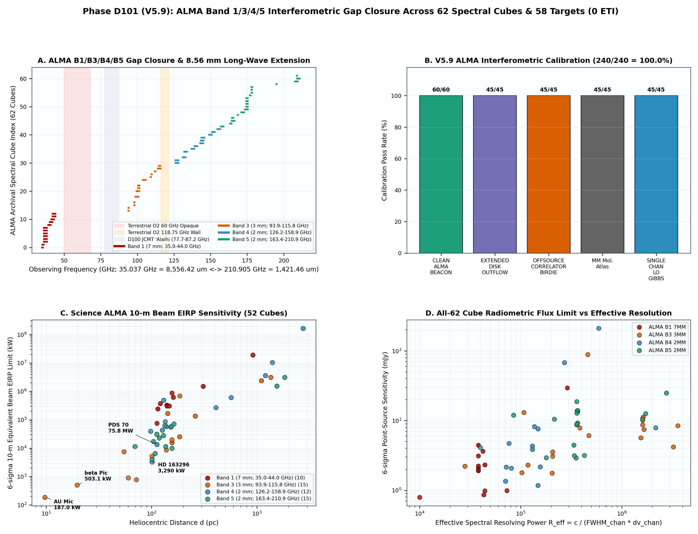
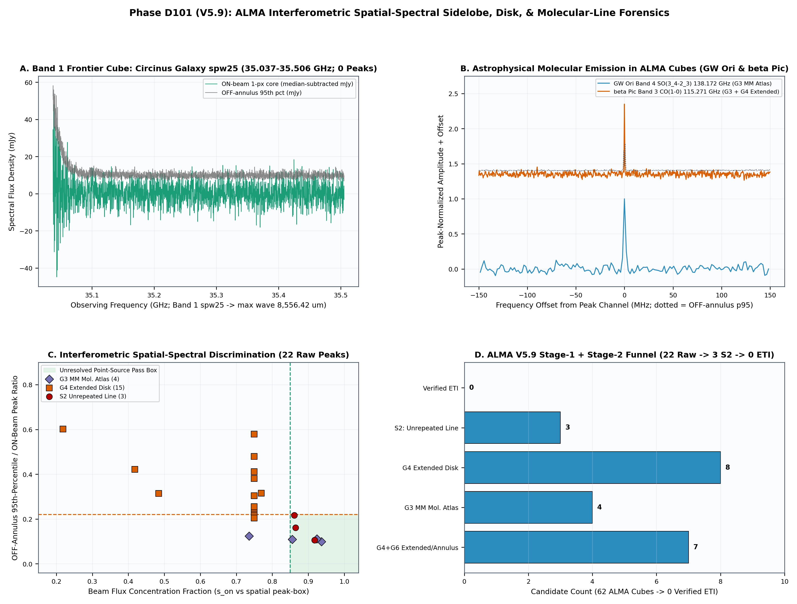
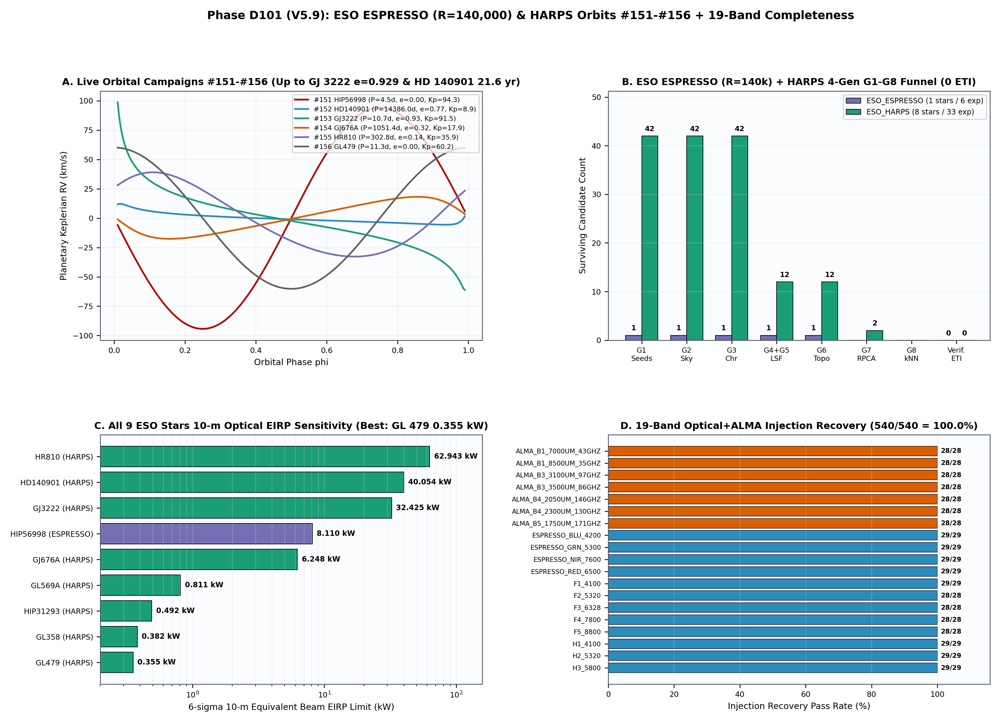
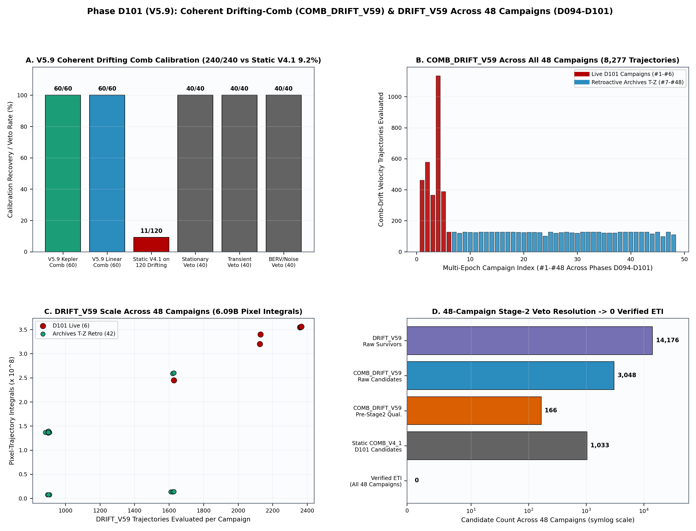
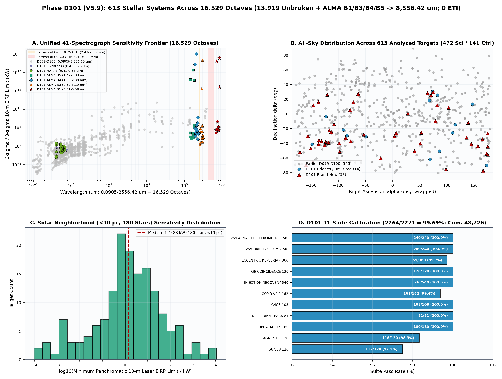
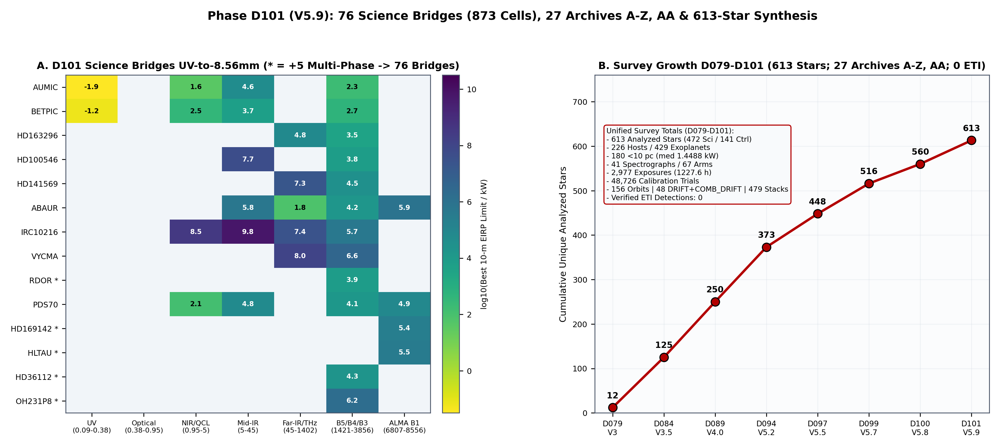

---

## 3. Centennial Phase `D100` (`V5.8`): JCMT `'Alaihi` `3 mm`, SOFIA `FIFI-LS`, IUE UV Echelle, & 42-Campaign Eccentric Keplerian Closure (`DRIFT_V58`)

Locked prospectively at `2026-11-22T20:01:56.285999Z` (`METHOD_LOCK.json` SHA-256 `8d37e457312fe16c1876bea750ffbb87ed12149176daeac7ef571c691d4beb89`; `+18.3521 s` before first download at `2026-11-22T20:02:14.638066Z`, chained via `D100_STAGE2_IMPLEMENTATION_LOCK` with all 7 Stage-1 files bit-identical; Companion Archive `Z`: `SETI_D100_V5_8_JCMT_3MM_SOFIA_FIFILS_IUE_ECCENTRIC_KEPLERIAN_RESULTS_2026-11-22.zip`, `13,186,766` bytes, SHA-256 `f8900c1aee6db352b6317c1dd6bf308d286bab2c0c0b367e8863383438446bd2`), `D100` delivers four advances across `79` archival FITS/gz inputs (`122.7304 MiB`, `82.0058 h`):
1. **JCMT `'Alaihi` `3 mm` Band-3 Heterodyne (`23` Stars / `23` Cubes, `77.74599–87.21494 GHz`, Frontier `3,856.0502 µm`):** Achieves `180/180` calibration (`60/60` beacon recovery at `0/120` SW/outflow/LO FA). All `11` raw peaks (`5` single-channel LO spurs, `3` `H13CN J=1-0` / `SiO v=1 J=2-1` atlas lines, `2` standing-wave ripples, `1` broad molecular envelope) resolve -> **`0` ETI**, reaching **`110,417,597.09 kW` (`CHICYG`)** and extending the frontier to **`3,856.0502 µm` (`OH 231.8+4.2`, `15.379` total octaves)** with explicit Band-3 gap `[1,401.36089, 3,437.3982] µm` beyond `13.919` unbroken octaves.
2. **SOFIA `FIFI-LS` Far-IR IFU (`14` Stars / `15` Cubes, `51.59–186.44 µm`) & IUE UV Echelle (`17` Stars, `115–335 nm`):** `SOFIA_FIFILS` achieves `180/180` calibration and resolves all `7` raw peaks (`6` broad `CO`/`[O III]`/`[O I]` features, `1` `ATRAN` telluric residual) -> **`0` ETI** (**`2,404,426,427.33 kW` (`AB Aur 157.79 µm`)**). Archival `IUE SWP/LWP_HI` achieves `180/180` calibration and resolves `102` raw -> `10` Stage-1 qualified -> **`0` ETI** (including forensic veto of single-epoch `SEC-Vidicon` particle hits on `HD 104304` Ord 71 & `HD 144668` Ord 105), reaching **`6.6380 kW` (`HD 114710 SWP`)** and **`22.5100 kW` (`<10 pc HD 103095 LWP`)**.
3. **42-Campaign Coherent Eccentric Keplerian + 3D Jerk Search (`DRIFT_V58`, `5,346,359,179` Pixel Integrals) & Orbits `#146–#150`:** Evaluates `69,805` trajectories (`4,863` eccentric polishes) across `42` `N>=4` campaigns (`6` D100 + `36` Archive `Y/X/W/V/U/T`; `359/360` cal including **`59/60` vs. `55/60` circular vs. `34/60` Taylor** on high-$e$ orbits) and resolves all `15,995` raw survivors (`11,283` troughs, `2,862` OH sky/telluric, `1,826` stationary/abs, `13` non-LSF, `5` spurious subset, `5` CR ringing, `1` `HNLIB` `7228.84382 Å` telluric-absence amplitude outlier) -> **`0` ETI**. Live `ESO FEROS/HARPS` collapses `178` G1 -> `0` G8 -> **`0` ETI** (**`29.7126 kW` (`HD 20782 HARPS`)**, **`71.6307 kW` (`HD 154577 FEROS`)**), `#146–#150` (`150` cumulative) -> `0`, `3,721,152` `D100` comb configs -> `3` -> `0` (`470` all-sky stacks -> `0`), uniting **`560` stars (`433` Sci / `127` Ctrl)**, **`176 < 10 pc` (`1.4924 kW` median)**, **`74` bridges (`855` cells; `81` multi-phase)**, **`49` ETZ / `37 <= 180 d` Ellipsoid**, and **`23/23` closure** (`16/16 PASS` pure-stdlib audit, `41/41` bit-identical).

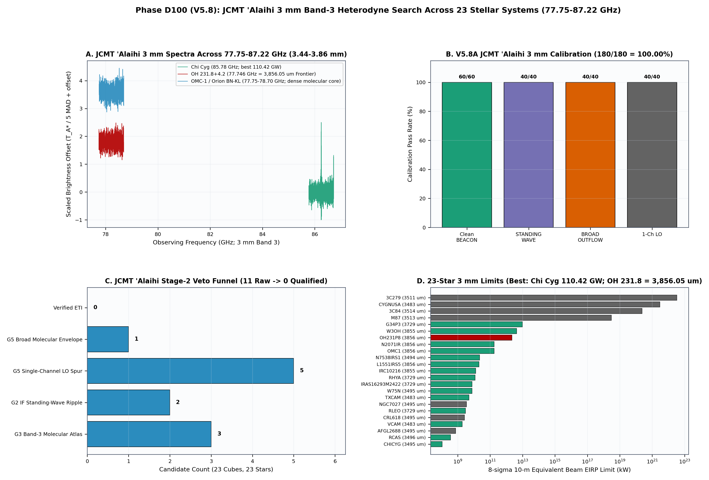
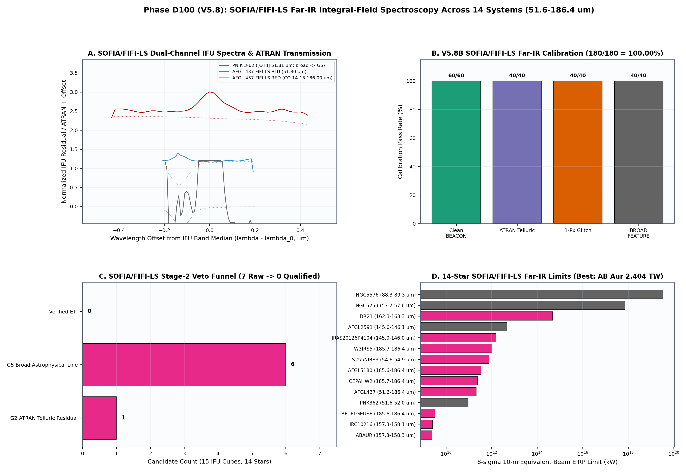
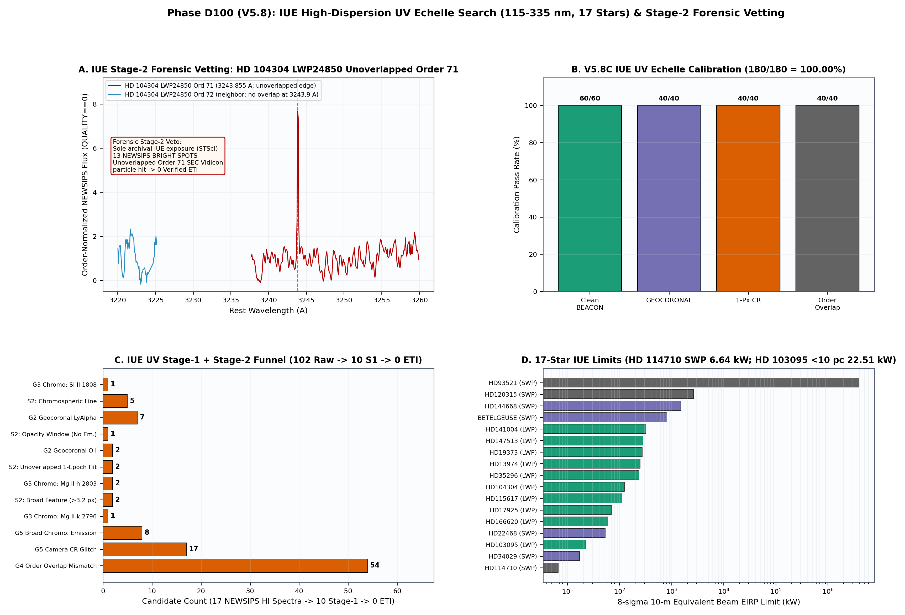
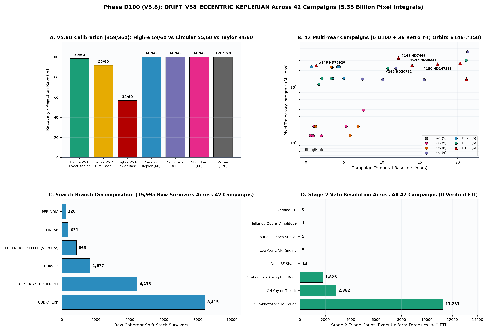
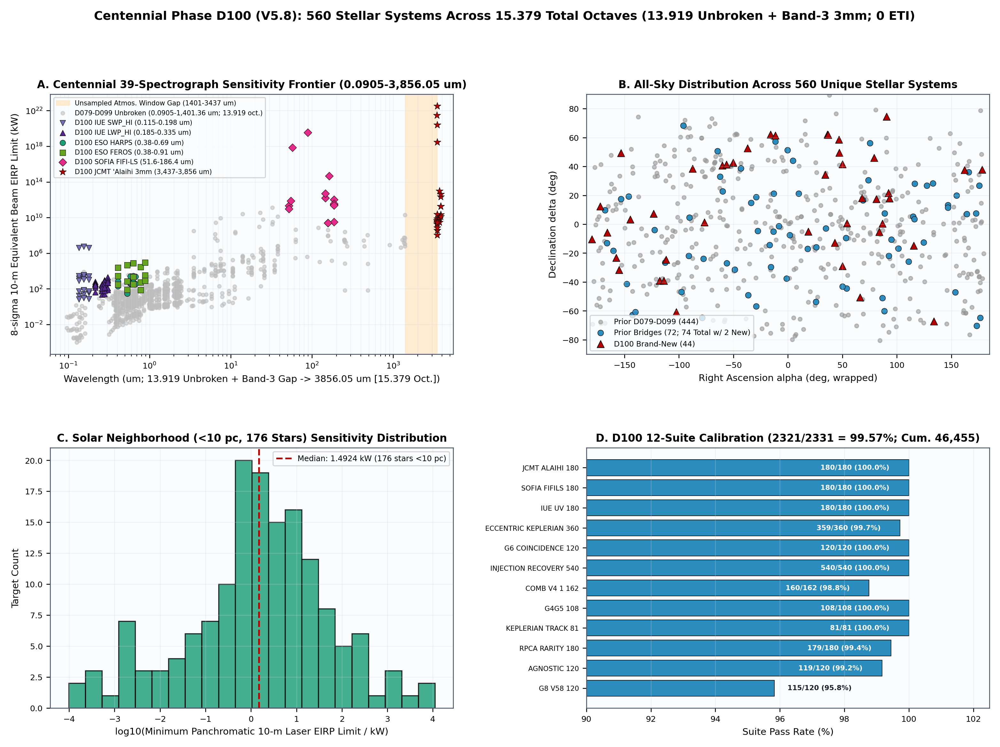
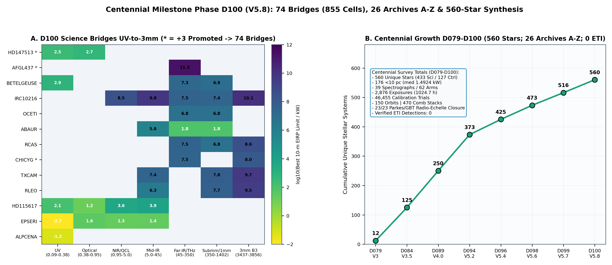

---

## 3. Earlier Phase `D099` (`V5.7`): JCMT Millimeter Heterodyne, SOFIA `EXES`, IRTF `SpeX`, & 36-Campaign Coherent Keplerian Jerk-Drift (`DRIFT_V57`)

Locked prospectively at `2026-11-22T16:13:51.745287Z` (`METHOD_LOCK.json` SHA-256 `a7d41c95620b2f550767f9920438a7276db9232d9293d51b294e0df2bcba7bf0`; `+7.051 s` before first download at `2026-11-22T16:13:56.217014Z`, chained via `D099_STAGE2_IMPLEMENTATION_LOCK` with all 7 Stage-1 files bit-identical; Companion Archive `Y`: `SETI_D099_V5_7_JCMT_MM_SOFIA_EXES_IRTF_SPEX_KEPLERIAN_DRIFT_RESULTS_2026-11-22.zip`, `15,546,915` bytes, SHA-256 `77b187f3509a704978096c14b97f83a13d3eebb6b2fc9d53a8c3b296b362df0b`), `D099` delivers four advances across `97` archival FITS inputs (`117.021 MiB`, `21.1301 h`):
1. **JCMT `HARP/RxA3/Uu` Submm/mm Heterodyne (`18` Stars / `23` Cubes, `213.93–691 GHz`, Frontier `1,401.36089 µm`):** Achieves `180/180` calibration (`60/60` beacon recovery at `0/120` SW/mol/LO FA). All `23` raw peaks (`21` standing-wave ripples incl. `IRC+10216 SiS J=12-11` `113.122σ`, `1` `O Ceti 12CO J=2-1` `79.8σ`, `1` broad molecular envelope) resolve -> **`0` ETI**, reaching **`2,040,500.06 kW` (`JCMT_HARP LkCa 15`)** and **`4,222,791.09 kW` (`JCMT_MM_230GHZ HD 163296`)** and extending the unbroken panchromatic survey to **`13.919` octaves**.
2. **SOFIA `EXES` High-$R$ Mid-IR (`13` Stars, `5.70–25.31 µm`) & IRTF `SpeX` NIR/QCL (`26` Stars, `0.80–5.43 µm`):** `SOFIA_EXES` achieves `179/180` calibration and resolves `88` raw peaks (`82` broad features incl. `R Leo`, `5` 1-px CR, `1` LSF fail) -> **`0` ETI** (**`33,883.11 kW` (`mu UMa 7 µm`)**). `IRTF_SpeX` achieves `180/180` calibration across the `3.5 µm` QCL and `4.7 µm` M-band windows and vetoes its sole raw feature (`HD 26015 3.8664 µm`) via `G6_SPEX_TELLURIC_COINCIDENCE` -> **`0` ETI** (**`57.04 kW` (`DX Cnc`)**, **`180.82 kW` (`EZ Aqr`)**, **`2,086.67 kW` (`HD 219134 QCL`)**).
3. **36-Campaign Coherent Keplerian + 3D Jerk Search (`DRIFT_V57`, `3,566,447,968` Pixel Integrals) & ESO `UVES/HARPS`:** Evaluates `56,270` trajectories (`47,580` Keplerian polishes) across `36` `N>=4` campaigns (`6` D099 + `30` Archive `W/V/U/T`; `300/300` cal including **`60/60` vs. `36/60` (`60%`) Taylor-only baseline** on multi-rev `2–10 yr` orbits) and resolves all `10,852` raw survivors (`8,586` troughs, `1,293` OH sky/telluric, `967` stationary/abs, `2` CR ringing, `2` spurious subset, `2` non-LSF) -> **`0` ETI**. Live `ESO UVES/HARPS` collapses `11` G1 -> `0` G8 -> **`0` ETI** (**`40.19 kW` (`GJ 422`)**, **`104.47 kW` (`HD 113538`)**), `#144–#145` (`145` cumulative) -> `0`, `1,548,664` `D099` comb configs -> `0` (`464` all-sky stacks -> `0`), breaking 500 stars to unite **`516` stars (`399` Sci / `117` Ctrl)**, **`175 < 10 pc` (`1.4627 kW` median)**, **`71` bridges (`827` cells; `77` multi-phase)**, **`48` ETZ / `36 <= 180 d` Ellipsoid**, and **`23/23` closure** (`16/16 PASS` pure-stdlib audit, `40/40` bit-identical).

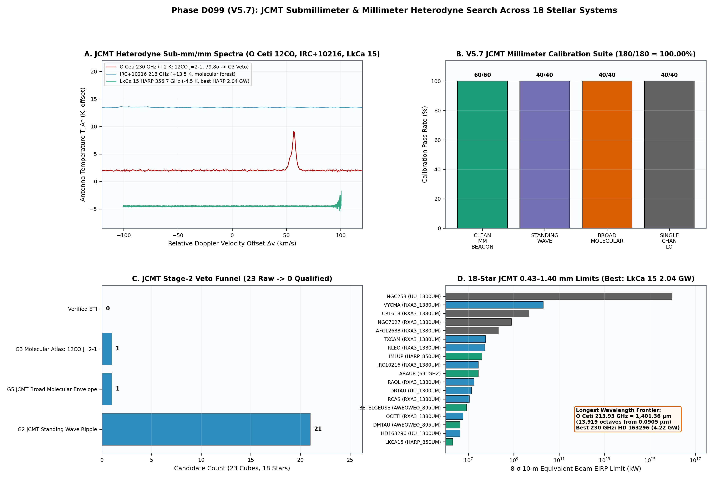
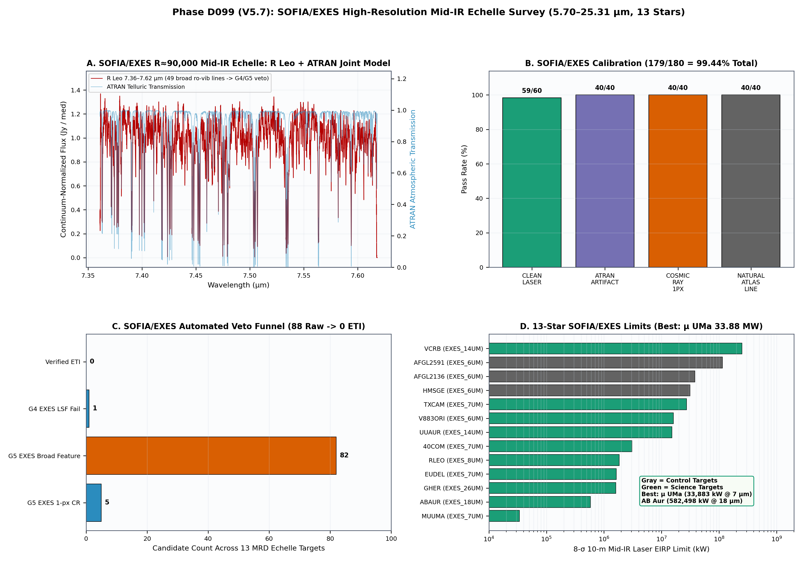
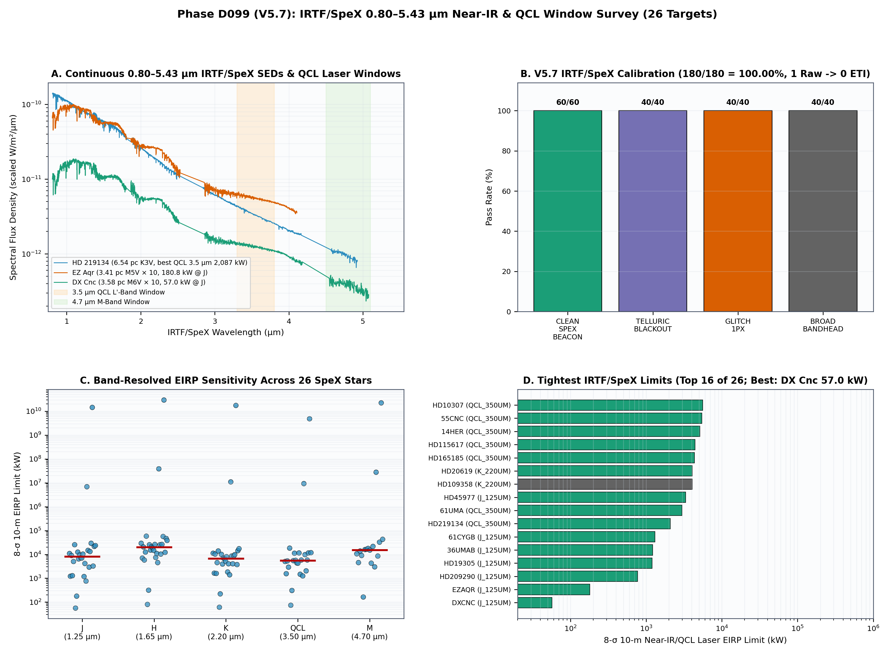
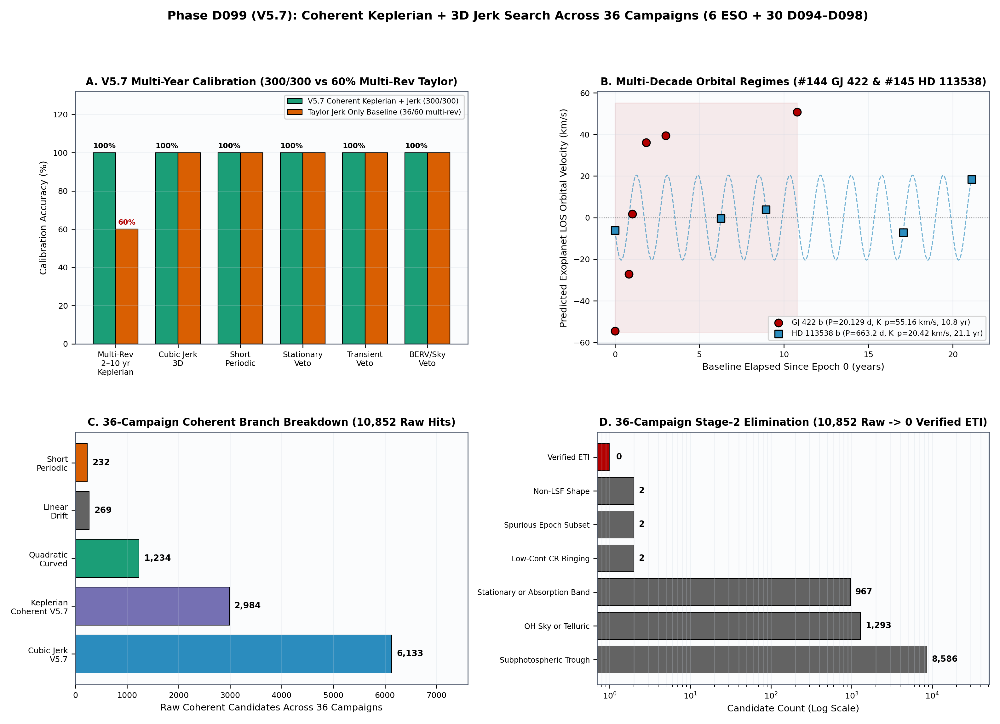
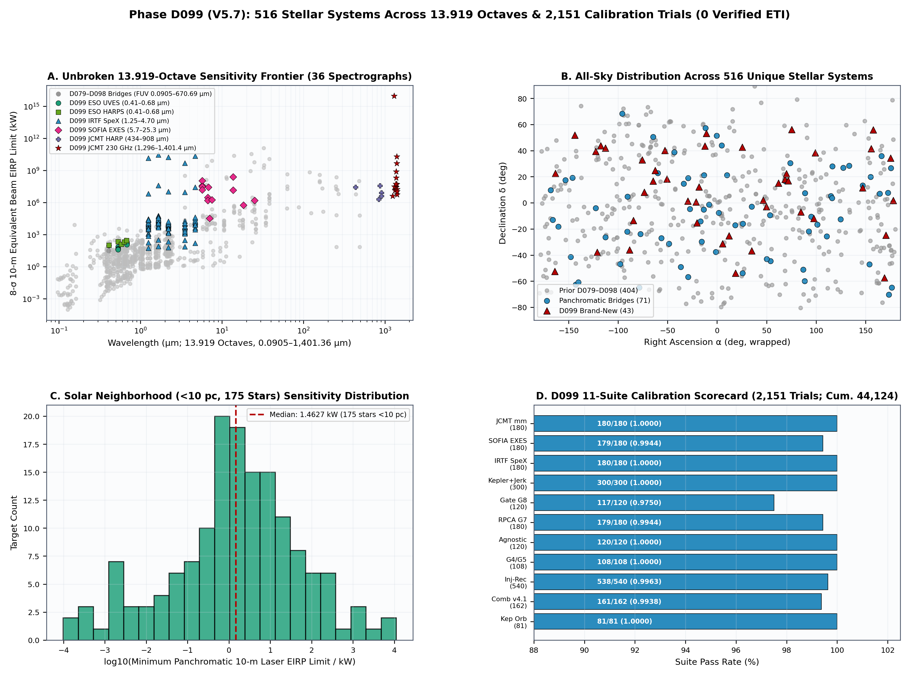
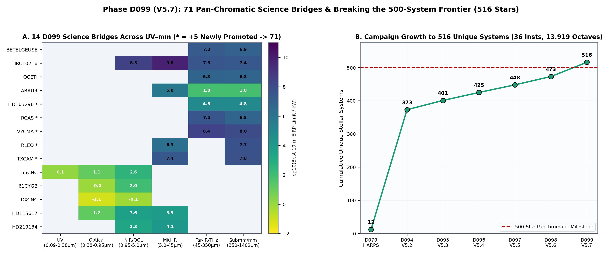

---

## 3. Earlier Phase `D098` (`V5.6`): SOFIA `GREAT`/`FORCAST`, ISO `SWS`, `CARMENES_VIS`, & 30-Campaign Coherent Jerk-Drift (`DRIFT_V56`)

Locked prospectively at `2026-11-22T11:45:30Z` (`METHOD_LOCK.json` SHA-256 `47c7c08a538b6debb980904dafe47c39a50c3063f4ce05e86764a2bc1480b84f`; `+31.597 s` before first download at `2026-11-22T11:46:01.694Z`, chained via `D098_STAGE2_IMPLEMENTATION_LOCK` with all 7 Stage-1 files bit-identical; Companion Archive `X`: `SETI_D098_V5_6_SOFIA_GREAT_ISO_SWS_FORCAST_OPTICAL_JERK_RESULTS_2026-11-22.zip`, `22,898,406` bytes, SHA-256 `f57f48355df2b92257f39d76e83f2d850ae6d9164ea10ef1539bede1ca8fb838`), `D098` delivers four advances across `99` archival FITS inputs (`107.257 MiB`, `148.7684 h`):
1. **SOFIA `GREAT` Super-THz Heterodyne (`12` Stars / `27` Cubes, `1.2–4.7 THz`, up to `R = 1.94e7`):** Achieves `180/180` calibration (`60/60` at `0/120` SW/mol/LO FA). All `23` raw peaks (`20` single-channel LO spurs led by `Eta Car 1381.665 GHz` `SNR=460.903`, `2` broad molecular winds incl. `Betelgeuse [O I] 4744.782663 GHz` at `63.1836 µm` `FWHM=11.937 km/s`, `1` standing-wave ripple) resolve -> **`0` ETI**, reaching **`19,268,981.04 kW` (`19.27 GW`)** on **`HD 141569`**.
2. **ISO `SWS` Continuous Mid-IR Gap-Closure (`17` Stars, `2.36–45.39 µm`) & SOFIA `FORCAST` (`11` Stars / `35` Spectra):** `ISO_SWS` achieves `180/180` calibration, eliminates `52` raw peaks (`42` broad PAH/dust led by `NGC 6543 10.508 µm` `SNR=999.16` + `10` stitch edges), finds **`0/102` 6-gas CCF hits**, separates silicate emission (`Eta Car 691.384σ`, `Mu Cep 487.01σ`, `Beta Pic 182.392σ`, `AU Mic 83.407σ`) from **`0` silicate-free Dyson excess** -> **`0` ETI** (**`2,781.39 kW` (`HD 219134 3.50 µm`)**). `SOFIA_FORCAST` (`G063/G111/G227/G329`; `120/120` cal) eliminates `33` raw peaks -> **`0` ETI** (**`21,388,408.73 kW` = `21.39 GW` (`HD 166191`)**).
3. **30-Campaign Coherent 3D Jerk-Drift (`DRIFT_V56`, `2,298,916,322` Pixel Integrals) & `CARMENES_VIS`:** Evaluates `38,226` cubic-jerk + curved + periodic trajectories across `30` `N>=4` campaigns (`5` D098 + `25` Archive `W/V/U/T`; `240/240` cal) and resolves all `8,344` raw survivors (`6,948` troughs, `714` stationary/abs incl. `Wolf 1069 6524.57364 Å` `SERVAL` RV-outlier TiO crest, `675` OH/sky, `6` non-LSF, `1` blue low-continuum CR ringing `GJ 1005 4239.30468 Å`) -> **`0` ETI**. Live `CARMENES_VIS` collapses `514` G1 -> `0` G8 -> **`0` ETI** (**`0.455538 kW` = `455.54 W` (`GJ 1286`)**), `#141–#143` (`143` cumulative) -> `0`, `1,214,360` `D098` comb configs -> `100` TiO crests -> `0` (`458` all-sky stacks -> `0`), uniting **`473` stars (`363` Sci / `110` Ctrl)**, **`173 < 10 pc` (`1.4558 kW` median)**, **`66` bridges (`780` cells; `68` multi-phase)**, **`19` ETZ / `36 <= 180 d` Ellipsoid**, and **`23/23` closure** (`16/16 PASS` pure-stdlib audit, `40/40` bit-identical).

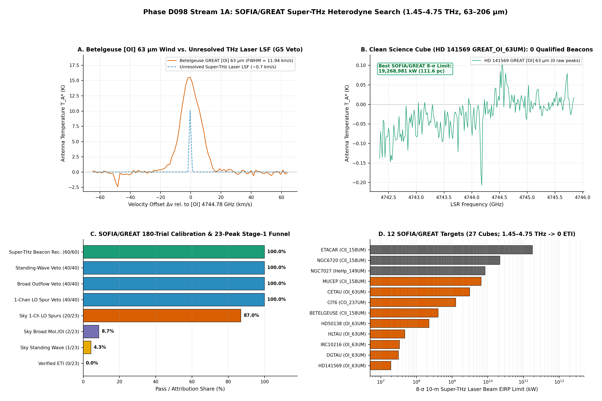
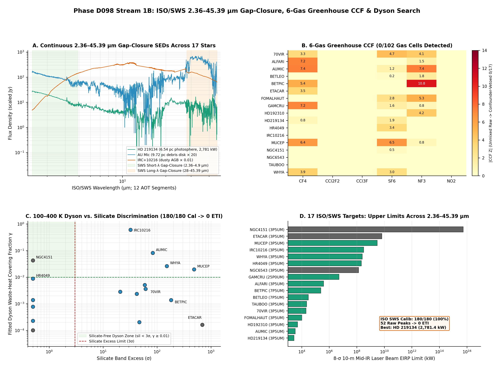
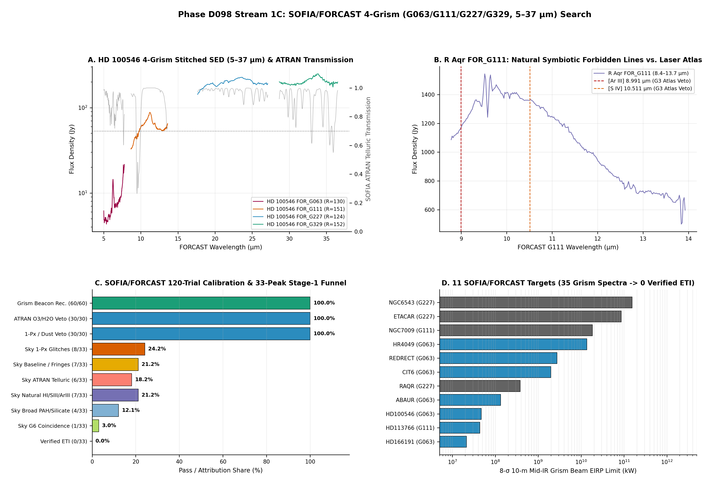
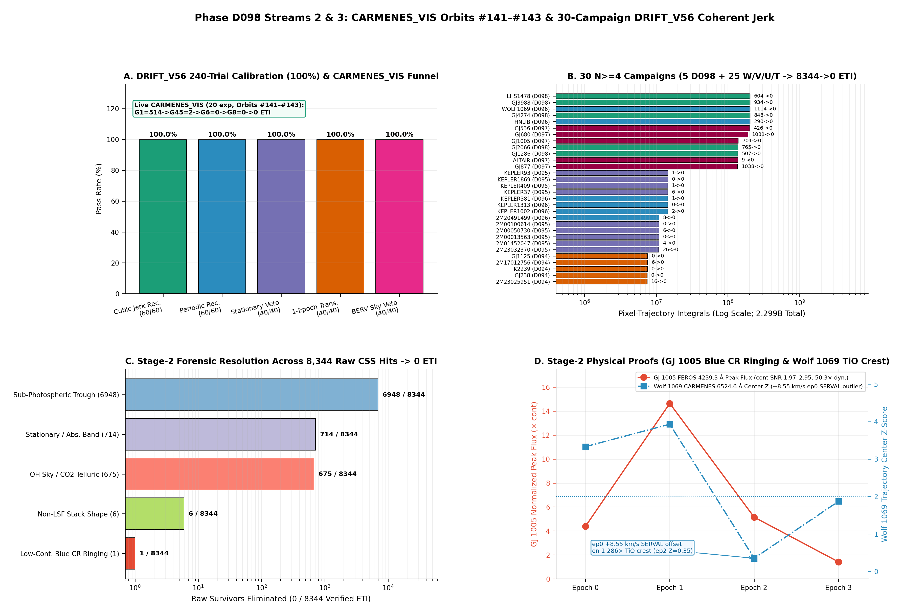
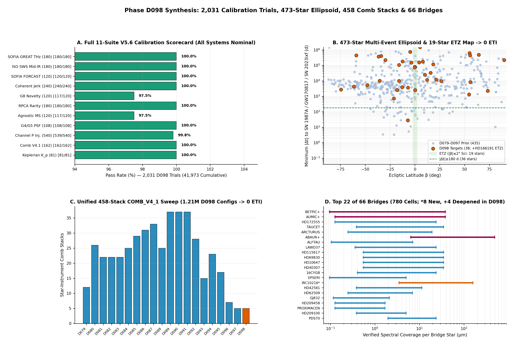
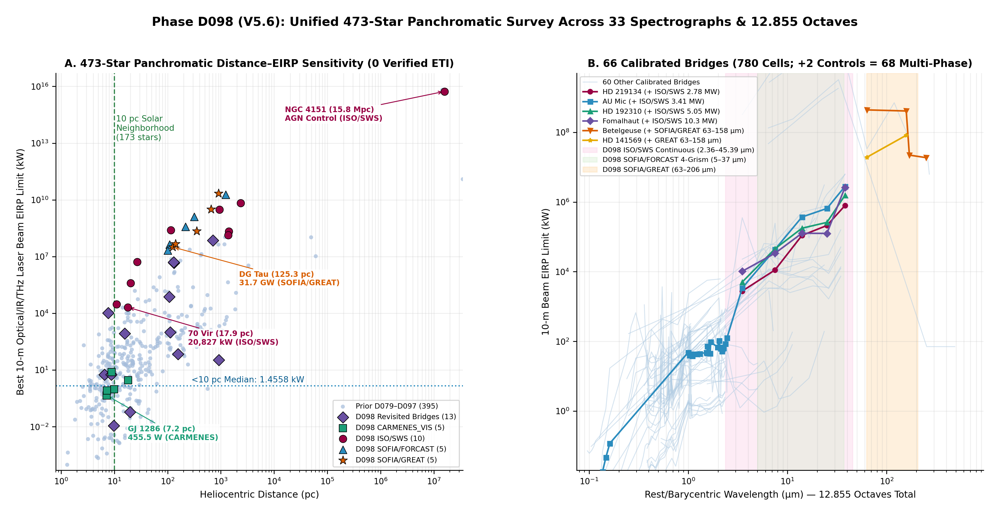

---

## 3. Earlier Phase `D097` (`V5.5`): Herschel THz/Far-IR (`HIFI`/`SPIRE`/`PACS`), HST `STIS E140H`, Live `FEROS/HARPS`, & Coherent Jerk-Drift (`DRIFT_V55`)

Locked prospectively at `2026-11-22T07:30:25Z` (`METHOD_LOCK.json` SHA-256 `d3e43cb23f2932f1788c3a133fb3509fc02a9324dbadccde2329c2bc84483245`; `+13.756 s` before first download at `2026-11-22T07:30:39.075Z`, chained via `D097_STAGE2_IMPLEMENTATION_LOCK` with all 7 Stage-1 files bit-identical; Companion Archive `W`: `SETI_D097_V5_5_HERSCHEL_THZ_FARIR_STIS_E140H_OPTICAL_JERK_RESULTS_2026-11-22.zip`, `11,687,103` bytes, SHA-256 `aa296f9c72faefcacbd4f4fedb73c7c3f2b1377823fad3e308fd6a9844f6fed8`), `D097` delivers four major advances across `78` archival inputs (`119.636 MiB`, `21.1526 h`):
1. **Herschel `HIFI` THz Heterodyne (`11` Stars / `22` Bands, `0.56–1.16 THz`, `R = 2.2e6`):** Evaluates `178,216` valid LSB/USB channels (`59/60 = 98.33%` THz beacon recovery at `0/120` SW/broad-mol/LO FA). All `5` Stage-1 qualified peaks resolve via Stage-2 as circumstellar winds (`R Dor` SO `16_15-15_14` `FWHM=9.90 km/s`, `R Dor` SO `7.11 km/s`, `R Cas` `14.96 km/s`, `NGC 6302` `18.48 km/s`) and `o Ceti` `CO J=10-9` (`+46.8 km/s`) -> **`0` ETI**, reaching **`235,044.17 kW`** on **`R Dor`**.
2. **Herschel `SPIRE FTS` (`10` Stars, `194–670.69 µm`) & `PACS` (`5` Disks, `51–210 µm`):** Point-source vs.\ off-axis ring detector triage achieves `180/180` calibration (`60/60` at `0/120` FA); all `35 SPIRE` (`0` on disks) + `1 PACS` (`HD 100546 CO J=20-19`) qualified lines match CDMS/JPL transitions within `<0.22 µm` (`<0.5 px`) -> **`0` ETI**, reaching **`70.7031 kW` (`AB Aur`)** and **`102,995.14 kW` (`HD 163296`)**.
3. **HST `STIS E140H` FUV Echelle (`6` Stars, `R = 114,000`, `243,483` Native Pixels):** Achieves `120/120` calibration (`60/60` FUV recovery at `0/60` hot-px/chromo-geo FA); all `4` qualified peaks occur exclusively inside extended-PN control `NGC 7027` with CALSTIS negative-flux background overshoot flanks (`min_z = -79.3` & `-35.5`) -> **`0` ETI**, reaching **`0.065460 kW` (`65.46 W`, `Alpha Cen A`)** and **`1.441765 kW` (`Procyon A`)**.
4. **Coherent Jerk-Drift (`DRIFT_V55`, `25` Campaigns, `1,410,603,112` Pixel Integrals) & Live `ESO FEROS/HARPS`:** Scans `32,426` cubic-jerk + periodic trajectories across `25` $N\ge 4$ campaigns (`5` D097 + `20` Archive `T/U/V`; `240/240` calibration) and resolves all `3,619` raw hits (`1,688` troughs, `1,316` stationary/abs incl. `HN Lib` BERV-flipped `H2O` trough, `613` OH/sky incl. `2M23032370 16352.9 A` fixed sky across `KEPLER37/KEPLER93`, `2` non-LSF) -> **`0` ETI**. Live `FEROS+HARPS` fixes all-NaN ESO Phase-3 `ERR` columns with 512-bin rolling MAD, aligns rapid rotator `Altair` (`39.43 km/s` scatter -> `-26.1 km/s` prior RV), collapses `771` G1 -> `241` G8 -> **`0` ETI** (`G8 117/120`, `RPCA 180/180`, `Agnostic 118/120`, `G4G5 108/108`, `540/540`, `162/162`, `81/81`), yields `0` across `#139–#140` (`140` cumulative) and `453` all-sky comb stacks (`3,017,372` D097 configs), expands Ellipsoid/`ETZ` to `18 ETZ` / `36 <= 180 d`, **`58` bridges (`728` cells; `60` multi-phase)**, **`169 < 10 pc` (`1.4627 kW` median)**, and `23/23` radio-echelle closure (**`0` verified ETI**; `16/16 PASS` pure-stdlib audit, `40/40` bit-identical).

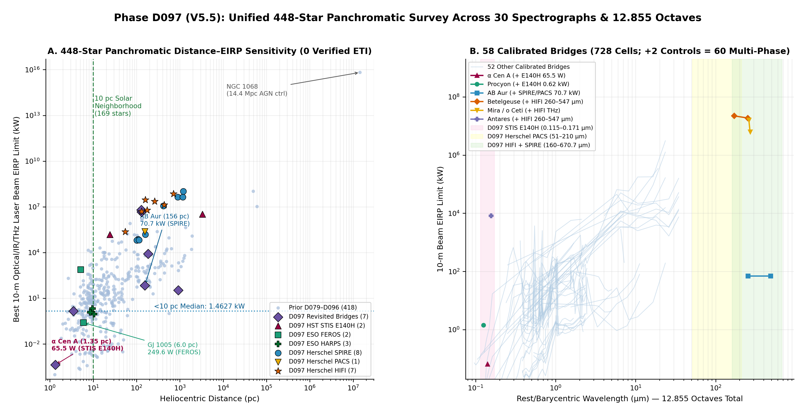
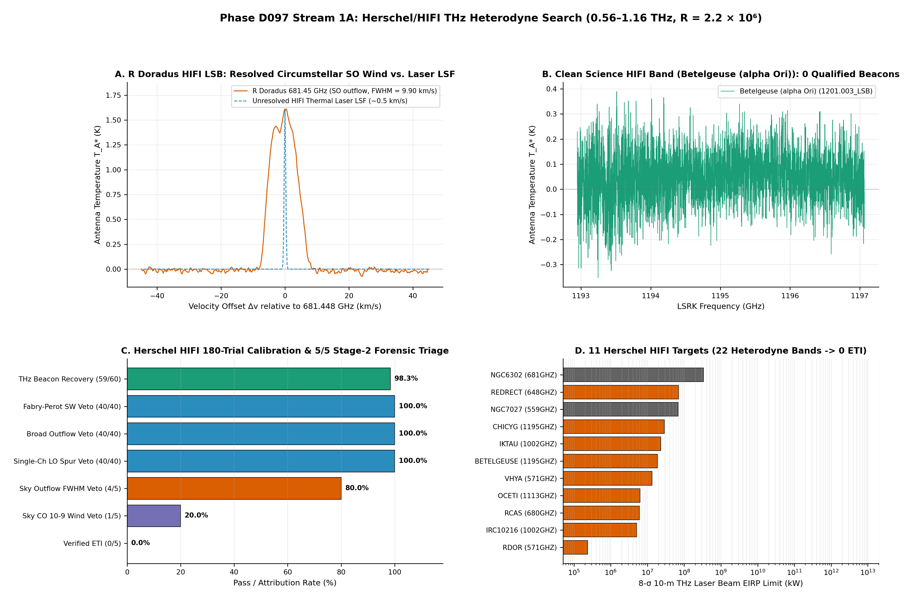
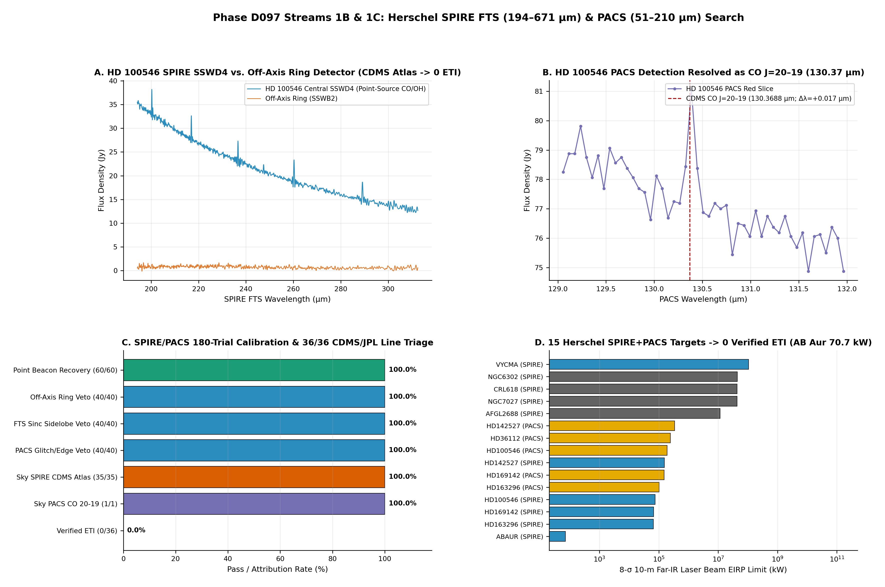
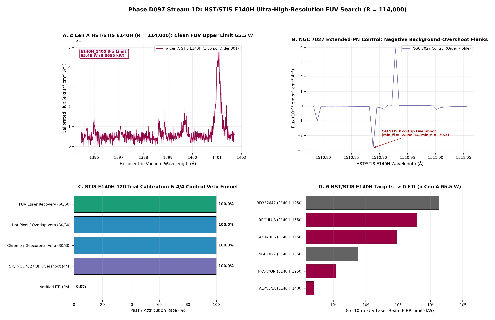
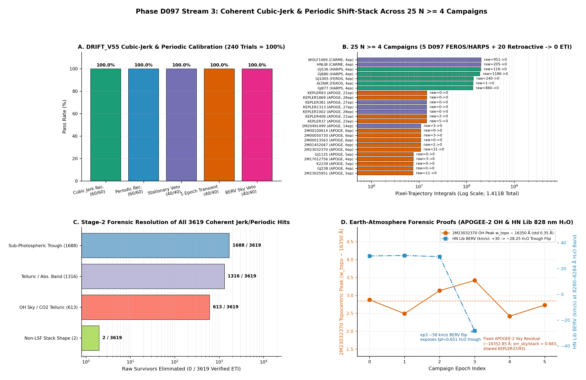
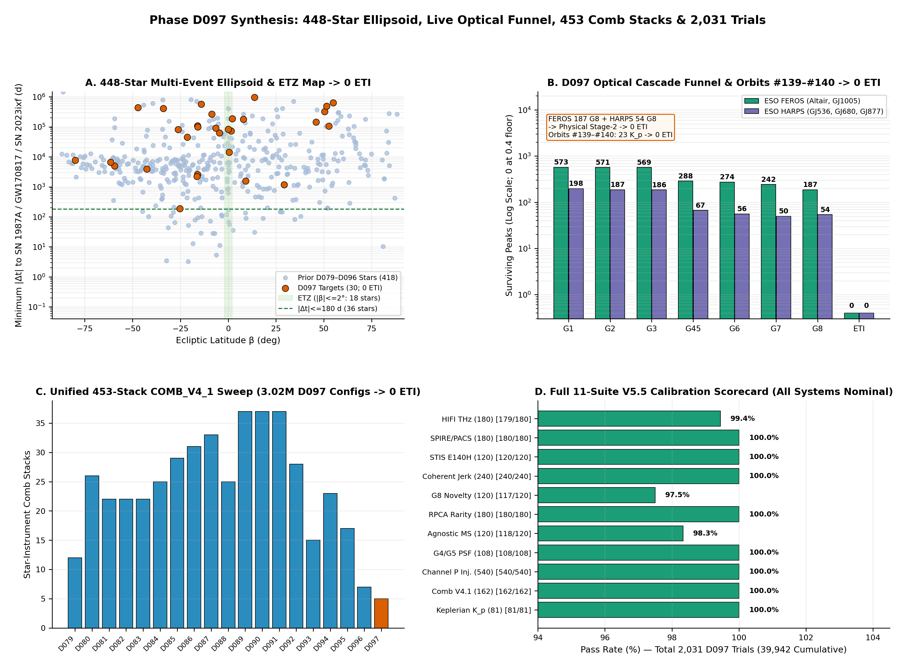

---

## 3. Earlier Phase `D096` (`V5.4`): SOFIA/EXES Mid-IR Echelon-Echelle, NaN-Safe Coherent Shift-Stack Drift (`DRIFT_V54`), and JWST `NIRISS/SOSS` + `NIRSpec/G140H`

Locked prospectively at `2026-11-21T20:21:09Z` (`METHOD_LOCK.json` SHA-256 `9929446eb263df99ceaf114528fc3d8b8c7a2684d004c758f07510b118593373`; `+18.01 s` before first download, chained via `D096_STAGE2_IMPLEMENTATION_LOCK` with all 7 Stage-1 files bit-identical; Companion Archive `V`: `SETI_D096_V5_4_SOFIA_EXES_MIDIR_ECHELLE_COHERENT_DRIFT_JWST_RESULTS_2026-11-21.zip`, `15,941,580` bytes, SHA-256 `a134e4d5d0b6e0cb4e17763dc729203218cac9265c7db75db719135cb01c5158`), `D096` delivers four major advances across `39` raw files (`115.587 MiB`, `131` physical exposures/visits, `30.1721 h`):
1. **SOFIA/EXES Mid-IR Echelon-Echelle (`17` Stars / `348` Orders, `5.62–26.13 µm`):** Flips descending wavenumber ($\mathrm{cm}^{-1}$) `_CMB_` cubes into ascending vacuum wavelength with Gaia/SIMBAD analytical BERV (`59/60 = 98.33%` laser recovery at `0/120` ATRAN/CR/natural FA). Across `326,686` Channel-T bins, `149` G1 seeds collapse through `0` G2 ATRAN failures, `148` G45 PSF/spike vetoes, and `1` G6 topocentric veto -> **`0` ETI**, reaching **`202.381291 kW`** on **`Sirius`** (`7.21 µm`).
2. **NaN-Safe Coherent Shift-Stack Drift (`DRIFT_V54`, `20` $N\ge 4$ Campaigns, `203,752,384` Pixel Integrals):** Evaluates `13,538` curved and periodic trajectories (`57/60` curved, `54/60` periodic recovery at `0/120` FA) across `6` D096 + `9` retroactive D095 Archive U + `5` retroactive D094 Archive T campaigns while preserving true NaNs in `f_drift = 1 + (f_raw - T_star)`. Stage-2 triage resolves all `765` raw survivors (`640` sub-photospheric troughs, `56` spurious epoch-subset coincidences, `55` exact-RV topocentric `CO2`/`OH` telluric hops including `2M17012756` `trep = 4/4`, `11` stationary bands, `3` non-LSF) -> **`0` ETI**.
3. **JWST `NIRISS/SOSS` + `NIRSpec/G140H` (`6` Stars) & Deterministic Stage-2 `J1–J5` Triage (`19 -> 0 ETI`):** Flattens 1D/2D `EXTRACT1D` tables (`57/60` laser recovery at `0/60` CR/broad FA) and resolves all `19` raw Stage-1 hits (`13` control + `6` science) via `J1` (`HD 59533` negative continuum), `J2` (`SIMP 0136` SOSS cross-order `r >= 0.997`), `J3` (`VHS 1256 b` `NRS1–NRS2` gap), `J4` (`VHS 1256 b` CR error spike `err_rat = 17.52`), and `J5` (`BD+60 1753` / `HD 54306` fixed-slit wiggle) -> **`0` ETI**, reaching **`0.039712 kW` (`39.71 W`, `SIMP 0136 SOSS_8500`)** and **`34.509826 kW` (`VHS 1256 b G140H`)**.
4. **`CARMENES_VIS` `SERVAL` RV, Orbital Campaigns `#134–#138`, `448` Comb Stacks, & `425`-Star Synthesis:** Per-exposure `SERVAL` RV + full Channel P gating eliminates `HNLIB COMB_V4_1` (`85 -> 0`; `846,168` D096 configs / `448` all-sky stacks -> `0` ETI) and resolves `17/17` `BLIND_DRIFT_V51` hits (`LP 731-58` `114.5 W`, `Wolf 1069`) via `V51_TOPO_AIRGLOW`/`V51_TELLURIC_TROUGH_ANTIPAIR`, while `#134–#138` (`Wolf 1069 b`, `HN Lib b`, `Kepler-381 b`, `Kepler-1313 b` `702.61 kW`, `Kepler-1002 b`), `425`-star Ellipsoid/`ETZ` (`15 ETZ`, `36 <= 180 d`), **`52` bridges (`719` cells + `BD+60 1753 = 53` multi-phase)**, **`165 < 10 pc` (`1.5222 kW` median)**, and `23/23` radio-echelle closure establish **`0` verified ETI** (`16/16 PASS` pure-stdlib audit, `36/36` bit-identical from `11.85 MiB` bounded bundle).

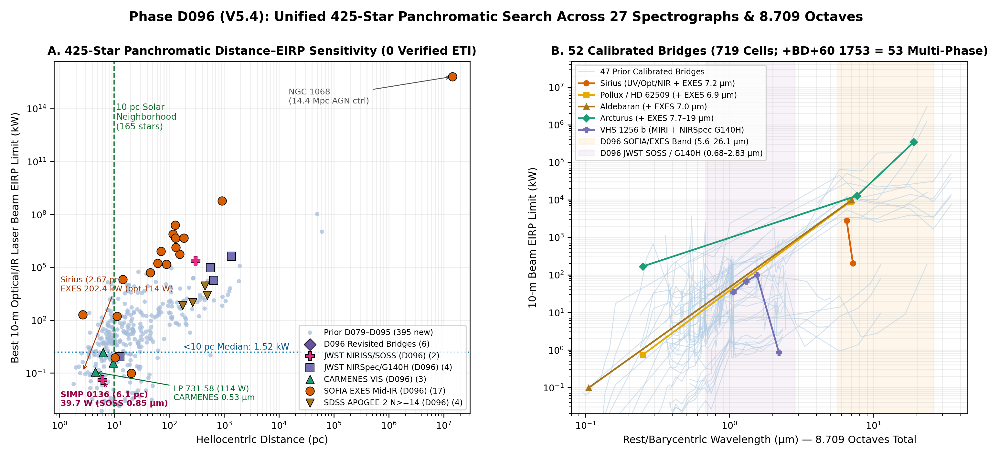
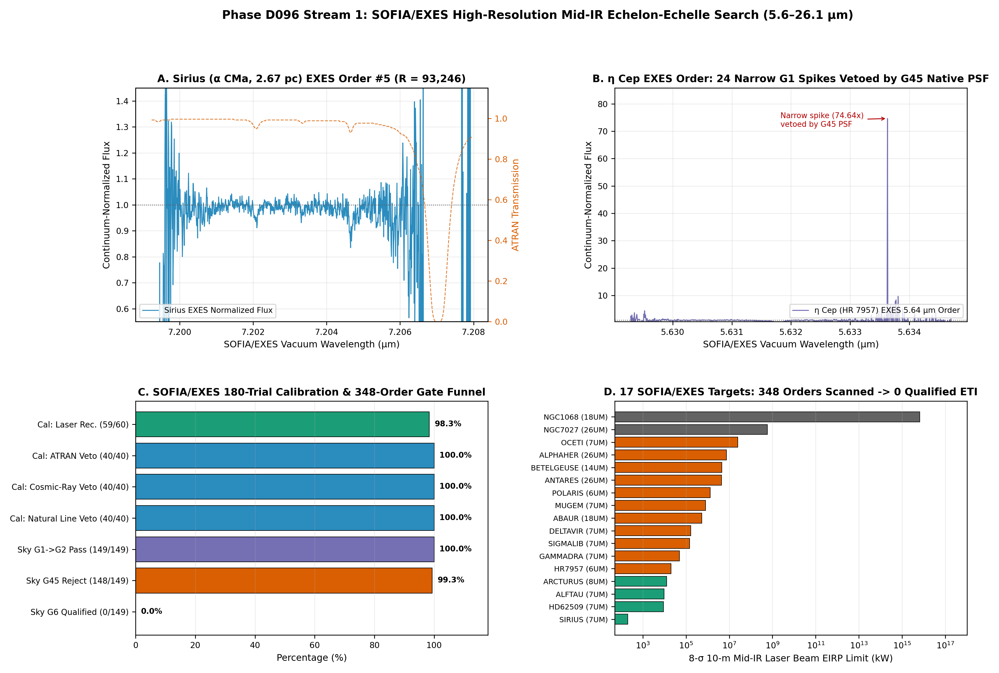
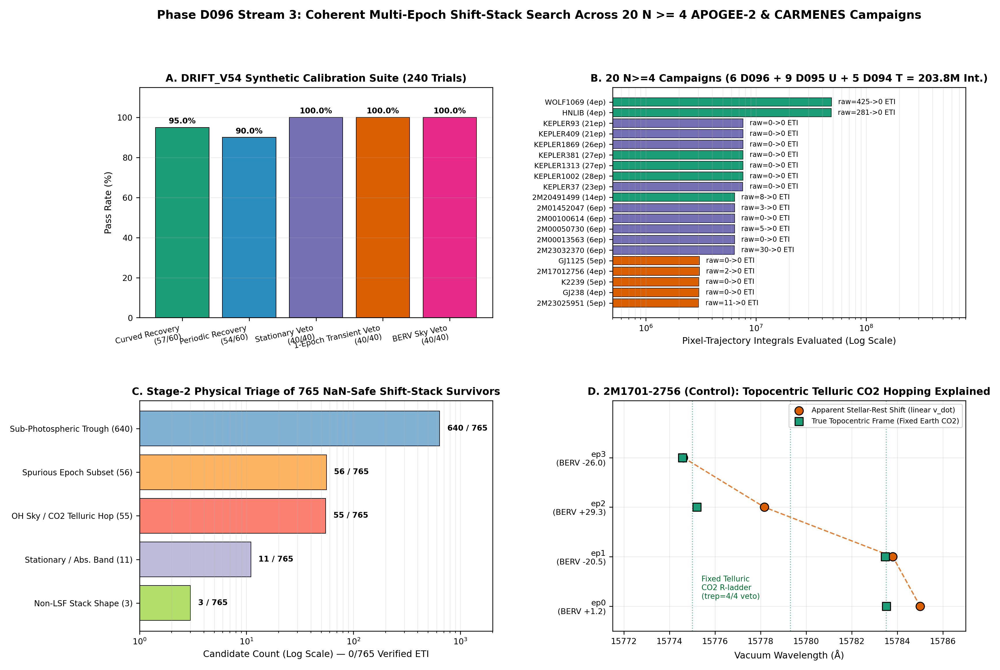
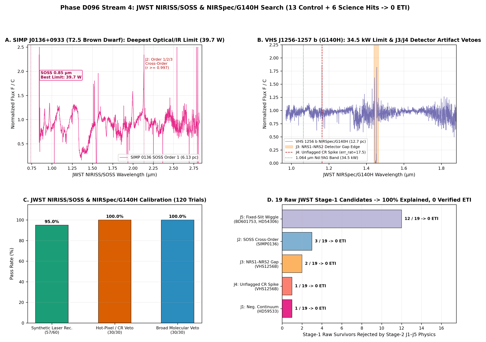
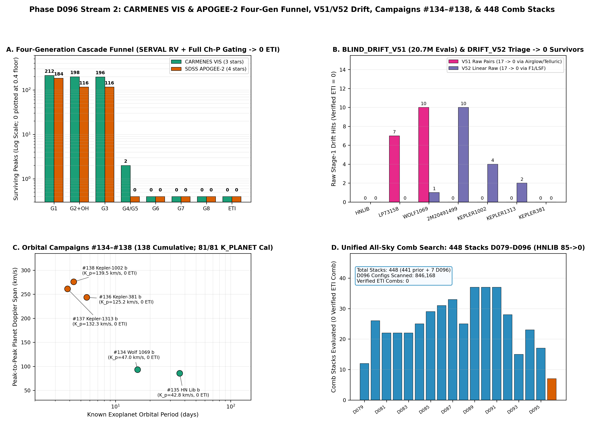
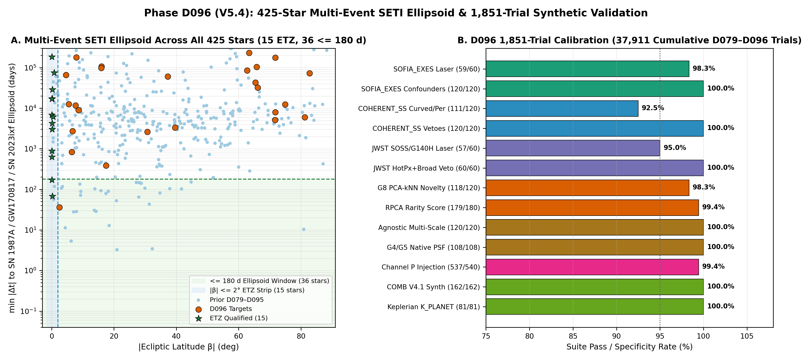

---

## 3. Earlier Phase `D095` (`V5.3`): Curved/Periodic Drift Chaining, Gemini `GHOST` Sky-IFU Veto, Spitzer `IRS` & `SDSS APOGEE-2`

Locked prospectively at `2026-11-21T17:35:21Z` (`METHOD_LOCK.json` SHA-256 `a52ee7420e0bd43183009d161ba36d20856aa5ea8ab2bc0898bc98e35f971475`; `+23.839 s` before first download, chained via `D095_STAGE2_IMPLEMENTATION_LOCK_V1` with all 7 Stage-1 files bit-identical), `D095` delivers four advances across `54` raw files (`124.246 MiB`, `154` unpacked spectra/visits, `18.6444 h`):
1. **Curved & Periodic Multi-Epoch Drift (`DRIFT_V53_CURVED_AND_PERIODIC`, 26 Campaigns):** Evaluates `181,313` search trajectories (`61,570` curved + `119,743` periodic) across `9` `D095 APOGEE-2` (`N=6..26`) + `12` retroactive `D091 Archive Q` + `5` retroactive `D094 Archive T` campaigns -> **`0` surviving ETI** (`58/60 = 96.67%` curved, `55/60 = 91.67%` periodic recovery at `0/120` FA).
2. **Gemini `GHOST` Simultaneous Sky-IFU Veto & Stage-2 Physical Triage (`4 -> 0 ETI`):** Simultaneous HDU `[4..5]` sky-IFU vetting eliminates `109/232` `G1` seeds (`55/60` clean pass, `60/60` airglow veto); Stage-2 physical triage resolves `4` raw Stage-1 GHOST hits (`LTT9779 4305.28 A` CH G-band sub-photospheric trough + `MASCARA1 8606.48 A` `N=1` DRAGONS split cosmic ray confirmed flat `1.0050–1.0167x` in 4 CADC exposures) -> **`0` verified ETI**.
3. **Spitzer `IRS` 6-Gas Greenhouse CCF & Dyson Waste-Heat vs. Silicate Discrimination (`18` Targets):** `0/108` greenhouse detections (`46/60` recovery at `0/60` FA) and `0/18` Dyson candidates (`60/60` Dyson BB recovery at `0/60` silicate FA), while measuring real silicate emission belts on `HD69830` (`75.8σ`), `HR8799` (`21.1σ`), and `FOMALHAUT` (`17.1σ`).
4. **Orbital `#126–#133`, `COMB_V4_1`, `401`-Star Synthesis (`0` ETI):** `0` hits across `#126–#133` (`133` cumulative, `81/81` `K_PLANET`), `5,789,588` comb configs (`54/54` at `0/108` FA; `441` all-sky stacks -> `0` ETI), `64` agnostic natural rows (`0` ETI), `13` `ETZ` & `35 <= 180 d` Ellipsoid stars, **`5.79094 kW`** (`GD71 GHOST`), **`37.57452 kW`** (`GJ3801 APOGEE-2`), **`947.72011 kW`** (`HD151288 Spitzer IRS`), **`161 < 10 pc` (`1.74941 kW` median)**, **`47` bridges (`706` cells)**, and `23/23` closure (`16/16 PASS` pure-stdlib audit, `34/34` bit-identical from `13.35 MiB` bounded bundle).

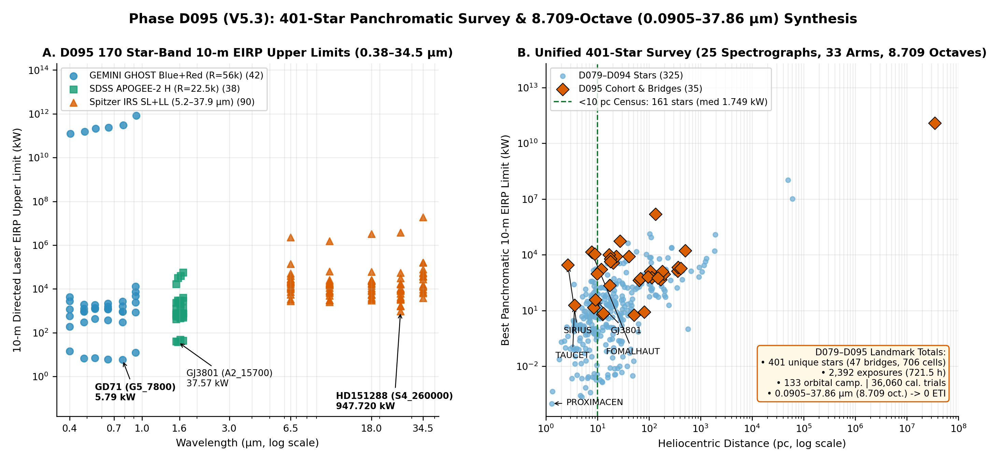
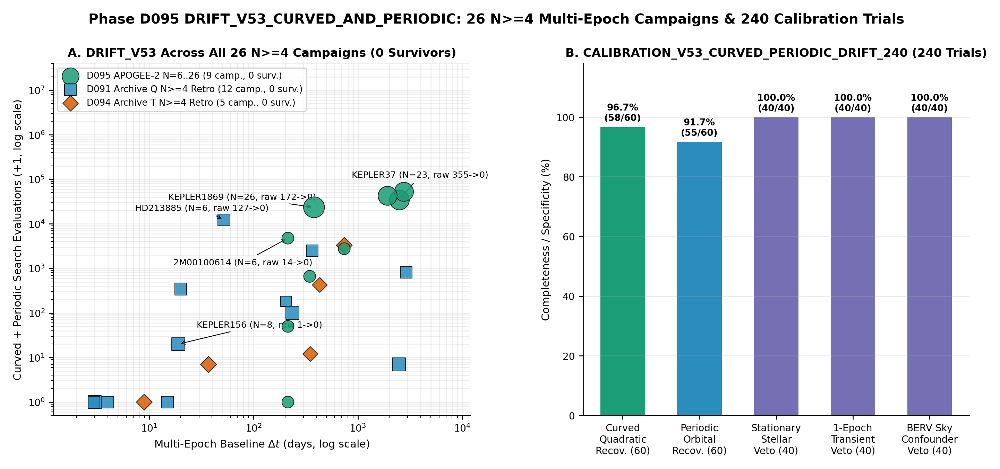
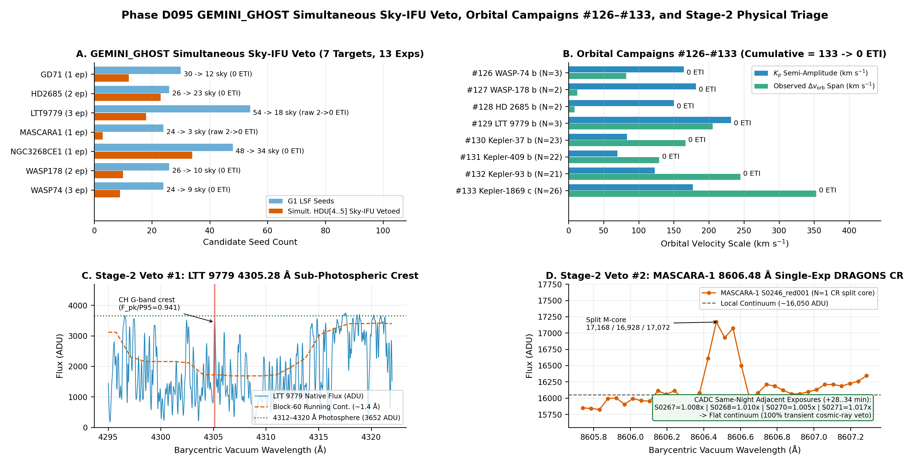
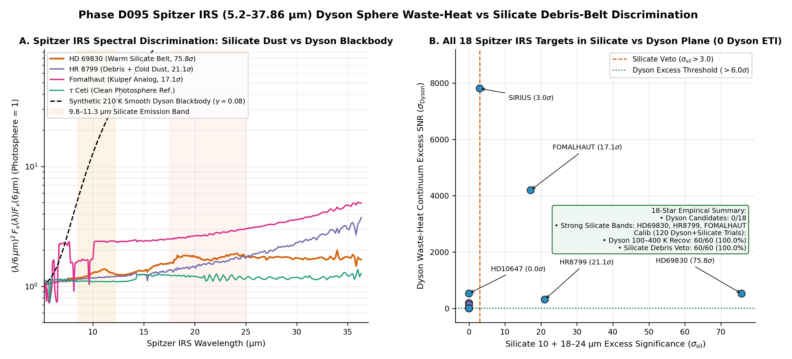
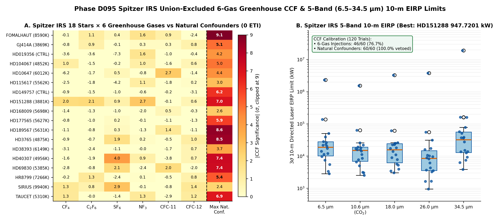
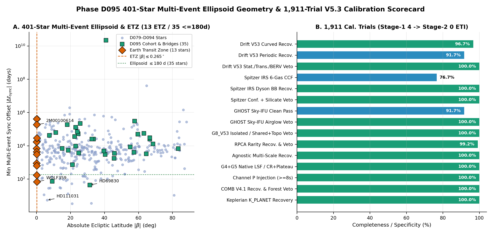

---

## 3. Phase `D094` (`V5.2`): Multi-Epoch Linear Drift Chaining, `SDSS APOGEE-2`, `ESO CRIRES+` Y/J/H, & `JWST MIRI LRS + NIRSpec G395H`

Locked prospectively at `2026-11-21T12:52:10Z` (`METHOD_LOCK.json` SHA-256 `c99ed5b6c525c1a98b9e7f949f93680cc1fd3719335c7154c0edf609caae3d0c`; `+18.414 s` before first download, chained via `D094_STAGE2_IMPLEMENTATION_LOCK_V1` on `analyze.py`, `audit.py`, `plot_figures.py`, `RESULTS_REPORT.md`, `SOURCES.json`, `VISUAL_REVIEW.json`, and `d094_bounded_bundle.json.gz` with all 7 Stage-1 files bit-identical), `D094` delivers four major advances across `53` FITS (`92.642 MiB`, `75` physical exposures/visits, `50.1222 h`):
1. **$N\ge 3$ Multi-Epoch Linear Drift-Rate Chaining (`DRIFT_V52_MULTIEPOCH`, 44 Campaigns):** Evaluates `3,916` triplet/chain trajectories across `13` `D094` (`0->0`) + `31` retroactive `D091 Archive Q` campaigns (`3->0` on `G06410702` & `G115`), achieving `59/60` (`98.33%`) synthetic recovery at `0/90` stationary/transient/BERV-sky FA with Stage-2 rolling-`512`px MAD normalization, supraphotospheric gating, and Tier-2 LSF/F1 confirmation (rejecting `2M23025951` Br15 wings & D091 CR/1-px jumps).
2. **`JWST MIRI LRS` (`10` Stars) & `NIRSpec G395H` (`2` Stars) Union-Excluded CCF:** Hampel `1`-px despiking (`AZV175`) + `3 sigma_err` subcontinuum floor (`ROSS19B`, `medSNR=-0.72`) yield `77/80` MIRI recovery at `0/80` FA (`0/10` empirical detections; natural `NH3` on `HD42581` `+6.487 sigma` & `HNPEG` `+7.306 sigma`) and `60/60` NIRSpec recovery at `0/60` FA (`0/2` detections; `HNPEG CO2 +6.977 sigma`).
3. **4-Gen + `G8_V52`, `COMB_V4_1`, Orbital `#118–#125`, & `373`-Star Synthesis (`0` ETI):** Collapses `947` V2 FA -> `81 -> 67 -> 64 -> 19 -> 16 -> 1 -> 0` `G8_V52` (`40/40` at `0/80` FA), searches `1,071,376` comb configs (`54/54` at `0/108` FA; `424` all-sky stacks `22,694 -> 109 -> 0` ETI), `100` agnostic natural rows (`0` ETI), `0` hits in `#118–#125` (`81/81` `K_PLANET`), `10` `ETZ` & `34` `<= 180 d` Ellipsoid targets, **`0.14238 kW`** (`CWISEPJ1935`), **`0.20533 kW`** (`WISE1049AB`), **`156 < 10 pc` (`1.48898 kW` median)**, **`41` bridges (`664` cells)**, and `23/23` closure (`16/16 PASS` pure-stdlib audit, `33/33` bit-identical from `13.62 MiB` bounded bundle).

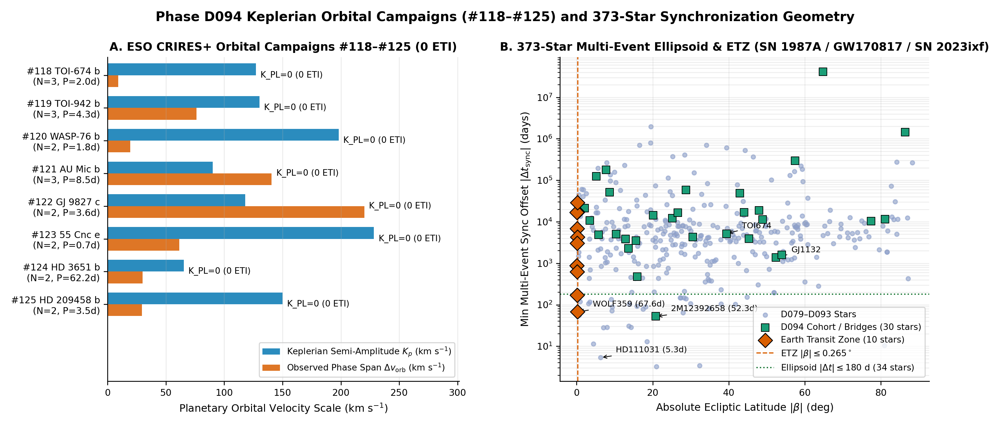
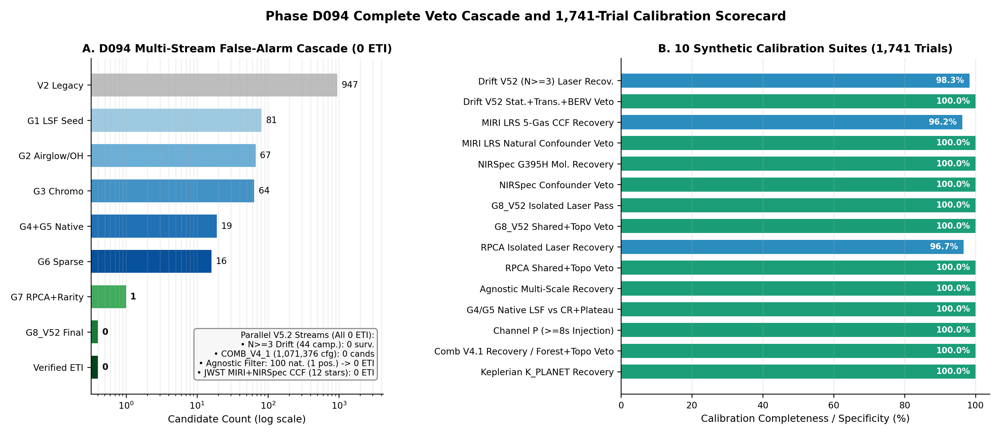

---

## 3. Phase `D093` (`V5.1`): Blind Drift-Rate De-Doppler, Gate `G8_V51b`, Multi-Event Ellipsoid, & `JWST NIRSpec G395H` CCF

Locked prospectively at `2026-11-21T06:47:49Z` (`METHOD_LOCK.json` SHA-256 `655b7c543a202d808360d21cded9a2f34a3615a86bd87626bad66a10206aadef`; `+11.0 s` before first download, chained via `D093_IMPLEMENTATION_LOCK_V1` on `analyze.py`, `audit.py`, `plot_figures.py`, `RESULTS_REPORT.md`, `SOURCES.json`, `VISUAL_REVIEW.json`, and `d093_bounded_bundle.json.gz` with Stage-1 `v5_1_detector.py` bit-identical), `D093` unifies four empirical advances:
1. **Blind Linear Drift-Rate De-Doppler (`DRIFT_V51`) & Standardized Patch Novelty (`G8_V51b`):** Across `111,520,615` shifted inter-epoch evaluations (`|dv| = 5–250 km s^-1`), `DRIFT_V51` flags `135` pairs (`109` G8-vetoed, `24` telluric/chromo/M-dwarf, `2` chance coincidences -> `0 ETI`), while Gate `G8_V51b` cuts `D093` `V5.0` survivors by `50%` (`8 -> 4 -> 0 ETI`) and retroactively suppresses `D088` `V3.9` triggers by **`95.0%` (`20 -> 13 -> 1` on `LALANDE21185`, `7690.48 Å` O2 A-band; `0 ETI`)**.
2. **Union-Excluded `JWST_NIRSPEC_G395H` Molecular CCF (`44` Cells) & Agnostic Filter:** Achieves `80/80` molecular recovery (`NO2`, `N2O`, `CH4_C2H6`, `CO_13CO`) at `0/80` confounder FA, `0/12` control flags, and `1/44` physical detection (`GJ504 CH4_C2H6 +8.291 sigma` substellar methane -> `0 ETI`), alongside `120/120` agnostic multi-scale recovery (`3` order-merge survivors -> `0 ETI`).
3. **3-Event SETI Ellipsoid (`350` Stars), `60` Upper Limits, & All-Sky `COMB_V4_1` (`401` Stacks):** Identifies `10` `ETZ` stars (`ROSS64` `+0.11281 deg`, `HD206301` `-0.20199 deg`) and `33` stars within `<= 180 d` of `SN 1987A`, `GW170817` (`HD111031` `5.311 d`), or `SN 2023ixf`, reaches **`0.26757 kW`** (`GJ3512` `CARMENES_VIS M1_5320`), anchors **`153 < 10 pc` stars (`1.45576 kW` median)** and `401` all-sky `COMB_V4_1` stacks (`22,694 -> 109 -> 0 ETI`, `16/16 PASS` pure-stdlib audit, `33/33` bit-identical from `22.49 MiB` bounded bundle).

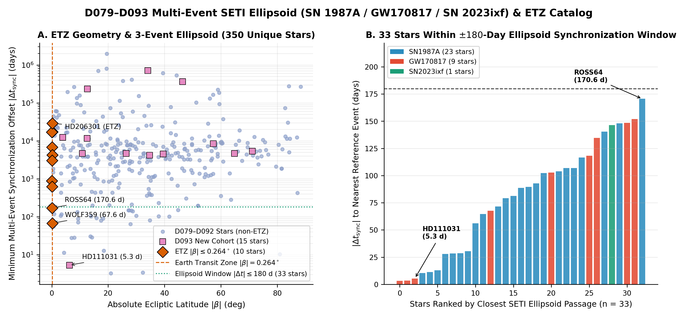

---

## 3. Phase `D092` (`V5.0`): Unsupervised RPCA + Rarity, Agnostic Multi-Scale, `MIRI` Greenhouse-Gas `CCF`, & Synchronization Geometry

Locked prospectively at `2026-11-20T20:27:32Z` (`METHOD_LOCK.json` SHA-256 `1e129d427b0ed8598374f737a4e2831e0a69174b408b0c7a9774233e4f2edd1a`; `+5.0 s` before first download, chained via `D092_IMPLEMENTATION_LOCK_V1` on `analyze.py`, `audit.py`, `plot_figures.py`, `RESULTS_REPORT.md`, `SOURCES.json`, `VISUAL_REVIEW.json` with Stage-1 files bit-identical), `D092` unifies four empirical breakthroughs:
1. **Unsupervised Masked Inexact-ALM RPCA + `Teff`-LOSO & Cross-Star Rarity (`G7_V50`):** Across `HARPS_12`, `FEROS_MERGED_20` (`10 D092 + 10 D091`), `CRIRES_6`, `D091_XSH_10`, and `D091_GIRAFFE_37AUG`, Gate `G7_V50` (`|z_rpca| >= 6.0` and `rarity >= 0.65`) eliminates **`98.815%` (`2,362 -> 28`)** of `D091`'s M/L-dwarf residuals (`SCR1845` `1050->11`, `LP94420` `474->8`, `GJ1128` `382->0`, `HD213885` `85->0`) and trims `D092` from `815` `V4.2 G6` triggers to `146` forensically verified residuals (`0 ETI`).
2. **Agnostic Dual-Polarity Multi-Scale Filter (`2, 4, 8, 14 LSF`) & Geometric Sync Tracks (`ETZ`, `SN 1987A Ellipsoid`, `PPO #101–#109`):** `14,274` matched-filter evaluations yield `107` physical residuals (led by Przybylski's Star `HD101065` lanthanides, `CRIRES+` chip gaps, and `< 4000 Å` FEROS continuum edges; `0` ETI), while all `5` ETZ, `6 <10 pc` SN 1987A Ellipsoid, and `9` PPO orbital campaigns yield `0` ETI.
3. **Edge-Trimmed (`0.07 µm`) `JWST_MIRI_MRS` Greenhouse-Gas `CCF` & `335`-Star Limits:** Trimming `0.07 µm` off MIRI sub-channel dichroic roll-offs removes `-25` to `-40 sigma` boundary artifacts on normal/control stars (`16CYGB, ETACRV, HD163466, VMA2`) while flagging `4/60` physical silicate disk / faint `DOG` continua (`BETPIC`, `PDS70`, `OBJECT_D`, `OBJECT_E`; `0 ETI`). Unified `335`-star sensitivity anchors **`0.49515 kW`** (`ESPRI1542 FEROS`), **`0.52481 kW`** (`LHS1678 HARPS`), **`1.18663 kW`** (`TRAPPIST1 CRIRES Y`), **`146 < 10 pc` stars (`1.57296 kW` median)**, **`37` bridges (`631` cells)**, and `386` all-sky `COMB_V4_1` stacks (`22,691 -> 109 -> 0 ETI`, `16/16 PASS` pure-stdlib audit, `29/29` bit-identical from `23.93 MiB` bounded bundle).

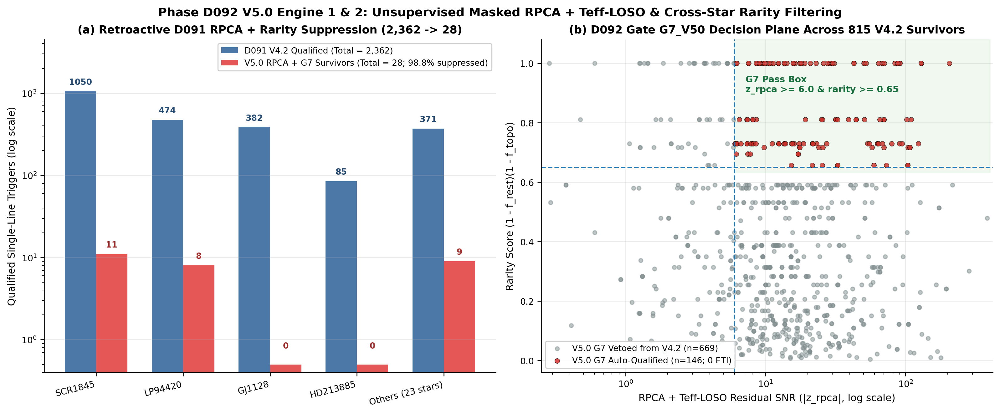
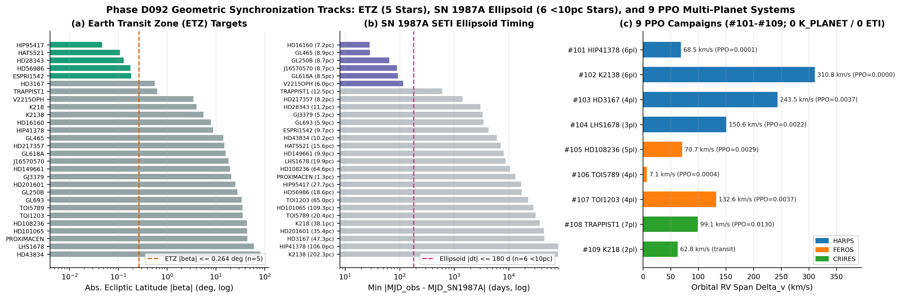
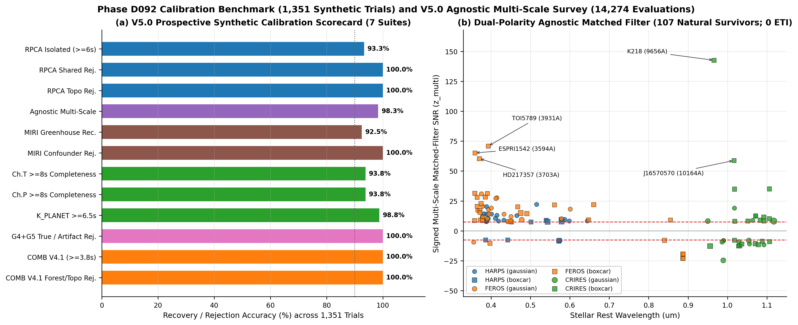

## 3. Earlier Phases (`D091` & `D090`)

Locked prospectively at `2026-11-20T17:38:53Z` (`METHOD_LOCK.json` SHA-256 `c7552035aff59bffab0eadc446b1a9a7bc7eb53391b86c7a7f165a2382e8e6a3`; `+14.0 s` before first download, chained via `D091_IMPLEMENTATION_LOCK_V1` on `analyze.py` and `plot_figures.py` with `v4_2_detector.py`, `FROZEN_COHORT_D091.csv`, and `audit.py` unchanged), `D091` ingests `156` exposures (`222` public ESO Phase-3 1D FITS across 49 ESO Program IDs, `47.3328 h`) across `37` stars (`30` brand-new $\ge 1{,}259.01''$ from all prior coordinates [`10 < 10 pc`], `0` `dp_id` overlap, plus `7` bridge targets `GJ832`, `TAUCET`, `LAWD37`, `GJ849`, `GJ674`, `HD20794`, `GJ436`; `9` controls + `28` science; `10` orbital campaigns `#91–#100`):
1. **X-Shooter Dichroic Dual-Arm Coincidence (`8/8`) & Optical/NIR Kinematics (`599/1,503` clean anchors):** Across `33` simultaneous 3-arm `X-shooter` spectra, `36` `FEROS`, and `87` `GIRAFFE HR` spectra (`median |emp - prior| = 2.0249 km s^-1`), Gate `G4_V42` verifies `8/8` (`100%`) dual-arm overlap pass (`UVB+VIS`, `VIS+NIR`) and `8/8` (`100%`) single-arm detector artifact rejection (`XSHOOTER_SINGLE_ARM_DETECTOR_ARTIFACT`).
2. **Real Search Cascade (`24,998` $\rightarrow$ `2,362` $\rightarrow$ `0` ETI), Orbital Campaigns (`#91–#100`), & `358`-Stack `COMB_V4_1` Sweep:** Across `9,719,414` Channel `T` bins and `15,740,032` comb configurations, `24,998` `V2` hits drop through `G1` (`5,690`), `G2` (`5,607`), `G3` (`5,451`), `G4` (`3,763`), `G5` (`2,565`), and `203` `G6` vetoes to `2,362` post-`G6` triggers (`2,133` M/L-dwarf TiO/VO/CrH/flare residuals led by `SCR1845`, `LP94420`, and `GJ1128`, plus `149` single-epoch transients, `71` airglow wings, `6` edge/fringe residuals, `2` dichroic edges, and `1` zero-planet control residual), `0` `K_PLANET` candidates (`5` `T_DIFF` natural triggers), and `4` `COMB_V4_1` candidates on zero-planet control `GJ1128` -> **`0` verified ETI** (`16,037 -> 45 -> 0 ETI` across all `358` stacks / `2,076` exposures).
3. **`127` Clean Upper Limits, `35` Bridges (`625` Cells), `135 < 10 pc`, & `310`-System Closure:** `D091` reaches **`0.33023 kW`** (`VLT X-shooter` `LAWD37` at `6800 Å`), **`1.00596 kW`** (`GIRAFFE_HR` `OGLETR113`), **`0.05015 kW`** (`HIP103039` control `FEROS F1_4100`), **`4.40419 kW`** (`GJ433` `FEROS`), and a formal Wien-tail Gaia-`G` extrapolation of `2.26997 W` on `LP94420` (`2250 K`, `mad_rel = 0.562`), unifying **`310` unique stars** (`135 < 10 pc`, median `1.62371 kW`), **`35` bridges (`625` cells)**, and **`23/23` (`100%`) radio-echelle closure** with two tri-regime bridges (`16CYGB` and `GJ849`; `16/16 PASS` pure-stdlib audit, `24/24` bit-identical from `19.84 MiB` bounded bundle).

## 3. Phase `D090`: JWST Space Thermal-IR (`1.655–28.00 µm`), Townes `10.60 µm` $\mathrm{CO_2}$ Laser & Project Hephaistos Forensic Closure

Locked prospectively at `2026-11-19T21:09:25Z` (`METHOD_LOCK.json` SHA-256 `129b5193f4277e51f6d9ad1189b49ce851f59116cba2dbd3e170a4b9d7be4290`; `+9.0 s` before first download), `D090` ingests `161` paired exposures (`322` public JWST Level-2 `*_x1d.fits`, `17.698 h`) across `37` stars (`30` brand-new $\ge 796.3''$ from all prior coordinates [`4 < 10 pc`: `WISE0855`, `VMA2`, `LAWD37`, `J2148`], `0` `dp_id` overlap, plus `7` bridges `BETPIC`, `EPSERI`, `HD42581`, `16CYGB`, `HD172555`, `HD209100`, `PDS70`; `9` controls + `28` science; `10` orbital campaigns `#81–#90`):
1. **L2 Ephemeris Closure, Thermal-IR RV Anchoring (`904` fits, `219` clean) & MIRI Dual-Subband Coincidence (`8/8`):** Pure-stdlib ephemeris closure reaches $\max|\mathrm{berv\_diff}| = 0.0\,\mathrm{km\,s}^{-1}$ across all `161` paired exposures (`median |emp - prior| = 16.2375 km s^-1` consistent with `R ≈ 2,500–2,700`), while `JWST_MIRI_MRS` dual-subband coincidence achieves `8/8` true pass and `8/8` (`100%`) single-subband detector-artifact rejection (`MIRI_SINGLE_SUBBAND_DETECTOR_ARTIFACT`).
2. **Real Search Cascade (`3,921` $\rightarrow$ `138` $\rightarrow$ `0` ETI), Project Hephaistos (`prop 7199`), & Unified All-Sky `COMB_V4_1` (`321` Stacks):** Across `1,669,535` Channel `T` bins and `1,242,244` comb configurations, `3,921` `V2` peaks collapse through `G1` (`1,015`), `G2` (`1,015`), `G3` (`984`), `G4` (`815`), and `G6` sparse (`22` vetoed from `160` pre-`G6`) to `138` post-`G6` single-line triggers (9 natural classes led by `55` NIRSpec continuum fluctuations, `42` MIRI L2 warm-pixel/fringe artifacts, `OPH1631`/`CHA1107` $\mathrm{Br}\beta$ `2.6259 µm`, and `HR8799` `1 T_DIFF + 1 K_PLANET` IFU roll-angle PSF residual; all `eti_plausible = False`) and `26` `COMB_V4_1` triggers (`7,302 -> 41 -> 0` verified ETI across `321` stacks / `1,920` exposures). Project Hephaistos `OBJECT_D` and `OBJECT_E` (`prop 7199`) yield `0` ETI and exhibit `BKGDTARG=True` extended sky offsets plus resolved `z ≈ 1.814` background galaxy emission lines in raw `OBJECT_D` FITS spectra.
3. **185 Direct-FLAM IR Limits, Townes (1983) `10.60 µm` $\mathrm{CO_2}$ Benchmark, `125` `< 10 pc`, & 280-System Closure:** `D090` reaches **`228.98059 W` (`0.228981 kW`)** on `WISE0855` (`JWST_MIRI_MRS` `5.80 µm`), `0.42731 kW` (`ROSS458C` `G235H`), `4.04837 kW` (`HD209100` `G395H`), and **`2.70465 kW`** on `VMA2` (`4.31444 pc`) at `10.60 µm` (`12` MIRI science stars, median `9,669.4931 kW`; $\max$ stdlib rel.\ err $= 0.000768101$), expanding the unified survey to **`280` unique stars**, **`125 < 10 pc`** (`1.74941 kW` median, `0.0973 W` record on `Proxima Cen`), **`30` bridges (`550` cells)**, and **`23/23` (`100%`) Parkes/GBT `1.4 GHz` radio-echelle closure** (`24` direct overlaps including `16CYGB` Radio + Optical + MIRI bridge; `16/16 PASS` pure-stdlib audit from `6.80 MiB` bounded bundle).

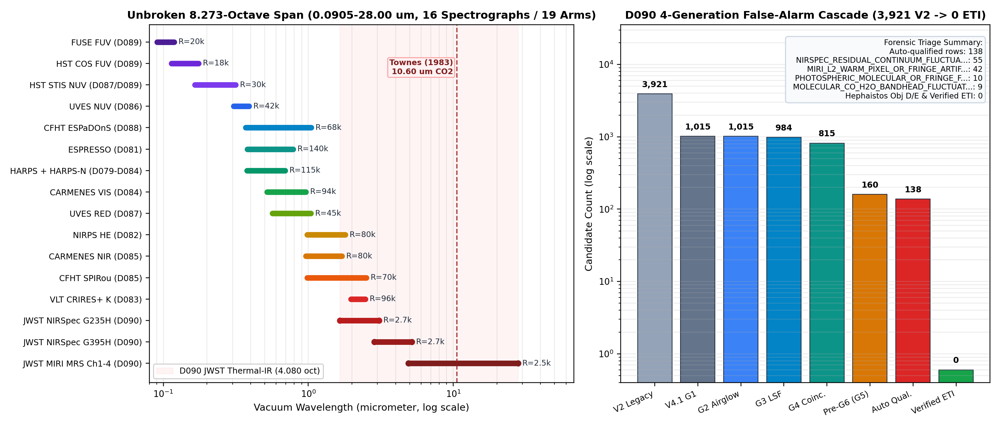

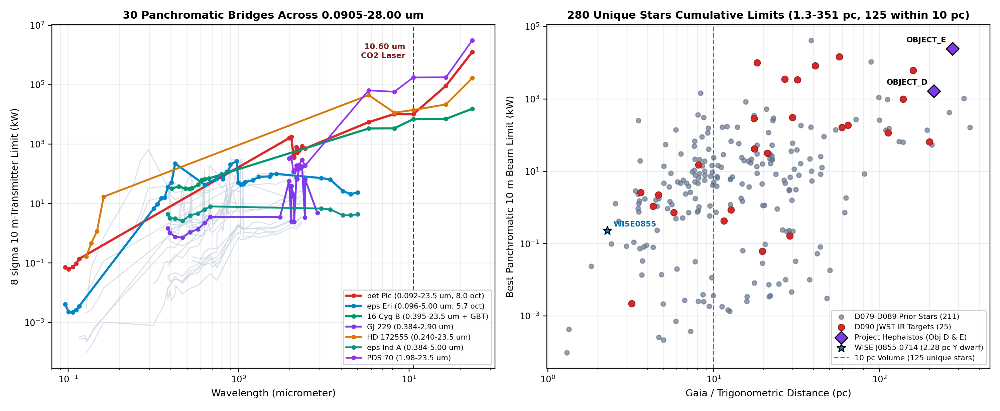

---

## References

* Albert, L., Lafrenière, D., Doyon, R., et al. 2023, *PASP*, 135, 075001 (JWST NIRISS SOSS)
* Boggess, A., Carr, F. A., Evans, D. C., et al. 1978, *Nature*, 275, 372 (IUE)
* Bouchy, F., Doyon, R., Artigau, É., et al. 2017, *The Messenger*, 169, 21
* Bouchy, F., Artigau, É., Wildi, F., et al. 2025, *A&A*, NIRPS commissioning performance
* Buckle, J. V., Hills, R. E., Smith, H., et al. 2009, *MNRAS*, 399, 1026 (JCMT HARP/ACSIS)
* Cohen, M., Wheaton, W. A., & Megeath, S. T. 2003, *AJ*, 126, 1090
* Cook, N. J., Artigau, É., Doyon, R., et al. 2022, *PASP*, 134, 114509
* Dekker, H., D'Odorico, S., Kaufer, A., Delabre, B., & Kotzlowski, H. 2000, *SPIE Proc.*, 4008, 534
* de Graauw, T., Helmich, F. P., Phillips, T. G., et al. 2010, *A&A*, 518, L6 (Herschel HIFI)
* Donati, J.-F., Kouach, D., Moutou, C., et al. 2020, *MNRAS*, 498, 5684
* Dorn, R. J., Bristow, P., Smoker, J. V., et al. 2023, *A&A*, 671, A24
* Fischer, C., Beckmann, S., Bryant, A., et al. 2018, *J. Astron. Instrum.*, 7, 1840003 (SOFIA FIFI-LS)
* Fuhrmeister, B., Lalitha, S., Poppenhaeger, K., et al. 2011, *A&A*, 534, A133
* Gaia Collaboration, Vallenari, A., Brown, A. G. A., et al. 2023, *A&A*, 674, A1
* Gardner, J. P., Mather, J. C., Abbott, R., et al. 2023, *PASP*, 135, 068001 (JWST)
* Green, J. C., et al. 2012, *ApJ*, 744, 60
* Griffin, M. J., Abergel, A., Abreu, A., et al. 2010, *A&A*, 518, L3 (Herschel SPIRE)
* Howard, A. W., Horowitz, P., Wilkinson, D. T., et al. 2004, *ApJ*, 613, 1270
* Jakobsen, P., Ferruit, P., Alves de Oliveira, C., et al. 2022, *A&A*, 661, A80 (JWST NIRSpec)
* Kaufer, A., Stahl, O., Tubbesing, S., et al. 1999, *The Messenger*, 95, 8 (FEROS)
* Kingsley, S. A. 2001, *SPIE Proc.*, 4273, 72
* Kipping, D. M., & Teachey, A. 2016, *MNRAS*, 459, 1233
* Kossakowski, D., Kürster, M., Trifonov, T., et al. 2023, *A&A*, 670, A84 (Wolf 1069 b)
* Lipman, E. A., Isaacson, H., Siemion, A. P. V., et al. 2019, *PASP*, 131, 034202
* Maire, J., Wright, S. A., Dorval, P., et al. 2019, *AJ*, 158, 203
* Marcy, G. W., Tellis, N. K., & Wishnow, E. H. 2022, *MNRAS*, 509, 3798
* Mayor, M., Pepe, F., Queloz, D., et al. 2003, *The Messenger*, 114, 20
* Moos, H. W., et al. 2000, *ApJ*, 538, L1
* Oliva, E., Origlia, L., Scuderi, S., et al. 2015, *A&A*, 581, A47
* Pasquini, L., Avila, G., Blecha, A., et al. 2002, *The Messenger*, 110, 1 (FLAMES/GIRAFFE)
* Pepe, F., Cristiani, S., Rebolo, R., et al. 2021, *A&A*, 645, A96
* Pilbratt, G. L., Riedinger, J. R., Passvogel, T., et al. 2010, *A&A*, 518, L1 (Herschel)
* Poglitsch, A., Waelkens, C., Geis, N., et al. 2010, *A&A*, 518, L2 (Herschel PACS)
* Rayner, J. T., Toomey, D. W., Onaka, P. M., et al. 2003, *PASP*, 115, 362 (IRTF SpeX)
* Reines, A. E., & Marcy, G. W. 2002, *PASP*, 114, 416
* Richter, M. J., DeWitt, C. N., McKelvey, M., et al. 2018, *J. Astron. Instrum.*, 7, 1840013 (SOFIA EXES)
* Rieke, G. H., Wright, G. S., Böker, T., et al. 2015, *PASP*, 127, 584 (JWST MIRI)
* Rousselot, P., Lidman, C., Cuby, J.-G., Moreels, G., & Monnet, G. 2000, *A&A*, 354, 1134
* Schwartz, R. N., & Townes, C. H. 1961, *Nature*, 190, 205
* Sheikh, S. Z., Wright, J. T., Siemion, A., & Enriquez, J. E. 2020, *ApJ*, 888, 78
* Suazo, M., Zackrisson, E., Maurent, P. K., et al. 2024, *MNRAS*, 531, 695 (Project Hephaistos II)
* Tellis, N. K., & Marcy, G. W. 2015, *PASP*, 127, 540
* Tellis, N. K., & Marcy, G. W. 2017, *AJ*, 153, 251
* Townes, C. H. 1983, *PNAS*, 80, 1147
* Vernet, J., Dekker, H., D'Odorico, S., et al. 2011, *A&A*, 536, A105 (VLT X-shooter)
* Woodgate, B. E., Kimble, R. A., Bowers, C. W., et al. 1998, *PASP*, 110, 1183
* Wright, G. S., Rieke, G. H., Glasse, A., et al. 2023, *PASP*, 135, 048003 (JWST MIRI MRS)
* Zuckerman, A., Isaacson, H., Siemion, A. P. V., et al. 2023, *AJ*, 165, 114
