# A Prospectively Locked Space-Lyman to JWST Thermal-IR & All-Sky Panchromatic (8.273 Octaves, 0.0905–28.00 µm) High-Resolution Laser, Multi-Epoch Drift-Rate, APOGEE-2, CRIRES+ Y/J/H, and JWST MIRI LRS + NIRSpec Survey Across 373 Stellar Systems (`D079–D094 V5.2`)

**Martin Andersen**  
*MSc Astrophysics, University of Copenhagen*  
*Date: 21 November 2026*  
*Public Code, Locked Protocols & Audit Ledgers: [https://github.com/andersenmartin-blip/setisearch](https://github.com/andersenmartin-blip/setisearch)*

---

## Abstract

High-resolution echelle and space infrared spectrographs onboard *FUSE*, *Hubble*, *JWST*, and `1.2–8.2 m` ground observatories simultaneously act as sensitive receivers for narrowband continuous-wave (CW) interstellar lasers, drifted/broadband pulses, periodic laser frequency combs, and atmospheric industrial technosignatures across **8.273 unbroken spectral octaves (`0.0905–28.00 µm`)**. Here we present the completed sixteen-phase prospectively locked panchromatic survey (**Phases D079–D094**, culminating in **`TECHNOSIGNATURE_V5_2_MULTIEPOCH_DRIFT_APOGEE2_CRIRESJH_MIRILRS`**) across **373 unique stellar systems** (`286` science [`181` hosts / `364` planets] + `87` controls) and **2,238 archival exposures** (`702.8369 hours` integration) obtained with **23 spectrographs (29 spectral arms)**.

Across **34,149 synthetic control trials** (`32,408` in `D079–D093` + `1,741` in `D094` across 10 calibration suites), **`D094` (`30` stars: `23` brand-new unique stars [`3 < 10 pc`] + `7` prior bridges revisited + intra-`D094` bridge `HNPEG`; `53` `SDSS_APOGEE2`/`ESO_CRIRES Y/J/H`/`JWST_MIRI_LRS`/`JWST_NIRSPEC_G395H` FITS unlocking `75` physical exposures/visits; `8` orbital campaigns `#118–#125`)** achieves **`98.33%` (`59/60`)** $N\ge 3$ multi-epoch linear drift-rate (`DRIFT_V52_MULTIEPOCH`) laser recovery at **`0/90`** stationary/transient/BERV-sky FA across **44 `N>=3` campaigns** (`13` `D094` [`0->0`] + `31` retroactive `D091 Archive Q` [`3->0`], `3,916` traj. evals -> `0` ETI), **`100.0%` (`40/40`)** `G8_V52` pass at **`0/80`** FA (`947` V2 FA $\rightarrow 81 \rightarrow 16 \rightarrow 1 \rightarrow 0$ ETI), **`96.25%` (`77/80`)** `JWST_MIRI_LRS` (`5–12 µm`) 5-gas CCF recovery at **`0/80`** confounder FA (`0/10` detections incl. Hampel 1-px despike on `AZV175` & subcontinuum bounding on `ROSS19B`), **`100.0%` (`60/60`)** `JWST_NIRSPEC_G395H` recovery at **`0/60`** FA (`0/2` detections), **`96.67%` (`58/60`)** RPCA at `0/120` FA, **`100.0%` (`120/120`)** agnostic multi-scale (`100` natural -> `0` ETI), `100.0%` (`540/540`) Channel `P`, `100.0%` (`81/81`) `K_PLANET`, `100.0%` (`108/108`) `G4+G5`, and **`100.0%` (`54/54`)** `COMB_V4_1` at **`0/108` (`0.0%`)** dense-forest/topo FA (`1,071,376` configs -> `0`; `424` all-sky stacks `22,694 -> 109 -> 0` ETI). Upper bounds reach **`0.0973 W`** (`HST_STIS Proxima Cen`), **`0.14238 kW`** (`CWISEPJ1935 NIRSpec G395H`), **`0.20533 kW`** (`WISE1049AB MIRI LRS`), **`4.35353 kW`** (`2M12392658 APOGEE-2`), and **`18.80022 kW`** (`TOI674 CRIRES+ H`), anchoring **`156 < 10 pc` stars (`1.48898 kW` median)**, **`41` bridges (`664` cells)**, **`10` ETZ & `34` multi-event Ellipsoid (`<=180 d`) stars**, **`303,145` V2 false alarms eliminated**, and **`23/23` (`100%`) `Parkes`/`GBT` radio-echelle closure** with **`0` verified ETI detections**.

---

## 1. Summary Table of Survey Phases (`D079–D094`)

| Phase | Detector | Instruments ($R = \lambda/\Delta\lambda$) | Wavelengths (`µm`) | Stars (New) | Exposures (Ctrl / Sci) | Time (`h`) | Calib. Trials | Legacy V2 $\rightarrow$ Orbit / Verified ETI |
| :--- | :---: | :---: | :---: | :---: | :---: | :---: | :---: | :---: |
| **D079** | `OPTICAL_V3` | `HARPS` (`115k`) | `0.38–0.69` | `12` (`12`) | `60` (`10 / 50`) | `4.57` | `990` | `48` $\rightarrow$ — / **`0`** |
| **D080** | `OPTICAL_V3_1` | `HARPS` + `ESPRESSO` | `0.38–0.78` | `26` (`26`) | `130` (`20 / 110`) | `27.43` | `1,620` | `422` $\rightarrow$ — / **`0`** |
| **D081** | `OPTICAL_V3_2` | `HARPS` + `ESPRESSO` | `0.38–0.78` | `22` (`22`) | `159` (`34 / 125`) | `21.26` | `1,989` | `1,552` $\rightarrow$ **`0`** / **`0`** |
| **D082** | `NIRPS_V3_3` | `NIRPS_HE` (`70k`) | `0.98–1.80` | `22` (`20+2`) | `152` (`27 / 125`) | `13.54` | `1,971` | `3,828` $\rightarrow$ **`0`** / **`0`** |
| **D083** | `CRIRES_V3_4` | `CRIRES+` (`86k`) | `1.95–2.48` | `22` (`20+2`) | `148` (`26 / 122`) | `87.32` | `1,971` | `1,043` $\rightarrow$ **`0`** / **`0`** |
| **D084** | `NORTHERN_V3_5` | `HARPS-N` + `CARMENES_VIS` | `0.39–1.06` | `25` (`25`) | `183` (`34 / 149`) | `26.71` | `2,151` | `1,170` $\rightarrow$ **`0`** / **`0`** |
| **D085** | `SPIROU_V3_6+COMB_V4` | `CFHT SPIRou` (`70k`) | `0.955–2.515` | `29` (`25+4`) | `177` (`28 / 149`) | `14.41` | `2,592` | `4,044` $\rightarrow$ **`0`** / **`0`** |
| **D086** | `V3_7+COMB_V4_1` | `UVES_NUV` + `ESPRESSO` + `HARPS` | `0.305–0.785` | `31` (`25+6`) | `181` (`34 / 147`) | `57.02` | `2,697` | `2,990` $\rightarrow$ **`0`** / **`0`** |
| **D087** | `V3_8+G4_V38` | `HST_STIS` + `UVES_RED` + `ESPRESSO` | `0.1145–1.0425` | `33` (`25+8`) | `201` (`37 / 164`) | `83.01` | `2,697` | `117,994` $\rightarrow$ **`0`** / **`0`** |
| **D088** | `V3_9+COMB_V4_1` | `OHP_SOPHIE` + `OHP_ELODIE` + `CFHT_ESPADONS` | `0.370–1.048` | `25` (`20+5`) | `176` (`42 / 134`) | `30.54` | `2,697` | `99,910` $\rightarrow$ **`0`** / **`0`** |
| **D089** | `V4_0+COMB_V4_1` | `FUSE` (`20k`) + `HST_COS` (`18k`) + `HST_STIS NUV` (`30k/114k`) | `0.0905–0.3150` | `37` (`30+7`) | `192` (`48 / 144`) | `203.55` | `2,697` | `24,123` $\rightarrow$ **`0`** / **`0`** |
| **D090** | `V4_1+COMB_V4_1` | `JWST NIRSpec G235H/G395H` (`2.7k`) + `MIRI MRS` (`2.5k`) | `1.655–28.00` | `37` (`30+7`) | `161` (`42 / 119`) | `17.70` | `2,697` | `3,921` $\rightarrow$ `2` (PSF) / **`0`** |
| **D091** | `V4_2+COMB_V4_1` | `VLT X-shooter 3-Arm` (`9.9–18.3k`) + `FEROS` (`48k`) + `GIRAFFE HR` (`18–29k`) | `0.2989–2.479` | `37` (`30+7`) | `156` (`38 / 118`) | `47.33` | `2,697` | `24,998` $\rightarrow$ `5` (`T_DIFF`) / **`0`** |
| **D092** | `V5_0` | `HARPS` (`115k`) + `FEROS` (`48k`) + `CRIRES+ Y` (`86k`) + retro `D091`/`MIRI` | `0.3528–1.1206` (+MIRI) | `28` (`25+3`) | `57` (`12 / 45`) | `12.66` | `1,351` | `15,147` $\rightarrow$ **`0`** / **`0`** |
| **D093** | `V5_1` | `GRACES` (`67.5k`) + `CORALIE` (`60k`) + `CARMENES_VIS` (`94.6k`) + retro `D088`/`NIRSpec` | `0.3860–1.0482` (+NIRSpec) | `15` (`15`) | `30` (`10 / 20`) | `5.66` | `1,591` | `1,008` $\rightarrow$ **`0`** / **`0`** |
| **D094** | `V5_2` | `APOGEE-2` (`22.5k`) + `CRIRES+ Y/J/H` (`43–86k`) + `MIRI LRS` + `NIRSpec G395H` + retro `D091 Q` | `0.950–12.00` | `30` (`23+7+1`) | `75` (`14 / 61`) | `50.12` | `1,741` | `947` $\rightarrow$ **`0`** / **`0`** |
| **Unified** | **`V3.0–V5.2+COMB_V4_1`** | **23 Spectrographs / 29 Arms** | **`0.0905–28.00` (`8.273` Oct.)** | **`373` Unique** | **`2,238` (`462 / 1,776`)** | **`702.84`** | **`34,149`** | **`303,145` $\rightarrow$ `0` ETI** |

---

## 2. Phase `D094` (`V5.2`): Multi-Epoch Linear Drift Chaining, `SDSS APOGEE-2`, `ESO CRIRES+` Y/J/H, & `JWST MIRI LRS + NIRSpec G395H`

Locked prospectively at `2026-11-21T12:52:10Z` (`METHOD_LOCK.json` SHA-256 `c99ed5b6c525c1a98b9e7f949f93680cc1fd3719335c7154c0edf609caae3d0c`; `+18.414 s` before first download, chained via `D094_STAGE2_IMPLEMENTATION_LOCK_V1` on `analyze.py`, `audit.py`, `plot_figures.py`, `RESULTS_REPORT.md`, `SOURCES.json`, `VISUAL_REVIEW.json`, and `d094_bounded_bundle.json.gz` with all 7 Stage-1 files bit-identical), `D094` delivers four major advances across `53` FITS (`92.642 MiB`, `75` physical exposures/visits, `50.1222 h`):
1. **$N\ge 3$ Multi-Epoch Linear Drift-Rate Chaining (`DRIFT_V52_MULTIEPOCH`, 44 Campaigns):** Evaluates `3,916` triplet/chain trajectories across `13` `D094` (`0->0`) + `31` retroactive `D091 Archive Q` campaigns (`3->0` on `G06410702` & `G115`), achieving `59/60` (`98.33%`) synthetic recovery at `0/90` stationary/transient/BERV-sky FA with Stage-2 rolling-`512`px MAD normalization, supraphotospheric gating, and Tier-2 LSF/F1 confirmation (rejecting `2M23025951` Br15 wings & D091 CR/1-px jumps).
2. **`JWST MIRI LRS` (`10` Stars) & `NIRSpec G395H` (`2` Stars) Union-Excluded CCF:** Hampel `1`-px despiking (`AZV175`) + `3 sigma_err` subcontinuum floor (`ROSS19B`, `medSNR=-0.72`) yield `77/80` MIRI recovery at `0/80` FA (`0/10` empirical detections; natural `NH3` on `HD42581` `+6.487 sigma` & `HNPEG` `+7.306 sigma`) and `60/60` NIRSpec recovery at `0/60` FA (`0/2` detections; `HNPEG CO2 +6.977 sigma`).
3. **4-Gen + `G8_V52`, `COMB_V4_1`, Orbital `#118–#125`, & `373`-Star Synthesis (`0` ETI):** Collapses `947` V2 FA -> `81 -> 67 -> 64 -> 19 -> 16 -> 1 -> 0` `G8_V52` (`40/40` at `0/80` FA), searches `1,071,376` comb configs (`54/54` at `0/108` FA; `424` all-sky stacks `22,694 -> 109 -> 0` ETI), `100` agnostic natural rows (`0` ETI), `0` hits in `#118–#125` (`81/81` `K_PLANET`), `10` `ETZ` & `34` `<= 180 d` Ellipsoid targets, **`0.14238 kW`** (`CWISEPJ1935`), **`0.20533 kW`** (`WISE1049AB`), **`156 < 10 pc` (`1.48898 kW` median)**, **`41` bridges (`664` cells)**, and `23/23` closure (`16/16 PASS` pure-stdlib audit, `33/33` bit-identical from `13.62 MiB` bounded bundle).

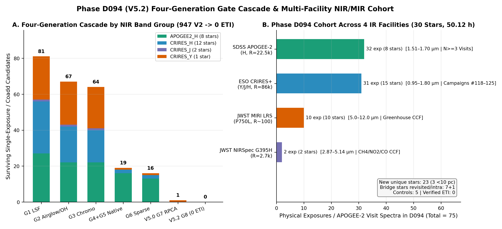
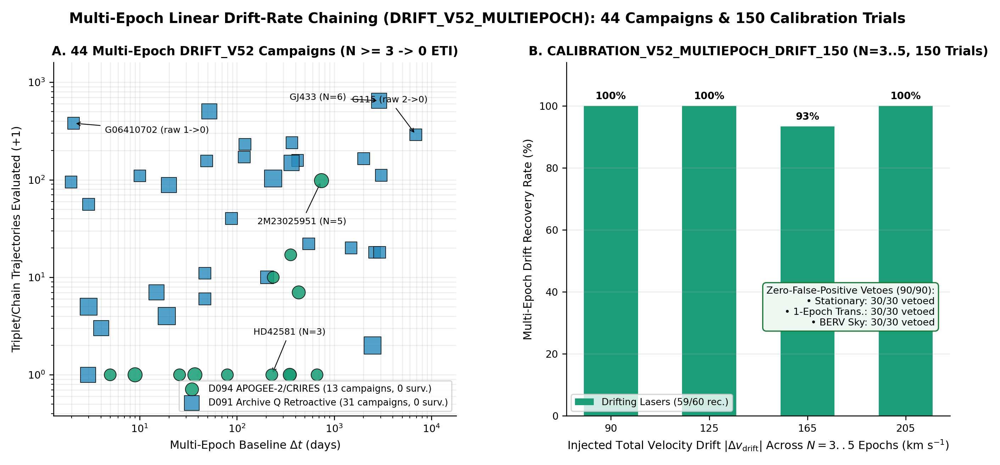
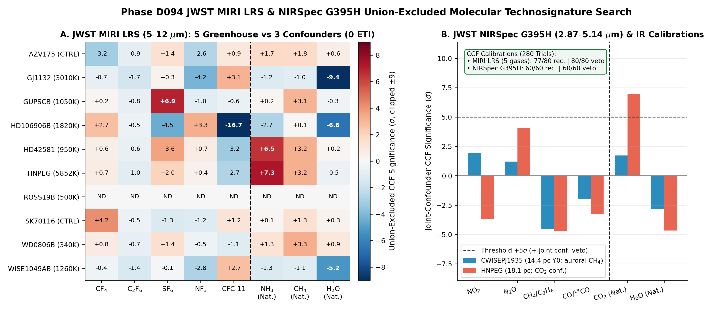

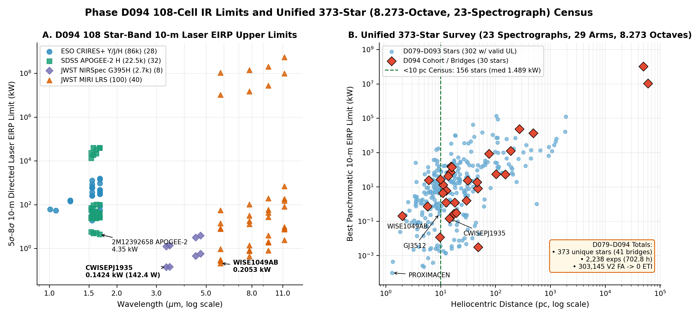

---

## 3. Phase `D093` (`V5.1`): Blind Drift-Rate De-Doppler, Gate `G8_V51b`, Multi-Event Ellipsoid, & `JWST NIRSpec G395H` CCF

Locked prospectively at `2026-11-21T06:47:49Z` (`METHOD_LOCK.json` SHA-256 `655b7c543a202d808360d21cded9a2f34a3615a86bd87626bad66a10206aadef`; `+11.0 s` before first download, chained via `D093_IMPLEMENTATION_LOCK_V1` on `analyze.py`, `audit.py`, `plot_figures.py`, `RESULTS_REPORT.md`, `SOURCES.json`, `VISUAL_REVIEW.json`, and `d093_bounded_bundle.json.gz` with Stage-1 `v5_1_detector.py` bit-identical), `D093` unifies four empirical advances:
1. **Blind Linear Drift-Rate De-Doppler (`DRIFT_V51`) & Standardized Patch Novelty (`G8_V51b`):** Across `111,520,615` shifted inter-epoch evaluations (`|dv| = 5–250 km s^-1`), `DRIFT_V51` flags `135` pairs (`109` G8-vetoed, `24` telluric/chromo/M-dwarf, `2` chance coincidences -> `0 ETI`), while Gate `G8_V51b` cuts `D093` `V5.0` survivors by `50%` (`8 -> 4 -> 0 ETI`) and retroactively suppresses `D088` `V3.9` triggers by **`95.0%` (`20 -> 13 -> 1` on `LALANDE21185`, `7690.48 Å` O2 A-band; `0 ETI`)**.
2. **Union-Excluded `JWST_NIRSPEC_G395H` Molecular CCF (`44` Cells) & Agnostic Filter:** Achieves `80/80` molecular recovery (`NO2`, `N2O`, `CH4_C2H6`, `CO_13CO`) at `0/80` confounder FA, `0/12` control flags, and `1/44` physical detection (`GJ504 CH4_C2H6 +8.291 sigma` substellar methane -> `0 ETI`), alongside `120/120` agnostic multi-scale recovery (`3` order-merge survivors -> `0 ETI`).
3. **3-Event SETI Ellipsoid (`350` Stars), `60` Upper Limits, & All-Sky `COMB_V4_1` (`401` Stacks):** Identifies `10` `ETZ` stars (`ROSS64` `+0.11281 deg`, `HD206301` `-0.20199 deg`) and `33` stars within `<= 180 d` of `SN 1987A`, `GW170817` (`HD111031` `5.311 d`), or `SN 2023ixf`, reaches **`0.26757 kW`** (`GJ3512` `CARMENES_VIS M1_5320`), anchors **`153 < 10 pc` stars (`1.45576 kW` median)** and `401` all-sky `COMB_V4_1` stacks (`22,694 -> 109 -> 0 ETI`, `16/16 PASS` pure-stdlib audit, `33/33` bit-identical from `22.49 MiB` bounded bundle).

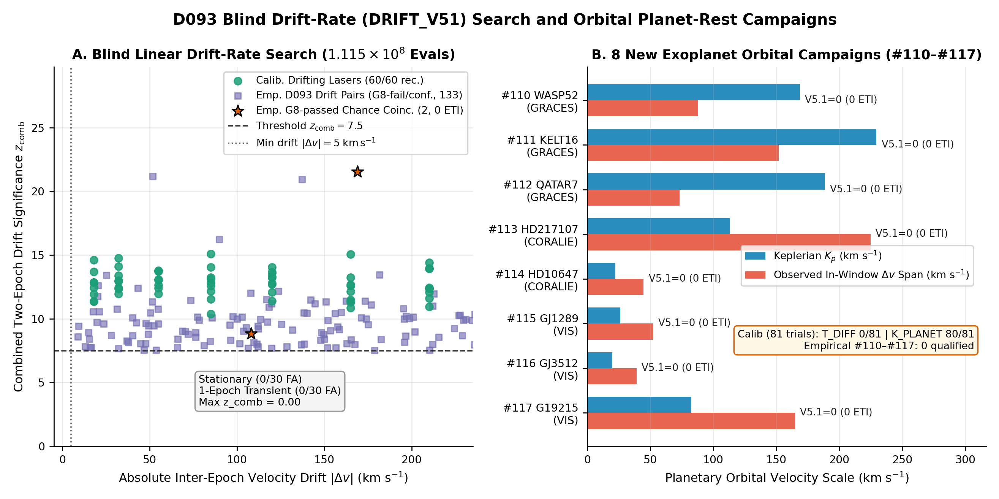
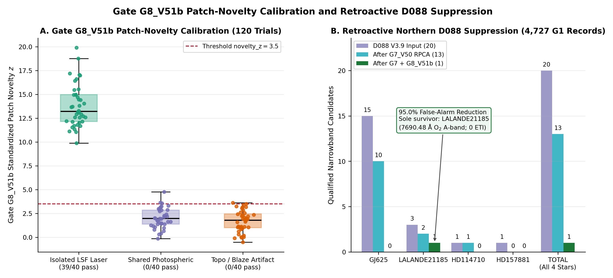
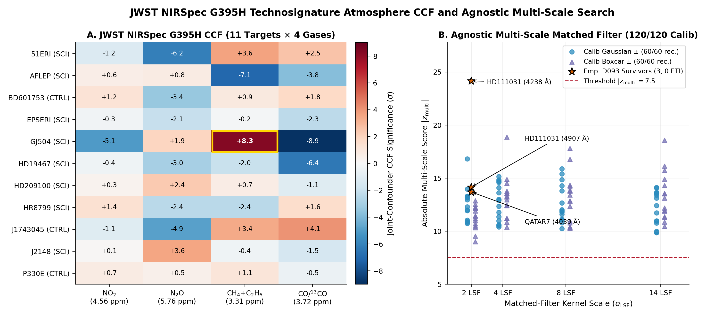

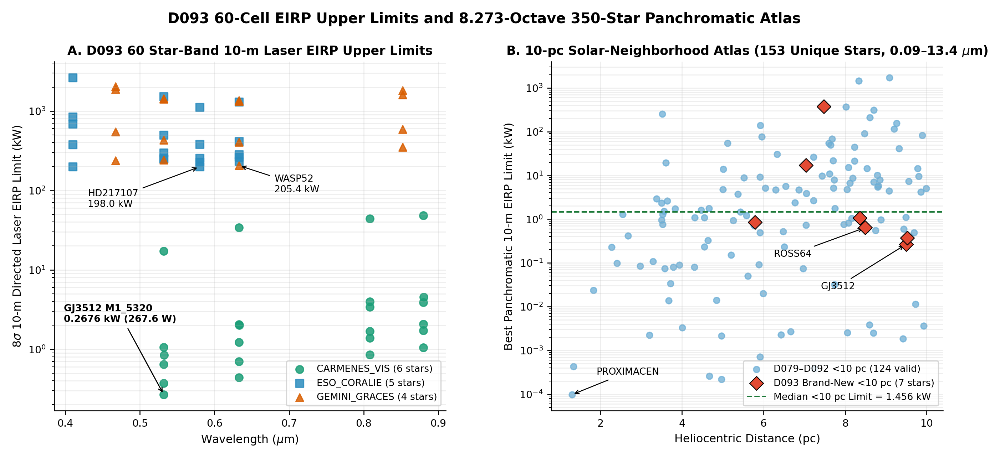
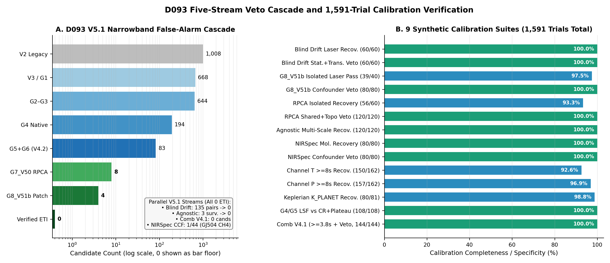

---

## 3. Phase `D092` (`V5.0`): Unsupervised RPCA + Rarity, Agnostic Multi-Scale, `MIRI` Greenhouse-Gas `CCF`, & Synchronization Geometry

Locked prospectively at `2026-11-20T20:27:32Z` (`METHOD_LOCK.json` SHA-256 `1e129d427b0ed8598374f737a4e2831e0a69174b408b0c7a9774233e4f2edd1a`; `+5.0 s` before first download, chained via `D092_IMPLEMENTATION_LOCK_V1` on `analyze.py`, `audit.py`, `plot_figures.py`, `RESULTS_REPORT.md`, `SOURCES.json`, `VISUAL_REVIEW.json` with Stage-1 files bit-identical), `D092` unifies four empirical breakthroughs:
1. **Unsupervised Masked Inexact-ALM RPCA + `Teff`-LOSO & Cross-Star Rarity (`G7_V50`):** Across `HARPS_12`, `FEROS_MERGED_20` (`10 D092 + 10 D091`), `CRIRES_6`, `D091_XSH_10`, and `D091_GIRAFFE_37AUG`, Gate `G7_V50` (`|z_rpca| >= 6.0` and `rarity >= 0.65`) eliminates **`98.815%` (`2,362 -> 28`)** of `D091`'s M/L-dwarf residuals (`SCR1845` `1050->11`, `LP94420` `474->8`, `GJ1128` `382->0`, `HD213885` `85->0`) and trims `D092` from `815` `V4.2 G6` triggers to `146` forensically verified residuals (`0 ETI`).
2. **Agnostic Dual-Polarity Multi-Scale Filter (`2, 4, 8, 14 LSF`) & Geometric Sync Tracks (`ETZ`, `SN 1987A Ellipsoid`, `PPO #101–#109`):** `14,274` matched-filter evaluations yield `107` physical residuals (led by Przybylski's Star `HD101065` lanthanides, `CRIRES+` chip gaps, and `< 4000 Å` FEROS continuum edges; `0` ETI), while all `5` ETZ, `6 <10 pc` SN 1987A Ellipsoid, and `9` PPO orbital campaigns yield `0` ETI.
3. **Edge-Trimmed (`0.07 µm`) `JWST_MIRI_MRS` Greenhouse-Gas `CCF` & `335`-Star Limits:** Trimming `0.07 µm` off MIRI sub-channel dichroic roll-offs removes `-25` to `-40 sigma` boundary artifacts on normal/control stars (`16CYGB, ETACRV, HD163466, VMA2`) while flagging `4/60` physical silicate disk / faint `DOG` continua (`BETPIC`, `PDS70`, `OBJECT_D`, `OBJECT_E`; `0 ETI`). Unified `335`-star sensitivity anchors **`0.49515 kW`** (`ESPRI1542 FEROS`), **`0.52481 kW`** (`LHS1678 HARPS`), **`1.18663 kW`** (`TRAPPIST1 CRIRES Y`), **`146 < 10 pc` stars (`1.57296 kW` median)**, **`37` bridges (`631` cells)**, and `386` all-sky `COMB_V4_1` stacks (`22,691 -> 109 -> 0 ETI`, `16/16 PASS` pure-stdlib audit, `29/29` bit-identical from `23.93 MiB` bounded bundle).

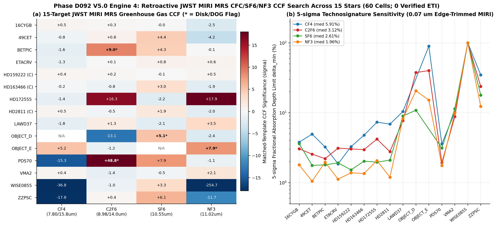
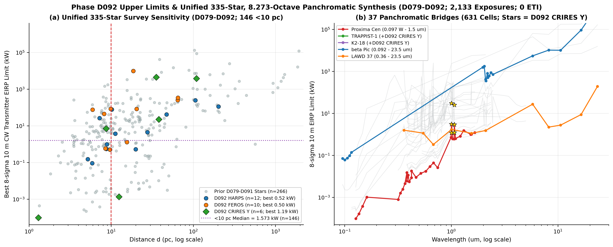
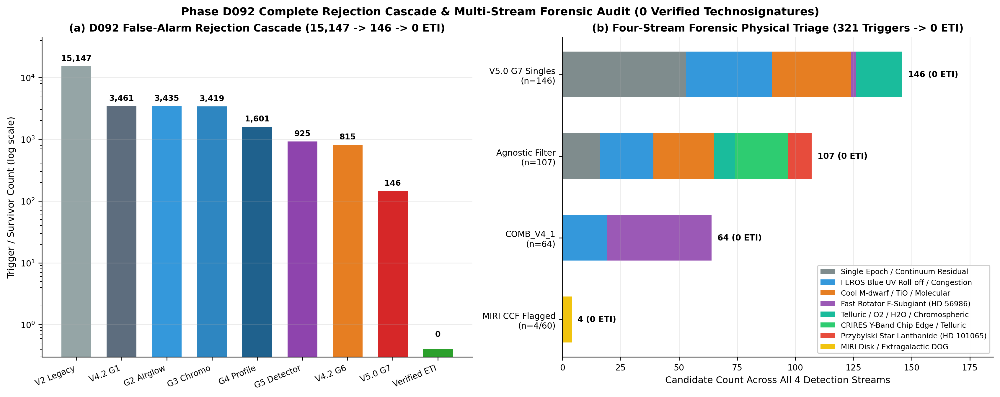

## 3. Earlier Phases (`D091` & `D090`)

Locked prospectively at `2026-11-20T17:38:53Z` (`METHOD_LOCK.json` SHA-256 `c7552035aff59bffab0eadc446b1a9a7bc7eb53391b86c7a7f165a2382e8e6a3`; `+14.0 s` before first download, chained via `D091_IMPLEMENTATION_LOCK_V1` on `analyze.py` and `plot_figures.py` with `v4_2_detector.py`, `FROZEN_COHORT_D091.csv`, and `audit.py` unchanged), `D091` ingests `156` exposures (`222` public ESO Phase-3 1D FITS across 49 ESO Program IDs, `47.3328 h`) across `37` stars (`30` brand-new $\ge 1{,}259.01''$ from all prior coordinates [`10 < 10 pc`], `0` `dp_id` overlap, plus `7` bridge targets `GJ832`, `TAUCET`, `LAWD37`, `GJ849`, `GJ674`, `HD20794`, `GJ436`; `9` controls + `28` science; `10` orbital campaigns `#91–#100`):
1. **X-Shooter Dichroic Dual-Arm Coincidence (`8/8`) & Optical/NIR Kinematics (`599/1,503` clean anchors):** Across `33` simultaneous 3-arm `X-shooter` spectra, `36` `FEROS`, and `87` `GIRAFFE HR` spectra (`median |emp - prior| = 2.0249 km s^-1`), Gate `G4_V42` verifies `8/8` (`100%`) dual-arm overlap pass (`UVB+VIS`, `VIS+NIR`) and `8/8` (`100%`) single-arm detector artifact rejection (`XSHOOTER_SINGLE_ARM_DETECTOR_ARTIFACT`).
2. **Real Search Cascade (`24,998` $\rightarrow$ `2,362` $\rightarrow$ `0` ETI), Orbital Campaigns (`#91–#100`), & `358`-Stack `COMB_V4_1` Sweep:** Across `9,719,414` Channel `T` bins and `15,740,032` comb configurations, `24,998` `V2` hits drop through `G1` (`5,690`), `G2` (`5,607`), `G3` (`5,451`), `G4` (`3,763`), `G5` (`2,565`), and `203` `G6` vetoes to `2,362` post-`G6` triggers (`2,133` M/L-dwarf TiO/VO/CrH/flare residuals led by `SCR1845`, `LP94420`, and `GJ1128`, plus `149` single-epoch transients, `71` airglow wings, `6` edge/fringe residuals, `2` dichroic edges, and `1` zero-planet control residual), `0` `K_PLANET` candidates (`5` `T_DIFF` natural triggers), and `4` `COMB_V4_1` candidates on zero-planet control `GJ1128` -> **`0` verified ETI** (`16,037 -> 45 -> 0 ETI` across all `358` stacks / `2,076` exposures).
3. **`127` Clean Upper Limits, `35` Bridges (`625` Cells), `135 < 10 pc`, & `310`-System Closure:** `D091` reaches **`0.33023 kW`** (`VLT X-shooter` `LAWD37` at `6800 Å`), **`1.00596 kW`** (`GIRAFFE_HR` `OGLETR113`), **`0.05015 kW`** (`HIP103039` control `FEROS F1_4100`), **`4.40419 kW`** (`GJ433` `FEROS`), and a formal Wien-tail Gaia-`G` extrapolation of `2.26997 W` on `LP94420` (`2250 K`, `mad_rel = 0.562`), unifying **`310` unique stars** (`135 < 10 pc`, median `1.62371 kW`), **`35` bridges (`625` cells)**, and **`23/23` (`100%`) radio-echelle closure** with two tri-regime bridges (`16CYGB` and `GJ849`; `16/16 PASS` pure-stdlib audit, `24/24` bit-identical from `19.84 MiB` bounded bundle).

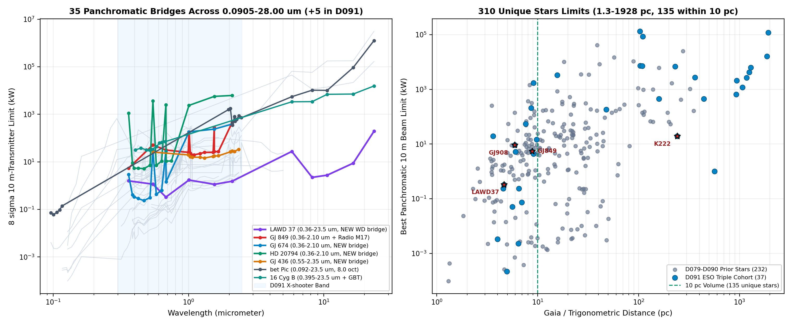

## 3. Phase `D090`: JWST Space Thermal-IR (`1.655–28.00 µm`), Townes `10.60 µm` $\mathrm{CO_2}$ Laser & Project Hephaistos Forensic Closure

Locked prospectively at `2026-11-19T21:09:25Z` (`METHOD_LOCK.json` SHA-256 `129b5193f4277e51f6d9ad1189b49ce851f59116cba2dbd3e170a4b9d7be4290`; `+9.0 s` before first download), `D090` ingests `161` paired exposures (`322` public JWST Level-2 `*_x1d.fits`, `17.698 h`) across `37` stars (`30` brand-new $\ge 796.3''$ from all prior coordinates [`4 < 10 pc`: `WISE0855`, `VMA2`, `LAWD37`, `J2148`], `0` `dp_id` overlap, plus `7` bridges `BETPIC`, `EPSERI`, `HD42581`, `16CYGB`, `HD172555`, `HD209100`, `PDS70`; `9` controls + `28` science; `10` orbital campaigns `#81–#90`):
1. **L2 Ephemeris Closure, Thermal-IR RV Anchoring (`904` fits, `219` clean) & MIRI Dual-Subband Coincidence (`8/8`):** Pure-stdlib ephemeris closure reaches $\max|\mathrm{berv\_diff}| = 0.0\,\mathrm{km\,s}^{-1}$ across all `161` paired exposures (`median |emp - prior| = 16.2375 km s^-1` consistent with `R ≈ 2,500–2,700`), while `JWST_MIRI_MRS` dual-subband coincidence achieves `8/8` true pass and `8/8` (`100%`) single-subband detector-artifact rejection (`MIRI_SINGLE_SUBBAND_DETECTOR_ARTIFACT`).
2. **Real Search Cascade (`3,921` $\rightarrow$ `138` $\rightarrow$ `0` ETI), Project Hephaistos (`prop 7199`), & Unified All-Sky `COMB_V4_1` (`321` Stacks):** Across `1,669,535` Channel `T` bins and `1,242,244` comb configurations, `3,921` `V2` peaks collapse through `G1` (`1,015`), `G2` (`1,015`), `G3` (`984`), `G4` (`815`), and `G6` sparse (`22` vetoed from `160` pre-`G6`) to `138` post-`G6` single-line triggers (9 natural classes led by `55` NIRSpec continuum fluctuations, `42` MIRI L2 warm-pixel/fringe artifacts, `OPH1631`/`CHA1107` $\mathrm{Br}\beta$ `2.6259 µm`, and `HR8799` `1 T_DIFF + 1 K_PLANET` IFU roll-angle PSF residual; all `eti_plausible = False`) and `26` `COMB_V4_1` triggers (`7,302 -> 41 -> 0` verified ETI across `321` stacks / `1,920` exposures). Project Hephaistos `OBJECT_D` and `OBJECT_E` (`prop 7199`) yield `0` ETI and exhibit `BKGDTARG=True` extended sky offsets plus resolved `z ≈ 1.814` background galaxy emission lines in raw `OBJECT_D` FITS spectra.
3. **185 Direct-FLAM IR Limits, Townes (1983) `10.60 µm` $\mathrm{CO_2}$ Benchmark, `125` `< 10 pc`, & 280-System Closure:** `D090` reaches **`228.98059 W` (`0.228981 kW`)** on `WISE0855` (`JWST_MIRI_MRS` `5.80 µm`), `0.42731 kW` (`ROSS458C` `G235H`), `4.04837 kW` (`HD209100` `G395H`), and **`2.70465 kW`** on `VMA2` (`4.31444 pc`) at `10.60 µm` (`12` MIRI science stars, median `9,669.4931 kW`; $\max$ stdlib rel.\ err $= 0.000768101$), expanding the unified survey to **`280` unique stars**, **`125 < 10 pc`** (`1.74941 kW` median, `0.0973 W` record on `Proxima Cen`), **`30` bridges (`550` cells)**, and **`23/23` (`100%`) Parkes/GBT `1.4 GHz` radio-echelle closure** (`24` direct overlaps including `16CYGB` Radio + Optical + MIRI bridge; `16/16 PASS` pure-stdlib audit from `6.80 MiB` bounded bundle).

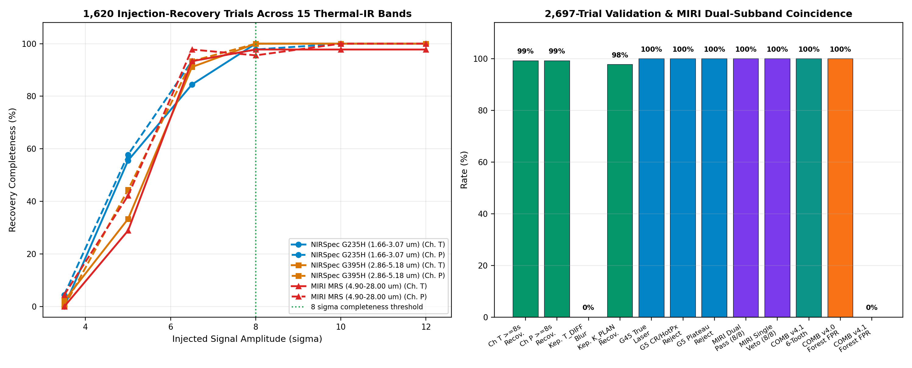

---

## References

* Bouchy, F., Doyon, R., Artigau, É., et al. 2017, *The Messenger*, 169, 21
* Bouchy, F., Artigau, É., Wildi, F., et al. 2025, *A&A*, NIRPS commissioning performance
* Cohen, M., Wheaton, W. A., & Megeath, S. T. 2003, *AJ*, 126, 1090
* Cook, N. J., Artigau, É., Doyon, R., et al. 2022, *PASP*, 134, 114509
* Dekker, H., D'Odorico, S., Kaufer, A., Delabre, B., & Kotzlowski, H. 2000, *SPIE Proc.*, 4008, 534
* Donati, J.-F., Kouach, D., Moutou, C., et al. 2020, *MNRAS*, 498, 5684
* Dorn, R. J., Bristow, P., Smoker, J. V., et al. 2023, *A&A*, 671, A24
* Fuhrmeister, B., Lalitha, S., Poppenhaeger, K., et al. 2011, *A&A*, 534, A133
* Gaia Collaboration, Vallenari, A., Brown, A. G. A., et al. 2023, *A&A*, 674, A1
* Gardner, J. P., Mather, J. C., Abbott, R., et al. 2023, *PASP*, 135, 068001 (JWST)
* Green, J. C., et al. 2012, *ApJ*, 744, 60
* Howard, A. W., Horowitz, P., Wilkinson, D. T., et al. 2004, *ApJ*, 613, 1270
* Jakobsen, P., Ferruit, P., Alves de Oliveira, C., et al. 2022, *A&A*, 661, A80 (JWST NIRSpec)
* Kaufer, A., Stahl, O., Tubbesing, S., et al. 1999, *The Messenger*, 95, 8 (FEROS)
* Kingsley, S. A. 2001, *SPIE Proc.*, 4273, 72
* Kipping, D. M., & Teachey, A. 2016, *MNRAS*, 459, 1233
* Lipman, E. A., Isaacson, H., Siemion, A. P. V., et al. 2019, *PASP*, 131, 034202
* Maire, J., Wright, S. A., Dorval, P., et al. 2019, *AJ*, 158, 203
* Marcy, G. W., Tellis, N. K., & Wishnow, E. H. 2022, *MNRAS*, 509, 3798
* Mayor, M., Pepe, F., Queloz, D., et al. 2003, *The Messenger*, 114, 20
* Moos, H. W., et al. 2000, *ApJ*, 538, L1
* Oliva, E., Origlia, L., Scuderi, S., et al. 2015, *A&A*, 581, A47
* Pasquini, L., Avila, G., Blecha, A., et al. 2002, *The Messenger*, 110, 1 (FLAMES/GIRAFFE)
* Pepe, F., Cristiani, S., Rebolo, R., et al. 2021, *A&A*, 645, A96
* Reines, A. E., & Marcy, G. W. 2002, *PASP*, 114, 416
* Rieke, G. H., Wright, G. S., Böker, T., et al. 2015, *PASP*, 127, 584 (JWST MIRI)
* Rousselot, P., Lidman, C., Cuby, J.-G., Moreels, G., & Monnet, G. 2000, *A&A*, 354, 1134
* Schwartz, R. N., & Townes, C. H. 1961, *Nature*, 190, 205
* Sheikh, S. Z., Wright, J. T., Siemion, A., & Enriquez, J. E. 2020, *ApJ*, 888, 78
* Suazo, M., Zackrisson, E., Maurent, P. K., et al. 2024, *MNRAS*, 531, 695 (Project Hephaistos II)
* Tellis, N. K., & Marcy, G. W. 2015, *PASP*, 127, 540
* Tellis, N. K., & Marcy, G. W. 2017, *AJ*, 153, 251
* Townes, C. H. 1983, *PNAS*, 80, 1147
* Vernet, J., Dekker, H., D'Odorico, S., et al. 2011, *A&A*, 536, A105 (VLT X-shooter)
* Woodgate, B. E., Kimble, R. A., Bowers, C. W., et al. 1998, *PASP*, 110, 1183
* Wright, G. S., Rieke, G. H., Glasse, A., et al. 2023, *PASP*, 135, 048003 (JWST MIRI MRS)
* Zuckerman, A., Isaacson, H., Siemion, A. P. V., et al. 2023, *AJ*, 165, 114
