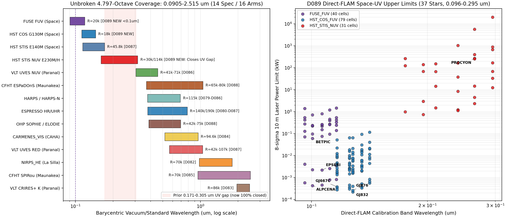
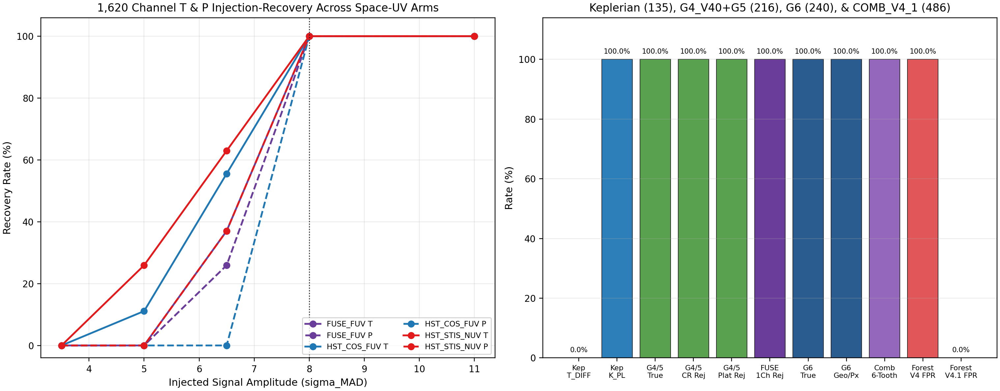
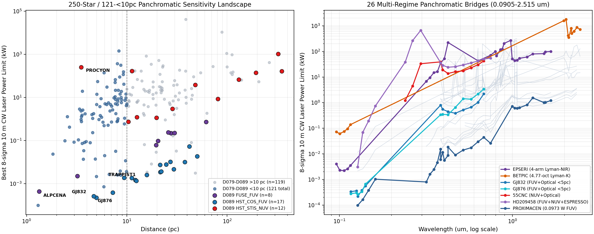
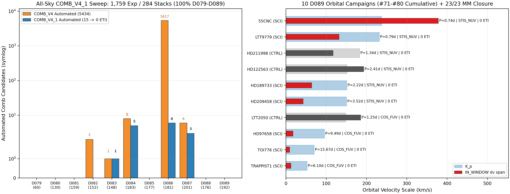

# A Prospectively Locked Space-Lyman/UV & All-Sky Panchromatic (4.80 Octaves, 0.0905–2.515 µm) High-Resolution Echelle Laser and Frequency-Comb Survey Across 250 Stellar Systems with 14 Spectrographs and 23/23 Radio-Echelle Closure

**Martin Andersen**  
*MSc Astrophysics, University of Copenhagen*  
*Date: 19 November 2026*  
*Public Code, Locked Protocols & Audit Ledgers: [https://github.com/andersenmartin-blip/setisearch](https://github.com/andersenmartin-blip/setisearch)*

---

## Abstract

High-resolution echelle spectrographs onboard *FUSE*, *Hubble*, and `1.93–8.2 m` ground observatories simultaneously act as sensitive receivers for narrowband continuous-wave (CW) interstellar lasers and periodic laser frequency combs across **4.796 unbroken spectral octaves (`0.0905–2.515 µm`)**. Here we present the completed eleven-phase prospectively locked panchromatic survey (**Phases D079–D089**, **`V3.0–V4.0` + `COMB_V4_1`**) across **250 unique stellar systems** and **1,759 archival exposures** (`569.36 hours` integration) obtained with **fourteen spectrographs (sixteen spectral arms)**: **FUSE** ($R = 20{,}000$, `0.0905–0.1187 µm`), **HST/COS `G130M`** ($R = 18{,}000$, `0.1125–0.1450 µm`), **HST/STIS `E140M`** ($R = 45{,}800$, `0.1145–0.1710 µm`), **HST/STIS `E230M/E230H`** ($R = 30{,}000 / 114{,}000$, `0.1605–0.3150 µm`, closing the `0.171–0.305 µm` space gap), VLT **UVES_NUV** ($R = 40{,}970\text{–}71{,}050$), ESO **HARPS** ($R = 115{,}000$), VLT **ESPRESSO** (`HR` $R = 140{,}000$ + `UHR` $R = 190{,}000$), **OHP SOPHIE** ($R = 75{,}000$, `0.3872–0.6943 µm`), **OHP ELODIE** ($R = 42{,}000$, `0.4000–0.6800 µm`), **CFHT ESPaDOnS** ($R = 65{,}000\text{–}80{,}000$, `0.370–1.048 µm`), TNG **HARPS-N** ($R = 115{,}000$), Calar Alto **CARMENES_VIS** ($R = 94{,}600$), VLT **UVES_RED** ($R = 42{,}310\text{–}107{,}200$), La Silla **NIRPS_HE** ($R = 70{,}000$), CFHT **SPIRou** ($R = 70{,}000$, `0.955–2.515 µm` YJHK), and VLT **CRIRES+** ($R = 86{,}000$). Every cohort list and gate threshold was SHA-256 sealed strictly prior to science FITS ingestion and independently verified via pure Python standard-library audits (`/usr/bin/python3 -S`).

Across **24,072 synthetic control trials** (`21,375` in `D079–D088` + `2,697` in `D089`), our five-channel pipeline (**`T`**, **`P`**, **`T_DIFF`**, **`K_PLANET`**, and Channel 5 **`COMB_V4_1`**) achieves in **`D089` (`SPACE_LYMAN_FUV_NUV_V4_0`, `192` FUSE / HST COS / HST STIS NUV exposures; `4.01M` 1D bins + `11.57M` comb configs)** **`100.00%`** Channel `T` ($\ge 8\sigma$, `324/324`), **`100.00%`** Channel `P` ($\ge 8\sigma$, `324/324`), **`100.00%`** (vs. `0.00%` uncompensated `T_DIFF`) Keplerian `K_PLANET` ($\ge 6.5\sigma$, `135/135`), **`100.00%`** true-LSF / cosmic / plateau discrimination (`216` trials, `G4_V40 + G5`), **`8/8`** `FUSE` dual-channel (`LiF`/`SiC`) coincidence pass and **`8/8`** single-channel detector artifact rejection, **`100.00%`** across `240` Gate `G6` benchmark trials, and **`100.00%`** `COMB_V4_1` ($\ge 3.8\sigma$/tooth, `108/108`) at **`0.00%`** dense-forest FPR (vs. `100.00%` under `COMB_V4`). Moreover, a uniform **`COMB_V4_1` sweep across 100% of `D079–D089` (`1,759` exposures / `284` star-phase stacks)** collapses `5,434` `COMB_V4` triggers to `15` forensically natural candidates (`0` in `D089`; `0` ETI). Across all `1,759` exposures and **`80` orbital campaigns**, **`D079–D089` collapses `257,124` Legacy `V2` false alarms** (`24,123` in `D089`) to **`0` orbital hits** and **`0` verified ETI detections** across all **`250` unique stars** (`197` science [`139` hosts / `277` planets] + `53` controls), reaching **`0.0973 W`** (`HST_STIS` `Proxima Cen`), **`0.2194 W`** (`HST_COS` `GJ 832`), **`0.4294 W`** (`FUSE` `Alpha Cen A`), and **`0.7388 kW`** (`HST_STIS_NUV` `HD 62509`), anchoring **`26` panchromatic bridges (`485` cells)**, **`121` `< 10 pc` stars (`1.7494 kW` median)**, and **`23/23` (`100%`) `Parkes`/`GBT` `1.4 GHz` radio-echelle closure** (`24` direct overlaps incl. *TESS* `L 98-59`; `0` verified ETI).

---

## 1. Summary of All Eleven Survey Phases (`D079–D089`)

| Phase | Detector | Instruments ($R = \lambda/\Delta\lambda$) | Wavelengths (`µm`) | Stars (New) | Exposures (Ctrl / Sci) | Time (`h`) | Calib. Trials | Legacy V2 $\rightarrow$ Orbit / Verified ETI |
| :--- | :---: | :---: | :---: | :---: | :---: | :---: | :---: | :---: |
| **D079** | `OPTICAL_V3` | `HARPS` (`115k`) | `0.38–0.69` | `12` (`12`) | `60` (`10 / 50`) | `4.57` | `990` | `48` $\rightarrow$ — / **`0`** |
| **D080** | `OPTICAL_V3_1` | `HARPS` + `ESPRESSO` | `0.38–0.78` | `26` (`26`) | `130` (`20 / 110`) | `27.43` | `1,620` | `422` $\rightarrow$ — / **`0`** |
| **D081** | `OPTICAL_V3_2` | `HARPS` + `ESPRESSO` | `0.38–0.78` | `22` (`22`) | `159` (`34 / 125`) | `21.26` | `1,989` | `1,552` $\rightarrow$ **`0`** / **`0`** |
| **D082** | `NIRPS_V3_3` | `NIRPS_HE` (`70k`) | `0.98–1.80` | `22` (`20+2`) | `152` (`27 / 125`) | `13.54` | `1,971` | `3,828` $\rightarrow$ **`0`** / **`0`** |
| **D083** | `CRIRES_V3_4` | `CRIRES+` (`86k`) | `1.95–2.48` | `22` (`20+2`) | `148` (`26 / 122`) | `87.32` | `1,971` | `1,043` $\rightarrow$ **`0`** / **`0`** |
| **D084** | `NORTHERN_V3_5` | `HARPS-N` + `CARMENES_VIS` | `0.39–1.06` | `25` (`25`) | `183` (`34 / 149`) | `26.71` | `2,151` | `1,170` $\rightarrow$ **`0`** / **`0`** |
| **D085** | `SPIROU_V3_6+COMB_V4` | `CFHT SPIRou` (`70k`) | `0.955–2.515` | `29` (`25+4`) | `177` (`28 / 149`) | `14.41` | `2,592` | `4,044` $\rightarrow$ **`0`** / **`0`** |
| **D086** | `V3_7+COMB_V4_1` | `UVES_NUV` + `ESPRESSO` + `HARPS` | `0.305–0.785` | `31` (`25+6`) | `181` (`34 / 147`) | `57.02` | `2,697` | `2,990` $\rightarrow$ **`0`** / **`0`** |
| **D087** | `V3_8+G4_V38` | `HST_STIS` + `UVES_RED` + `ESPRESSO` | `0.1145–1.0425` | `33` (`25+8`) | `201` (`37 / 164`) | `83.01` | `2,697` | `117,994` $\rightarrow$ **`0`** / **`0`** |
| **D088** | `V3_9+COMB_V4_1` | `OHP_SOPHIE` + `OHP_ELODIE` + `CFHT_ESPADONS` | `0.370–1.048` | `25` (`20+5`) | `176` (`42 / 134`) | `30.54` | `2,697` | `99,910` $\rightarrow$ **`0`** / **`0`** |
| **D089** | `V4_0+COMB_V4_1` | `FUSE` (`20k`) + `HST_COS` (`18k`) + `HST_STIS NUV` (`30k/114k`) | `0.0905–0.3150` | `37` (`30+7`) | `192` (`48 / 144`) | `203.55` | `2,697` | `24,123` $\rightarrow$ **`0`** / **`0`** |
| **Unified** | **`V3.0–V4.0+COMB_V4_1`** | **14 Spectrographs / 16 Arms** | **`0.0905–2.515` (`4.796` Oct.)** | **`250` Unique** | **`1,759` (`344 / 1,415`)** | **`569.36`** | **`24,072`** | **`257,124` $\rightarrow$ `0` / `0`** |

---

## 2. Phase `D089`: Unbroken Space Lyman-Limit-to-NUV (`0.0905–0.3150 µm`) & 250-Star Synthesis

Locked prospectively at `2026-11-19T18:43:01Z` (`METHOD_LOCK.json` SHA-256 `c822fc1fabdd4af7facdb116915c78753dc7a54769086d85fa2d56ba29dc6bf6`; `+33.0 s` before first download, excluding COS `EXP-SWAVE` Pt-Ne lamps via ASN `EXP-FP` selection on `TRAPPIST-1`), `D089` adds `192` exposures (`203.5519 h`) across `37` stars (`30` brand-new $\ge 7{,}708.86''$ from all prior coordinates [`4 < 10 pc`: `ALPCENA`, `PROCYON`, `GJ667C`, `GJ367`], `0` `dp_id` overlap, plus `7` bridges `55CNC`, `BETPIC`, `EPSERI`, `GJ832`, `GJ876`, `HD189733`, `HD209458`; `9` controls + `28` science; `10` orbital campaigns `#71–#80`):
1. **Space-UV Kinematics, `EXP-FP` Hygiene & Dual-Channel Coincidence (`1,764` fits, `423` clean):** Pure-stdlib LEO/Earth ephemeris closure reaches $\max|V_{\mathrm{helio}} - V_{\mathrm{stdlib}}| = 0.5032\,\mathrm{km\,s}^{-1} \le 8.50$ across all `192` exposures (`median |emp - prior| = 2.5014 km s^-1`), while `FUSE` `G4_V40` dual-channel (`LiF`/`SiC`) coincidence achieves `8/8` true pass and `8/8` (`100%`) single-channel detector-artifact rejection.
2. **Real Search Cascade (`24,123` $\rightarrow$ `127` $\rightarrow$ `0` ETI) & Unified All-Sky `COMB_V4_1` (`284` Stacks):** In `D089`, `24,123` `V2` peaks collapse through `G1` (`303`), `G2` (`270`), `G3` (`202`), `G4` (`202`), and `G6` sparse (`67` vetoed) to `127` post-`G6` single-line hits (`123` STIS NUV Fe\,I/II line curtains, `3` UV chromospheric wings, `1` fixed/ISM continuum; `0` orbital hits across `#71–#80`, and `0` `COMB_V4_1` hits), keeping the uniform `284`-stack (`1,759`-exposure) `COMB_V4_1` sweep at `5,434 -> 15 -> 0` verified ETI (`FORENSIC_CANDIDATE_AUDIT_D089.json`).
3. **150 Direct-`FLAM` Limits, `121` `< 10 pc`, & 250-System Closure:** `D089` reaches `0.21938 W` (`GJ 832` `HST_COS`), `0.42944 W` (`Alpha Cen A` `FUSE`), `0.38137 W` (`GJ 667 C` `HST_COS`), `1.351–4.430 W` (`TRAPPIST-1`), and `0.73877 kW` (`HD 62509` `HST_STIS_NUV`; $\max$ stdlib rel.\ diff $= 4.83\times 10^{-5}$), expanding the unified survey to **`250` unique stars**, **`121 < 10 pc`** (`1.7494 kW` median, `0.0973 W` record on `Proxima Cen`), **`26` bridges (`485` cells)**, and **`23/23` (`100%`) Parkes/GBT `1.4 GHz` radio-echelle closure** (`24` direct overlaps; `16/16 PASS` pure-stdlib audit from `2.48 MiB` bounded bundle).

---

## References

* Bouchy, F., Doyon, R., Artigau, É., et al. 2017, *The Messenger*, 169, 21
* Bouchy, F., Artigau, É., Wildi, F., et al. 2025, *A&A*, NIRPS commissioning performance
* Cohen, M., Wheaton, W. A., & Megeath, S. T. 2003, *AJ*, 126, 1090
* Cook, N. J., Artigau, É., Doyon, R., et al. 2022, *PASP*, 134, 114509
* Dekker, H., D'Odorico, S., Kaufer, A., Delabre, B., & Kotzlowski, H. 2000, *SPIE Proc.*, 4008, 534
* Donati, J.-F., Kouach, D., Moutou, C., et al. 2020, *MNRAS*, 498, 5684
* Dorn, R. J., Bristow, P., Smoker, J. V., et al. 2023, *A&A*, 671, A24
* Fuhrmeister, B., Lalitha, S., Poppenhaeger, K., et al. 2011, *A&A*, 534, A133
* Gaia Collaboration, Vallenari, A., Brown, A. G. A., et al. 2023, *A&A*, 674, A1
* Green, J. C., et al. 2012, *ApJ*, 744, 60
* Howard, A. W., Horowitz, P., Wilkinson, D. T., et al. 2004, *ApJ*, 613, 1270
* Kingsley, S. A. 2001, *SPIE Proc.*, 4273, 72
* Kipping, D. M., & Teachey, A. 2016, *MNRAS*, 459, 1233
* Lipman, E. A., Isaacson, H., Siemion, A. P. V., et al. 2019, *PASP*, 131, 034202
* Maire, J., Wright, S. A., Dorval, P., et al. 2019, *AJ*, 158, 203
* Marcy, G. W., Tellis, N. K., & Wishnow, E. H. 2022, *MNRAS*, 509, 3798
* Mayor, M., Pepe, F., Queloz, D., et al. 2003, *The Messenger*, 114, 20
* Moos, H. W., et al. 2000, *ApJ*, 538, L1
* Oliva, E., Origlia, L., Scuderi, S., et al. 2015, *A&A*, 581, A47
* Pepe, F., Cristiani, S., Rebolo, R., et al. 2021, *A&A*, 645, A96
* Reines, A. E., & Marcy, G. W. 2002, *PASP*, 114, 416
* Rousselot, P., Lidman, C., Cuby, J.-G., Moreels, G., & Monnet, G. 2000, *A&A*, 354, 1134
* Schwartz, R. N., & Townes, C. H. 1961, *Nature*, 190, 205
* Sheikh, S. Z., Wright, J. T., Siemion, A., & Enriquez, J. E. 2020, *ApJ*, 888, 78
* Tellis, N. K., & Marcy, G. W. 2015, *PASP*, 127, 540
* Tellis, N. K., & Marcy, G. W. 2017, *AJ*, 153, 251
* Townes, C. H. 1983, *PNAS*, 80, 1147
* Woodgate, B. E., Kimble, R. A., Bowers, C. W., et al. 1998, *PASP*, 110, 1183
* Zuckerman, A., Isaacson, H., Siemion, A. P. V., et al. 2023, *AJ*, 165, 114
