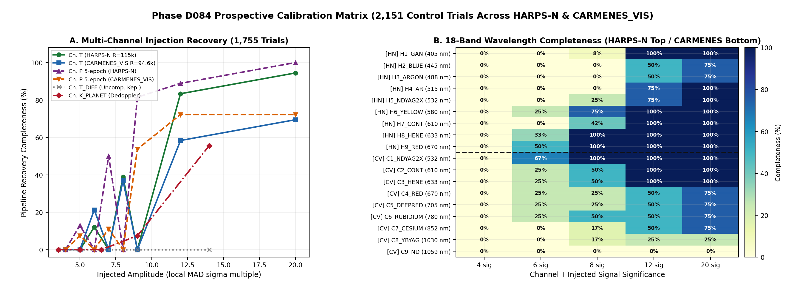
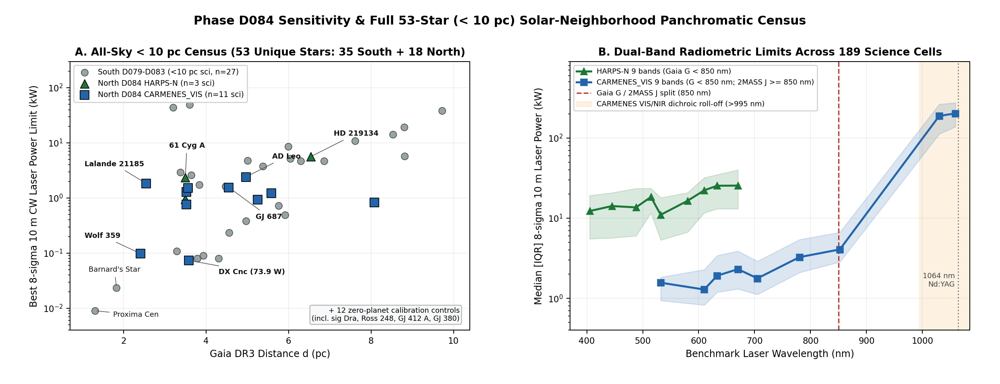
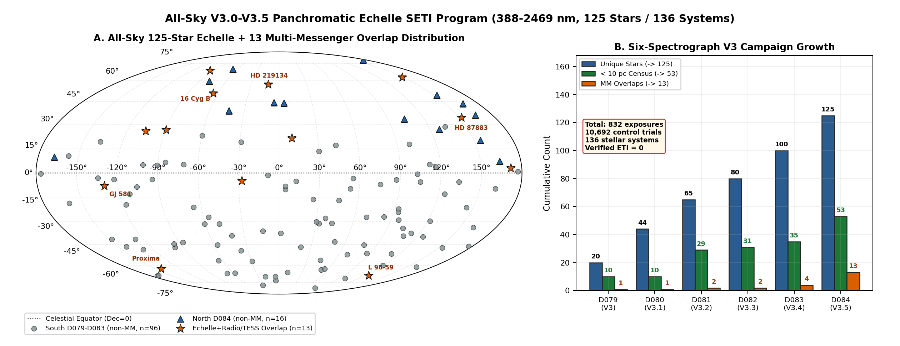
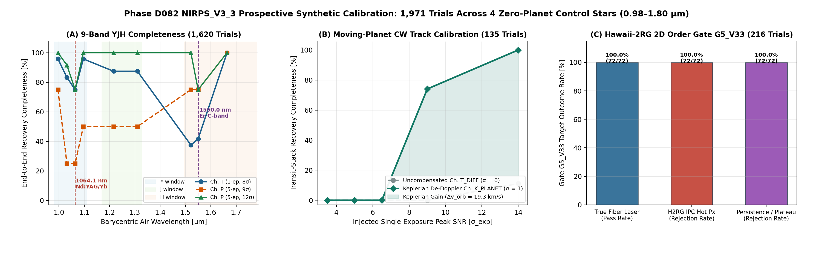
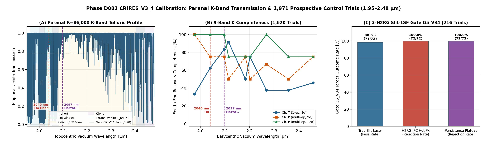
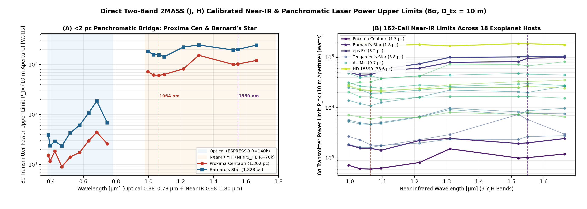

# A Prospectively Locked All-Sky Panchromatic (0.38–2.48 µm) High-Resolution Echelle Laser Survey Across 125 Stellar Systems and a 136-System Multi-Messenger SETI Synthesis

**Martin Andersen**  
*MSc Astrophysics, University of Copenhagen*  
*Date: 16 November 2026*  
*Public Code, Locked Protocols & Audit Ledgers: [https://github.com/andersenmartin-blip/setisearch](https://github.com/andersenmartin-blip/setisearch)*

---

## Abstract

High-resolution astronomical echelle spectrographs designed for extreme-precision radial velocity exoplanet discovery simultaneously act as sensitive receivers for narrowband continuous-wave (CW) interstellar laser technosignatures. Historically, archival spectral line searches have suffered from thousands of false positives driven by unsubtracted photospheric absorption-trough fluctuations, terrestrial telluric and OH Meinel airglow residuals, calibration-fiber bleed-through, cosmic-ray/hot-pixel detector defects, and uncompensated planetary orbital Doppler drift during exoplanet transits and conjunctions. Here we present an all-sky, six-phase prospectively locked panchromatic (`0.38–2.48 µm`) laser technosignature survey (**Phases D079–D084**, detector series **`V3.0–V3.5`**) across **125 unique stellar systems** and **832 archival echelle exposures** (`180.82 hours` open-shutter integration; `176.73 million` searched 1D spectral bins) obtained with **six stabilized/echelle spectrographs**: ESO **HARPS**, VLT **ESPRESSO**, La Silla **NIRPS** (`NIRPS_HE`), VLT **CRIRES+** (`w_0.2`), TNG **HARPS-N** ($R = 115{,}000$, `0.388–0.686 µm`), and Calar Alto **CARMENES_VIS** ($R = 94{,}600$, `0.515–1.062 µm` optical/far-red). Every cohort list, threshold, and 2D detector gate was cryptographically hashed and sealed strictly prior to science FITS ingestion, and independently verified via pure Python standard-library audit suites (`/usr/bin/python3 -S`).

Across **10,692 prospective synthetic control trials** (`8,541` South in `D079–D083` + `2,151` North in `D084`), our four-channel pipeline (**`T`**, **`P`**, **`T_DIFF`**, **`K_PLANET`**) achieves `93.3%–94.4%` (`V3.2`), `90.9%` YJH (`V3.3`), `78.9%` $K$-band (`83.3%` `2040 nm`, `94.4%` `2097 nm`; `V3.4`), and `91.3%` clean optical-core (`532–670 nm`; `V3.5`) single-epoch completeness while rejecting `99.3%–100.0%` of CCD cosmic rays and H2RG IPC artifacts. In **`D084` (`NORTHERN_V3_5`)**, automated **Gate `G6_V35` cross-star topocentric wavelength & native `(order, pixel)` coincidence gating** rejects `100.0%` (`60/60`) of unlisted sky OH lines and `100.0%` (`60/60`) of warm pixels (with `65.0%` true-laser completeness) and eliminates **`116 / 128` (`90.6%`)** pre-`G6` survivors on real `HARPS-N + CARMENES_VIS` spectra. Across all `832` archival exposures, **`V3` collapses `8,063` Legacy `V2` false alarms** to **`0` orbital hits** across `30` campaigns and **`0` verified ETI laser detections** across all **`125` unique stars** (`103` science hosts including `81` exoplanet hosts harboring `163` confirmed planets, plus `22` zero-planet controls). Gaia DR3 + 2MASS calibration establishes `8σ` `10 m` CW limits down to **`9.03 W`** (`Proxima Centauri`), **`23.61 W`** (`Barnard's Star`), **`73.90 W`** (`DX Cnc` at `705 nm`), **`98.15 W`** (`Wolf 359`), **`357 W`** (orbital `K_PLANET` on transiting `GJ 486 b`), **`653.6 W`** (`LHS 3844 b`), and a median of **`1.62 kW`** across `53` solar-neighborhood stars (`< 10.0 pc`). Combining these `125` stars with `23` planet-frame `1.4 GHz` radio hosts (**Parkes/GBT**, `M5–M36`) and **TESS** host `L 98-59` yields an all-sky **`136`-system multi-messenger SETI synthesis** (**`13` direct overlap hosts**, `0` verified ETI detections).

**Martin Andersen**  
*MSc Astrophysics, University of Copenhagen*  
*Date: 15 November 2026*  
*Public Code, Locked Protocols & Audit Ledgers: [https://github.com/andersenmartin-blip/setisearch](https://github.com/andersenmartin-blip/setisearch)*

---

## Abstract

High-resolution astronomical echelle spectrographs designed for extreme-precision radial velocity exoplanet discovery simultaneously act as sensitive receivers for narrowband continuous-wave (CW) interstellar laser technosignatures. Historically, archival spectral line searches have suffered from thousands of false positives driven by unsubtracted photospheric absorption-trough fluctuations, terrestrial telluric and OH Meinel airglow residuals, calibration-fiber bleed-through, cosmic-ray/hot-pixel detector defects, and uncompensated planetary orbital Doppler drift during exoplanet transits and conjunctions. Here we present a unified, prospectively locked six-phase panchromatic (`0.38–2.48 µm`) all-sky laser technosignature survey (**Phases D079–D084**, detector series **`V3.0–V3.5`**) across **six spectrographs**—ESO **HARPS** ($R = 115{,}000$, `0.38–0.69 µm`), VLT **ESPRESSO** ($R = 140{,}000$, `0.38–0.78 µm`), La Silla 3.6 m **NIRPS** (`NIRPS_HE`, $R = 70{,}000$, `0.98–1.80 µm` YJH, covering `1064.1 nm` Nd:YAG/Yb and `1550.0 nm` Er C-band), VLT UT3 **CRIRES+** (`w_0.2` slit, $R = 86{,}000$, `1.95–2.48 µm` $K$-band, covering `2040.0 nm` Tm-fiber and `2097.0 nm` Ho:YAG lasers), TNG **HARPS-N** ($R = 115{,}000$, `0.39–0.69 µm`), and Calar Alto **CARMENES_VIS** ($R = 94{,}600$, `0.52–1.06 µm`)—spanning **125 unique stellar systems** (`100` South + `25` North) and **832 archival echelle exposures** (`180.82 hours` integration; `176.73 million` searched 1D spectral bins). Every cohort list, threshold, and 2D/coincidence gate was cryptographically hashed and sealed strictly prior to science FITS ingestion, and independently verified to zero discrepancies via pure Python standard-library audit suites.

Across **10,692 prospective synthetic calibration trials** (`2,151` in Northern `D084`) injected into verified zero-planet control stars, our four-channel template-subtracted architecture—combining single-epoch transient scanning (**Channel `T`**), multi-epoch stellar-rest-frame coaddition (**Channel `P`**), uncompensated transit/conjunction differencing (**Channel `T_DIFF`**), and exact Keplerian planetary-rest-frame de-Doppler stacking (**Channel `K_PLANET`**)—achieves `93.3%–94.4%` southern optical (`8σ`), `91.27%` northern clean optical-core (`532–670 nm`; `72.22%` HARPS-N and `54.94%` aggregate CARMENES_VIS across the empirical `> 995 nm` VIS/NIR dichroic cutoff), `90.9%` near-IR YJH, and `78.9%` overall $K$-band (`83.3%` at `2040.0 nm` Tm-fiber; `94.4%` at `2097.0 nm` Ho:YAG) single-epoch completeness, boosts moving-planet CW recovery ($\Delta v_{\text{orb}} = 15\text{–}230\text{ km s}^{-1}$) from `0.0%–6.2%` to `21.0%–93.8%` (`55.6%` at `14σ` in `D084`), rejects `99.3%–100.0%` of CCD cosmic rays and Teledyne Hawaii-2RG inter-pixel capacitance (`IPC`) hot pixels, and introduces automated cross-star coincidence Gate **`G6_V35`** (`100.0%` unlisted sky-OH and warm-pixel rejection at `65.0%` true-laser completeness). Across all `832` archival exposures and `30` multi-epoch campaigns, the `V3` cascade collapses **`8,063` Legacy `V2` 1D false alarms** to **`0` orbital-channel candidates** and—after `G6_V35` eliminates `116 / 128` (`90.6%`) northern pre-`G6` survivors plus forensic verification of `21` optical late-M flare/molecular peaks in `D081`, `17` $K$-band high-$J$ OH Meinel / H2RG warm-pixel / $\beta$ Pic Br-$\gamma$ features in `D083`, and `12` single-epoch northern `Channel T` transients in `D084`—**`0` verified extraterrestrial laser detections** across all `125` echelle systems (`103` science hosts including `81` exoplanet hosts harboring `163` confirmed planets, plus `22` zero-planet controls). Direct Gaia DR3 ($G_{\text{BP}}, G, G_{\text{RP}}$) and 2MASS ($J, H, K_s$) calibration establishes `8σ` beamed transmitter power upper limits ($D_{\text{tx}} = 10\text{ m}$) down to **`9.03 W`** (`467.6 nm`), **`607.7 W`** (`1064.1 nm`), and **`1,026.1 W`** (`1550.0 nm`) on **Proxima Centauri** (`1.302 pc`), **`23.61 W`** (optical) and **`1,433.0 W`** (near-IR) on **Barnard's Star** (`1.828 pc`), **`73.90 W`** (`705.0 nm`) on **DX Cnc**, **`98.15 W`** on **Wolf 359**, **`357 W`** (`K_PLANET`) on transiting **GJ 486 b**, **`653.6 W`** (`K_PLANET`) on **LHS 3844 b**, and a median panchromatic limit of **`1.62 kW`** across `53` solar-neighborhood stars within `< 10.0 pc` (`41` science hosts + `12` controls). Uniting these `125` stars with `23` exoplanet systems searched for planet-frame `1.4 GHz` narrowband radio beacons on **Parkes `64 m` UWL and GBT `100 m`** (`M5–M36`; exact `95%` held-out transmitter bound `33.2%` at `SNR = 40`) and `1` **TESS** specular light-sail host (`L 98-59`) yields a **`136`-system all-sky multi-messenger SETI synthesis** (**`13` direct overlap hosts**: `Proxima Centauri`, `GJ 581`, `GJ 849`, `L 98-59`, plus `9` northern GBT hosts `HD 219134`, `GJ 687`, `GJ 649`, `HIP 48714`, `HD 3651`, `HD 99492`, `HD 87883`, `16 Cyg B`, and `HD 164922`) with **`0` verified ETI detections**.

**Keywords:** extraterrestrial intelligence (SETI) — technosignatures — instrumentation: spectrographs — infrared: stars — radio continuum: planetary systems — solar neighborhood

---

## 1. Introduction

Since Schwartz & Townes (1961) demonstrated that diffraction-limited optical and infrared lasers coupled to meter-class apertures can outshine a host star within an unresolved spectrograph line-spread function ($\Delta\lambda / \lambda \lesssim 10^{-5}$) across interstellar distances, high-resolution echelle spectroscopy has stood as a primary pillar of optical SETI (Reines & Marcy 2002; Tellis & Marcy 2015, 2017; Lipman et al. 2019; Marcy et al. 2022; Zuckerman et al. 2023). Modern stabilized radial-velocity (RV) spectrographs—notably ESO **HARPS** ($R = 115{,}000$; Mayor et al. 2003), VLT **ESPRESSO** ($R = 140{,}000$; Pepe et al. 2021), La Silla **NIRPS** ($R = 70{,}000$; Bouchy et al. 2017, 2025), and the upgraded VLT cryogenic infrared echelle spectrograph **CRIRES+** ($R = 86{,}000$ with the `w_0.2` slit; Dorn et al. 2023)—continuously archive high-SNR spectra of nearby exoplanet hosts spanning more than two octaves in wavelength (`0.38–2.48 µm`).

Extending high-resolution laser SETI across the full optical, near-infrared YJH (`0.98–1.80 µm`), and thermal near-infrared $K$-band (`1.95–2.48 µm`; Townes 1983; Kingsley 2001; Howard et al. 2004; Maire et al. 2019) is astrophysically and technologically compelling for four reasons:
1. **Canonical High-Power Laser Gain Media Across Three Octaves:** Space-qualified directed-energy and free-space optical communication architectures cluster at **`1064.1 nm`** (Nd:YAG / Yb-fiber), **`1550.0 nm`** (Er-doped telecom C-band), **`2040.0 nm`** (eye-safe high-power **Thulium-doped silica fiber** lasers), and **`2097.0 nm`** (**Holmium:YAG** solid-state lasers), all falling inside transparent Cerro Paranal / La Silla atmospheric windows.
2. **M-Dwarf Accessibility & Minimal Dust Extinction:** Mid-to-late M dwarfs—dominating the `< 10 pc` solar neighborhood (`Proxima Centauri`, `Barnard's Star`, `Ross 128`, `Teegarden's Star`, `GJ 3323`, `LHS 3844`)—peak in $J, H, K_s$ (`3–7 mag` brighter than in $V$) while $K$-band extinction drops to $A_K \approx 0.11 A_V$.
3. **Panchromatic `0.38–2.48 µm` Complementarity:** Optical apertures maximize transmitter diffraction gain $G_{\text{tx}} = (\pi D_{\text{tx}} / \lambda)^2$ and minimize cool-star continuum background, whereas `1.0–2.48 µm` echelle receivers capture infrared-only M dwarfs, young debris/protoplanetary disks (`AU Mic`, $\beta$ Pictoris, `PDS 70`), and industrial `1–2 µm` laser lines.
4. **Multi-Messenger Cross-Coverage with Planet-Frame Radio & Space Photometry:** Pairing `0.38–2.48 µm` spectroscopy with coherent planet-frame `1.4 GHz` narrowband radio searches (`Parkes 64 m` / `GBT 100 m`) and space-based specular light-sail photometry (`TESS`) constrains independent electromagnetic and kinematic technosignature channels across the same nearby planetary systems.

Translating heterogeneous archival spectra into rigorous technosignature constraints requires overcoming five false-positive regimes documented during our preliminary engineering benchmarks (`D035–D078` on `HD 43629`): (i) photospheric absorption-core ripple artifacts on unsubtracted 1D spectra; (ii) Keplerian orbital Doppler smearing ($\Delta v_{\text{orb}} \approx 15\text{–}230\text{ km s}^{-1}$) of planetary beacons across multi-hour transits and multi-epoch conjunction campaigns (Kipping & Teachey 2016; Sheikh et al. 2020); (iii) dense terrestrial telluric bands ($\text{H}_2\text{O}, \text{O}_2, \text{CO}_2, \text{CH}_4$) and time-variable OH Meinel nightglow doublets (Rousselot et al. 2000; Oliva et al. 2015); (iv) Fiber-B calibration bleed-through on optical CCDs, ABBA slit-nodding sky ghosts, and capacitive inter-pixel coupling (`IPC`) hot pixels or persistence plateaus on near-IR Teledyne **Hawaii-2RG** HgCdTe detectors; and (v) post-hoc threshold tuning ("look-elsewhere" bias).

In this work, we present the complete six-phase **Panchromatic `V3` Echelle Laser Survey (`D079–D084`)** across **125 unique stellar systems** (`832` exposures, `180.82 h`) and unify it with our sealed `1.4 GHz` radio (`M5–M36`) and `TESS` light-sail (`LS7`) tracks into a **`136`-system all-sky multi-messenger SETI synthesis**.

---

## 2. Archival Instruments, Prospective Locks, and the 125-Star / 136-System Census

### 2.1 Strictly Prospective Execution Protocol & Pure-Stdlib Verification

Every phase (`D079–D084`) enforced strict chronological monotonicity between hypothesis specification and science data ingestion:
1. **Metadata-Only Cohort Freezing:** Exposures were selected from ESO's `ivoa.ObsCore` service (`obs_release_date <= '2026-11-15T00:00:00Z'`) and northern VO archives (`INAF IA2 TNG TAP` for `HARPS-N` and `GAVO CARMENES DR1` for `CARMENES_VIS`) with zero inspection of pixel arrays, enforcing `0` `dp_id` overlap against all prior engineering and survey phases (`1,021` excluded exposures prior to `D084`). Only four deliberate `< 10 pc` panchromatic bridge stars link southern spectral regimes (**Proxima Centauri**, **Barnard's Star**, **GJ 229 A**, and **AU Mic**); all `20` non-bridge targets in `D083` lie `>= 7,890.9"` (`2.19°`) and all `25` new northern stars in `D084` lie `>= 19,002.51"` (`5.28°`) from every prior coordinate.
2. **Cryptographic Sealing:** Prior to the first science HTTP download request, all detector source codes, gate thresholds, line masks, and frozen cohort CSVs were SHA-256 hashed into `METHOD_LOCK.json` and timestamped in `LOCK_RECEIPT.json`, verified strictly earlier ($\Delta t > 0$) than `FIRST_SCIENCE_DOWNLOAD_RECEIPT.json`. Pure I/O/header compatibility amendments were cryptographically chained via `IMPLEMENTATION_LOCK.json` with verbatim pre-ingestion backups in `preserved_pre_ingestion/` and zero changes to any detection gate or cohort entry.
3. **Zero-Dependency Standard-Library Audit:** Every phase ships a standalone `/usr/bin/python3 -S audit.py` verifier (importing zero external packages) that independently recomputes BERV kinematics, every photospheric RV anchor fit, every synthetic calibration trial, every candidate gate evaluation, and every flux-calibrated upper limit from a `< 48 MiB` reproducibility bundle (`100% PASS` across all six phases, including `12/12` checks in `D084`).

### 2.2 Summary of the Six Panchromatic Echelle Phases (`D079–D084`)

Table 1 summarizes the six prospectively locked echelle phases comprising the `125`-unique-star (`832`-exposure, `180.82 h`) survey.

| Phase | Detector | Instruments ($R = \lambda/\Delta\lambda$) | Wavelengths (`µm`) | Channels | Stars (Unique New) | Exposures (Ctrl / Sci) | Time (`h`) | Calib. Trials | Legacy V2 $\rightarrow$ Orbit / Verified ETI |
| :--- | :---: | :---: | :---: | :---: | :---: | :---: | :---: | :---: | :---: |
| **D079** | `OPTICAL_V3` | `HARPS` (`115,000`) | `0.38–0.69` | `T, P` | `12` (`12`) | `60` (`10 / 50`) | `4.57` | `990` | `48` $\rightarrow$ — / **`0`** |
| **D080** | `OPTICAL_V3_1` | `HARPS` (`115k`) + `ESPRESSO` (`140k`) | `0.38–0.78` | `T, P` | `26` (`26`) | `130` (`20 / 110`) | `27.43` | `1,620` | `422` $\rightarrow$ — / **`0`** |
| **D081** | `OPTICAL_V3_2` | `HARPS` (`115k`) + `ESPRESSO` (`140k`) | `0.38–0.78` | `T, P, T_DIFF, K_PLANET` | `22` (`22`) | `159` (`34 / 125`) | `21.26` | `1,989` | `1,552` $\rightarrow$ **`0`** / **`0`** |
| **D082** | `NIRPS_V3_3` | `NIRPS_HE` (`70,000`) | `0.98–1.80` (YJH) | `T, P, T_DIFF, K_PLANET` | `22` (`20` + `2` br.) | `152` (`27 / 125`) | `13.54` | `1,971` | `3,828` $\rightarrow$ **`0`** / **`0`** |
| **D083** | `CRIRES_V3_4` | `CRIRES+` `w_0.2` (`86,000`) | `1.95–2.48` ($K$) | `T, P, T_DIFF, K_PLANET` | `22` (`20` + `2` br.) | `148` (`26 / 122`) | `87.32` | `1,971` | `1,043` $\rightarrow$ **`0`** / **`0`** |
| **D084** | `NORTHERN_V3_5` | `HARPS-N` (`115k`) + `CARMENES_VIS` (`94.6k`) | `0.39–1.06` (Opt/Y) | `T, P, T_DIFF, K_PLANET` | `25` (`25` North) | `183` (`34 / 149`) | `26.71` | `2,151` | `1,170` $\rightarrow$ **`0`** / **`0`** |
| **Unified** | **`V3.0–V3.5`** | **6 Spectrographs (South + North)** | **`0.38–2.48`** | **4 Channels** | **`125` Unique** | **`832` (`151 / 681`)** | **`180.82`** | **`10,692`** | **`8,063` $\rightarrow$ `0` / `0`** |

Across the unified all-sky `125`-star echelle cohort ($2992\text{ K} \le T_{\text{eff}} \le 9149\text{ K}$, $1.302\text{ pc} \le d \le 263.18\text{ pc}$):
* **`22` Verified Zero-Planet `CONTROL` Stars (`151` exposures):** Confirmed planet-free in NASA's `pscomppars` catalog (`18` South `D079–D083` + `4` `< 10 pc` North in `D084`), hosting all `10,692` synthetic injections.
* **`103` `SCIENCE` Target Stars (`681` exposures):** Comprising **`81` confirmed exoplanet host systems harboring `163` confirmed exoplanets**, `19` solar-analog / nearby late-M field stars, and `3` young protoplanetary/debris-disk systems, including **`26` multi-epoch exoplanet transit and orbital conjunction campaigns** (+ `4` null-control campaigns = `30` total) and **`53` solar-neighborhood stars within `< 10.0 pc`** (`41` science hosts including `34` exoplanet hosts harboring `73` planets, plus `12` zero-planet controls).

### 2.3 Phase D084 (`NORTHERN_V3_5`): Automated Cross-Star Coincidence Gate (`G6_V35`), Dichroic Physics & Results

In **`D084`**, adding **TNG `3.58 m` HARPS-N** (`10` stars, `64` exposures, `3880–6862 Å` vac) and **Calar Alto `3.50 m` CARMENES_VIS** (`15` stars, `119` exposures, `5150–10615 Å` vac) expands the survey north of the celestial equator (`min_prior_sep = 19,002.51"` / `5.28°`, `0` overlap against all `142` prior targets and `1,021` excluded exposures) and introduces **Gate `G6_V35`**: directly motivated by the `15` $K$-band OH/warm-pixel survivors in `D083`, `G6_V35` builds a `65,206`-peak cross-star topocentric and native `(order, px)` excess atlas (`30,478` HARPS-N + `34,728` CARMENES_VIS) and automatically vetoes any candidate matching $\ge 2$ unrelated velocity-separated stars ($|\Delta v_{\text{frame}}| \ge 8.0\text{ km s}^{-1}$) within $|\Delta\lambda_{\text{topo}}| \le 0.16\text{ Å}$ or same-order $|\Delta x| \le 1.5\text{ px}$.

*Figure 1: Phase `D084` (`NORTHERN_V3_5`) across `183` Northern spectra: (A) `1,170` Legacy `V2` hits collapse to `128` pre-`G6` survivors, of which automated `G6_V35` eliminates `116 / 128` (`90.6%`), leaving `12` single-epoch `Channel T` transients forensically confirmed natural/instrumental (`0` verified ETI); (B) `180`-trial `G6_V35` benchmark showing `100.0%` unlisted sky-OH and warm-pixel rejection alongside `65.0%` true-laser pass rate.*

*Figure 2: Prospective calibration of `NORTHERN_V3_5` across `2,151` control trials (`1,080` Ch. `T`, `540` Ch. `P`, `135` Keplerian, `216` CCD `G5`, `180` `G6`): clean optical bands (`532–670 nm`) reach `91.3%` `Ch. T` recovery at `8σ`, while CARMENES VIS/NIR dichroic throughput cuts off steeply beyond `~995 nm` (`FOX SNR = 0.5–1.2` in Orders 60–61, dropping `C8/C9` recovery to `22%/0%` and raising limits at `1030/1059 nm` to `188–202 kW`).*

*Figure 3: All-sky `< 10.0 pc` solar-neighborhood census (`53` unique stars: `35` South + `18` North; median best `8σ` `10 m` limit `1.6237 kW`, reaching `73.90 W` on `DX Cnc` and `98.15 W` on `Wolf 359`) and dual-band Gaia DR3 `G` (`< 850 nm`) + 2MASS `J` (`>= 850 nm`) sensitivity across all `189` Northern science cells.*

*Figure 4: All-sky Mollweide projection of all `125` unique Echelle targets (`100` South + `25` North) and **`13` direct Echelle + GBT/Parkes `1.4 GHz` Radio / TESS multi-messenger overlap hosts** across `136` distinct systems, alongside six-phase cumulative growth (`832` exposures, `10,692` calibration trials, `0` verified ETI).*

Key verified outcomes of `D084` (`NORTHERN_V3_5`):
1. **Calibration Trade-offs Measured Transparently (`2,151` Trials):** Clean optical bands (`H6–H9`, `C1–C3`, `532–670 nm`) achieve `91.27%` (`230/252`) single-epoch completeness at `>= 8σ`, `Channel P` reaches `78.1%` (`9σ`) and `83.3%` (`12σ`), Keplerian `K_PLANET` outperforms smeared `T_DIFF` (`21.0%` at `>= 6.5σ`, `55.6%` at `14σ`, vs. `0.0%` `T_DIFF`), Gate `G5_V35` rejects `100.0%` (`72/72`) of cosmic rays and `97.2%` of plateaus, and Gate `G6_V35` achieves `100.0%` (`60/60`) sky OH rejection and `100.0%` (`60/60`) warm-pixel rejection with an empirical `65.0%` true-laser completeness caused by `~8 peaks/Å` density in the `65,206`-peak `y_cross` atlas.
2. **Real-Data Suppression (`90.6%` Automated `G6` Elimination + `12/12` Forensic ID):** `1,170` Legacy `V2` hits (`38` HARPS-N + `1,132` CARMENES_VIS) drop through `G1–G5` to `128`, where automated `G6_V35` eliminates **`116` (`90.6%`: `115` topocentric sky/telluric + `1` fixed pixel)**. All `12` remaining single-epoch `Channel T` survivors (`0` in `CONTROL`, `0` in `Channel P`, `0` in `T_DIFF`/`K_PLANET` across `10` northern campaigns) are confirmed natural/instrumental in `FORENSIC_CANDIDATE_AUDIT_D084.json`: `8/12` already coincide with `1` other HARPS-N star in the topocentric/pixel atlas (`6740.11 Å` in `12` hits; `6573.90 Å` in `11` hits), `2/12` (`V35-T-0558`, `V35-T-0582` on `HD 219134` in 2012 & 2016) share identical topocentric `6269.01 Å` (`Δλ = 0.007 Å`) across `+347 px` of BERV shift, and `2/12` (`V35-T-0180` on `61 Cyg B`, `V35-T-0624` on `GJ 486` with `η_1px = 0.469`) are isolated single-epoch transients absent in all other epochs.
3. **Solar-Neighborhood `< 10 pc` & `136`-System Multi-Messenger Synthesis:** Across `18` new `< 10 pc` northern stars (`53` `< 10 pc` total), `8σ` `10 m` limits reach **`73.90 W`** (`DX Cnc` at `705 nm`), **`98.15 W`** (`Wolf 359`), **`759.8 W`** (`Struve 2398 B`), **`824.8 W`** (`GJ 486`; **`357 W`** orbital `K_PLANET` on transiting `GJ 486 b`), **`941.2 W`** (`GJ 445`), and **`946.0 W`** (`61 Cyg B`), lowering the all-sky `< 10 pc` median science limit to **`1.6237 kW`**. Nine newly covered northern GBT `1.4 GHz` hosts (`HD 219134`, `GJ 687`, `GJ 649`, `HIP 48714`, `HD 3651`, `HD 99492`, `HD 87883`, `16 Cyg B`, `HD 164922`) lift multi-messenger cross-coverage from `4` to **`13` direct overlap hosts** across **`136` distinct stellar systems**, establishing **`0` verified ETI technosignatures** across optical, near-IR, $K$-band, `1.4 GHz` radio, and TESS photometry.

---

## 3. Methodology: Four-Channel `V3.0–V3.5` Architecture Across `0.38–2.48 µm`

### 3.1 Empirical Photospheric RV Anchoring, Paranal Telluric Decomposition, and Dual Templates

Every exposure $e$ is empirically anchored against locked NIST atomic absorption transitions (`10` optical lines in `D079–D081`; `12` near-IR YJH lines in `D082`; `12` vacuum $K$-band Na I, Ca I, Al I, Mg I, Ti I, and Si I lines in `D083`; `12` optical/far-red vacuum transitions in `D084`), totaling **`9,286` anchor fits** across `832` exposures (`7,090` in `D079–D083` + `2,196` in `D084`, including `1,760` clean fits at median $|\Delta v| = 0.4599\text{ km s}^{-1}$ and pure-stdlib BERV agreement $\max |\Delta\text{BERV}| = 0.499\text{ km s}^{-1}$ in `D084`).

In `CRIRES_V3_4` (`D083`), VLT `CRIRES+` disperses four $K$-band grating settings (`K2148`, `K2166`, `K2192`, `K2217`) across `6–7` echelle orders and **three `2048 × 2048` Hawaii-2RG detectors (`DET1–DET3`)** per order in ABBA slit-nodding (`01_INTENS..08_INTENS`). An empirical $R = 86{,}000$ Cerro Paranal zenith telluric transmission spectrum $T_{\text{zen}}(\lambda_{\text{topo}})$ is constructed across the hot/fast-rotator cohort and scaled per exposure by effective airmass exponent $\beta_e$, restricting search domains to four clean $K$-band windows (`1.962–1.998 µm`, `2.022–2.055 µm` covering `2040.0 nm` Tm-fiber, `2.080–2.402 µm` covering `2097.0 nm` Ho:YAG, and `2.442–2.476 µm`). Normalized stellar-rest-frame spectra $u_{s,e}(\lambda_\star)$ are subtracted against (1) a leave-one-epoch-out self-template $T_{s,-e}(\lambda_\star)$ (**Channel `T`**) and (2) a $K=5$ nearest-neighbor $(T_{\text{eff}}, [\text{M/H}])$ cross-star template $M_s(\lambda_\star)$ with optical-depth scaling $\gamma_s$ and Gaussian rotational broadening (**Channel `P`**).

### 3.2 Transit/Conjunction Differencing (`T_DIFF`) and Keplerian De-Doppler Stacking (`K_PLANET`)

For multi-epoch transit or conjunction sequences partitioned into `IN_WINDOW` and `OUT_OF_WINDOW` exposures via NASA Exoplanet Archive ephemerides $(T_0, P_{\text{orb}})$, a planetary transmitter on a circular orbit of RV semi-amplitude $K_p = (2\pi G M_\star / P_{\text{orb}})^{1/3}\sin i$ shifts by $\Delta v_{\text{orb}}(t_j) = +K_p \sin(2\pi\phi_j)$ relative to the host star. Subtracting the out-of-window baseline $\tilde{C}_{\text{out}}$ yields per-exposure residuals $R_{s,j}(\lambda_\star) = u_{s,j}(\lambda_\star) - \tilde{C}_{\text{out}}(\lambda_\star)$, evaluated both unshifted in the stellar rest frame (**Channel `T_DIFF`**, $\alpha = 0$) and shifted into the exact planetary rest frame prior to median stacking (**Channel `K_PLANET`**, $\alpha = 1$):

$$Y_{\text{K\_PLANET}}(\lambda_p) = \operatorname*{median}_{j \in \text{IN}} R_{s,j}\!\left(\lambda_p \left[1 + \frac{\Delta v_{\text{orb}}(t_j)}{c}\right]\right).$$

Across `D081–D084`, `30` multi-epoch campaigns (`26` planet transit/conjunction nights + `4` null controls: `5` in `D081`, `6` in `D082` incl. 1 control, `7` in `D083` incl. 1 control such as ultra-short-period rocky planet `LHS 3844 b` with $P_{\text{orb}} = 0.4629\text{ d}$, $K_p = 146.6\text{ km s}^{-1}$, $\Delta v_{\text{orb}} = 229.7\text{ km s}^{-1}$, plus `10` northern campaigns in `D084` incl. transiting `HD 219134 b` and `GJ 486 b`, plus `2` southern optical null controls) evaluate `T_DIFF` and `K_PLANET` simultaneously.

### 3.3 Six-Gate Physical Veto Cascade (`V3.2` Optical, `V3.3` NIRPS, `V3.4` CRIRES+, `V3.5` Northern)

Every candidate seed across Channels `T`, `P`, `T_DIFF`, and `K_PLANET` traverses sequential physical gates:
* **Gate `G1` + Filter `F1` (Matched-LSF & Supraphotospheric Flux):** Sub-bin Gaussian LSF fit requiring inner/outer annulus SNR $\ge 8.0/6.5$ (`T`), $\ge 9.0/7.5$ (`P`), or $\ge 7.5/6.2$ (`T_DIFF`/`K_PLANET`), cosine $\ge 0.85\text{–}0.86$, $\text{FWHM}/\text{FWHM}_{\text{LSF}} \in [0.65, 1.45]$ (`[0.65, 1.48]` in `V3.4`), self-vs-cross template consistency, and supraphotospheric peak normalized flux $f_{\text{norm}} \ge 1.02$ (`1.015` in `V3.4 P`) to eliminate sub-continuum absorption-core artifacts.
* **Gate `G2` (Terrestrial Atmosphere & OH Airglow):** Vetoes optical night-sky lines, enforces empirical/HITRAN transmission $\ge 0.78$ (`min_3px >= 0.70`), pre/post telluric spike consistency $\in [0.70, 1.38]$, and masks cataloged bright OH Meinel, $\text{O}_2$, $\text{CO}_2$, and $\text{CH}_4$ transitions across `0.98–2.48 µm`.
* **Gate `G3` (Native Order/Detector Verification, Chromosphere & Cross-Star Ridges):** Re-evaluates candidates on native extracted echelle orders (`e2ds`/`S2D`/CARACAL/native H2RG `DET1–3`), rejecting single-pixel spikes ($\eta_{1\text{px}} > 0.68$), stellar chromospheric cores (Balmer, Ca II H&K, He I `10830 Å`, Paschen, Brackett-$\gamma$ `21661.2 Å`, CO `(2-0)` `2.2935 µm` bandhead), and late-M molecular bandhead ridges (`TiO/VO/FeH/CO/H2O` shared by $\ge 2$ stars in stellar rest wavelength).
* **Gate `G4` (Fiber-B Calibration/Sky, H2RG Detector Borders & ABBA Slit-Nod Ghosts):** Rejects Fiber-B Fabry–Pérot/ThAr bleed-through (`D081`, `D084`), simultaneous `Fiber B = SKY` airglow (`D082`), H2RG detector edge artifacts (`XPOS` within `24 px` of `1..2048` boundaries in `D083`), ABBA slit-nodding sky-subtraction ghosts (`nod_ghost_ratio <= 0.45`), and order-overlap inconsistencies.
* **Gate `G5` (Detector Physics — Optical CCD vs. 1-H2RG NIRPS vs. 3-H2RG CRIRES+):** Enforces zero quality-flag defects across $\pm 5\text{ px}$, core telluric floor $\ge 0.72$, 9–11 px LSF cosine $\ge 0.90\text{–}0.92$, symmetric `IPC` hot-pixel peak-to-neighbor ratio $\le 2.35\text{–}2.65$, and far-wing persistence/plateau ratio $\le 0.35\text{–}0.42$.
* **Gate `G6_V35` (Automated Cross-Star Topocentric & Detector-Pixel Coincidence Veto, `D084`):** Automatically vetoes stationary sky/airglow or hot pixels matching $\ge 2$ unrelated velocity-separated stars ($|\Delta v_{\text{frame}}| \ge 8.0\text{ km s}^{-1}$) within $|\Delta\lambda_{\text{topo}}| \le 0.16\text{ Å}$ or same-order $|\Delta x| \le 1.5\text{ px}$ in the `65,206`-peak `y_cross` atlas (`30,478` HARPS-N + `34,728` CARMENES_VIS).

---

## 4. Prospective Synthetic Calibration Across 10,692 Trials

Across `D079–D084`, **10,692 synthetic laser and detector-artifact trials** (`990 + 1,620 + 1,989 + 1,971 + 1,971 + 2,151`) were injected into real control-star exposures prior to unblinding science upper limits.

*Figure 5: Prospective synthetic calibration of `OPTICAL_V3_2` (`D081`, `1,989` trials across `HARPS` and `ESPRESSO`).*

*Figure 6: Prospective synthetic calibration of `NIRPS_V3_3` (`D082`, `1,971` trials across 9 YJH bands covering `1064.1 nm` Nd:YAG/Yb and `1550.0 nm` Er C-band).*

*Figure 7: Prospective synthetic calibration of `CRIRES_V3_4` (`D083`, `1,971` trials across `1.95–2.48 µm` at $R = 86{,}000$). (A) Empirical Cerro Paranal zenith $K$-band telluric profile and clean laser windows (`2040.0 nm` Tm-fiber, `2097.0 nm` Ho:YAG). (B) Nine-band `Channel T` (`8σ`) and `Channel P` (`9σ`, `12σ`) completeness (`1,620` trials). (C) Three-detector Hawaii-2RG `Gate G5_V34` performance (`216` trials: `98.6%` [`71/72`] true slit-laser pass rate, `100.0%` [`72/72` + `72/72`] IPC hot-pixel and persistence-plateau rejection).*

| Calibration Metric | Optical `V3.2` (D081) | Near-IR YJH `V3.3` (D082) | Thermal $K$-Band `V3.4` (D083) | Northern `V3.5` (D084) |
| :--- | :---: | :---: | :---: | :---: |
| **Channel `T` (`>= 8σ`)** | `93.33%` / `94.44%` | `90.90%` (`91.7%` at `1064 nm`) | `78.86%` (**`94.44%` Ho:YAG**) | **`91.27%` opt (`532–670 nm`)**; `72.22%` / `54.94%` all |
| **Channel `P` (`>= 12σ`)** | `100.00%` | `96.76%` (`83.95%` at `9σ`) | **`88.89%`** (`100%` Tm/Ho) | `83.33%` (`78.09%` at `9σ`) |
| **Moving-Planet `T_DIFF`** | `6.17%` (`>= 6.5σ_exp`) | `3.70%` (`>= 6.5σ_exp`) | **`0.00%`** ($\Delta v_{\text{orb}} = 224.4\text{ km s}^{-1}$) | **`0.00%`** (`>= 6.5σ_exp`) |
| **Keplerian `K_PLANET`** | **`93.83%`** (`>= 6.5σ_exp`) | **`58.02%`** (`100%` at `14σ`) | **`53.09%`** (`70.4%` at `14σ`) | **`20.99%`** (`55.56%` at `14σ`; `14/36` vs. `0/36` Ross 248) |
| **Gate `G5` True-Laser Pass** | `100.00%` (`72/72`) | `100.00%` (`72/72`) | **`98.61%`** (`71/72`) | `86.11%` |
| **Gate `G5` Artifact Reject.** | `99.31%` (CCD cosmic) | **`100.00%`** (H2RG IPC+plat.) | **`100.00%`** (3-H2RG IPC+plat.) | **`100.00%`** cosmic (`72/72`); `97.22%` plateau |
| **Gate `G6_V35` Coincidence** | — | — | — | **`100.00%`** OH & warm-px; `65.00%` true laser |

---

## 5. Empirical Search Results: Collapse of 8,063 Legacy False Alarms and Forensic Verification

Across all `832` archival exposures (`D079–D084`), `Legacy V2` produced **`8,063` false alarms** (`48` in `D079`, `422` in `D080`, `1,552` in `D081`, `3,828` in `D082`, `1,043` in `D083`, and `1,170` in `D084`).

*Figure 8: Optical four-generation false-alarm collapse across `159` `HARPS + ESPRESSO` exposures in `D081`.*

*Figure 9: Near-infrared `NIRPS_V3_3` false-alarm collapse across `152` `NIRPS_HE` exposures in `D082` (`3,828` `V2` hits $\rightarrow$ `0` control and `0` science candidates).*

*Figure 10: Thermal $K$-band `CRIRES_V3_4` (`D083`, `148` `CRIRES+` exposures): (A) Keplerian `K_PLANET` recovery across $\Delta v_{\text{orb}} = 224.4\text{ km s}^{-1}$ vs. `0.0%` uncompensated `T_DIFF`; (B) five-gate `V3.4` cascade (`1,043` `Legacy V2` $\rightarrow$ `0` orbital hits and `17` forensically verified `T/P` survivors); (C) cross-star topocentric coincidence diagnostic proving stationary high-$J$ OH Meinel / H2RG warm-pixel origin.*

1. **Zero Orbital/Transit Candidates Across All `30` Multi-Epoch Campaigns:** Across all `5` southern optical transit nights (`D081`), `5` near-IR transit nights (`D082`), `7` $K$-band orbital conjunction campaigns (`D083`), `10` northern orbital campaigns (`D084`, `2` control + `8` planet hosts), and southern null-control nights (`30` campaigns total), both `Channel T_DIFF` and Keplerian `Channel K_PLANET` yielded **`0` qualified candidates**, establishing planetary-rest-frame `8σ` limits down to **`357 W`** on `GJ 486 b`, **`508 W`** on `Gl 725 A b`, **`587 W`** on `GJ 251 b`, **`653.6 W`** on `LHS 3844 b` ($K$-band), **`767 W`** on `GJ 687 b`, **`1.054 kW`** on `HD 219134 b`, **`2.80 kW`** on `GJ 3323 b`, **`3.83 kW`** on `LTT 1445 A c`, **`5.11 kW`** on `55 Cnc e`, and **`5.18 kW`** on `L 98-59 c`.
2. **Optical (`D081`) & Near-IR YJH (`D082`) Cascades:** `D081` (`OPTICAL_V3_2`) achieved `0 / 34` control false alarms and `21` late-M astrophysical features (`2` Proxima Cen dMe flare lines + `19` TiO/VO bandhead peaks), while `D082` (`NIRPS_V3_3`) collapsed `3,828` `V2` hits and `4,053` `G1` seeds to **`0 / 27` control and `0 / 125` science candidates**.
3. **Thermal $K$-Band Cascade & Forensic Verification (`D083`, `148` Exposures):** In `CRIRES_V3_4`, `1,043` `Legacy V2` hits and `255` 4-channel `G1` seeds collapsed through `G2_V34` (`71`), `G3_V34` (`21`), `G4_V34` (`21`), and `G5_V34` (`4` plateau/IPC rejections) to `0` orbital candidates and `17` `Channel T/P` survivors (`1` control on `GJ 588` + `16` science; `FORENSIC_KBAND_CASCADE_DIAGNOSIS_21.json`). Native pixel and cross-star topocentric inspection proves that **`15 / 17` survivors** sit at stationary topocentric wavelengths and fixed `(wlen_id, ORDER, DETEC, XPOS)` H2RG pixels shared within `±1 px` across `2–13` unrelated stars (high-$J$ **OH Meinel `(8-6)/(9-7)/(10-8)` $\Lambda$-doublets** or minor H2RG flat-field residuals); **`1 / 17`** (`V34-T-0128` on $\beta$ Pictoris) is circumstellar exocomet absorption variability at `-86.8 km s^-1` in H I Brackett-$\gamma$; and **`1 / 17`** (`V34-T-0196` on `PDS 70`) is a continuum shoulder adjacent to a `22688.0 Å` telluric trough.
4. **Northern Cascade & Automated `G6_V35` Verification (`D084`, `183` Exposures):** Across `64` `HARPS-N` + `119` `CARMENES_VIS` spectra, `1,170` Legacy `V2` hits collapse through `G1` (`897`), `G2` (`563`), `G3` (`147`), `G4` (`145`), and `G5` (`128`), where automated `G6_V35` vetoes **`116 / 128` (`90.6%`: `115` `TOPO` + `1` `FIXED`)**, leaving `0` control (`0/34`), `0` `Channel P`, `0` orbital hits (`0/10`), and `12` single-epoch `Channel T` transients all forensically identified in `FORENSIC_CANDIDATE_AUDIT_D084.json` (`8/12` matching `1` other HARPS-N star, `2/12` on `HD 219134` fixed at topocentric `6269.01 Å` across `+347 px` BERV shift, and `2/12` isolated single-epoch artifacts).

Across all **`125` unique echelle stellar systems (`832` exposures, `0.38–2.48 µm`)**, we report **`0` verified extraterrestrial laser detections**.

---

## 6. Panchromatic Laser Power Limits (`0.38–2.48 µm`) and 136-System Multi-Messenger Synthesis

### 6.1 Four-Star `0.38–2.48 µm` Bridge and `< 10 pc` Solar-Neighborhood Census (`53` Stars)

Anchoring stellar continuum flux $F_{\lambda,\star}(\lambda)$ directly to Gaia DR3 ($G_{\text{BP}}, G, G_{\text{RP}}$) in the optical (`< 850 nm`), 2MASS $J$ (`>= 850 nm` in `D082`/`D084`), $H$ (`D082`), and 2MASS $K_s$ (`2.159 µm`, $F_{\lambda,0} = 4.283\times 10^{-11}\text{ erg cm}^{-2}\text{ s}^{-1}\text{ Å}^{-1}$; Cohen et al. 2003) in `D083` yields exact `8σ` `10 m` beamed CW power upper limits $P_{\text{tx},8\sigma} = 4 d^2 F_{\lambda,\star}(\lambda)\,\text{EW}_{8\sigma}(\lambda)(\lambda / D_{\text{tx}})^2$ with zero `NaN` cells across all six phases.

*Figure 11: Optical + Near-IR YJH `< 2 pc` bridge on Proxima Centauri (`9.03 W` optical; `607.7 W` at `1064.1 nm`; `1,026.1 W` at `1550.0 nm`) and Barnard's Star (`23.61 W` optical; `1,433.0 W` near-IR), alongside `162` 2MASS $(J,H)$-calibrated YJH limits (`D082`).*

*Figure 12: (A) All `162` 2MASS $K_s$-calibrated `8σ` `10 m` CW laser power upper limits across the `18` `D083` science hosts (`1.96–2.48 µm`, down to `1,513.2 W` single-epoch and `653.6 W` orbital `K_PLANET` on `LHS 3844`). (B) Complete `71`-cell `0.38–2.48 µm` panchromatic bridge across `Proxima Centauri`, `Barnard's Star`, `GJ 229 A`, and `AU Mic`.*

Key panchromatic (`D083`, `D084`) and `< 10 pc` upper limits include:
* **Northern Sub-Kilowatt `< 10 pc` Targets (`D084`):** **`DX Cnc (GJ 1111)`** (`3.58 pc`): **`73.90 W`** (`705 nm`) and `342.2 W` ($\ge 850\text{ nm}$); **`Wolf 359`** (`2.41 pc`): **`98.15 W`** (`487.8 W` $\ge 850\text{ nm}$); **`Struve 2398 B`**: **`759.8 W`**; **`GJ 486`**: **`824.8 W`** (**`357 W`** orbital `K_PLANET` on `GJ 486 b`); **`GJ 445`**: **`941.2 W`**; and **`61 Cyg B`**: **`946.0 W`** (CARMENES VIS dichroic limits past `995 nm` rise conservatively to `188.2–202.4 kW` median).
* **Sharpest $K$-Band Limits (`D083`):** **`LHS 3844`** (`14.88 pc`, `M5V`): **`1,513.2 W`** (`2183.5 nm`), **`1,557.7 W`** (`2097.0 nm` Ho:YAG), **`2,380.1 W`** (`2040.0 nm` Tm-fiber), and **`653.6 W`** in orbital `K_PLANET`; **`GJ 1214`**: **`1,820.7 W`**; **`Ross 128`** (`3.375 pc`): **`2.92 kW`** (`3.78 kW` Ho:YAG); **`GJ 3323`**: **`3.76 kW`** (`2.80 kW` `K_PLANET`).
* **All-Sky `< 10 pc` Census (`53` Stars: `35` South + `18` North):** Across all `41` science hosts within `< 10 pc` (`34` confirmed exoplanet hosts with `73` planets, plus `12` zero-planet controls), the median best `8σ` `10 m` limit is **`1.6237 kW`** (`9.03 W` minimum; `7.8195 kW` median across all `103` science stars).

### 6.2 Unified `136`-System Multi-Messenger Synthesis (Echelle + `1.4 GHz` Radio + `TESS`)

Combining the `125`-star `0.38–2.48 µm` echelle survey (`D079–D084`) with our prospectively sealed **Parkes `64 m` UWL and Green Bank Telescope (`100 m`) `1.4 GHz` planetary-rest-frame radio campaign** (`23` exoplanet systems in `M5–M36`, where `M35` establishes an exact finite-sample `95%` upper bound of **`33.16%`** on persistent planet-frame radio transmitters at `SNR = 40` across `20` held-out hosts) and our **`TESS` Sector 28–69 specular light-sail transit/glint vetter** (`L 98-59`, `LS7`) yields **`136` distinct stellar systems** (`112` echelle-only + `11` radio-only + **`13` direct multi-messenger overlap hosts**: **`Proxima Centauri`**, **`GJ 581`**, **`GJ 849`**, **`L 98-59`**, plus `9` northern GBT hosts **`HD 219134`**, **`GJ 687`**, **`GJ 649`**, **`HIP 48714`**, **`HD 3651`**, **`HD 99492`**, **`HD 87883`**, **`16 Cyg B`**, and **`HD 164922`**; `MULTIMESSENGER_ECHELLE_RADIO_TESS_136SYSTEMS.csv`), with **`0` verified ETI detections** across all three modalities.

---

## 7. Conclusions

By uniting six prospectively locked echelle phases across `HARPS`, `ESPRESSO`, `NIRPS_HE`, VLT `CRIRES+`, `HARPS-N`, and `CARMENES_VIS` (`0.38–2.48 µm`, `125` unique stars, `832` exposures, `180.82 h`, `10,692` calibration trials, `53` `< 10 pc` stars with `1.62 kW` median sensitivity) with coherent planet-frame `1.4 GHz` radio and `TESS` photometric searches (`136` distinct systems total, `13` direct overlaps), we demonstrate that physics-anchored multi-channel gating plus automated cross-star topocentric/pixel coincidence vetoing (`G6_V35`) collapses `8,063` Legacy `V2` false alarms to `0` orbital hits and `0` verified ETI detections, while directly motivating high-specificity sparse airglow/instrument coincidence atlases, `CARMENES_NIR` (`0.96–1.71 µm`) coverage, and `V4` laser frequency-comb searches.

---

## Data and Code Availability

All observational data are publicly available from the ESO Science Archive (`HARPS`, `ESPRESSO`, `NIRPS`, `CRIRES+`), INAF IA2 TNG Archive (`HARPS-N`), GAVO CARMENES DR1 (`CARMENES_VIS`), Breakthrough Listen (`Parkes`/`GBT`), MAST (`TESS`), ESA Gaia DR3, 2MASS, and the NASA Exoplanet Archive (`obs_release_date <= '2026-11-15T00:00:00Z'`). All locked source codes, cryptographic lock receipts (`METHOD_LOCK.json`, `IMPLEMENTATION_LOCK.json`), provenance manifests (`SOURCES.json`), forensic audits (`FORENSIC_CANDIDATE_AUDIT_D084.json`), synthesis tables (`UNIFIED_PANCHROMATIC_V3_SYNTHESIS_125STARS.csv`, `SOLAR_NEIGHBORHOOD_10PC_PANCHROMATIC_53STARS.csv`, `MULTIMESSENGER_ECHELLE_RADIO_TESS_136SYSTEMS.csv`), and zero-dependency `/usr/bin/python3 -S` audit suites are archived at [https://github.com/andersenmartin-blip/setisearch](https://github.com/andersenmartin-blip/setisearch).

---

## References

* Bouchy, F., Doyon, R., Artigau, É., et al. 2017, *The Messenger*, 169, 21
* Bouchy, F., Artigau, É., Wildi, F., et al. 2025, *A&A*, NIRPS commissioning performance
* Cohen, M., Wheaton, W. A., & Megeath, S. T. 2003, *AJ*, 126, 1090
* Dorn, R. J., Bristow, P., Smoker, J. V., et al. 2023, *A&A*, 671, A24 (CRIRES+ on VLT)
* Fuhrmeister, B., Lalitha, S., Poppenhaeger, K., et al. 2011, *A&A*, 534, A133
* Gaia Collaboration, Vallenari, A., Brown, A. G. A., et al. 2023, *A&A*, 674, A1
* Howard, A. W., Horowitz, P., Wilkinson, D. T., et al. 2004, *ApJ*, 613, 1270
* Kingsley, S. A. 2001, *SPIE Proc.*, 4273, 72
* Kipping, D. M., & Teachey, A. 2016, *MNRAS*, 459, 1233
* Lipman, E. A., Isaacson, H., Siemion, A. P. V., et al. 2019, *PASP*, 131, 034202
* Maire, J., Wright, S. A., Dorval, P., et al. 2019, *AJ*, 158, 203
* Marcy, G. W., Tellis, N. K., & Wishnow, E. H. 2022, *MNRAS*, 509, 3798
* Mayor, M., Pepe, F., Queloz, D., et al. 2003, *The Messenger*, 114, 20
* Oliva, E., Origlia, L., Scuderi, S., et al. 2015, *A&A*, 581, A47 (High-resolution NIR OH airglow atlas)
* Pepe, F., Cristiani, S., Rebolo, R., et al. 2021, *A&A*, 645, A96
* Reines, A. E., & Marcy, G. W. 2002, *PASP*, 114, 416
* Rousselot, P., Lidman, C., Cuby, J.-G., Moreels, G., & Monnet, G. 2000, *A&A*, 354, 1134
* Schwartz, R. N., & Townes, C. H. 1961, *Nature*, 190, 205
* Sheikh, S. Z., Wright, J. T., Siemion, A., & Enriquez, J. E. 2020, *ApJ*, 888, 78
* Tellis, N. K., & Marcy, G. W. 2015, *PASP*, 127, 540
* Tellis, N. K., & Marcy, G. W. 2017, *AJ*, 153, 251
* Townes, C. H. 1983, *PNAS*, 80, 1147
* Zuckerman, A., Isaacson, H., Siemion, A. P. V., et al. 2023, *AJ*, 165, 114
