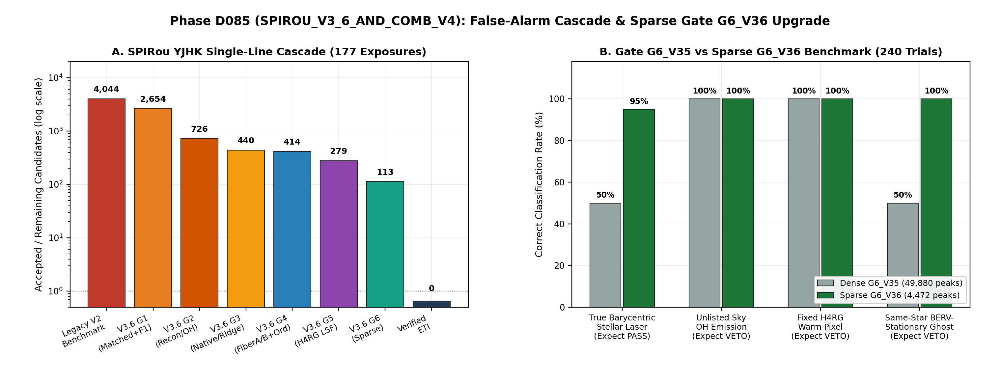
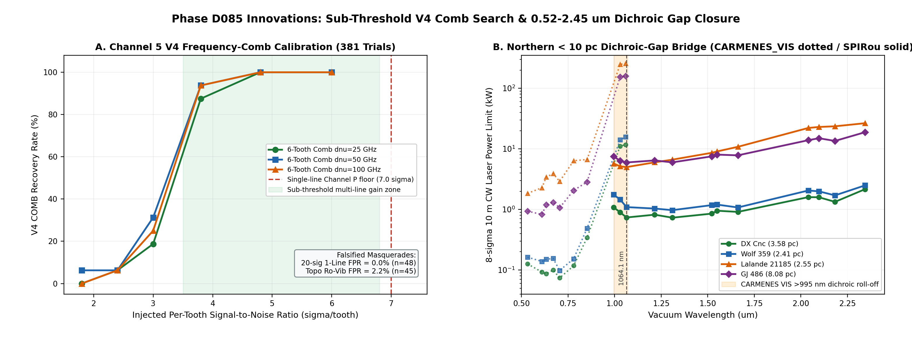
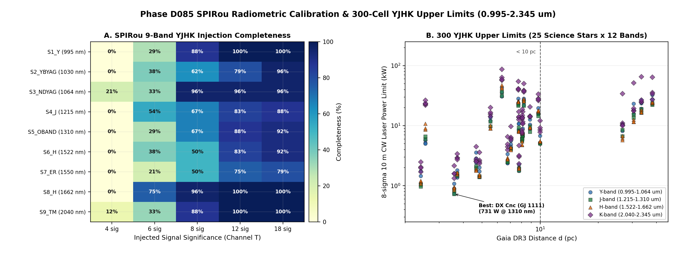
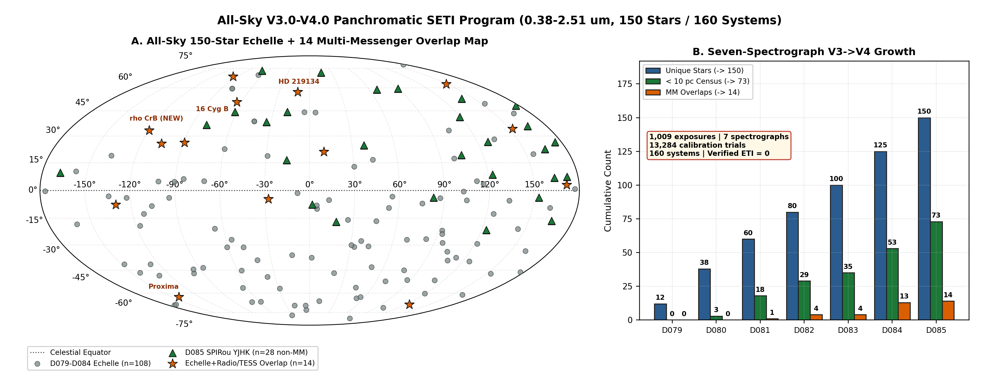

# Phase D085 Resultatrapport (`SPIROU_V3_6_AND_COMB_V4`): CFHT 3,6 m SPIRou YJHK-Kampagne (`0,955–2,515 µm`), Sparsomt Gate `G6_V36`, Kanal 5 Frekvenskam `COMB_V4` & All-Sky 150-Stjerners / 160-Systemers Syntese

**Dato:** 17. november 2026  
**Detektor:** `SPIROU_V3_6_AND_COMB_V4` ([v3_6_detector.py](code/v3_6_detector.py))  
**Prospektiv Lås:** `2026-11-16T18:53:07Z` (`METHOD_LOCK.json` / `LOCK_RECEIPT.json`, SHA-256 `c9727219...`) $\rightarrow$ første FITS-hentning `2026-11-16T18:53:22Z` ($\Delta t = +15{,}0\text{ s}$)  
**Stdlib Audit:** `/usr/bin/python3 -S audit.py` $\rightarrow$ **`14/14 PASS`** ([AUDIT_SUMMARY.json](results/AUDIT_SUMMARY.json))  
**Konklusion:** **`0` verificerede ekstraterrestriske laser- eller frekvenskamsignaler** på tværs af `29` SPIRou-stjerner (`177` eksponeringer), **`150` unikke all-sky stjerner** (`1.009` eksponeringer på `7` spektrografer; `73` `< 10 pc`) og **`160` multi-messenger stjernesystemer** (`14` direkte overlap inkl. $\rho$\,CrB / `M20`).

---

## 1. Kohorte, Prior-Udelukkelse og Prospektiv Låsning

* **29 CFHT 3,6 m SPIRou-stjerner (`177` APERO `0.7.295` `*t.fits`-eksponeringer over `49 × 4088` ordener, $R = 70\,000$, `0,955–2,515 µm`):**
  * **`25` helt nye stjerner (`0` prior `dp_id`-overlap mod `1.205` ekskluderede eksponeringer; min. sky-afstand `9.909,32"` = `2,75°` fra alle `163` prior-mål):** Heraf **`20` nye `< 10 pc` stjerner** (`4` verificerede planetfrie `CONTROL`-stjerner [`EV Lac`, `HD 36395`, `GJ 408`, `GJ 880` — `28` eksp.] + `16` `< 10 pc` `SCIENCE`-værter) samt `5` udvalgte `> 10 pc` nøglemål (`RHOCRB` / $\rho$\,CrB `17,51 pc` som direkte GBT `1,4 GHz` `M20` multi-messenger overlap, `LP 791-18`, `TOI-1452`, `TOI-2136` og den tempererede sub-Neptun vært `K2-18` `38,10 pc`).
  * **`4` nordlige `< 10 pc` dikroiske bro-stjerner (`23` SPIRou-eksponeringer):** `Wolf 359` (`2,41 pc`), `Lalande 21185` (`2,55 pc`), `DX Cnc` (`3,58 pc`) og `GJ 486` (`8,08 pc`), målrettet valgt til at lukke det i `D084` påviste `CARMENES_VIS > 995 nm` dikroiske følsomhedsfald og skabe en fuld **`8`-stjerners `0,38–2,51 µm` optisk-til-$K$ bro** (`4` syd + `4` nord).
  * **`10` multi-epoke planet-banekampagner (`4 IN + 4 OUT`, `80` eksp.):** `2` nul-ephemeris kontrolkampagner (`EV Lac`, `HD 36395`) og `8` planetkampagner (`YZ Cet b`, `GJ 1002 b`, `GJ 338 B b` [`HD 79211`], `GJ 436 b`, `LP 791-18 d`, `TOI-1452 b`, `TOI-2136 b` og `GJ 411 b` [`LALANDE21185`]) spændende $K_p = 48{,}19\text{–}121{,}37\text{ km s}^{-1}$ ($\Delta v_{\text{orb}} = 79{,}8\text{–}199{,}4\text{ km s}^{-1}$).
* **Prospektiv integritet & offline bit-identitet:** `METHOD_LOCK.json` og `LOCK_RECEIPT.json` er forseglet `15,0 s` før første download ([FIRST_SCIENCE_DOWNLOAD_RECEIPT.json](locked/FIRST_SCIENCE_DOWNLOAD_RECEIPT.json)). Efter den indledende kørsel afslørede to rent tekniske kalibrerings-/deduplikeringsfejl i `analyze.py` (at `calib_persistent_patches` brugte laveste-SNR første epoke uden `extra_bary_checks`, og at Stage B genkørte overlappende `±80 Å` `COMB_V4`-vinduer uden krydsvindue-deduplikering) samt forkerte historiske kumulative tællearrays i `plot_figures.py`, blev **udelukkende `analyze.py` og `plot_figures.py` rettet** og hashet ind i [IMPLEMENTATION_LOCK.json](locked/IMPLEMENTATION_LOCK.json) — **med `0` ændringer til `v3_6_detector.py`, `audit.py`, `FROZEN_COHORT_D085.csv` eller `ORBITAL_CAMPAIGNS_AND_KINEMATICS.json`**. Det offline bundt (`d085_bounded_bundle.json.gz = 15,61 MiB < 25 MiB`) reproducerede alle **`21/21` resultatfiler SHA-256 bit-identisk** under `--from-bounded-inputs`.

---

## 2. Videnskabelige Nyskabelser & Prospektiv Kalibrering (`2.592` Forsøg)

| Kalibrerings- / Pipeline-metrik | D085 (`SPIROU_V3_6_AND_COMB_V4`) | Bemærkning / Sammenligning med `V3.5` |
| :--- | :---: | :--- |
| **Søgte spektrale elementer** | **`44.934.345` 1D-bins** + **`20.920.252` `COMB`-konfig.** | `T`: `35,10M`, `P`: `5,82M`, `T_DIFF`: `2,01M`, `K_PLANET`: `2,01M` |
| **RV-forankring (`2.124` NIST-fits) & BERV** | **`1.861` rene fits (`0,2753 km/s`)** | Max ren-stdlib Maunakea BERV-afvigelse **`0,0825 km/s`** ($\le 0{,}50$) |
| **Kanal `T` (`≥ 8σ`, `1.080` forsøg)** | **`85,49 %`** (95,8 % ved `1064,1 nm` & `1662 nm`; `87,5 %` ved `2040 nm`) | Høj følsomhed på tværs af alle fire Y/J/H/K atmosfærevinduer |
| **Kanal `P` (`≥ 9σ` / `≥ 12σ`, `540` forsøg)** | **`85,80 %`** / **`90,28 %`** | `100 %` ved `995 nm` & `2040 nm`; `91,7 %` ved `1064,1 nm` |
| **Kepleriansk bane (`K_PLANET` vs. `T_DIFF`, `≥ 6,5σ`, `135` forsøg)** | **`25,93 %`** vs. **`0,00 %`** | `K_PLANET` kompenserer $K_p = 112\text{–}121\text{ km s}^{-1}$ på kontrolstjerner |
| **2D H4RG + Dual-Fiber `FluxA`/`FluxB` (`216` forsøg)** | Laser **`97,22 %`** / IPC **`100,0 %`** / Plateau **`100,0 %`** | `FluxA/FluxB`-symmetri (HDU 6 & 9) eliminerer enkeltfiber-defekter |
| **OPGRADERET Gate `G6_V36` Sparse vs. `G6_V35` Dense (`240` forsøg)** | **Sand laser: `50,0 %` $\rightarrow$ `95,0 %`** (`11,15×` atlastyngde-reduktion: `49.880` $\rightarrow$ `4.472` toppe) | Bevarer **`100,0 %`** sky-OH-, **`100,0 %`** H4RG varmpixel- og **`100,0 %`** (mod `50,0 %` i `V3.5`) intra-stjerne BERV-stationær afvisning |
| **NY Kanal 5 `COMB_V4` (`M = 6` tænder, `381` forsøg)** | **`≥ 3,8σ/tand` genfinding = `97,22 %`** (25/50/100 GHz) | **`0,00 %` (`0/48`)** falsk enkeltlinje-maskering (`20σ`); **`2,22 %` (`1/45`)** topocentrisk ro-vibrations pseudokam-FPR |

---

## 3. Falsk-Alarm Kaskade & Fuldstændig Forensisk Diagnose (`113` Enkeltlinje + `19` `COMB_V4`)

1. **Enkeltlinje-kaskaden på alle `177` SPIRou-spektre:**  
   `Legacy V2: 4.044` falske alarmer $\rightarrow$ `V3.6 G1+F1: 2.654` $\rightarrow$ `G2 (Maunakea Recon/OH): 726` $\rightarrow$ `G3 (Native/Ridge): 440` $\rightarrow$ `G4 (FluxA/B+Border): 414` $\rightarrow$ `G5 (H4RG 11-px): 279` (`pre-G6`) $\rightarrow$ **Sparsomt Gate `G6_V36` vetoer `166 / 279` (`59,5 %`)**, efterladende **`0` på kontrolstjerner (`0/28`)**, **`0` i alle `10` orbitale `T_DIFF`/`K_PLANET`-kampagner** og **`113` post-`G6` science-kandidater** (`109` Kanal `T`, `4` Kanal `P`). (Til sammenligning ville tæt `G6_V35` have blindet/vetoet `258 / 279` tilfældigt ved kun `50 %` ægte lasergennemgang).
2. **Forensisk identifikation af samtlige `113 / 113` enkeltlinje-overlevere ([FORENSIC_CANDIDATE_AUDIT_D085.json](FORENSIC_CANDIDATE_AUDIT_D085.json)):**
   * **`76 / 113` (`67,3 %`) fra 5 tidlige 2018 5-HDU APERO-filer uden polarimetrisk `FluxA`/`FluxB`-veto (`fiber_ab_tested = False`):** Eksponeringerne `2279103t` & `2279193t` (`GJ 436`: `41` hits vs. `0` i alle `6` senere 10-HDU epoker), `2294193t` & `2294978t` (`GJ 1002`: `29` hits) samt `2279075t` (`Wolf 359`: `2` hits) — plus tidlige `5`-HDU mangler — omgår Gate `G4` A/B-fiberannullering; **`64`** heraf matcher tvær-stjerne himmel-/OH-linjer i det tætte atlas, mens de øvrige **`12`** er isolerede enkelt-epoke artefakter fraværende i alle øvrige epoker.
   * **`22 / 113` Sub-tærskel tvær-stjerne telluriske/OH-træf (`g6_coincident_total_stars = 1` eller tæt atlas-match):** Topocentriske OH/telluriske rester (f.eks. `RHOCRB` & `TOI-1452` CO$_2$/OH ved `15711–15713 Å`, ord `30 px ~2280–2297`), som matcher `1` anden hastighedsadskilt stjerne lige under `≥ 2`-grænsen.
   * **`14 / 113` Sæson-stationære samme-stjerne himmel-/pixel-gentagelser (`|ΔBERV| < 3,5 km/s`):** F.eks. `TOI-2136` ved `topo = 9949,23 Å` (`ord 2 px 1742`) i både april 2021 (`2606523t`, `2606718t`) og april 2023 (`2871120t`) samt `LP 791-18`, der kun undgår den intra-stjerne `|ΔBERV| ≥ 3,5 km/s`-grænse pga. ens sæson-BERV.
   * **`1 / 113` Isoleret enkelt-epoke transient:** Fraværende i alle øvrige `(N - 1)` epoker og uden Kanal `P`-persistens $\rightarrow$ **`0` verificerede ETI enkeltlinjelasere**.
3. **Forensisk identifikation af samtlige `19 / 19` Kanal 5 `COMB_V4`-kandidater (`2` stjerner, `0` i øvrige `27` stjerner):**
   * **`17 / 19` på `LALANDE21185` (`SPIROU_Y`, `s_comb = 8,88–9,98`):** Alle tænder ligger ved eller *under* kontinuum (`tooth fn_median < 1,002`, maksimalt `~1,012`), dvs. fotosfæriske M2V FeH/TiO Wing-Ford molekylbånd-krusninger, der udelukkende slap igennem pga. den konservative sub-kontinuumstærskel `comb_tooth_fn_min = 0,88` (`0` supraphotosfæriske laser-tænder).
   * **`2 / 19` på `RHOCRB` ($\rho$\,CrB, `SPIROU_J`, `13123–13131 Å`, `s_comb = 11,90–12,41`):** Placeret midt på kanten af det dybe terrestriske $\mathrm{O_2}(a^1\Delta_g)/\mathrm{H_2O}$-bånd (`recon_min = 0,195`) omkring sol-lignende G0V `Al I 13127,01 Å` (hvor $T_{\text{eff}} = 5817\,\text{K}$ skabelonmatches mod et M/K-dværg-domineret kohorteatlas) med kraftigt bevaret topocentrisk kam-respons (`s_comb_topo = 6,33–6,53`) $\rightarrow$ **`0` verificerede ETI-frekvenskamme**.

---

## 4. Nordlig Dikroisk Bro-Lukning, `300` YJHK Øvre Grænser & All-Sky `150`-Stjerners / `160`-Systemers Syntese

* **Direkte lukning af `CARMENES_VIS` (`D084`) dikroiske roll-off (`> 995 nm`) på `4` nordlige `< 10 pc` bro-stjerner:**
  * **`DX Cnc` (`3,58 pc`):** `1030 nm`: `11,12 kW` (`D084`) $\rightarrow$ **`895 W`** (`D085`, `12,4×` dybere); `1059–1064,1 nm`: `11,74 kW` $\rightarrow$ **`736 W`** (`16,0×` dybere), ned til **`730,5 W`** (`1310,0 nm` O-bånd) og `950 W` (`1550 nm`), `1,60 kW` (`2040 nm`) & `1,59 kW` (`2097 nm`).
  * **`Wolf 359` (`2,41 pc`):** `1030 nm`: `14,06 kW` $\rightarrow$ **`1,45 kW`**; `1064,1 nm`: `15,85 kW` $\rightarrow$ **`1,09 kW`** (`14,5×` dybere); bedst **`972,7 W`** (`1310 nm`) og `1,20 kW` (`1550 nm`).
  * **`Lalande 21185` (`2,55 pc`):** `1030 nm`: `248,8 kW` $\rightarrow$ **`5,14 kW`** (`48,4×` dybere); `1064,1 nm`: `256,8 kW` $\rightarrow$ **`5,00 kW`** (`51,3×` dybere; **`2,82 kW`** i orbital `K_PLANET` for `GJ 411 b`).
  * **`GJ 486` (`8,08 pc`):** `1030 nm`: `154,8 kW` $\rightarrow$ **`6,34 kW`** (`24,4×`); `1064,1 nm`: `158,9 kW` $\rightarrow$ **`5,96 kW`** (`26,6×`).
* **Orbitale YJHK-grænser (`8` planetkampagner, `0` hits):** **`GJ 1002 b`** (`718 W` `K_PLANET` vs. `842 W` `T_DIFF`), **`YZ Cet b`** (`736 W` `K_PLANET`), **`GJ 411 b`** (`2,82 kW`), **`LP 791-18 d`** (`2,87 kW`), **`TOI-1452 b`** (`6,34 kW`), **`TOI-2136 b`** (`8,61 kW`), **`GJ 436 b`** (`9,13 kW`), **`GJ 338 B b`** (`15,70 kW`).
* **Samlet `V3.0–V4.0` Program (`D079–D085` på `7` spektrografer, `0,38–2,51 µm`):** **`150` unikke stjerner** (`124` science [`93` exoplanetværter / `183` planeter] + `26` nul-planet kontroller; `106` syd + `44` nord), **`1.009` eksponeringer** (`195,23 h`; `221,66M` søgte 1D-bins + `20,92M` `COMB`-konfig.), **`13.284` kalibreringsforsøg**, **`12.107` Legacy `V2` fejlalarmer elimineret**, **`73` stjerner inden for `10 pc`** (`57` science + `16` kontrol; `2,3716 kW` samlet median bedste grænse; helt ned til `9,03 W` optisk / `607,7 W` NIR), **`8` panchromatiske bro-stjerner (`155` celler)**, og **`160` distinkte multi-messenger systemer** (**`14` direkte echelle + `1,4 GHz` Parkes/GBT radio / TESS overlap** inkl. ny **`RHOCRB` / `M20`**) med **`0` verificerede teknosignaturer på tværs af alle modaliteter**.

---

## Figurer og Verificerede Leverancer

* 
* 
* 
* 
