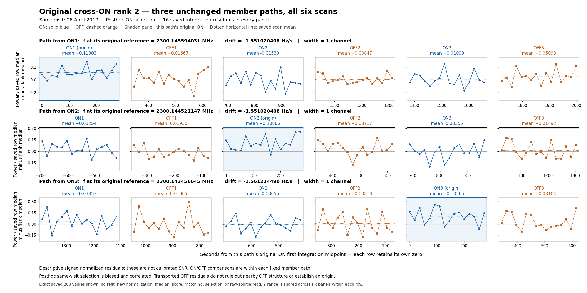

# SETI: 635 matches undersøgt i alle seks scanninger

10. oktober 2026 · observation 28. april 2017, AGBT17A_999_55 · HIP98505 / HD189733

De faste profiler er færdigberegnet og kildekontrollen er bestået. Resultatet dokumenterer 635 tidligere cross-ON-sammenkædninger i alle seks scanninger. Det etablerer endnu ingen kvalificeret SETI-detektion eller én fælles sammenhængende signalbane.

De tre originale ON-medlemsbaner i hver sammenkædning er bevaret hver for sig. Kun 838 af deres 1.905 baner har positiv profilmiddelværdi i alle tre ON-scanninger. Det understreger, at en association af nærliggende detektorvindere ikke i sig selv er et gentaget signal på samme faste bane.

## Faktisk gennemført

| Størrelse | Resultat |
|---|---:|
| Tidligere matches i udgangspunktet | 636 |
| Eksakt kendt ON/OFF-match udeladt før måling | 1 |
| Undersøgte matches | 635 |
| Uændrede originale ON-medlemsbaner | 1.905 |
| Logiske profiler, seks scanninger pr. bane | 11.430 |
| Tidsrækker i de logiske profiler | 182.880 |
| Forskellige nye udtræksgeometrier | 11.369 |
| Interne geometrigenbrug | 61 |
| Genbrug af tidligere målte profilgeometrier | 0 |
| Ny detektor-gridscoring fra dette profiltrin | 0 |
| Nye kildeforespørgsler / marginalomkostning | 0 / 0 DKK |

Det udeladte match er alene `radio_s2017_cross_on_storage_recovery_20261010_rank_0001`, den allerede kendte linje ved 2300,390625 MHz i både ON og OFF. De resterende matches er fortsat uklassificerede. Udvalget er ikke ændret efter profillæsningen.

De seks scanninger er ON1 HIP98505/0039, OFF1 HIP97319/0040, ON2 HIP98505/0041, OFF2 HIP97461/0042, ON3 HIP98505/0043 og OFF3 HIP97663/0044. De tilhører ét historisk besøg; de er ikke uafhængige gentagelser af observationen.

## Hvad der er målt

Hver medlemsbane beholder sin oprindelige referencefrekvens, referencetid, drift og kanalbredde. Kanalcentre rundes fra den absolutte frekvensbane med `np.rint` til nærmeste lige heltal. Der foretages intet fælles sporfit eller ny centrering efter sammenkædningen.

For hver af de 16 tidsrækker læses 129 rå kanaler omkring den faste bane. Rå effekt divideres med den allerede lagrede median for hele den oprindelige native-række. Den nye restværdi er middelværdien i banens 1 eller 3 centerkanaler minus medianen af de 122 flankekanaler uden for ±3 kanaler. ON og OFF bruger samme formel. Resultaterne er dimensionsløse, fortegnsbevarende profilrester, som ikke kan ligestilles med de gamle robuste detektorscorer eller kalibreret SNR.

De 96 gemte fuldbåndsmedianer genbruges. Nye lokale flankemedianer og profiler er faktisk beregnet i dette trin; tidligere detektorberegning og fuldbåndsmedianer er ikke genkørt. De 61 interne aliases deler samme udtræk, mens deres originale tidsreferencer bevares.

## Beskrivende optællinger

Reglerne blev skrevet før læsningen af de nye metrikværdier: middelværdi > 0, og OFF-middelværdi >= samme medlems oprindelige ON-middelværdi. Der er ingen tilpasset tærskel, ny rangliste eller kandidatgodkendelse.

| Egenskab ved en uændret medlemsbane | Antal af 1.905 |
|---|---:|
| Positiv middelværdi i dens oprindelige ON | 1.905 |
| Positiv middelværdi i begge halvdele af oprindelig ON | 1.899 |
| Positiv middelværdi i alle tre ON | 838 |
| Mindst én positiv OFF-middelværdi | 1.741 |
| Alle tre OFF-middelværdier positive | 341 |
| Mindst én OFF-middelværdi >= egen oprindelig ON | 8 |

Alle oprindelige ON-værdier er positive efter tidligere ON-udvælgelse; det er udvalgsbetinget og er ikke en ny validering. De otte OFF-sammenligninger fordeler sig på ét medlem i hver af otte matches. De øvrige 627 har ingen sådan sammenligning. Dette er hverken et OFF-veto, en fejlalarmssandsynlighed eller bevis for en himmelkilde.

Faste bevægelige OFF-baner kan passere ved siden af nærliggende stationær eller anderledes driftende struktur. Svage eller negative OFF-rester udelukker derfor ikke interferens. Profilerne og de fælles kontroller er korrelerede; fortegn alene skelner ikke mellem støj, instrument, interferens og fysisk oprindelse.

## Det allerede viste match nr. 2

Dette eksempel er den oprindelige visningsrang 2, valgt før de nye profiler. Alle tre oprindelige medlemsbaner og alle seks scanninger er vist; der er ingen ny rangordning. ON1 og ON2 har drift −1,5510204081632657 Hz/s; ON3 har nabotrinnet −1,5612244897959187 Hz/s. Alle tre har bredde én kanal.

| Oprindelig medlemsbane | ON1 | OFF1 | ON2 | OFF2 | ON3 | OFF3 |
|---|---:|---:|---:|---:|---:|---:|
| epoch1_on | 0.113029 | 0.016673 | -0.015297 | 0.008474 | 0.010985 | 0.050981 |
| epoch2_on | 0.032540 | -0.019298 | 0.108860 | 0.037169 | -0.003554 | 0.014919 |
| epoch3_on | 0.038529 | -0.010648 | -0.006559 | 0.008179 | 0.105651 | 0.031038 |

Hver bane er stærkest i den ON-scanning, hvor den oprindeligt blev udvalgt. De samme baner giver mindre og til dels negative middelværdier i de andre ON-scanninger. Det demonstrerer betydningen af den præcise kanal-, drift- og referencebane; det fastlægger ingen fælles sammenhængende linje eller fysisk oprindelse.

Figuren viser alle 288 gemte rækkeværdier uden ny normalisering eller profilberegning. Hver figur-række har sin egen oprindelige ON-tidsreference og samme y-område på tværs af de seks scanninger. Middelværdierne og nulreferencen er vist; y-aksen er ikke SNR.

## Kontrol, reproduktion og begrænsninger

Den faktiske beregning afsluttede med kode 0 og 4,711122 CPU-sekunder i den ydre proces, inden for de fastlåste grænser. Den separate kontrol afsluttede med PASS efter 2,587426197 CPU-sekunder. Den verificerede alle medlemsidentiteter, 16 kompakte arrays, geometrier, tidsreferencer, resuméhenvisninger og kildepins. Alle 96 fulde dekodede kilderækker blev autentificeret.

Kontrollen matchede 181.904 udtræksrække-hashes, svarende til **23.465.616 råcelleforekomster**. Efter logisk aliasudfoldning er der 23.591.520 forekomster. Disse er gentagne udvalgte forekomster, ikke så mange forskellige fysiske celler. SHA-kontrollen autentificerer råbyteindhold og resuméernes interne forbindelser; den genberegner ikke profilkernel, normalisering eller flankemedian uafhængigt. JSON-medianer kontrolleres for endelighed og grænser, uden ny medianberegning.

De kompakte resultater indeholder de fulde gemte profiler, kanalcentre, tidsreferencer og rå række-hashes. Hele råpatches er ikke duplikeret; de kan reproduceres fra de allerede gemte originale kildeudtræk og deres bytepins. Hele de oprindelige teleskopfilers MD5 er fortsat ikke verificeret.

Dette er posthoc arbejde på ét besøg. Der er ingen kalibreret SNR, fejlalarmssandsynlighed, flux, EIRP, følsomhed, generelt nulresultat, oprindelsesklassifikation eller uafhængig bekræftelse. De beskyttede holdouts og den gamle A/B FAIL_CLOSED-status er fortsat lukkede. Profiltrinets 0 nye detektor-gridscoringer må ikke lægges oven i tidligere hypotesetællinger.

Den første fastlåste profilfase stoppede før arrays og målinger på grund af forskellig PID-identitet mellem systemkald og procfs. Den er bevaret uden genkørsel. En særskilt recovery-fase rettede proceskontrollen til procfs-processens egen identitet og bevarede målekoden byteidentisk. Den første beskrivende JSON-læsning havde desuden en serializerfejl i et ressourcefeltnavn; original kode og fejloptegnelse er bevaret. En særskilt V2 rettede QA-feltopslaget samt kontrol/proveniens- og CPU-bogføring uden ændrede optællingsregler.

## Faste kildeidentiteter

| Genstand | SHA256 |
|---|---|
| Scope | `ba699556755e7b0621c8972e61f609f62f8b87ca8e37c6c7c9d8cb4242df8506` |
| Profilberegningens indre afslutningsreceipt | `74c5534ee86557923162521bbd0287deb3b3e2436e69ead7450dd25827000640` |
| Faktisk ydre afslutningsreceipt | `9dde6a6e9c8f04fb7f6ee7e37eff0e0b5d001f06fc1662512415d69b9e39aa2c` |
| Faktisk uafhængig QA | `542659607565595ec77074fadcd98d236eda8b126da8a09414c8696baa0fd7dc` |
| Kompakte profiler, NPZ | `2aade708b3776dc8465b2c24e8818a9be11389bbf9d37f8b316c433cbe8fe561` |
| Beskrivende JSON-analyse | `4507ccf9d2235f6f0558d1467bc6abede8bb13e56fd2ceb5b8b8224216e72684` |
| Figur | `68de379677943dacdfabaee0ee4b2e1fc73105d056cae0ac4ac986d815b2b0c8` |

Profil- og QA-kode var fastlåst før kørsel i commit `afa74530e81fad064bf97d60bbc501696377009a` på `m43-support-qualification`. De faktiske afslutningsreceipts har forrang over det historiske checkpointfelt om afventende ressourcekontrol; de oprindelige filer er bevaret uændret. Resultatpakken indeholder kode, scope, alle tre komplette JSON-shards, NPZ, QA, fortolkningsregler, figur og historiske fejlbeviser. Den duplikerer ikke de originale teleskopdata.
