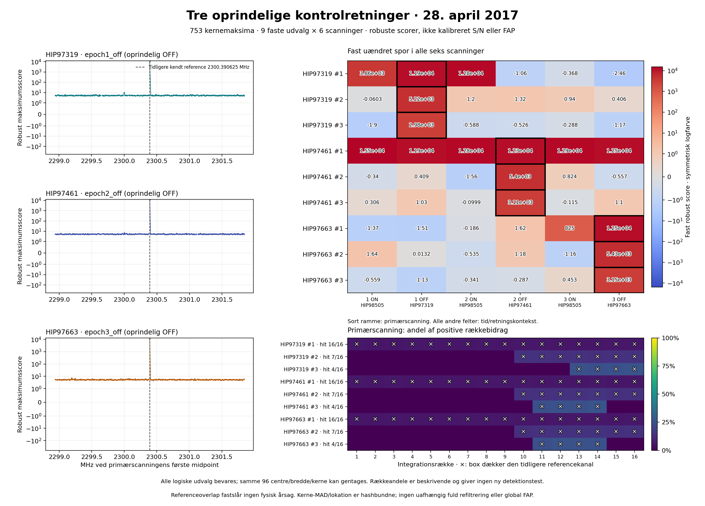

# SETI · tre oprindelige kontrolretninger · 11. oktober 2026

**753 nye kernemaps er afsluttet én gang i den korrigerede V2-fase og har bestået uafhængig QA.** De tre stjerner HIP97319, HIP97461 og HIP97663 har hver én oprindelig OFF-scanning fra besøget 28. april 2017. Ni spor er valgt efter primærsøgningen og derefter målt uændret i alle seks historiske scanninger. Dette er søge- og retningskontekst fra samme besøg; der er ingen ny kvalificeret SETI-detektion.

Alle 4096 referencekanalers maksimum i hver af 251 faste kerner pr. stjerne er bevaret. Kerne 0/255 og de allerede kortlagte kerner 64/128/192 indgår ikke i denne primærsøgning. Det giver 3.084.288 carrier-maksima og 4.842.332.160 korrelerede drift/bredde-kombinationer (785 drifter, bredde 1/3). Tallene er ikke uafhængige statistiske forsøg. Scoren er en empirisk robust box-track-score; den er **ikke kalibreret S/N eller FAP**.

| Primært udvalg | Frekvens MHz ved første midpoint | Drift Hz/s | Bredde | Primærscore | Største positive rækkeandel | Rækker med referencekanal i box |
|---|---:|---:|---:|---:|---:|---:|
| HIP97319 #1 | 2300.390627794 | -0.0102040816 | 3 | 11914.6 | 6.46% | 16/16 |
| HIP97319 #2 | 2300.390638970 | -0.0612244898 | 3 | 5223.29 | 14.58% | 7/16 |
| HIP97319 #3 | 2300.390652940 | -0.112244898 | 3 | 2980.07 | 25.54% | 4/16 |
| HIP97461 #1 | 2300.390627794 | -4.4408921e-16 | 3 | 12301.5 | 6.54% | 16/16 |
| HIP97461 #2 | 2300.390638970 | -0.0612244898 | 3 | 5400.4 | 14.89% | 7/16 |
| HIP97461 #3 | 2300.390650146 | -0.12244898 | 3 | 3107.77 | 25.87% | 4/16 |
| HIP97663 #1 | 2300.390627794 | -0.0204081633 | 3 | 12470 | 6.47% | 16/16 |
| HIP97663 #2 | 2300.390638970 | -0.0612244898 | 3 | 5432.34 | 14.79% | 7/16 |
| HIP97663 #3 | 2300.390650146 | -0.12244898 | 3 | 3150.55 | 25.50% | 4/16 |

Alle ni primærudvalg bruger kerne q127 og bredde 3. Referencekanalen ligger i følgende antal af de 16 rækkebokse (rank 1/2/3): HIP97319: 16/7/4; HIP97461: 16/7/4; HIP97663: 16/7/4. Mindst 99.9426% af den positive rækkemasse ligger på reference-hit-rækker for de udvalg med defineret nævner. Mønstret er foreneligt med flere søgeskabeloner omkring den tidligere kendte 2300.390625 MHz-komponent; de ni udvalg etablerer ikke ni uafhængige kilder. Rækkemassen gælder hele den valgte box og kan ikke tilskrives referencecellen alene. Den fysiske årsag er fortsat uafklaret.

HIP97461 #1 har drift -4.44089e-16 Hz/s og faste scorer fra 11914.4 til 15458.1 i de seks scanninger. Svagere scorer for andre faste drifter uden for deres primærscanning er tid/retningskontekst; de dokumenterer hverken blank himmel eller et signal, der kun findes ved den valgte stjerne.

Hver række er et separat primærudvalg. Tabellen nedenfor viser alle seks faste scorer; den primære scanning er markeret med fed, og de øvrige fem er tid/retningskontekst. De oprindelige ON/OFF-roller er bevaret. De andre retninger er ikke certificeret blank himmel eller gentagne observationer af den valgte primærstjerne.

| Udvalg | 1 ON · HIP98505 | 1 OFF · HIP97319 | 2 ON · HIP98505 | 2 OFF · HIP97461 | 3 ON · HIP98505 | 3 OFF · HIP97663 |
|---|---:|---:|---:|---:|---:|---:|
| HIP97319 #1 | 3863.73 | **11914.6** | 12812.9 | -1.05809 | -0.367822 | -2.46069 |
| HIP97319 #2 | -0.0602906 | **5223.29** | 1.19871 | 1.32219 | 0.939611 | 0.406487 |
| HIP97319 #3 | -1.89682 | **2980.07** | -0.588426 | -0.5264 | -0.287509 | -1.16824 |
| HIP97461 #1 | 15458.1 | 11914.4 | 12813.6 | **12301.5** | 12940.6 | 12468.9 |
| HIP97461 #2 | -0.33985 | 0.409024 | -1.55955 | **5400.4** | 0.823981 | -0.556975 |
| HIP97461 #3 | 0.305757 | 1.03205 | -0.0998658 | **3107.77** | -0.115349 | 1.10106 |
| HIP97663 #1 | -1.37053 | -1.51027 | -0.185774 | 1.61793 | 824.997 | **12470** |
| HIP97663 #2 | 1.64392 | 0.0131525 | -0.534725 | 1.18076 | -1.16471 | **5432.34** |
| HIP97663 #3 | -0.558908 | -1.13206 | -0.341002 | -0.286923 | 0.452923 | **3150.55** |

De ni logiske udvalg svarer til 9 forskellige kombinationer af alle 96 afrundede centre, bredde og fast normaliseringskerne. Gentagne kombinationer er bevaret: ingen. Dette er en beskrivelse af gemt målegeometri, ikke et antal uafhængige kilder.

Rækkeandelen er hvert positivt gemt rækkebidrag divideret med summen af alle 16 positive bidrag; de fortegnede bidrag bevares i JSON/CSV. Hvis nævneren er nul, er andelen udefineret. Den tidligere kendte reference er kildekanal 179830784, 2300.390625 MHz. Et hit betyder kun, at den valgte box dækker denne kanal i den pågældende række. Hverken overlap eller en dominerende række alene fastslår fysisk årsag, RFI eller en himmelkilde. Der er ingen ny tilpasning, filtrering af udvalg, veto eller detektionstest.

Kontekstsporet fastholder primærfrekvensen ved primærscanningens første integrationsmidpoint samt den valgte drift og bredde. Alle faktiske filstarttider og mellemrum indgår. De samme 4096 absolutte kernekanaler normaliserer hver scanning med uændret 501-filter og 4000-halo. Den primære driftgridopløsning giver ikke en garanti om subkanal-match over hele kadencen.

Primær-QA kontrollerede 753 maps og 3021 faste råscore-queries; kontekst-QA kontrollerede 54 profiler, 434.592 rå503-vinduesceller, alle 96 kilde-rækkehashes og ni primærscore-match med fast tolerance 1e-7 absolut/1e-10 relativ. Kernens rækkemedianer blev uafhængigt genberegnet. MAD/lokationsparametre er hashbundne gemte kerneparametre; de blev ikke uafhængigt fuldt refiltreret fra de lokale 503 celler. Ingen QA genkørte hele detektorgridet.

Den oprindelige fase fejlede i alle tre job ved lokale metadata før effektarrayet blev læst: 0 maps og 0 scorer. De oprindelige kodebytes, tre fejlreceipts og terminalbevis er bevaret. V2 bruger en særskilt mappe og gennemførte hvert af de tre videnskabsjob én gang; de oprindelige ON-udvalg, injektionstesten og kontekststadiet er særskilte resultater. Ingen nye teleskopforespørgsler eller BODY-bytes blev hentet; 0 kr. Original A/B-status er fortsat FAIL_CLOSED_UNCHANGED.

[Alle 60 top20-poster](TOP60.csv) · [Alle 753 kernemaksima](CORE_MAX753.csv) · [Alle 54 kontekster](CONTEXT54.csv) · [Samlet JSON](SUMMARY.json) · [Afslutning af rapport og figur](REPORT_COMPLETION_RECEIPT.json) · [Kilder og efterprøvning](DATA_AVAILABILITY.md)

Læsinput er bundet til de faktiske QA-receipts og deres bytepins i SUMMARY og REPORT_COMPLETION_RECEIPT. Der følger ingen kalibreret fluxfølsomhed, global falsk-alarm-rate, populationskomplethed, ny besøgsreplikation eller fysisk kildeklassifikation af denne opsummering.

Den første rapportkørsel skrev alle fem tekst- og tabelfiler og stoppede derefter i figurens eksport på et keyword-only argument til Matplotlib. Den oprindelige fejlreceipt, log, kode og tekstbytes er bevaret. En særskilt tegner retter alene eksportargumentet og bruger den gemte SUMMARY; der er ingen genkørsel af søgning, numerisk QA eller videnskabelig afledning. Denne afsluttende tekstversion retter kun receipt-henvisninger og forklarer eksportforløbet.
