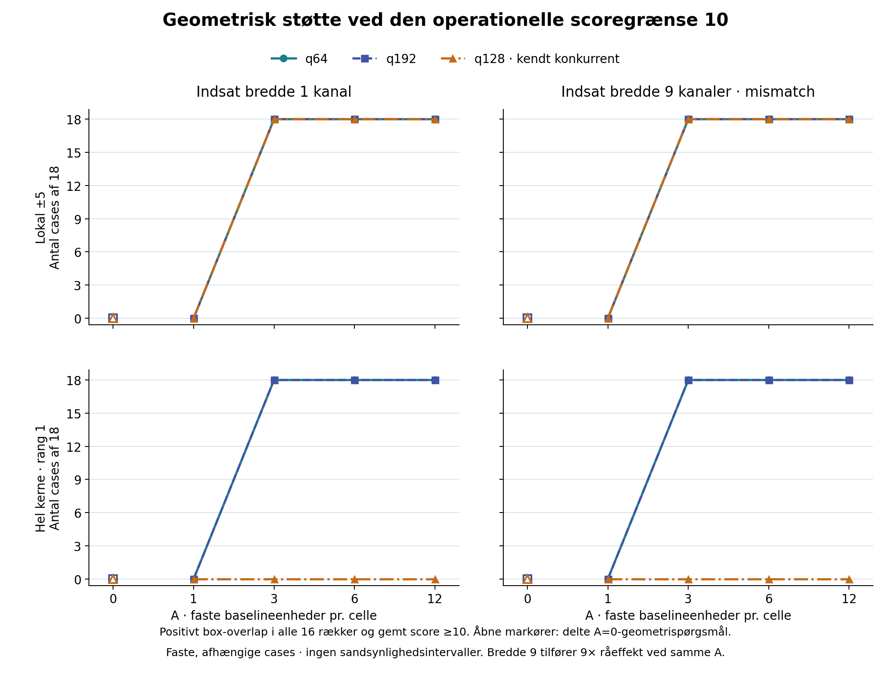

# SETI-signaltest · 11. oktober 2026

**Den smalle indsprøjtning passerede den fastlagte lokale tærskel i alle 54 cases ved hver af amplituderne A = 3, 6 og 12.** Kun 36 af 54 blev rang 1 i hele søgekernen: i q128 beholdt den allerede kendte linje førstepladsen. Søgealgoritmen gemmer maksimum for alle 4096 referencekanaler, så manglende rang 1 er ikke i sig selv en manglende genfinding. Dette er en kontrolleret signaltest på ét kendt historisk besøg, uden en ny kvalificeret SETI-detektion.

Begge job er afsluttet, og den uafhængige numeriske kontrol har status PASS. Der blev beregnet **450 forskellige kort: 18 uændrede baselines og 432 modificerede kort**. De 540 diagnostikposter består af 108 geometrispørgsmål til de delte nul-kort og 432 positive indsprøjtninger. Nul-kortene er ikke nye forsøg for hver amplitude. Ingen nye teleskopforespørgsler eller BODY-bytes blev hentet; omkostning **0 DKK**. Original A/B-status er fortsat `FAIL_CLOSED`, og de beskyttede 2016-kontroller er uændrede og blev ikke åbnet.

## Alle fastlagte betingelser

Tabellen og figuren viser **positivt overlap med den indsatte box i alle 16 tidsrækker samt gemt score ≥ 10**, enten for vinderen inden for kendt placering ±5 referencekanaler eller for rang 1 i hele kernen. Hver q/bredde/A-gruppe har 18 faste cases: seks scanninger × tre drifter. q64 og q192 har identiske tal hver for sig; deres fælles nævner er 36. A = 0 betegner delte baseline-spørgsmål og krediteres ikke som indsprøjtet genfinding.

| Indsat bredde | A pr. celle | Lokal q64 + q192 | Lokal q128 | Rang 1 q64 + q192 | Rang 1 q128 |
|---|---:|---:|---:|---:|---:|
| 1 kanal | 0 | 0/36 | 0/18 | 0/36 | 0/18 |
| 1 kanal | 1 | 0/36 | 0/18 | 0/36 | 0/18 |
| 1 kanal | 3 | 36/36 | 18/18 | 36/36 | 0/18 |
| 1 kanal | 6 | 36/36 | 18/18 | 36/36 | 0/18 |
| 1 kanal | 12 | 36/36 | 18/18 | 36/36 | 0/18 |
| 9 kanaler | 0 | 0/36 | 0/18 | 0/36 | 0/18 |
| 9 kanaler | 1 | 0/36 | 0/18 | 0/36 | 0/18 |
| 9 kanaler | 3 | 36/36 | 18/18 | 36/36 | 0/18 |
| 9 kanaler | 6 | 36/36 | 18/18 | 36/36 | 0/18 |
| 9 kanaler | 12 | 36/36 | 18/18 | 36/36 | 0/18 |



For bredde 1 har de strengere, fastlagte flag for samme søgetuples tærskelpassage også **0/54 ved A = 1 og 54/54 ved hver A = 3, 6 og 12 lokalt**, mod henholdsvis 0/54 og 36/54 for rang 1. Flagene kræver blandt andet præcis bredde, geometrisk match, positiv scoredifference og score under 10 for den samme tuple på baseline; de beviser ikke, at alle kompatible baseline-hypoteser lå under 10. Nærmeste referencekanals støtte/tærskeltal er identiske med de lokale tal i tabellen.

Søgningen anvender kun bredderne 1 og 3. **Bredde 9 er derfor en test af støtte ved bredde-mismatch, ikke præcis breddegenfinding.** Ved samme A tilfører den ni gange så meget samlet råeffekt pr. række som bredde 1. De to bredder sammenlignes ikke ved samme energi. Ved A = 1 steg den kendte sandhedsscore alligevel med 3,981–3,997 for bredde 1 og 11,716–11,857 for den ikke-søgte 9-kanalers sandhedsbox. Nul tærskelflag betyder altså ikke nul scorerespons.

I q128 var hele kernens vinder den kendte kanal 179830784 i alle 180 logiske cases. Den indsatte reference ligger 2048 kanaler, cirka 5722 Hz, derfra og uden for den lokale sporfamilie. Dette beskriver konkurrence i de gemte kort, uden en påstand om linjens fysiske årsag.

## Metode og kontrol

De seks ON/OFF-scanninger kommer fra besøget 28. april 2017, native171. De faste kerner er q64, q128 og q192; q128 blev valgt som kendt konkurrentkontekst. Indsatte drifter er −1,5, 0 og +1,5 Hz/s. A = 0, 1, 3, 6 og 12 er baseline-residualens robuste MAD-enheder pr. celle. Indsprøjtningen tilføjer `A × baseline-rækkemedian × baseline-residual-MAD` i en float64-kopi af råeffekten, hvorefter den uændrede forbehandling og søgning køres på 785 drifter fra −4 til +4 Hz/s. Referenceplaceringen er kerne-start +2048, afrundet på de faktiske integrationsmidtpunkter.

Hver scanning nulstiller sporet ved sit eget første midpoint, og alle seks scanninger, også OFF, får separate indsprøjtninger. Testen undersøger derfor ikke en sammenhængende ON-only himmelkilde eller OFF-veto. Det faste, afhængige gitter giver betingede case-andele; det giver ikke populationskomplethed, ny besøgsreplikation, kalibreret SNR/FAP, fluxfølsomhed eller en generel nulkonklusion. Score 10 er en operationel grænse.

[QA-receipten](../results/review/QA_RECEIPT.json) kontrollerer blandt andet 450 gemte kort, 540 diagnostikposter, 1.843.200 kanalmaxima/rangpositioner, seks kildefiler og 96 dekodede rækkehashes samt råeffektens lokale sandhedsaritmetik. Kernens rækkemedianer blev uafhængigt genberegnet; gemte MAD/lokationsparametre blev hash- og skemakontrolleret. QA genkørte hverken forbehandling eller detektor og genberegnede ikke udtømmende alle søgescorer. Videnskabsjobbene brugte tilsammen 808,906 CPU-sekunder; længste parallelle job varede 537,117 sekunder. QA brugte 5,380 CPU-sekunder, 5,329 vægsekunder og højst 482.721.792 bytes RSS.

## Reproduktion

Den offentlige kode/scope-frysning før værdilæsning er `aedf9a3e2bf33424f2d4e88875569eaa19ef4130`; den separate QA-frysning er `3f6cc15bca1d7cbda7f870193db6deb9ea7cfa64`. [Scope](../scope.json), [job-receipt](../results/offcenter/EXECUTION_RECEIPT.json), [q128-receipt](../results/known_center_competitor/EXECUTION_RECEIPT.json), [alle 30 grupper](ALL30_GROUPS.json) og [figurens producentreceipt](COMPARISON_RENDER_RECEIPT_V2.json) binder input- og outputbytes. Den fulde `results/summary/SUMMARY.json` med alle 540 oprindelige diagnostikposter bevares i resultatpakken.

Kilden er det allerede leverede **`SETI_S2017_NATIVE171_RAW_2026-10-10.zip`**, 466.351.822 bytes, SHA256 `6e08922aec5c5a6737987887cd62aab6d52495650297cae74745a654728f4786`. De seks oprindelige compact-H5-medlemmer ligger under `analysis/new_visit_recovery/results/acquire/` og skal udtrækkes dér med navnene `epoch1_on.compact.h5` til `epoch3_off.compact.h5` som angivet i scope. De duplikeres ikke i denne signaltests resultatpakke. Scopets syv tekst/kodepins omfatter fem ældre metadata/læser/detektorfiler samt denne tests `driver.py` og `prepare_scope.py`; brug deres oprindelige stier. Containerens delmængdeidentitet er ikke en verifikation af hele den oprindelige teleskopfils katalogchecksum.

Kørslen brugte Python 3.12.14, NumPy 2.3.5, SciPy 1.17.0, h5py 3.15.1, hdf5plugin 7.1.0 og HDF5 1.14.6; figuren brugte Matplotlib 3.10.8. De fastlåste h5py/hdf5plugin-wheels følger resultatpakken og skal installeres til `analysis/deps`; Python og de øvrige pakker skal være tilgængelige. Miljøet er ikke fuldt hermetisk, og POSIX/Linux-funktioner til låse og ressourceloft kræves. I en frisk projektrod med tomme outputmapper kan de to job køres sekventielt:

```bash
export OPENBLAS_NUM_THREADS=1 OMP_NUM_THREADS=1
export PYTHONPATH="$PWD/analysis/deps"
python3 analysis/s2017_injection_20261011/driver.py --root . --job offcenter \
  --scope-sha256 64e34e40377751a261381a589dc5603c851ca562a162b9255239aff785d93631 \
  --freeze-commit aedf9a3e2bf33424f2d4e88875569eaa19ef4130
python3 analysis/s2017_injection_20261011/driver.py --root . --job known_center_competitor \
  --scope-sha256 64e34e40377751a261381a589dc5603c851ca562a162b9255239aff785d93631 \
  --freeze-commit aedf9a3e2bf33424f2d4e88875569eaa19ef4130
```

Følg derefter [QA-programmets](../qa_saved.py), [summarizerens](../summarize.py) og [figurprogrammets](render_comparison_v2.py) CLI med de faktisk producerede receipts og deres SHA256. Ressourcemålinger gør nye receipts byteforskellige; genbrug ikke de oprindelige receipt-hashes som bevis for en ny kørsel. Der er create-only output, loft på 2 GiB RAM pr. job og 8 GiB arbejdsplads. Oprindelige forsøg og den første figurs layoutrevision er bevaret; ingen videnskab eller QA blev genkørt for figurrettelsen.
