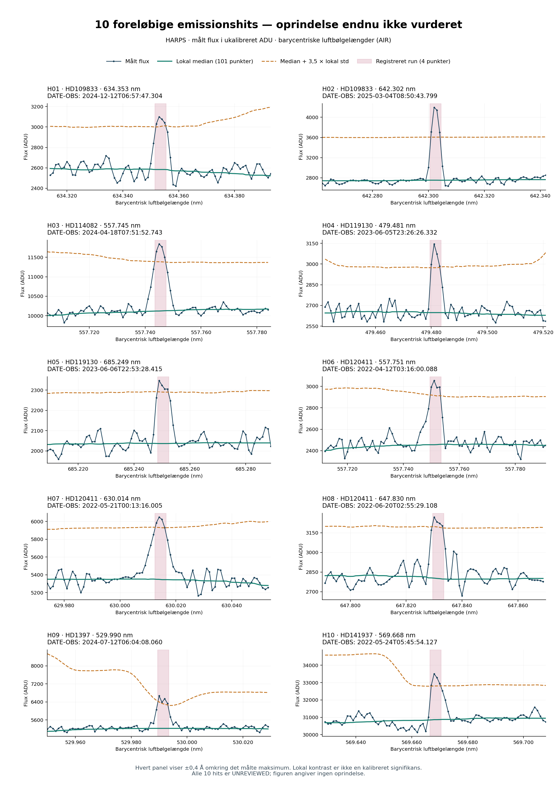

# HARPS — første analyse, 1. november 2026

**Opdatering om tempo og udvidelse:** Selve hovedkørslen tog 6,5 sekunder på klargjorte data. En ny metadataopgørelse finder 959 yderligere mulige eksponeringer, og et forslag på 100 ekstra er klar. Ingen af disse er endnu hentet eller analyseret. [Mulig udvidelse](expansion/FEASIBILITY.md) · [Faglig prioritering](expansion/NEXT_STEPS.md). En første headerkontrol af de eksisterende hits giver tre tætte O I-bølgelængdesammenfald, fortsat uden endelig disposition: [foreløbig kontrol](triage_initial/README.md).

**Den godkendte optiske uge er startet, og første hovedsøgning er gennemført.** 100 individuelle HARPS-eksponeringer af 20 mål er analyseret med regler fastlagt før hoveddata blev åbnet. Der er 10 foreløbige emissionshits på seks mål. Der er ingen identificeret laser eller kvalificeret SETI-kandidat. Ophavet til de 10 hits er endnu ikke vurderet.

Kontrolforsøget viser samtidig en væsentlig følsomhedsbegrænsning: kun 11 af 48 indsatte linjer genfindes. Derfor kan de øvrige eksponeringer ikke bruges som en bred udelukkelse af smalle optiske lasersignaler.

| Faktisk arbejde | Resultat |
|---|---:|
| Hovedprøve | 20 mål × 5 eksponeringer; mindst 3 nætter pr. mål |
| Observationstidspunkter | 11. juni 2021 – 26. august 2025 |
| Samlet eksponeringstid | 82.699,582 sekunder = 22,972 timer |
| Hentet og analyseret | 100 af 100 hovedeksponeringer |
| Søgte spektralpunkter, summeret over eksponeringer | 30.650.658 |
| Foreløbige emissionshits | 10, alle med præcis 4 punkter over grænsen |
| Kortere udsving | 1.629, alle bevaret |
| Bredere udsving over 60 punkter | 0 |
| Indsatte kontrollinjer | 48 af 48 vurderbare; 11 genfundet |
| Uændrede kontroludsnit | 12; ingen matchende hits |

Punkterne er resamplede og ikke statistisk uafhængige. De cirka 23 timer er summeret teleskopeksponering fordelt over flere stjerner og år, ikke sammenhængende overvågning. Søgeområdet er 380–690 nm i barycentriske luftbølgelængder; detektorhullet og ugyldige randpunkter er udeladt og opgjort pr. fil.

## Hele den foreløbige hitliste

[PRELIMINARY_HITS.csv](production/PRELIMINARY_HITS.csv) indeholder de ti hits; [ALL_THRESHOLD_RUNS.csv](production/ALL_THRESHOLD_RUNS.csv) indeholder samtlige 1.639 tærskelruns. [HIT_DISPOSITIONS.csv](production/HIT_DISPOSITIONS.csv) registrerer dato, råforløber og status `UNREVIEWED` for hvert hit. Ingen hændelser er fjernet efter resultatet blev kendt.

| Mål | Antal foreløbige hits | Barycentrisk luftbølgelængde, nm |
|---|---:|---|
| HD109833 | 2 | 634,353; 642,302 |
| HD114082 | 1 | 557,745 |
| HD119130 | 2 | 479,481; 685,249 |
| HD120411 | 3 | 557,751; 630,014; 647,830 |
| HD1397 | 1 | 529,990 |
| HD141937 | 1 | 569,668 |



Bølgelængderne er målinger i filernes referenceframe. Nærhed til en kendt atmosfærelinje er ikke her anvendt som en dokumenteret klassifikation; referenceframe, råbillede og relevante kontroller skal undersøges først.

## Hvad kontrolforsøget lærte os

Tre særskilte HD100508-spektre, fire på forhånd valgte bølgelængder og fire styrker giver 48 parrede forsøg på 12 baggrund/position-kombinationer. Linjerne er additive Gauss-profiler med FWHM = bølgelængde/115.000. Styrken angives som kontinuerlig topamplitude i enheder af den oprindelige lokale populationsstandardafvigelse over 101 punkter; det er ikke detektorens signal-støj-forhold.

| Indsat topamplitude | Genfundet |
|---|---:|
| 4 × oprindelig lokal spredning | 0/12 |
| 8 × | 0/12 |
| 16 × | 5/12 |
| 32 × | 6/12 |

Alle seks missede linjer ved den største styrke giver tre punkter over tærsklen og falder derfor fra på kravet om mindst fire. Desuden indgår selve linjen i detektorens lokale spredning, som vokser med linjestyrken. Der er ikke ændret grænser efter dette fund.

De fire styrker genbruger hver position; de 48 forsøg er ikke uafhængige. Pixelplacering og baggrund varierer sammen, så deres individuelle effekter kan ikke adskilles i dette lille forsøg. Resultatet måler vores filter i udvalgte reducerede 1D-data, ikke hele instrumentkæden eller alle stjerner. Se [fuld kontroltabel](validation/results_frozen_20261101/trials.csv), [fastlåst forsøgsplan](validation/VALIDATION_PLAN.json) og [kontrolresultat](validation/results_frozen_20261101/summary.json).

## Sporbarhed og kontrol

Udvalget er metadataudvalgt fra en afgrænset alfabetisk arkivliste på 5.000 rækker og er ikke repræsentativt for hele HARPS. To udviklingsmål er holdt ude af hovedprøven. Alle 105 udvalgte inputfiler har verificerede SHA-256, navne, tider og unikke råforløbere. Ingen af deres ADP- eller rå-ID'er matcher den fastlåste offentlige referenceliste fra tidligere arbejde. Det beviser ikke, at ingen andre har søgt dem.

Tilsigtede målkoordinater er konsistente mellem epoker. Det tidligere OSETI-katalog dækker og positionsbekræfter seks af de 20 hovedmål; de øvrige 14 er ikke eksternt positionsbekræftet med dette katalog. Observationernes målidentitet er dermed arkivunderstøttet, ikke fuldt uafhængigt astrometrisk verificeret.

En uafhængig direkte vinduesberegning reproducerer alle udviklingsvinduer, fem på forhånd aftalte hovedeksponeringer og alle ti hovedhits. Alle 100 eksponeringssummer og de samlede CSV/JSON-tabeller stemmer. Dette kontrollerer beregningerne, ikke signalernes astronomiske eller teknologiske ophav. Se [hovedaudit](review/PRODUCTION_NUMERICAL_REVIEW.json) og [identitetsaudit](review/IDENTITY_PROVENANCE_REVIEW.json).

Søgekoden er en selvstændig implementering af det første emissionsfilter beskrevet af [Fields og Goodman (2025)](https://arxiv.org/html/2508.08628v1). Den offentlige kode kunne ikke køres uændret og havde ingen LICENSE-fil; den er ikke kopieret. Konfigurationen blev publiceret i commit `dd62997101e09de16f83c0708ce50c6b495e8122` før hovedkørslen; kontrolplanen i `ab39726c3f22e334a67a4726fff2681401a8e339` før valideringsdata blev åbnet. Se [protokol](PROTOCOL.md).

## Status i ugeplanen

Udvælgelse, adgang, datahentning, første komplette hovedsøgning og det aftalte kontrolforsøg er udført allerede 1. november. **HARPS-ugen er delvist gennemført, ikke afsluttet.** Næste arbejde er rå 2D-kontrol af de ti hits, vurdering af atmosfære/instrument/naturlige linjer, sammenligning mellem epoker og endelig disposition. Følsomhedsbegrænsningen skal stå i slutrapporten; en eventuel forbedret detektor kræver et særskilt nyt forsøg med friske kontroller.

HARPS-ugen er 1.–7. november; Rubin følger 8.–14. november. Status beskriver faktisk udførte arbejdssessioner. Rubin-data er ikke analyseret i denne kørsel.

## Reproduktion

Inputdata er fastholdt i [SETI_HARPS_INPUT_CHECKPOINT_2026-11-01.zip](https://chatgpt.com/library?file_id=libfile_728e045275c08191b7a390bf2fc08db1&account_id=personal), SHA-256 `a9562b266fac4a481777162d85311d41ca6a6effd10ac74f8bd5d3a50346cfc7`, 226.849.385 bytes. Arkivet indeholder 107 oprindelige binære filer, kilde-CSV, udvælgelse, kvitteringer og ID-inventarer. For andre brugere kan de offentlige ESO-filer hentes fra `source_url` i [downloadmanifestet](acquisition/DOWNLOAD_MANIFEST.json) og kontrolleres mod de gemte hashes.

Brug Python 3.12, NumPy 2.5.4, SciPy 1.17.0 og Astropy 8.0.2. Placér input under dette projekts `data/` som angivet i manifestet. Fra denne mappe, med nye outputmapper:

```bash
python -m pip install -r requirements.txt
python code/test_harps_detector.py
python code/run_main.py --output production_repeat
python validation/run_injections.py --execute-frozen-plan --output validation/repeat
```

Kørslen kontrollerer input- og kodehashes før analyse. Tidsstempler og køretider vil ændre sig ved gentagelse; de videnskabelige resultater skal sammenlignes separat. Originale frosne manifests og resultater bevares; genkør ikke udvælgelsen oven i dem.
