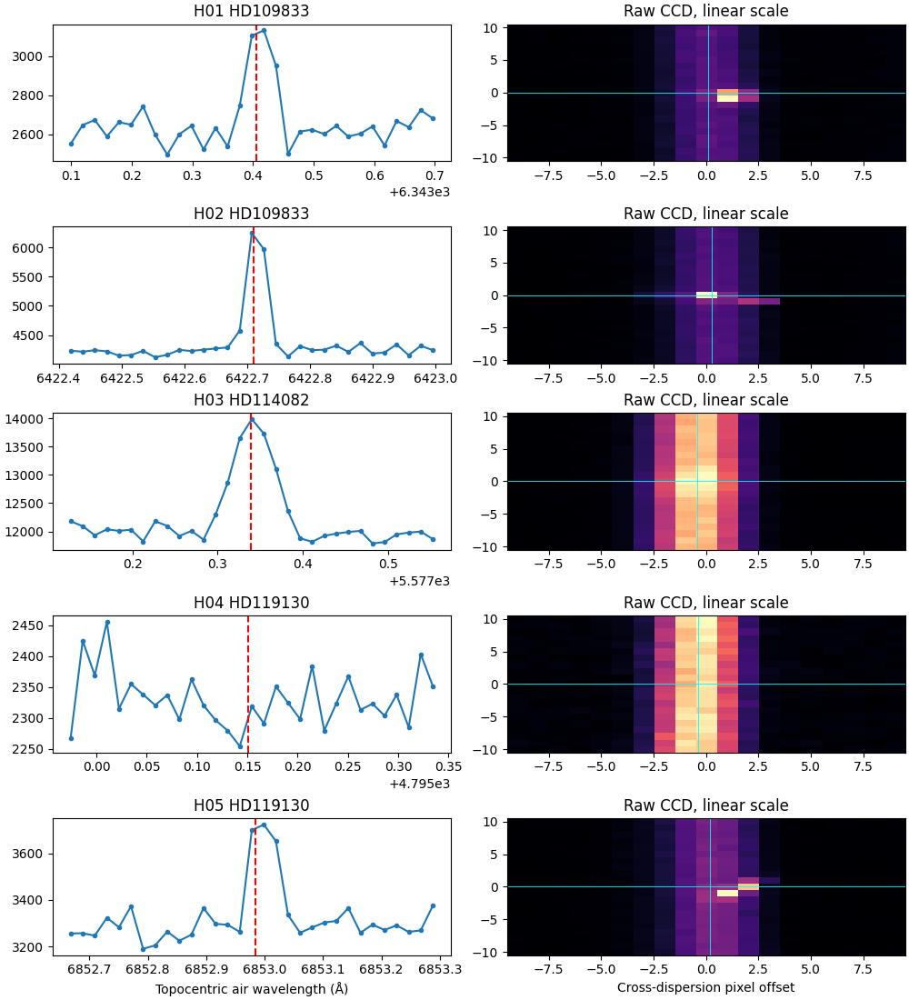
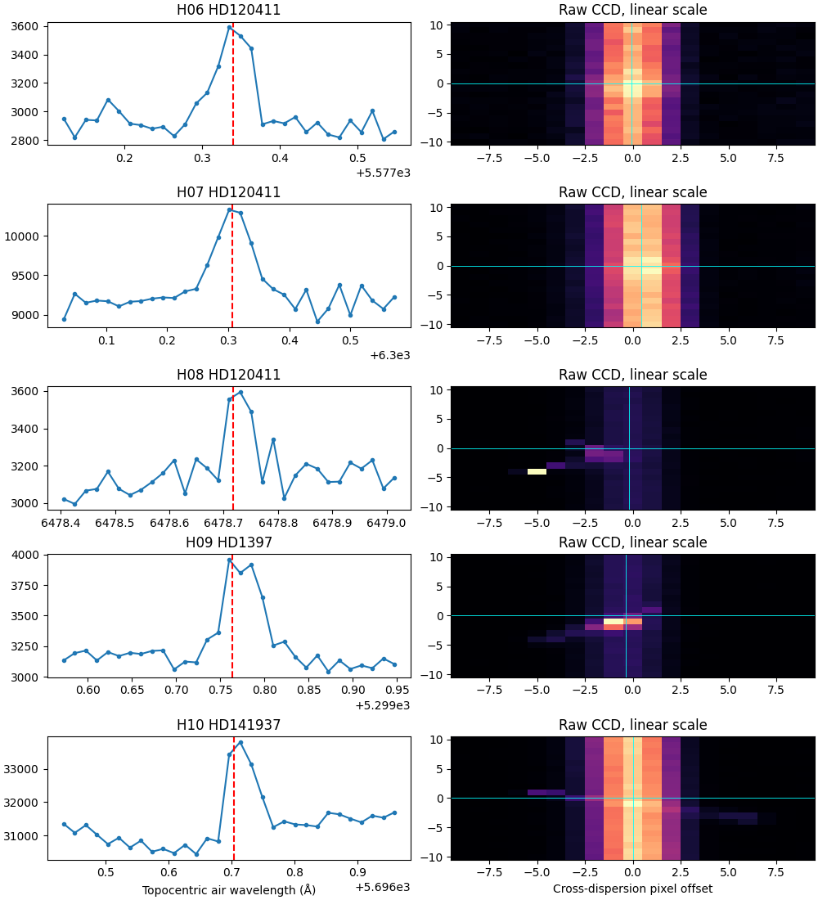
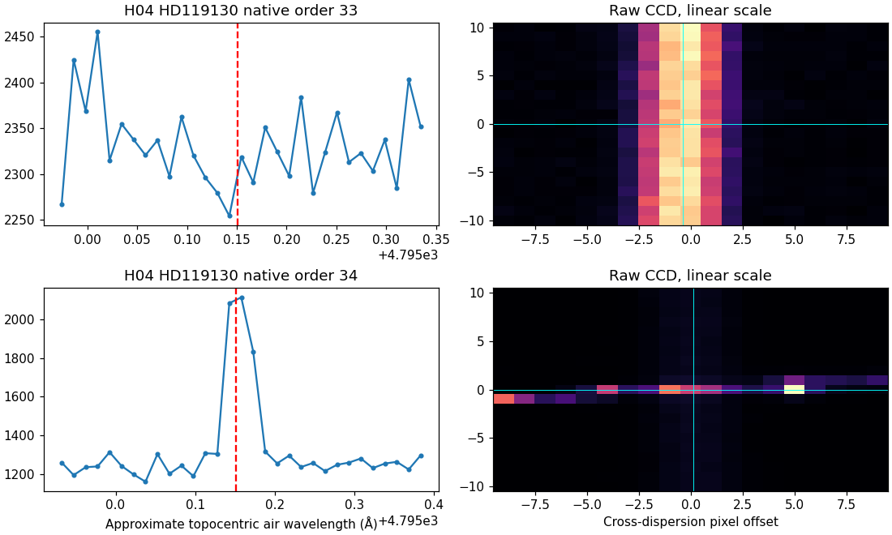
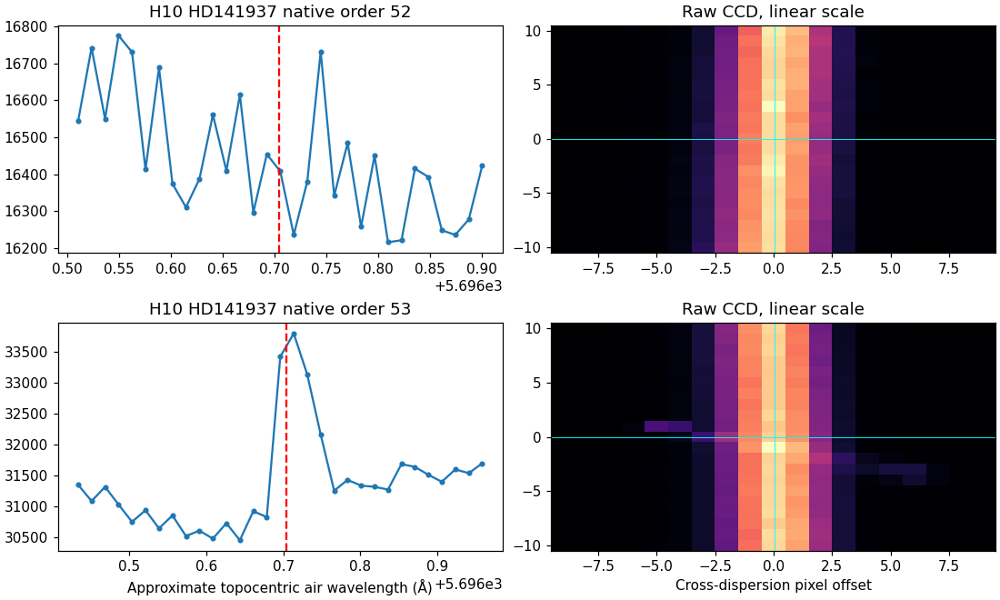

# Opfølgning på de oprindelige ti hits

Alle ti oprindelige hits er nu fulgt tilbage til rå CCD-billeder og udtrukne spektralordener. Den foreløbige visuelle vurdering giver **syv sandsynlige detektorartefakter og tre sandsynlige atmosfæriske iltlinjer**. Ingen er identificeret som laser. Vurderingerne er foreløbige; de oprindelige hitlister og detektorresultater er bevaret uændret.

| Hits | Foreløbig forklaring | Konkret evidens |
|---|---|---|
| H01, H02, H05, H08, H09 | Detektorartefakt, forenelig med partikeltræffer | Kompakte eller skrå ladningsspor med en anden form end fibrenes normale lysprofil. Flere spor fortsætter uden for fibren. |
| H04, H10 | Detektorartefakt, forenelig med partikeltræffer | Skråt spor krydser fibren; linjen ses kun i den ramte af to overlappende spektralordener. |
| H03, H06 | Sandsynlig atmosfærisk O I ved 5577,339 Å | Bølgelængdesammenfald, lys på fibersporet og lignende overskud ved samme omtrentlige topocentriske bølgelængde i de øvrige epoker. |
| H07 | Sandsynlig atmosfærisk O I ved 6300,304 Å | Bølgelængdesammenfald og lys på fibersporet; svagere overskud findes i andre epoker. |

[Alle begrundelser og resterende kontrolpunkter](FOLLOWUP_DISPOSITIONS.csv) · [Maskinlæsbart review](VISUAL_REVIEW.json). Klassifikationen bygger på denne agents visuelle vurdering. En særskilt reviewers gennemgang blev afbrudt af kontobrugsgrænsen og er ikke gennemført. Der mangler blandt andet uafhængig bedømmelse og særskilt sky-/kalibreringskontrol, før dispositionerne kan kaldes endelige.

## Råbilleder og overlappende ordener

Der er hentet ti råfiler og ti tilhørende ancillary-arkiver, alle med kilde og SHA-256 i [manifestet](products/MANIFEST.json). Råbilledernes to CCD-halvdele er trimmet for prescan/overscan og samlet. Headernes bølgelængde- og sporpolynomier forbinder native spektralpunkter med råpixel. Orienteringen er kontrolleret mod et fast referenceinterval væk fra hits: korrelationerne er 0,908–0,996. Dette er en registreringskontrol, ikke en ny fuld instrumentkalibrering.

H04 demonstrerer, hvorfor en enkelt native orden ikke er tilstrækkelig: den oprindelige automatiske visning valgte orden 33, som ikke viser toppen. Orden 34 har både toppen og et tydeligt spor gennem fibren. H10 viser en tilsvarende forskel mellem ordenerne 52 og 53. Begge tilfælde er fulgt op i alle dækkende ordener; intet hit er slettet på grund af den første visning.

## Andre epoker og referenceframe

[Epoketabellen](epochs/EPOCH_COMPARISON.csv) sammenligner fem allerede analyserede eksponeringer pr. mål i både barycentriske og omtrentlige topocentriske luftbølgelængder: 30 unikke spektre og 100 sammenligningsrækker. De lokale maksimum/MAD-tal er beskrivende mål uden kalibreret statistisk signifikans. Manglende gentagelse bruges ikke til at afvise et kortvarigt signal.

Den topocentriske omregning er `lambda_bary / (1 + BERV/c)`. Den præcise HARPS_3.8-implementering og pixelnulpunkt/drift er endnu ikke fuldt verificeret. O I-sammenfaldene og morfologien giver sandsynlige forklaringer, ikke en bred nuldetektion eller bevis for alle hændelsers ophav.

Rågeometri, native ordener og headerpolynomier: [ESO DRS-manual](https://www.eso.org/sci/facilities/lasilla/instruments/harps/doc/DRS.pdf), afsnit 4.2.1, 4.2.2, 4.2.6 og 4.2.7. O I-luftreferencer: [NBS-tabeller](https://www.govinfo.gov/content/pkg/GOVPUB-C13-8e601b629710db9963b4d618c9a1192a/pdf/GOVPUB-C13-8e601b629710db9963b4d618c9a1192a.pdf). Tidligere omregning og usikkerheder er bevaret i [den første kontrol](../triage_initial/README.md).

Reproduktion fra projektmappen: `python triage_followup/epochs/compare_epochs.py`, `python triage_followup/map_native_products.py` og `python triage_followup/inspect_overlaps.py`. Visuelle vurderinger er registreret eksplicit i `record_visual_review.py`; de genereres ikke af en automatisk ophavsklassifikator. Inputfilernes checkpoint er angivet i [V2-rapporten](../v2/README.md).
