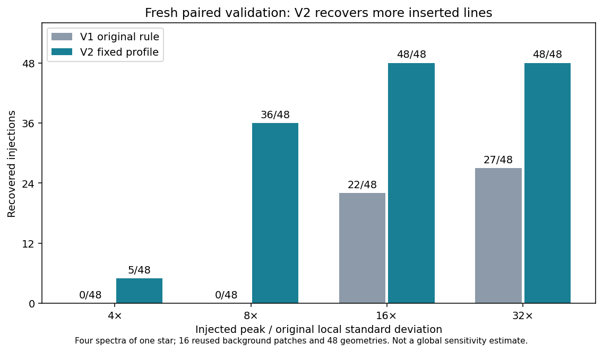

# HARPS V2 og 100 nye eksponeringer

**1. november 2026: Hovedprøven er udvidet til 200 unikke eksponeringer af 20 stjerner, samlet 46,750 timers teleskopeksponering.** De nye 100 er analyseret med både den oprindelige V1 og en særskilt, fastlåst profildetektor V2. V2 genfinder flere af de indsatte kontrollinjer. En [første rågennemgang af 96 af de 333 profilhits](triage_batch01/README.md) giver 56 sandsynlige detektorartefakter, 10 forenelige med atmosfærisk O I, 24 uafklarede spektralstrukturer og seks med utilstrækkelig råbilledkortlægning. De øvrige 237 er endnu ikke gennemgået. Der er ingen identificeret laser eller kvalificeret SETI-kandidat.

| Omfang | Oprindelige 100 | Nye 100 | Samlet |
|---|---:|---:|---:|
| Unikke eksponeringer | 100 | 100 | 200 |
| Stjerner | 20 | 19 af de samme | 20 |
| Eksponeringstid, sekunder | 82.699,582 | 85.599,583 | 168.299,165 |
| Søgte punkter med V1 | 30.650.658 | 30.650.652 | 61.301.310 |
| V1-emissionshits | 10 | 6 | 16 |
| V2-profilhits | Ikke kørt | 333 | Kun nye 100 undersøgt med V2 |

Eksponeringstiden er summeret over stjerner og år, ikke sammenhængende overvågning. V2 søger 30.619.618 punkter i det nye udvalg; masker og rande adskiller sig fra V1. De seks nye V1-hits har alle et V2-match inden for 0,02 Å og må ikke tælles som seks yderligere V2-hændelser.

## Frisk validering af V2

Det nye udvalg, kode, grænser og kontrolplan var publiceret i [commit 522608b](https://github.com/andersenmartin-blip/setisearch/commit/522608b66a4e8fd9416c2f9effc2e84667e35184), før de friske signalværdier blev undersøgt. Der blev ikke justeret efter kontrol- eller hovedresultaterne. De oprindelige 48 forsøg var kun udviklingsmateriale for V2.

Den friske prøve bruger fire andre HD100508-spektre, fire nye bølgelængder, tre pixelplaceringer og fire styrker: 192 parrede forsøg. Baggrund og pixelplacering er krydset. Der er 16 unikke baggrundsudsnit og 48 geometrier, som genbruges ved de fire styrker; forsøgene er ikke 192 uafhængige observationer.

| Indsat topamplitude / oprindelig lokal spredning | V1 genfundet | V2 genfundet |
|---|---:|---:|
| 4 × | 0/48 | 5/48 |
| 8 × | 0/48 | 36/48 |
| 16 × | 22/48 | 48/48 |
| 32 × | 27/48 | 48/48 |

V2 består de fastlagte mål for de to største styrker. Begge metoder har nul match i de 48 kontrolforespørgsler på de 16 uændrede udsnit. Det giver ikke en global falsk-alarm-rate. Ved søgning i de fire komplette, uændrede kontrolspektre finder V2 henholdsvis 4, 6, 5 og 6 hændelser; deres ophav er ikke bestemt, og de kan ikke blot kaldes falske positiver.

Resultatet måler genfinding af additive Gaussian-profiler i reducerede 1D-data fra én stjerne. Det måler ikke hele instrumentkæden, generel følsomhed på tværs af stjerner eller samme falsk-alarm-rate for V1 og V2. Svage signaler mistes stadig. [Kontrolplan](validation/PLAN.json) · [alle 192 forsøg](validation/results/TRIALS.csv) · [resultat](validation/results/SUMMARY.json).

## Detektor og fuld hændelsesliste

V2 estimerer en robust lineær baggrund og MAD-spredning fra sidebånd uden signalkernen. Den tilpasser en positiv Gaussian med fast FWHM = bølgelængde/115.000 ved fem pixelplaceringer. De fastlåste krav er amplitude/MAD mindst 6 og profilcosinus mindst 0,8 efter en særskilt forhåndsscreening. Disse scorer er ikke kalibreret signal-støj-forhold eller statistisk signifikans. Alle 23.961 screenede hændelser, inklusive afvisninger og dubletter, er bevaret.

[V2-kode](code/profile_detector.py) · [konfiguration](code/CONFIG.json) · [freeze](code/FREEZE.json) · [333 accepterede profilhits](production/V2_HITS.csv) · [eksponeringsregnskab](production/EXPOSURES.csv) · [alle screenede hændelser i det komplette evidensarkiv](V2_ANALYSIS_EVIDENCE.zip).

Der er lavet et atlas med **333 paneler på 28 sider**, i den oprindelige tabelrækkefølge og uden udvælgelse af de pæneste profiler. [Atlasindeks](review/REVIEW_INDEX.csv) forbinder hvert hit med dato, observations-ID og panel. Den oprindelige katalogstatus `UNREVIEWED` er bevaret; [efterfølgende dispositioner for de første 96](triage_batch01/FOLLOWUP_DISPOSITIONS.csv) ligger separat. En beskrivende kontrol markerer 25 hændelser inden for ±0,03 Å af enten O I 5577,339 eller 6300,304 efter omtrentligt BERV-skift; dette er prioriteringsflag, ikke endelig atmosfæreklassifikation. Se [atlasoversigt](review/ATLAS.md).

## Numerisk kontrol og de oprindelige hits

Alle 104 nye inputfiler — 100 hovedspektre og fire kontroller — består metadata- og identitetskontrollen. Ingen ADP-ID'er eller råforløbere overlapper den oprindelige prøve eller den fastlåste offentlige referenceliste. Det dokumenterer afgrænset overlapkontrol, ikke at observationerne aldrig har været undersøgt af andre. De oprindelige begrænsninger i ekstern positionsbekræftelse gælder stadig.

Fem på forhånd valgte nye eksponeringer er genkørt i en frisk proces med identiske resultater. Samtlige 333 accepterede fits er efterregnet med særskilt skalararitmetik; største relative afvigelse er 7,2 × 10⁻¹⁶. Alle 192 kontrolkombinationer og optællinger stemmer. Dette er samme agents beregningskontrol, ikke en uafhængig forskers gennemgang eller en særskilt fuld algoritme på alle 100. [Numerisk kontrol](review/NUMERICAL_CHECKS.json) · [identitetskontrol](review/METADATA_RECOUNT.json).

De **oprindelige ti hits** er fulgt op i rå CCD-billeder, native ordener og fem epoker pr. mål. Foreløbig forklaring: syv sandsynlige detektorartefakter og tre sandsynlige atmosfæriske iltlinjer. To hændelser har tydeligt spor og emission i kun den ene af to overlappende ordener. Dispositionerne er visuelle, foreløbige og separat registreret; originaltabellerne er uændrede. [Råbilleder, begrundelser og resterende kontrolpunkter](../triage_followup/README.md).

## Gemte input og reproduktion

De nye 104 spektre samt råfiler og ancillary-produkter til de oprindelige ti hits er fastholdt i [SETI_HARPS_V2_INPUTS_2026-11-01.zip](https://chatgpt.com/library?file_id=libfile_be85ea6d8e9c81918350b1141689f52e&account_id=personal): 395.957.057 bytes, SHA-256 `8afd05a57d9c5e82488a9660704c0a77588f53b7e93434666dabe368a7c1662f`. Det oprindelige inputcheckpoint er fortsat nødvendigt for V1 og epokesammenligninger: [oprindelige input](https://chatgpt.com/library?file_id=libfile_728e045275c08191b7a390bf2fc08db1&account_id=personal).

Komplette analyser, herunder alle per-spektrum- og per-forsøg-JSON, er fastholdt i `V2_ANALYSIS_EVIDENCE.zip`; [manifestet](EVIDENCE_ARCHIVE.json) angiver SHA-256 og alle medlemmer. De centrale tabeller, kode og figurer ligger også direkte i repository. Arkivet indeholder ikke de store råinput.

Afhængigheder: Python 3.12.14, NumPy 2.5.4, SciPy 1.17.0, Astropy 8.0.2 og Matplotlib. Fra projektmappen kan `python v2/review/check_results.py` efterprøve gemte resultater og `python v2/review/make_review_atlas.py` regenerere atlas og kontrolfigur. `python v2/code/test_profile_detector.py` kontrollerer udvalgte metodiske randtilfælde. En ny fuld reproduktion skal foregå i en særskilt kopi: `run_main.py` og `run_validation.py` opretter nye resultatmapper og afviser eksisterende, så historiske resultater ikke overskrives. Se [detaljeret gendannelse](RESTORE.md).

## Status og næste konkrete arbejde

HARPS-ugen er **delvist gennemført**. Dataudvidelsen, den nye fastlåste søgning, den friske genfindingstest, numerisk efterkontrol og den første råopfølgning er udført. Der er nu udført en første rågennemgang af 96 V2-hits. Næste opgave er V2-0097 og frem, samt særskilt afklaring af de seks kortlægningsproblemer, de 24 uafklarede spektralstrukturer og uafhængig kontrol af de foreløbige dispositioner. Det er nu kontrolarbejdet, der begrænser en meningsfuld yderligere dataudvidelse.

Den nye V2-prøve kan ikke beskrives som en afsluttet nuldetektion. HARPS-ugen er 1.–7. november; Rubin-ugen er 8.–14. november. Rubin er ikke analyseret i denne levering.
