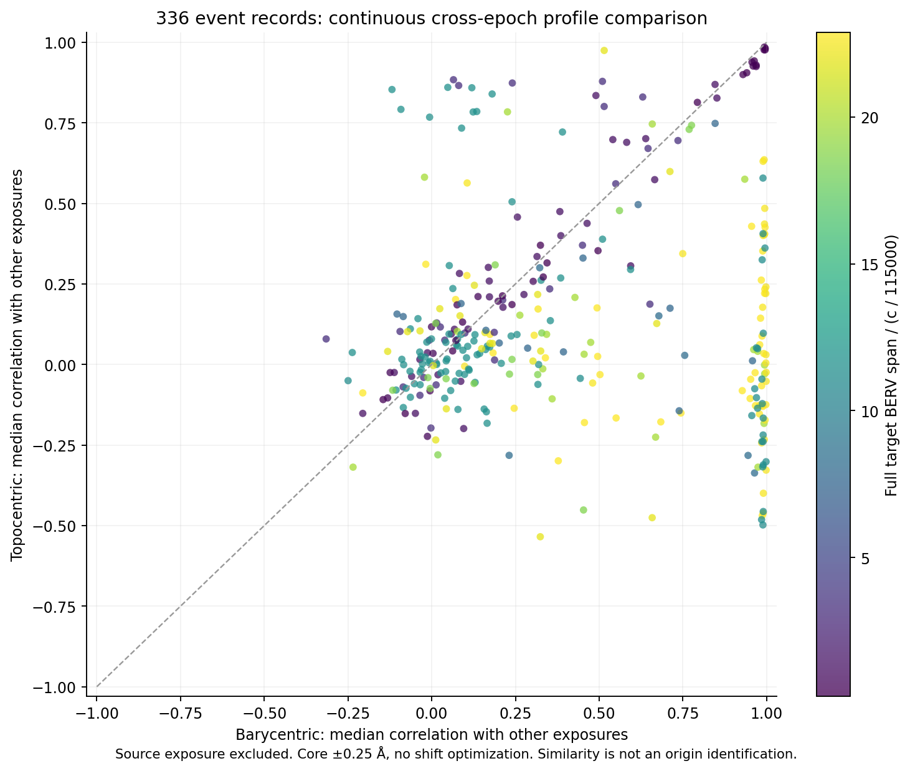

# Cross-epoch comparison of all 336 extension02 V2 records

Every one of the **336 new V2 event records** has now been measured in every available same-target exposure from the **100 extension02 spectra**. This produces **2,185 event/exposure pairs and 4,370 frame-specific profiles**. The discovery exposure is excluded from every other-exposure summary, leaving 1,849 other-exposure pairs. Each event has two to six other exposures. No observing time or survey coverage is added.

This is a **post-detection numerical comparison**, not completed raw-image triage or an origin determination. All original hit records remain unchanged. Earlier 200 survey exposures are outside this comparison; no absence or repeatability claim is made for them.

## Fixed measurements

The [plan](PLAN.json) was written before these new flux statistics. An unused pre-computation draft is retained as `PLAN_INITIAL_PRECOMPUTE.json`; parent review removed its proposed binary similarity counter before computation. The final method reports continuous quantities only.

The existing epoch-follow-up sampling method was retained: a ±1 Å grid at 0.01 Å spacing, positive local-median normalization within ±2 Å, and a linear background fitted to the fixed outer sidebands. Profiles are compared without fitted wavelength shifts within ±0.25 Å. Signed amplitudes from fixed Gaussian templates of FWHM λ/115000 and three times that width are preserved. No amplitude is called a signal-to-noise ratio.

Each accepted event keeps its own fitted barycentric air-wavelength center. The topocentric center is anchored to that event's discovery BERV using the classical factor `1 + BERV/c`. The comparison is **barycentric**, not stellar rest frame: stellar radial velocity has not been corrected. This approximation is not a complete relativistic or instrument-drift calibration.

All 100 input checksums and header identities passed. All 4,370 profiles have usable positive normalization and at least 181 finite samples; none was omitted. There are 36 low-reference-continuum measurements, retained with flags. Every input ERR array lacks finite positive uncertainties, so no formal parameter confidence intervals or detection significance are assigned.

**33 event records have less than one instrumental resolution element of BERV span**, across HD122640, HD126053 and HD135204. Those frames are poorly separated. A larger BERV range also does not guarantee that profile similarity identifies a physical source.

## Continuous results

[Full per-event summary](EVENT_SUMMARY.csv) · [all event/exposure/frame measurements](ALL_EPOCH_MEASUREMENTS.csv) · [nested per-event results](EVENT_RESULTS.json) · [accounting](SUMMARY.json)

Across the 336 records, the median of each event's other-exposure correlation has a catalogue median of **0.281 barycentric** and **0.063 topocentric**. The respective interquartile ranges are 0.062–0.931 and −0.052–0.286. These are descriptive summaries of selected, correlated hit records, not population rates or a calibration of astrophysical repeats.

The following five examples were requested after the raw-image review; they do not define a new selection rule, test, or reclassification:

| Record | Other exposures | Median correlation, barycentric | Median correlation, topocentric | Full BERV span (km/s) |
|---|---:|---:|---:|---:|
| V2E2-0001 | 5 | 0.490 | 0.835 | 3.193 |
| V2E2-0060 | 6 | 0.065 | 0.884 | 8.395 |
| V2E2-0104 | 6 | 0.475 | 0.069 | 51.572 |
| V2E2-0129 | 6 | 0.993 | 0.635 | 59.073 |
| V2E2-0204 | 6 | 0.391 | 0.722 | 30.291 |

V2E2-0129 has very similar barycentric profiles in the six other exposures. This supports investigating persistent spectral structure; it does not establish a natural line identity or rule out technology. V2E2-0104 has weaker barycentric consistency, and its median other-exposure narrow fitted amplitude is 0.202 versus 1.923 in the discovery profile, in locally normalized units. V2E2-0001 is more similar topocentrically but spans only 1.225 resolution elements; this alone does not determine origin. The newer, separately adopted mapping follow-up retains it as an unresolved spectral structure; only V2E2-0225 remains mapping-limited among the new V2 records. [Current raw dispositions](../raw_followup/CURRENT_V2_ALL336_DISPOSITIONS.csv) remain authoritative and are unchanged by this epoch comparison. The stronger topocentric similarity of V2E2-0060 and 0204 can support an atmospheric hypothesis from other evidence; this comparison alone does not prove it.

[First, middle and last catalogue-record profiles](figures/FIXED_INDEX_PROFILE_EXAMPLES.png) were chosen by fixed row indices, not by favorable results. All 4,370 profile arrays are preserved as [18 ordered binary parts](PROFILE_ARRAYS_PARTS.json), with [archive checksum and inventory count](PROFILE_ARCHIVE.json). Run `python3 restore_profile_archive.py` in this directory to reconstruct the byte-identical `PROFILE_ARRAYS.zip`. Correlations can be driven by absorption blends, background structure, or resampling. Narrow- and broad-template fits are simple descriptive models, not proof that the feature has either physical width.

## Reproduction and checks

`measure_epochs.py` is import-safe. In a separate copy with the preserved input spectra on their original relative paths, run it with no existing `SUMMARY.json`; outputs are written atomically. `plot_summary.py` recreates the two figures. `INPUT_CHECKS.json` retains all input identities and hashes. `ALL_EPOCH_MEASUREMENTS.csv` records a checksum for each profile array. First run `python3 restore_profile_archive.py`, which validates every part, the complete ZIP checksum and all 4,370 CRCs. Then extract `PROFILE_ARRAYS.zip` inside this directory to restore the `profiles/` tree for numerical audit or figure reproduction.

A [separately implemented audit](independent_audit/SUMMARY.json) **passed**. It checked all 100 FITS hashes and headers, all 336 event identities and same-target exposure coverage, every one of the 4,370 profile hashes and frame transformations, and all 336 event summaries, including discovery exclusion and independently calculated quantiles. A separate scalar reconstruction checked 50 frame profiles drawn from the first, middle and last catalogue events plus the first low-continuum event (eight low-continuum profiles included). The largest discrepancies were 1.82×10⁻¹² ADU in interpolated flux, 2.66×10⁻¹⁵ in fitted amplitude and 5.55×10⁻¹⁶ in correlation.

The audit did not import production functions; it shares Astropy FITS decoding and NumPy NPZ decoding. No requested sample fell outside the input wavelength coverage, so the no-extrapolation boundary branch was inspected but not empirically exercised. It is an independent software calculation, not independent observations or human peer review. [Audit implementation](independent_audit/check_epochs.py). No research worker is created by these scripts, and there is no automatic continuing search.

Next scientific work should combine these continuous measurements with native-order/raw-image checks and specific calibration, atmospheric, and stellar-line hypotheses. Numerical frame comparison does not resolve the 277 new V2 records still awaiting raw review.
