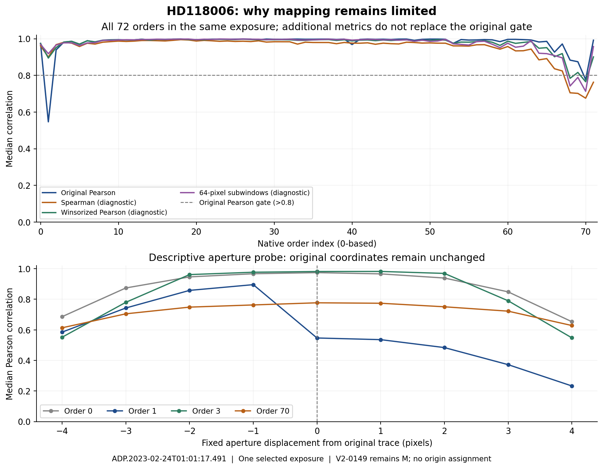

# Mapping limitations: all 35 diagnosed, first exposure investigated

**All 35 current mapping limitations remain M.** The complete queue has now been decomposed into specific failures, and a new raw-array diagnostic of its first exposure distinguishes a blue-order outlier-sensitive correlation failure from a red-order mismatch that survives the same robust diagnostics. This adds no observations, search detections or origin assignments.

## Complete queue decomposition

The frozen batch04 continuation queue contains 35 records in 21 exposures of 12 targets. All 49 covering-order records and 43 unique exposure/order references were reconciled against their original evidence.

| Event limitation | Records |
|---|---:|
| Reference correlation only | 28|
| Missing full cutout only | 5|
| Both | 2 |
| Total | 35 |

Thirty events depend on 28 unique exposure/order references whose median raw/native Pearson correlation does not exceed the unchanged 0.8 gate. **No failed reference is caused by insufficient window count or the trace-position gates.** The selected reference medians are all within 0.305419 pixel of the predicted trace, and every valid reference window peaks within 1 pixel. This establishes the numerical nature of the failure; it does not establish the accuracy of every candidate position or a physical origin.

Seven events lack a full cutout. Six involve order 0 crossing the active-array column edge. One, V2E2-0034, has order 2 at native pixel 4094/raw row 1, truncating both its 41-sample native snippet and 31-row raw cutout. For the queue head **V2-0149**, the order 0 trace center is raw column -0.849413 pixels: even the predicted center lies outside the active array. Widening a cutout or relaxing a correlation threshold cannot recreate those missing detector pixels.

[EVENT_LIMITATIONS.csv](EVENT_LIMITATIONS.csv) and [ORDER_LIMITATIONS.csv](ORDER_LIMITATIONS.csv) retain every event, gate, coordinate and source route. [SUMMARY.json](SUMMARY.json) records coverage and caveats. The separate [scalar audit](AUDIT.json) independently reconstructed 377 reference summaries and 1,871 profile peaks across the five source families and verified all nine original inputs against Git HEAD. It did not read original FITS arrays.

## New raw-array diagnostic: HD118006

The first stable queue event, V2-0149, belongs to **ADP.2023-02-24T01:01:17.491**. Its canonical raw/ancillary pair was restored from the existing saved archive and hash-verified. [The fixed method](RAW_DIAGNOSTIC_PLAN.json) was recorded after inspecting existing metadata/diagnostics and before opening the restored arrays for this analysis. This is transparent posthoc investigation, not a blind preregistration.

The calculation retains the original orientation, trace, five reference windows, ±80 pixel exclusion around all three original selected IDs, 31 pixel median high-pass filter and seven-pixel extraction aperture. It evaluates **all 72 orders** of this one exposure, measuring 358 of 360 windows; two order 0 windows fail the original reference geometry condition. All ten previous order 0/order 1 Pearson results, including missing windows, were reproduced within 1e−12.

The additional metrics are fixed descriptive probes: average-rank Spearman correlation, independent winsorization at median ±5 scaled-MAD,64 pixel subwindows retaining at least 40 unmasked samples, and aperture offsets −4…+4 pixels. They do not replace an acceptance gate or select new mapping coordinates.

| Median diagnostic | Order 1: candidate-covering failed reference | Order 70: same-exposure comparison |
|---|---:|---:|
| Original Pearson |0.546841|0.777042|
| Spearman |0.899935|0.675781|
| Winsorized Pearson |0.894527|0.765495|
|64 pixel subwindow Pearson |0.918269|0.713208|

Order 1's stronger rank, clipped-amplitude and local-window agreement shows that its low full-window Pearson correlation is sensitive to high-amplitude samples and/or a subset of the windows. The fixed aperture probe is also asymmetric: offset −1 pixel gives 0.895765, while the original position gives 0.546841. A spatially asymmetric contribution is therefore a hypothesis to test, **not** a demonstrated coordinate error or a reason to shift the trace. No individual contaminating pixels or physical causes were identified by these summary metrics.

Order 70 in the same exposure has poor agreement under the robust metrics as well. Thus robust statistics do not provide a general solution to the red-order correlation limitations. All 72 control orders are retained in [RAW_REFERENCE_SUMMARY.json](RAW_REFERENCE_SUMMARY.json); the complete 358-window diagnostic is in [RAW_REFERENCE_DIAGNOSTICS.json](RAW_REFERENCE_DIAGNOSTICS.json). These are same-exposure comparisons, not an independent calibration sample.



**V2-0149 stays M:** order 0 is incompletely observed and order 1 still fails the original Pearson gate. No detector-origin, sky-line or laser classification follows from this diagnostic. Other 34 M records also keep their exact prior labels.


The [independent raw numerical audit](RAW_NUMERICAL_AUDIT.json) reconstructed all 72 orders, 358 valid windows, 3,222 offset correlations, 3,717 valid subwindows and 8,964 metric comparisons without importing project analysis functions. The maximum metric discrepancy was 5.33×10⁻¹⁵. It used direct-power trace polynomials, direct seven-term aperture sums, centered-dot Pearson calculations and separately implemented average ranks. [Preflight](RAW_PREFLIGHT_AUDIT.json) also passed all 18 checks. Numerical agreement validates these calculations; it does not independently validate a physical interpretation.

## Next scientific control

The next not-yet-characterized exposure in stable mapping-queue order is **ADP.2023-02-23T01:01:36.779**, containing V2-0231 and V2-0232 on HD122640. Their order 3 reference median is 0.765695 (below the original 0.8 gate), but both covering orders have full cutouts. Its exact pair/archive requirements are retained in [NEXT_INPUTS.json](NEXT_INPUTS.json).

Before opening those arrays, freeze the same all 72-order descriptive diagnostic in a separate output directory. Do not rank or replace queue cases based on appearance. In any later diagnostic of specific residual pixels, predefine residual windows and apply identical checks to supported comparison orders; preserve the original Pearson gate and all original labels. A different mapping-acceptance procedure would require independent validation against known coordinate displacements and detector controls, plus a homogeneous rerun of its declared population. The present selected follow-up does not supply that validation.

## Reproduction and preservation

The raw pair is already preserved in **SETI_HARPS_V2_TRIAGE02_INPUTS_PART2_2026-11-01.zip**, 274,022,548 bytes, SHA256 `8dd3daf990103521422489653f17a23bc4e047c6b90d885fbf58e222fa5b6d03`, Library identity `libfile_c53374f2fc888191a07efa9f7d12cd1c`. The original [INPUT_CHECKPOINTS.json](../../triage_batch02/INPUT_CHECKPOINTS.json) records member hashes. Copy only verified products from staging; do not overwrite current status with historical archive reports.

The raw script accepts any directory containing the two original canonical basenames and independently verifies their hashes, sizes and FITS identities. In a separate project copy without the new raw outputs:

```bash
python3 work_harps_20261101/v2/extension02/mapping_followup_20261102/diagnose_raw_reference.py \
  --products-dir /absolute/path/to/restored/mapping_first
```

`diagnose_mapping.py` reconstructs the 35-event summary from committed JSON diagnostics. Its [PLAN.json](PLAN.json) identifies the exact historical source queue. Both scripts preserve original catalogs, decisions, coordinates and evidence. Recorded environment: Python 3.12.14, NumPy 2.3.5, SciPy 1.17.0, Astropy 8.0.2. No new telescope observation, survey sensitivity, false-alarm rate or calibrated null result is claimed.
