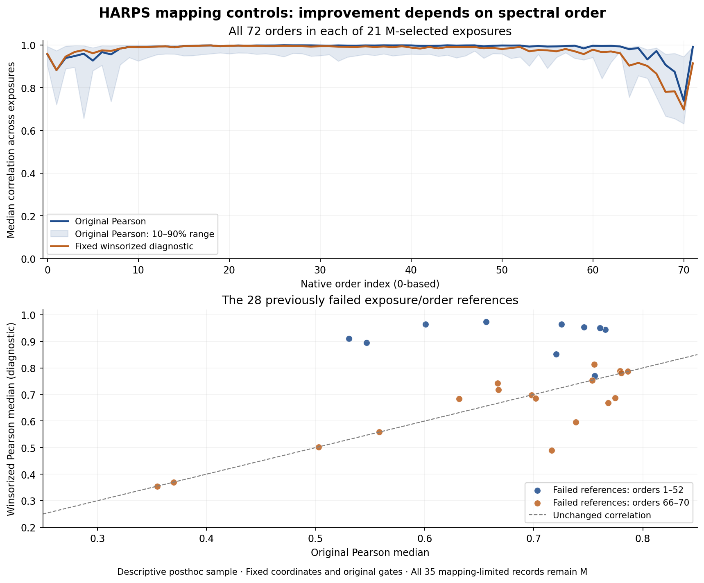

# Complete fixed mapping diagnostic for the remaining 20 exposures

**All 20 remaining exposures have been analyzed with the same fixed raw-reference diagnostic as the first exposure.** This characterizes another 34 mapping-limited records, completing the diagnostic for all 35 M records in 21 unique exposures. All 35 labels remain M; no coordinates, original acceptance gates or physical-origin assignments changed. No observing time or new detections were added.

## Scope and result

| Coverage | This continuation | Including the previous completed exposure |
|---|---:|---:|
| Unique exposures |20|21|
| Mapping-limited records covered |34|35|
| Native order diagnostics |1,440|1,512|
| Fixed reference windows |7,200|7,560|
| Measured windows |7,159|7,517|
| Unavailable windows |41|43|
| Earlier reference windows reproduced |640|650|

The fixed queue preserves the stable order in the batch04 continuation state and omits only the already completed HD118006 exposure. No case was replaced or ranked by strength, appearance, target, wavelength or availability. [EXPOSURE_QUEUE.json](EXPOSURE_QUEUE.json) records the exact 20 exposures and 34 IDs; [PLAN.json](PLAN.json) identifies the source hashes, shared script and 20 individual frozen plans. The [root freeze](ROOT_FREEZE.json) precedes the new raw-array reads. Independent [preflight](PREFLIGHT_AUDIT.json) passed all 23 checks, including exact scientific-code equivalence and input stop guards.

The earlier complete inventory remains valid: 28 events have reference-only limitations, five have missing-cutout-only limitations and two have both. They involve 43 unique covering exposure/orders, 28 of which fail the original reference-correlation gate. Every previously calculated reference value was reproduced. Missing detector pixels and the original gate failures remain explicit.

## What the diagnostic adds

The behavior first seen in HD118006 repeats across the remaining data, but is strongly dependent on spectral order. Among the previously failed references, the lower and middle orders often show much stronger agreement under fixed robust or local-window statistics; the red orders mostly do not.

| Example failed exposure/order | Original Pearson | Spearman | Winsorized Pearson | 64 pixel subwindow median |
|---|---:|---:|---:|---:|
|HD122640, ADP.2023-02-23T01:01:36.779, order 3 |0.765695|0.934943|0.944028|0.938741|
|HD120411, ADP.2023-03-23T01:02:04.835, order 32 |0.600868|0.963933|0.964254|0.967624|
|Failed order 70 references: median across 8 exposures |0.707145|0.583998|0.676446|0.582067|

All eight previously failed order 70 exposure references remain below 0.8 under each of these robust/local comparisons. Across all 28 failed exposure/order references, nine Spearman medians, ten winsorized medians and 13 local-subwindow medians exceed 0.8. **These are descriptive comparisons, not newly accepted mappings.** The original Pearson gate is unchanged, and none of the additional statistics has been calibrated here as a replacement gate.

The substantial improvement in some orders is consistent with sensitivity to high-amplitude samples or localized reference-window discrepancies. It does not identify the affected pixels' cause. The persistent red-order differences require separate investigation of extraction/background/instrumental effects; robust clipping alone does not explain or resolve them. No cosmic-ray, calibration-fiber, stellar or atmospheric explanation is established by this diagnostic.



[ALL_1512_ORDER_DIAGNOSTICS.csv](ALL_1512_ORDER_DIAGNOSTICS.csv) retains all same-exposure order comparisons, including the previously completed exposure. [SELECTED_43_ORDER_DIAGNOSTICS.csv](SELECTED_43_ORDER_DIAGNOSTICS.csv) and [FAILED_28_ORDER_DIAGNOSTICS.csv](FAILED_28_ORDER_DIAGNOSTICS.csv) preserve the exact selected references. [SUMMARY.json](SUMMARY.json) records the aggregate results; individual exposure summaries retain every aperture-offset diagnostic.

## Fixed method and independent validation

Scientific arithmetic is unchanged from [the first completed diagnostic](../mapping_followup_20261102/README.md): original global orientation/trace, five fixed reference windows, ±80 pixel exclusions around all original selected events, 31 pixel median high-pass filter and seven-pixel aperture. Every exposure includes all 72 native orders. Additional fixed probes are average-rank Spearman, winsorization at median ±5 scaled-MAD,64 pixel subwindows with at least 40 unmasked samples, and aperture offsets −4…+4 pixels. These probes neither fit new coordinates nor produce classifications.

The independent numerical audit reconstructed every new exposure from its canonical raw and ancillary arrays without importing project analysis functions:

| Independent numerical coverage | Count |
|---|---:|
| New exposures |20|
| Measured reference windows |7,159|
| Aperture-offset correlations |64,431|
| Valid64 pixel subwindows |74,121|
| Previous reference-window comparisons |640|
| Metric comparisons |179,698|

[NUMERICAL_AUDIT.json](NUMERICAL_AUDIT.json) records no mismatch; maximum metric discrepancy was 9.88×10⁻¹⁵. Independent direct-power and production Horner trace evaluations differed by at most 9.09×10⁻¹³ pixels. The [aggregate audit](AGGREGATE_AUDIT.json) passed all seven checks of 1,512 rows, 43 selected references, 28 failed references and grouped statistics. Numerical agreement validates the computations, not a physical-origin interpretation or a new mapping criterion.

## Restored inputs and durable evidence

[REQUIRED_INPUTS.json](REQUIRED_INPUTS.json) identifies 40 canonical raw/ancillary products (529,060,468 bytes) recovered from 17 already saved archives. [INPUT_RESTORATION_RECEIPT.json](INPUT_RESTORATION_RECEIPT.json) records archive/member size and SHA256 verification. No new ESO product download or replacement of failed cases was used. Original catalog, result, input and source hashes remain unchanged. Raw inputs retain their existing saved identities and are not duplicated in this delivery.

The 20 full diagnostic JSON files total 25,799,671 bytes and compress to 1,885,979 bytes. The archive SHA256 is `734144b699661b858000069072edf61d74923575e2a34c1bbad404ca42a72508`. Three ordered parts preserve the exact payload. [EVIDENCE_ARCHIVE.json](EVIDENCE_ARCHIVE.json) records all members; [EVIDENCE_PARTS.json](EVIDENCE_PARTS.json) records the parts. Summaries, tables, figures and scripts remain direct files.

From this directory:

```bash
python3 restore_evidence.py --verify-only
python3 restore_evidence.py
```

[Six restoration checks](RESTORE_VALIDATION.json) passed: deterministic repackaging, a fresh parts-only restore, retaining identical existing files, and refusing changed destinations, corrupt parts and symlinks. Restore checks run before writing. Full raw reruns require a separate project copy without previous generated outputs; `run_remaining.py` intentionally refuses to overwrite completed exposure results or continue through missing/changed input pairs.

## Continuation

**The fixed descriptive mapping diagnostic is complete for the entire 35-record queue. Do not rerun it merely to resume the project.** The mapping limitations remain unresolved scientific work; a new acceptance method would need declared controls, independent validation against known mapping perturbations, and homogeneous processing of its declared population. Missing detector coverage cannot be repaired statistically.

This checkpoint adds no calibrated sensitivity, false-alarm rate, new telescope observation or qualified laser candidate. All 72-order comparisons share each selected exposure's conditions. Continue the approved broader project using the recorded unresolved-structure queues and Rubin work; preserve these 35 M decisions until additional evidence supports a separately documented change.
