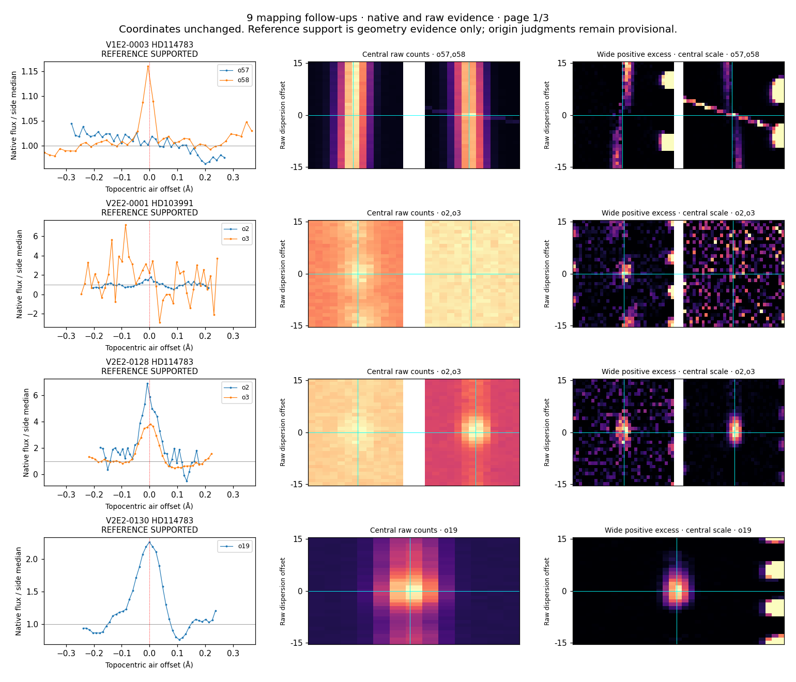
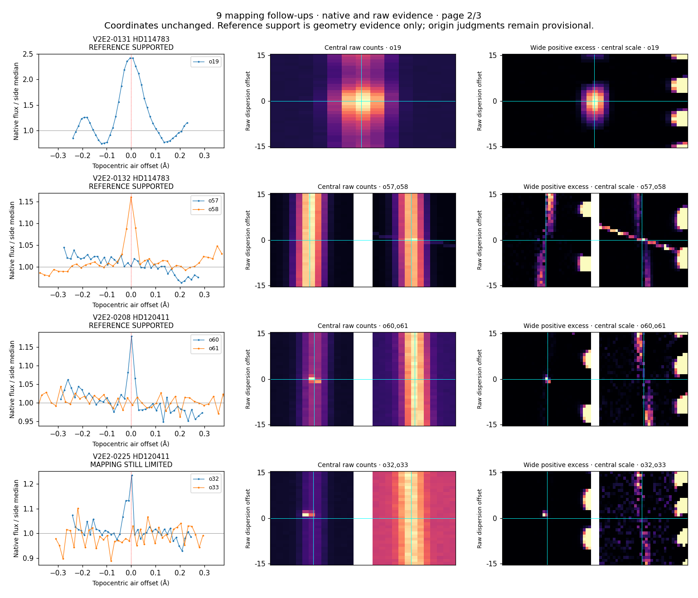
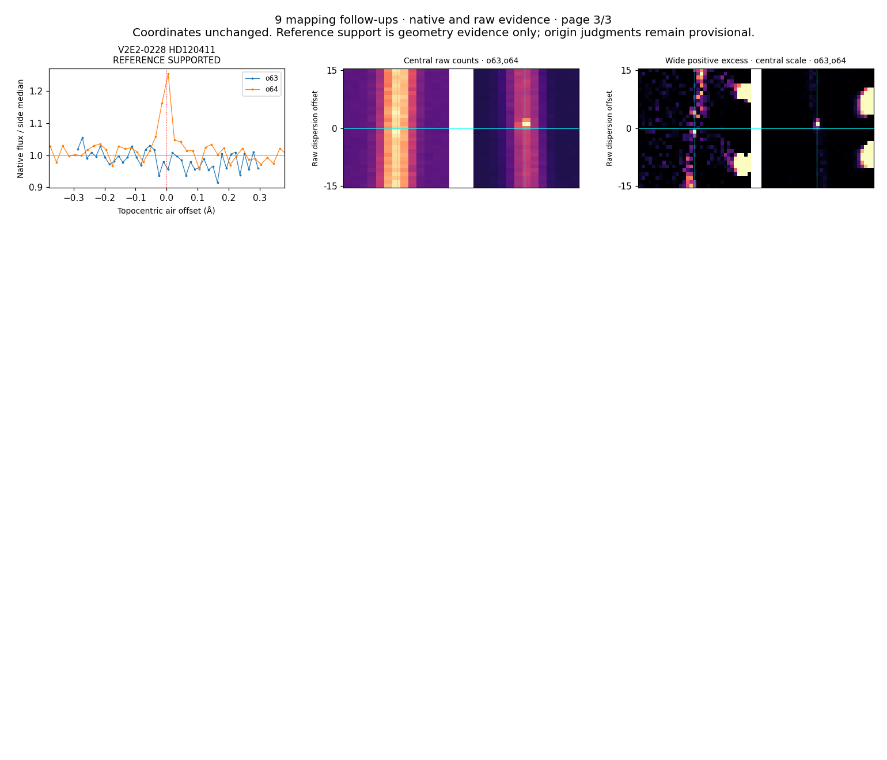
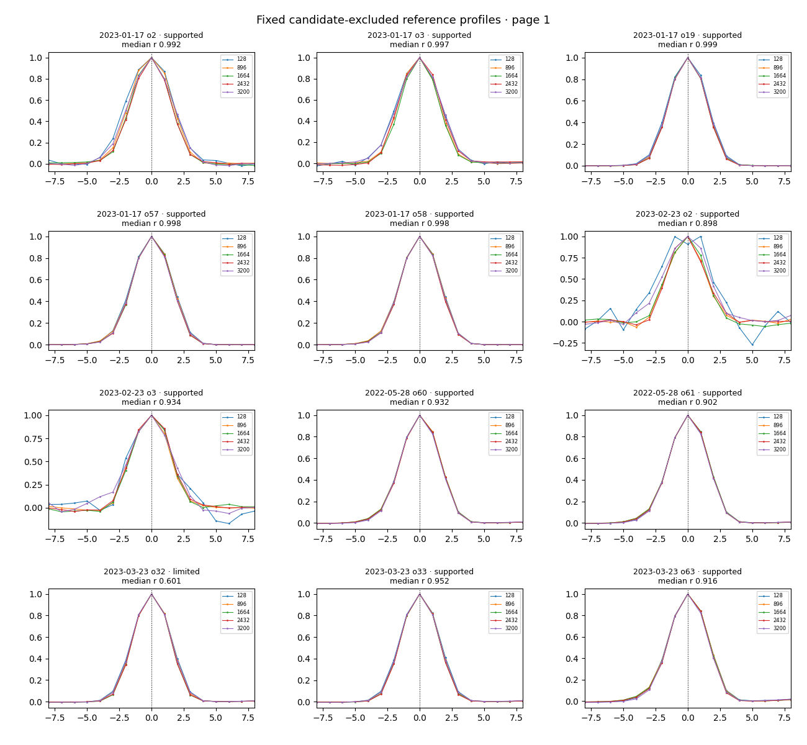
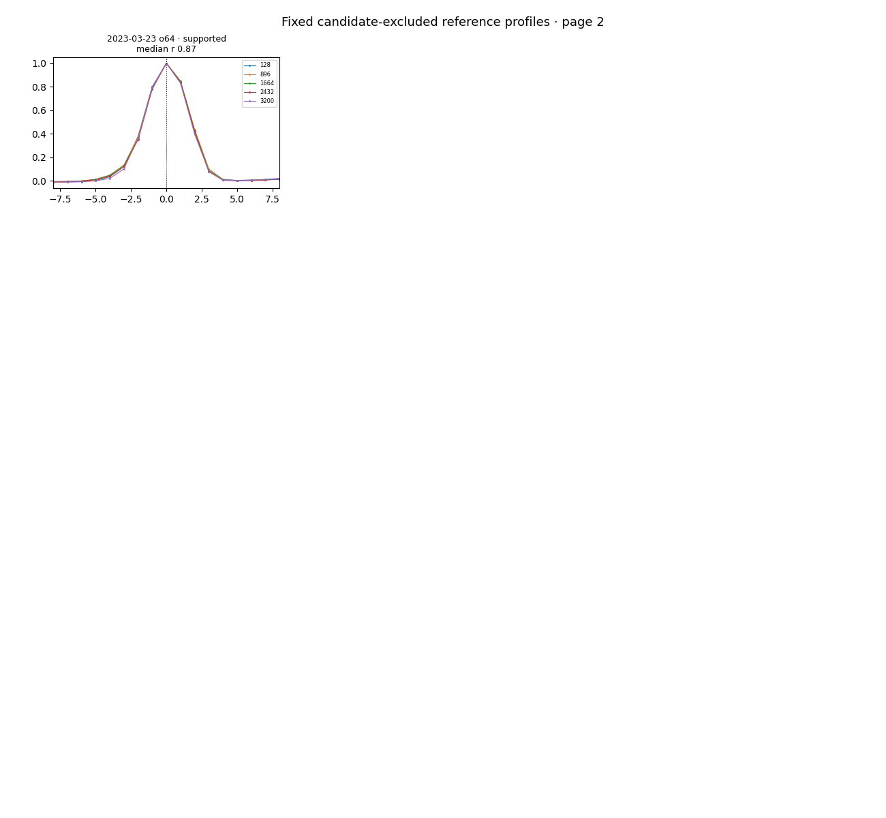

# Separat opfølgning på ni usikre billedkoblinger

De bredere faste referenceområder giver støtte til **otte af ni hændelsesregistreringer uden at flytte nogen koordinater**. To separate agentgennemgange er enige om fire foreløbige detektorartefakter, fire uafklarede spektralstrukturer og ét fortsat kortlægningsbegrænset tilfælde. Det er ni registreringer; V1E2-0003 og V2E2-0132 beskriver samme råbilledfeature.

[Baseline og foreslået status, række for række](FOLLOWUP_DISPOSITIONS.csv) · [samlet reviewsammenfatning](FINAL_REVIEW_SUMMARY.json) · [oprindelig kortlægningssammenfatning](SUMMARY.json).

## Metode og den tilbageværende begrænsning

Den særskilte efterfølgende plan genbruger nøjagtigt den tidligere mapping43-metode: fem faste intervaller per dækkende orden, alle 65 baselinekandidater udeladt inden for ±80 native pixels, mindst 200 referencepixels per interval og mindst tre brugbare intervaller. Median rå/native-korrelation skal være over0,8; median absolut sporoffset højst0,75pixel; mindst tre offsets skal ligge inden for1pixel. Profilinterpolation, filtrering, orientering og headerkoordinater er uændrede. Planen blev fastlagt før de nye referenceområder blev undersøgt. Alle ni gamle fejl skyldtes utilstrækkelige lokale samples, ikke en målt stor forskydning.

**Alle dækkende ordener undersøges, også dem der tidligere havde lokal støtte.** Derfor forbliver V2E2-0225 begrænset: den gamle utilstrækkelige orden33 består nu, men orden32 har median korrelation0,600868. Dens medianoffset på kun0,0162pixel ophæver ikke korrelationskravet. Synlig kompakt ladningsstruktur beskrives, men bruges ikke til at tilsidesætte den bevarede begrænsning.

De fire artefaktregistreringer er V1E2-0003, V2E2-0132, V2E2-0208 og V2E2-0228. De uafklarede registreringer er V2E2-0001,0128,0130 og0131. Den svage blå struktur i0001 er ikke en bekræftet ghost eller laser. Ingen af vurderingerne bekræfter et fysisk ophav.

## Kontrol og afgrænsning

En separat proces genopbyggede alle16 fem-array-NPZ'er fra de otte oprindelige rå-/TAR-produkter, alle13 ordensreferencer og alle65 referencevinduer præcist. De oprindelige21×25 råpixels,41 native samples, koordinater og orienteringer er identiske. Alle kildehashes og baselinefiler er bevaret. [Numerisk efterkontrol](VERIFICATION.json).

Baseline for65 registreringer og336 V2-events er ikke ændret. Root kan oprette et særskilt aktuelt overlay efter review; det ville give V2:44A,8O,6U,1M i den valgte delmængde samt277 uden råbilledreview; V1:3A,3O. Det er en efterfølgende undersøgelse af en udvalgt problemgruppe, ikke ensartet genbehandling af hele kataloget. Reviewerne kendte detektor- og baselinekonteksten; dette er hverken blind videnskabelig eller menneskelig validering.

De tidligere dokumenterede tre uforklarede .part-præfikser er bevaret separat som ikke-videnskabelig dokumentation. Kun hashverificerede slutprodukter blev anvendt her; årsagen til præfikserne og deres netværksproveniens er fortsat ukendt.

## Reproduktion og indhold

Brug en separat arbejdskopi med de otte produkter i `SOURCE_PRODUCTS.json` og projektets fastlåste Python-miljø. `run_mapping.py` skaber kortlægningsresultatet; `plot_mapping.py` skaber figurerne; `verify_mapping.py` genopbygger værdierne i en frisk proces. De to visuelle notefiler er eksplicitte agentvurderinger. `finalize_review.py` sammenholder dem og skriver forslagstabellen uden at ændre baseline eller den oprindelige kortlægningssammenfatning.

`MAPPING_FOLLOWUP_EVIDENCE.zip` indeholder hele denne opfølgnings kode, planer, noter, referenceværdier,16 NPZ'er og fem PNG-figurer. De store oprindelige rå-/TAR-filer findes i det separate baseline-checkpoint og dubleres ikke i ZIP-filen. `EVIDENCE_ARCHIVE.json` dokumenterer medlemmernes hashes.

