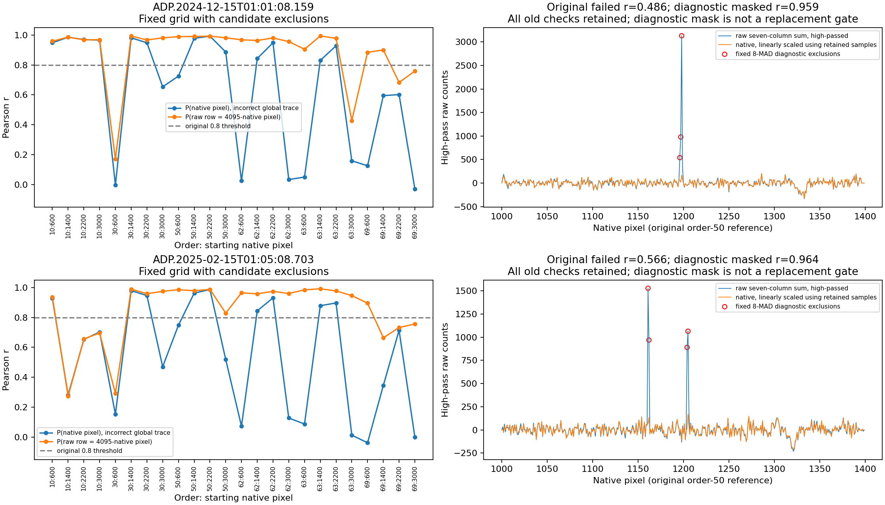
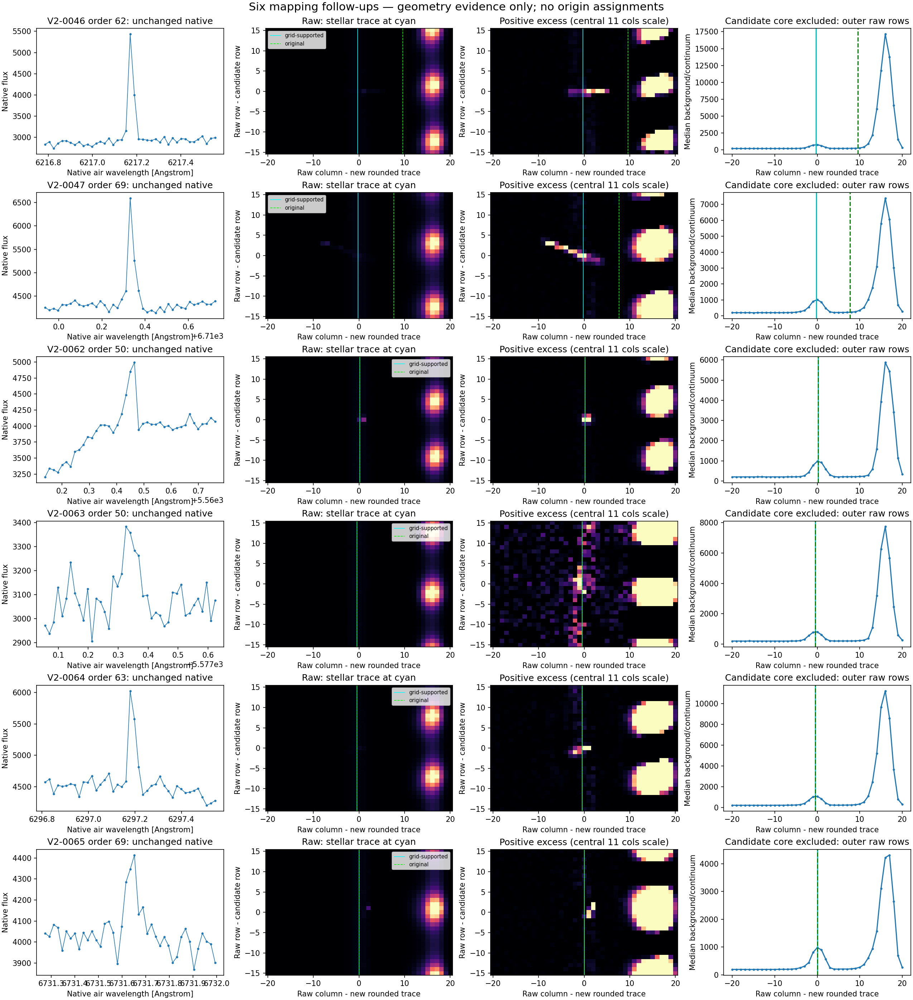

# Separat kontrol af seks usikre råbilledkortlægninger

**Et forkert polynomiumsargument forklarer kortlægningsfejlen ved V2-0046 og V2-0047. For V2-0062–0065 understøtter nye referenceområder den allerede anvendte geometri.** De gamle korrelationsfejl er bevaret. Dette er en kontrol af koordinater og fiberspor, ikke en ophavsbestemmelse; de seks hændelser har fortsat ingen ophavsklasse i denne kontrol.

Kontrollen blev udført af en separat agent, som kendte de tidligere problemer. Den er derfor et uafhængigt kode- og geometritjek, men hverken et blindt eksperiment, en fuld instrumentreduktion eller et eksternt forskerreview. Alle nye filer ligger i `v2/mapping_followup/`. Den oprindelige detektor, hitliste, dispositionstabel, rådata og tidligere mislykkede kontroller er ikke ændret.

## Fastlagt referenceprøve

[PLAN.json](PLAN.json) blev skrevet før den nye prøve. Begge eksponeringer undersøges i ordenerne 10, 30, 50, 62, 63 og 69, hver i native pixelintervallerne [600,900), [1400,1700), [2200,2500) og [3000,3300). Pixels inden for ±80 native pixels af et registreret hit i samme orden udelades. Alle 24 områder har mindst 100 brugbare pixels. Der anvendes samme syv-kolonners råapertur og 31-pixels medianfilter som i den gamle enkeltområdemetode. Samtlige otte orienteringer afprøves; alle korrelationer, også de lave, gemmes i [REFERENCE_GRID.json](REFERENCE_GRID.json).

Den bedst understøttede geometri for begge filer er:

- Rårække = 4095 − native pixel.
- Ingen spejling af råkolonnen.
- Sporets polynomium evalueres ved rårækken, altså 4095 − native pixel.

Koordinaterne er nulbaserede i det trimmede, sammenføjede 4096 × 4096 råbillede.

| Eksponering (DATE-OBS) | Bedste oprindelige reference | Median r, 24 områder, korrekt argument | Områder med r > 0,8 | Median r med forkert argument | Kontinuumtop ved korrekt heltalspixel |
|---|---:|---:|---:|---:|---|
| 2024-12-14 07:47:35.258 | 0,865, forkert argument | 0,968 | 20/24 | 0,837 | 24/24 områder |
| 2025-02-14 09:14:12.389 | 0,566, korrekt argument | 0,959 | 17/24 | 0,678 | 24/24 områder |

Dette er deskriptiv evidens for geometrien. 0,8-grænsen fra den gamle metode er ikke sænket, og den er ikke genfortolket som en kalibreret sandsynlighed. En median over 24 områder er en ny kontrol med en anden statistisk betydning; de svage delområder består stadig.



## Hvorfor det oprindelige interval vildledte

I decemberfilens oprindelige orden-50-interval gav det korrekte argument r = 0,486, mens det forkerte gav 0,865. Ved native pixels 1196–1198 findes store råudsving, som ikke følges tilsvarende i det reducerede native spektrum. En på forhånd fastlagt diagnostisk 8-MAD-maske fjerner tre af 400 samples, hvorefter korrelationen ved korrekt argument bliver 0,959. Det forkerte spors breddeapertur indeholder noget af stjernelyset, men rammer råudsvingene anderledes. Derfor kunne en lokal Pearson-korrelation favorisere den forkerte globale konvention.

I februarfilen gav det korrekte argument oprindeligt r = 0,566. Den samme diagnostiske maske udelader fire samples, native pixels 1161, 1162, 1204 og 1205, og giver r = 0,964. Det forklarer, at få råudsving kan dominere den gamle referencekorrelation. Det fastslår ikke den fysiske årsag til udsvingene eller den præcise behandling i instrumentets reduktion.

Masken blev defineret i [LOCAL_PLAN.json](LOCAL_PLAN.json) efter den nye referenceprøve. De maskerede korrelationer er en følsomhedsdiagnose, **ikke erstatninger for de tidligere fejlede kontroller**. Alle udeladte pixels og deres rå/native værdier er gemt i [LOCAL_CHECK.json](LOCAL_CHECK.json).

## Kandidaternes lokale geometri

Som en separat kontrol bruges intervallerne −280 til −81 og +81 til +280 native pixels fra hver kandidat. Andre hits udelades også med ±80 pixels. Kontinuummets tværprofil bestemmes uden kandidatens kerne, og toppen interpoleres med en lokal parabel. De angivne decimaler er beregningsresultater, ikke fejlgrænser eller en absolut astrometrisk kalibrering.

| Hit | Orden / native pixel | Ændring af råkolonne | Kontinuumafvigelse fra korrekt polynomium, venstre/højre | Lokal native/rå-korrelation, venstre/højre |
|---|---|---:|---:|---:|
| V2-0046 | 62 / 457 | −9,876 px | +0,079 / +0,009 px | 0,620 / 0,986 |
| V2-0047 | 69 / 1205 | −7,884 px | +0,153 / +0,098 px | 0,903 / 0,881 |
| V2-0062 | 50 / 1757 | 0 px | +0,074 / +0,017 px | 0,982 / 0,991 |
| V2-0063 | 50 / 2892 | 0 px | −0,026 / +0,030 px | 0,989 / 0,974 |
| V2-0064 | 63 / 1301 | 0 px | +0,063 / +0,035 px | 0,996 / 0,992 |
| V2-0065 | 69 / 2337 | 0 px | +0,082 / +0,062 px | 0,770 / 0,702 |

Alle seks lokale kontinuumprofiler følger den nye/geometrisk bekræftede sporposition inden for 0,153 pixels i de målte referenceområder. **V2-0065 har fortsat begge lokale spektralkorrelationer under 0,8; V2-0046 har én under grænsen.** Sporgeometrien er understøttet, men denne lokale spektrale begrænsning er ikke løst eller skjult. For orden 69 i februarfilen har det faste område [600,900) r = 0,896, mens de tre andre ligger mellem 0,664 og 0,757.

For V2-0046 og V2-0047 var den lyse struktur cirka seks pixels til højre for den gamle position en anden, stærkere nabostruktur. Det svagere stjernespor ligger henholdsvis cirka ti og otte pixels til venstre for den gamle position. De nye referenceområder og de lokale kontinuumprofiler understøtter dette uden brug af kandidaternes lysfordeling til at vælge geometrien. En specifik fysisk identifikation af nabostrukturen er ikke nødvendig for denne kontrol.



De nye råudsnit er bredere end de gamle: 31 rækker × 41 kolonner. Baggrund/continuum er medianen af de yderste otte rækker på hver side. Figuren viser både råbilledet og positivt overskud; overskuddets farveskala følger de centrale 11 kolonner, så den stærke nabo ikke skjuler stjernesporområdet. Alle råværdier, også negativt overskud, er bevaret i NPZ-filerne. Figuren skal bruges til en særskilt visuel vurdering; denne rapport tildeler ikke ophavsklasser.

## Reproduktion og genbrug

Kør fra `work_harps_20261101` med NumPy, SciPy, Astropy og Matplotlib tilgængelige:

```bash
python v2/mapping_followup/check_mapping.py
python v2/mapping_followup/verify_local.py
python v2/mapping_followup/plot_reference_diagnostics.py
```

De to rå- og ancillary-produkters SHA-256, DATE-OBS, native BERV og dimensioner kontrolleres mod de allerede gemte batch01-input. Ingen nye observationer hentes. Inputhashes og native filnavne er med i de nye resultater.

[registration.py](registration.py) giver den genbrugelige, import-sikre funktion `evaluate_reference_grid(raw, native, header, candidates)`. Den foretager ingen filskrivning, ophavsvurdering eller automatisk godkendelse. Den returnerer de rangerede orienteringer og samtlige områdeværdier; manglende datastøtte markeres. Dens resultater er sammenlignet felt for felt med de to gemte prøver og er identiske; [REUSABLE_MODULE_CHECK.json](REUSABLE_MODULE_CHECK.json) gemmer kontrollen.

For en ny gruppe skal referenceområder og kriterier fastlægges før dens resultater vurderes. Hver kandidats lokale sporposition bør stadig kontrolleres: et godt globalt resultat alene er utilstrækkeligt. Originale fejlede gates og nye brugbarhedsmarkeringer skal bevares særskilt. [MAPPING_FINDINGS.json](MAPPING_FINDINGS.json) giver en kort maskinlæsbar oversigt.
