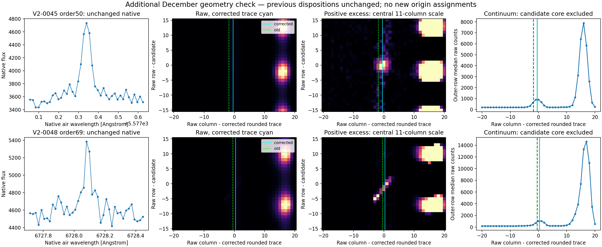

# Supplerende koordinatkontrol: V2-0045 og V2-0048

De to øvrige hits i decembereksponeringen er genvist med den polynomiekonvention, som allerede er underbygget af 24 faste referenceområder i den separate seks-hændelseskontrol. Begge bliver på samme stjernespor. Denne kontrol ændrer ikke tidligere ophavsvurderinger og tildeler ingen nye.

| Hit | Orden / native pixel | Ændring i råkolonne | Lokal kontinuumafvigelse, venstre/højre | Lokal rå/native-korrelation, venstre/højre |
|---|---|---:|---:|---:|
| V2-0045 | 50 / 2892 | +1,379 px | −0,016 / −0,016 px | 0,978 / 0,981 |
| V2-0048 | 69 / 2141 | +0,873 px | +0,119 / +0,118 px | 0,778 / 0,670 |

De lokale intervaller ligger −280 til −81 og +81 til +280 native pixels fra hvert hit; andre hits udelades inden for ±80 pixels. Kontinuumpositionerne understøtter den korrigerede geometri. **Begge lokale spektralkorrelationer ved V2-0048 er fortsat under den gamle 0,8-grænse.** Denne begrænsning bevares; referencerne fra den samlede seks-ordensprøve og den lokale kontinuumgeometri giver supplerende evidens, ikke en erstatning for en fejlet gate.

Den oprindelige disposition for V2-0045 er `PROVISIONAL_ATMOSPHERIC_OI`, og for V2-0048 `PROVISIONAL_DETECTOR_ARTIFACT`. De er citeret som tidligere vurderinger i [ADDITIONAL_CHECK.json](ADDITIONAL_CHECK.json), ikke bekræftet eller gentildelt automatisk. Den nye figur gør en separat visuel kontrol mulig.



Figuren viser rådata, positivt baggrundssubtraheret overskud og kontinuummet målt uden kandidatens centrale rækker. Cyan angiver den korrigerede position, grøn stiplet den gamle. Overskuddets skala er bestemt fra de centrale 11 kolonner for at synliggøre det svage stjernespor ved siden af den stærke nabo. NPZ-filerne indeholder også negative overskud og alle råværdier. Ingen fysisk ophavsklasse udledes af figurgenereringen.

Reproduktion fra projektroden:

```bash
python v2/mapping_followup_additional/check_additional.py
```

Scriptet genbruger inputlæseren i `mapping_followup/check_mapping.py` og eksisterende lokale rå-/ancillary-filer. Ingen netværksadgang er nødvendig. NumPy, SciPy, Astropy og Matplotlib kræves. [PLAN.json](PLAN.json) blev skrevet før denne ekstra prøve. SHA-256 før og efter kørslen bekræfter uændret original kortlægning og dispositionstabel samt uændret seks-hændelsesrapport, hovedresultat og færdigt evidensarkiv. De kontrollerede hashes fremgår af JSON-resultatet.
