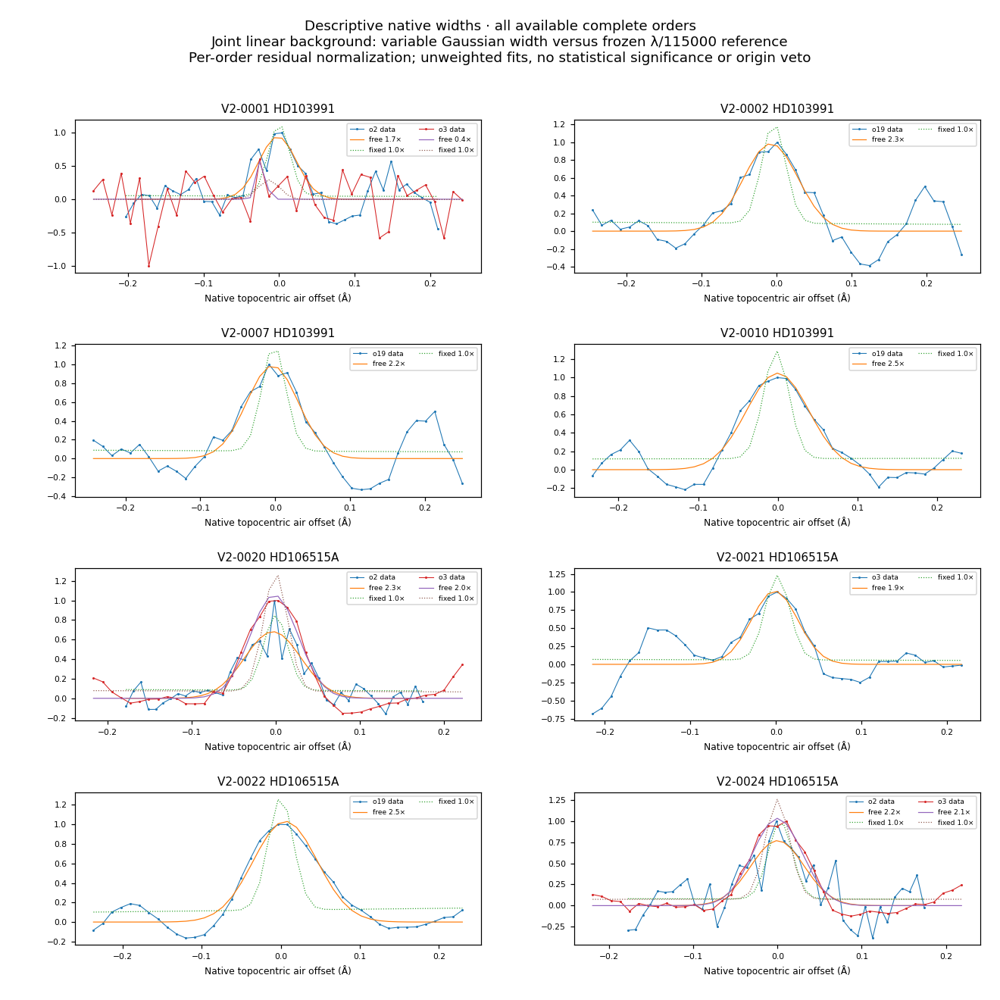
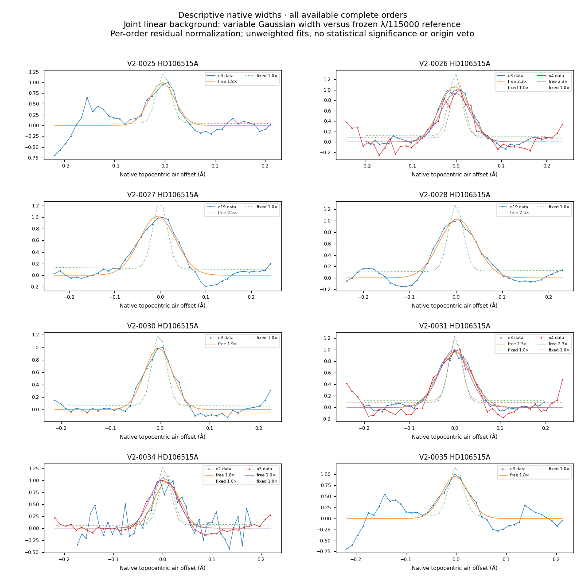
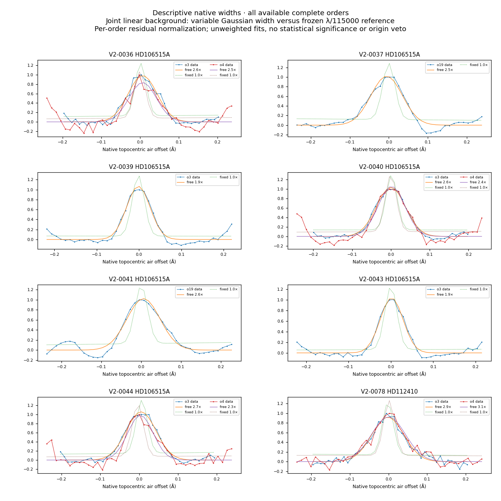
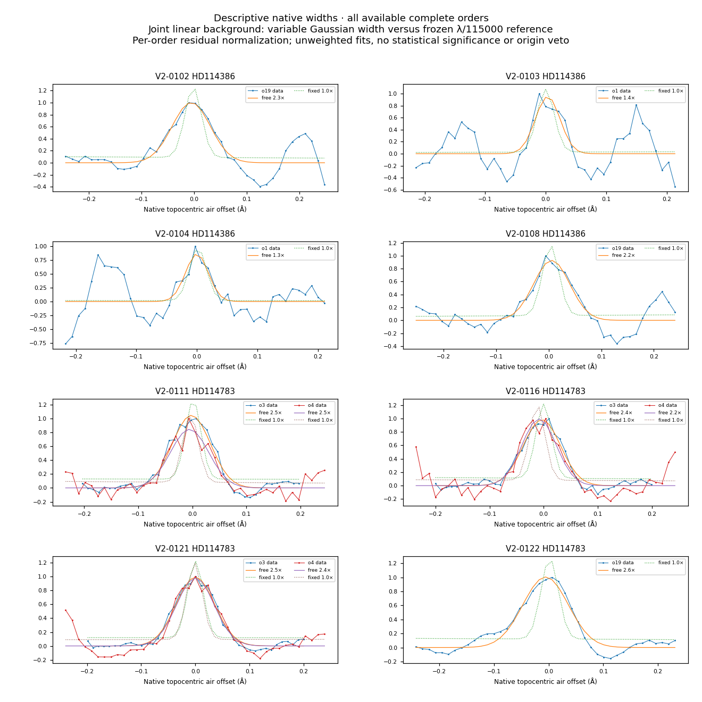
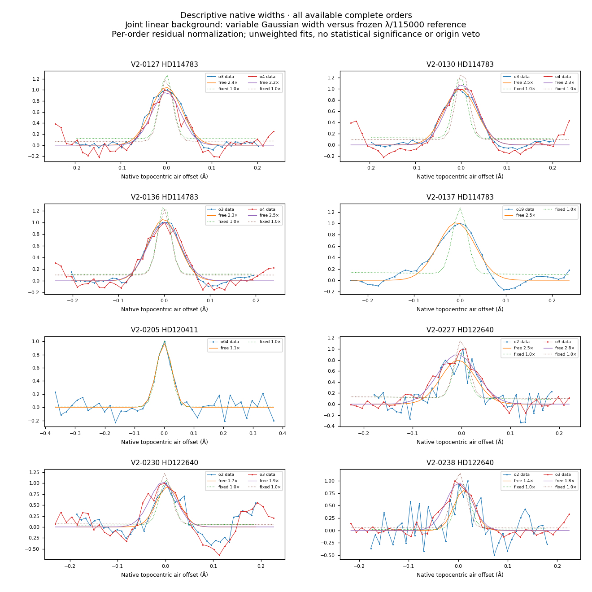
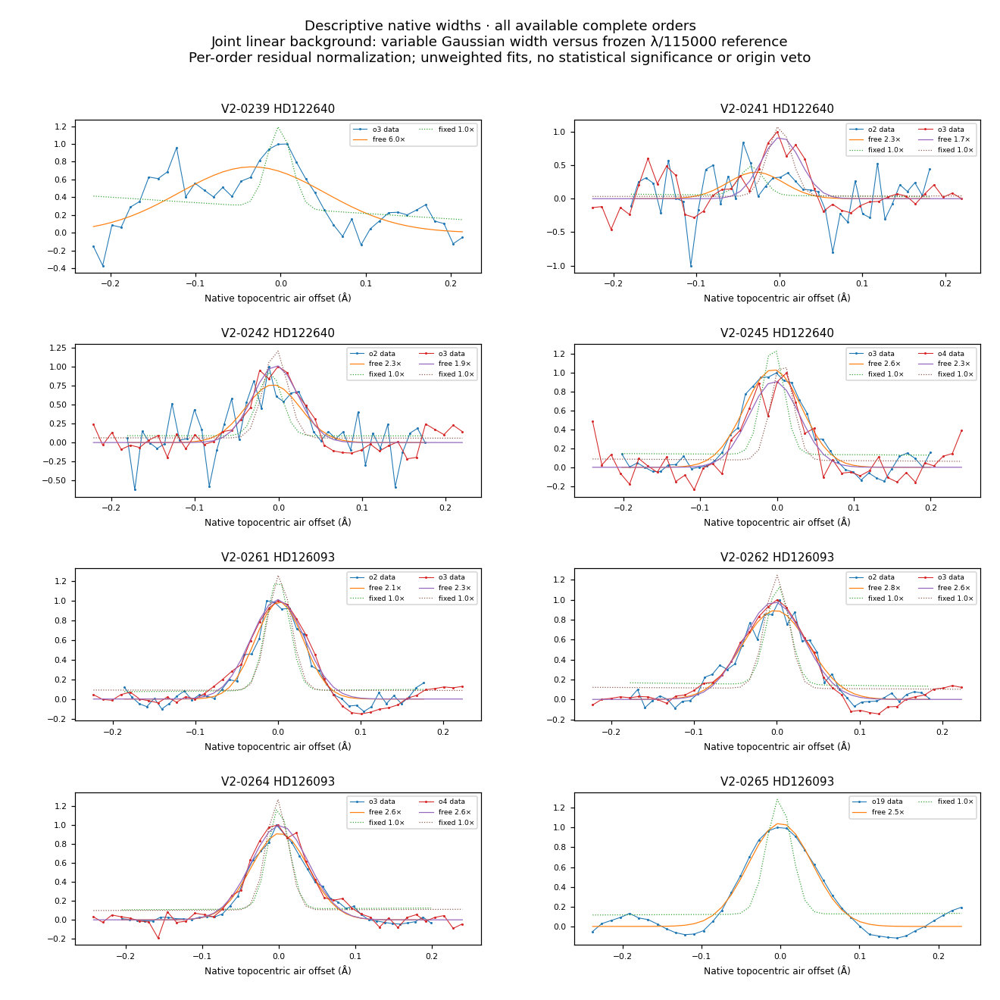
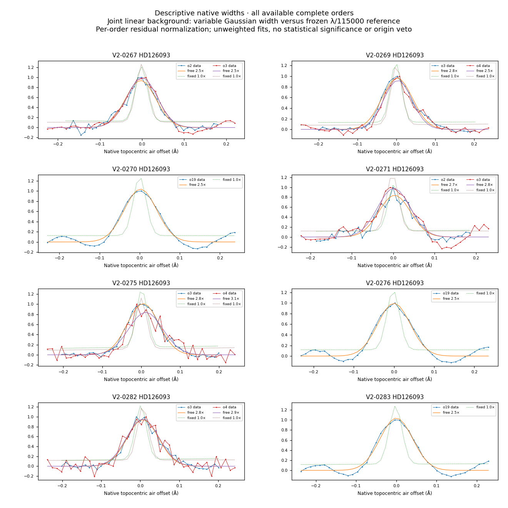
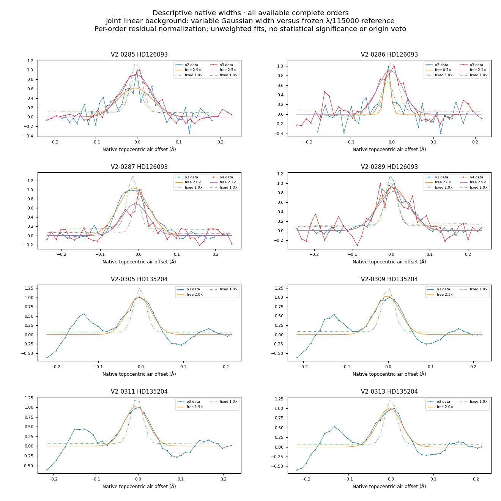

# Native profilbredder for 64 uafklarede fund

Alle 64 oprindeligt uafklarede V2-hændelser er undersøgt i 98 komplette native ordener. For **38 af 64** er den tilpassede positive struktur bredere end to gange detektorens referencebredde λ/115.000 i samtlige komplette ordener og med begge baggrundsmodeller. Det tal beskriver profilskala; det er ikke en klassifikation eller et veto mod en svag, smal komponent.

Hver orden er tilpasset med en positiv Gaussian og lineær baggrund. Bredde og centrum gennemløber et fast gitter. Den ene baggrund tilpasses samtidig med profilen; den anden bestemmes af de yderste 8+8 punkter. Der anvendes ingen påstået fotonstøjmodel eller formel statistisk signifikans. Det er en efterfølgende undersøgelse af allerede kendte fund.

V2-0205 har bredder på **1,05–1,11 gange referencebredden**, og den mulige atmosfæriske forklaring må derfor afprøves gennem bølgelængder, epoker og skyfiber. De fleste viste blå toppe er bredere og står mellem tydelige absorptionsstrukturer. Det er foreneligt med, at søgningen også finder lokale maksimummer i et struktureret stjernespektrum; linjeidentifikation og epokesammenligning ligger separat.

Et breddefit rammer gittergrænsen for V2-0001; centrum rammer grænsen for V2-0239 og V2-0241. De er bevaret. Modellen beskriver ikke alle asymmetriske eller blandede profiler, og alle målte bredder er modelafhængige.

[Protokol](PLAN.json) · [alle orden- og metodeværdier](ORDER_WIDTHS.csv) · [hændelsesoversigt](EVENT_WIDTHS.json) · [resultat](SUMMARY.json) · [kode](analyze.py) · [direkte skalar-efterkontrol](SCALAR_CHECK.json).

Efterkontrollen genfinder samme optimale gitterpunkter og SSE i første, midterste og sidste komplette orden med direkte tre-kolonne-mindste-kvadraters beregning i en frisk proces. Den oprindelige analyse bruger vektoriseret projektion. Begge er udført af hovedagenten og er ikke en uafhængig forskers validering. Ingen oprindelig status eller søgegrænse er ændret.

## Figurer

Alle komplette ordener vises. Punkter er native data, fuld kurve fri bredde, stiplet kurve den faste referencebredde. Den fælles lineære baggrund fra det frie fit er trukket fra, og hver ordens residual er skaleret separat.

