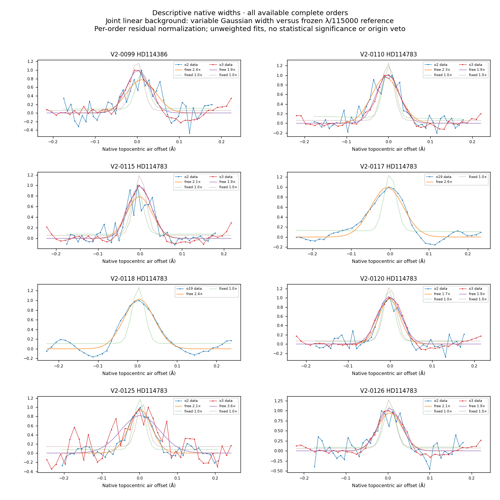
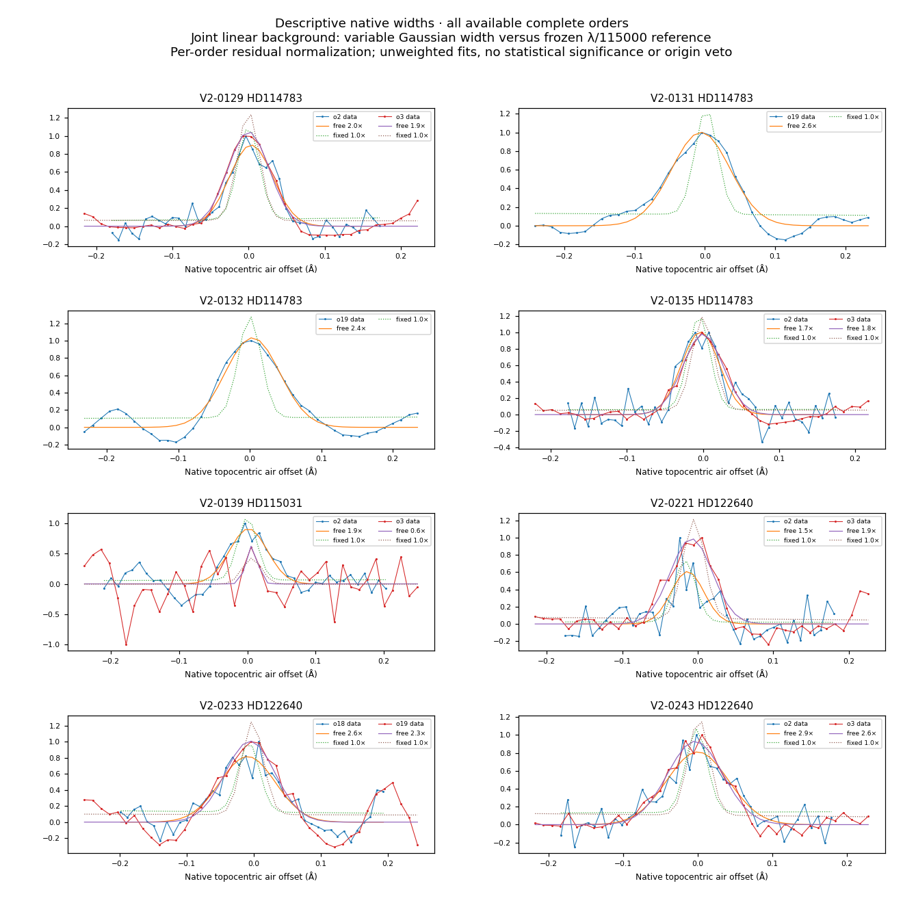
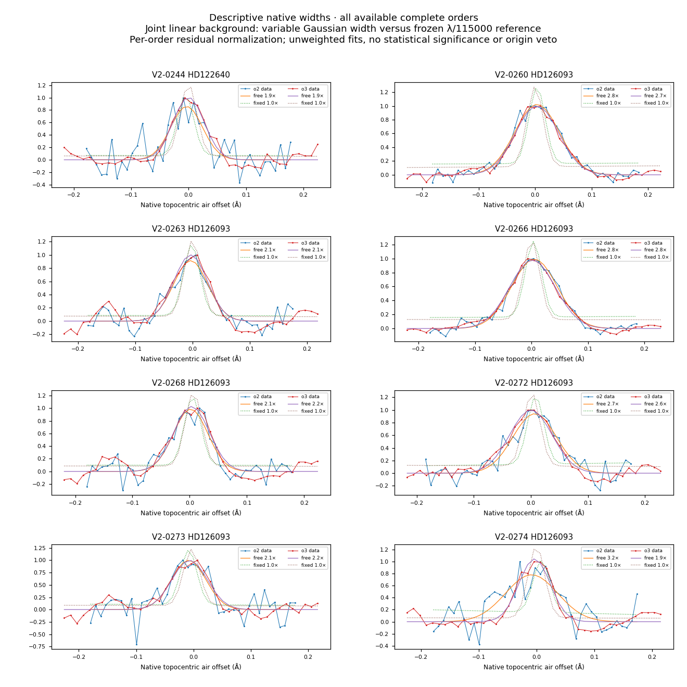
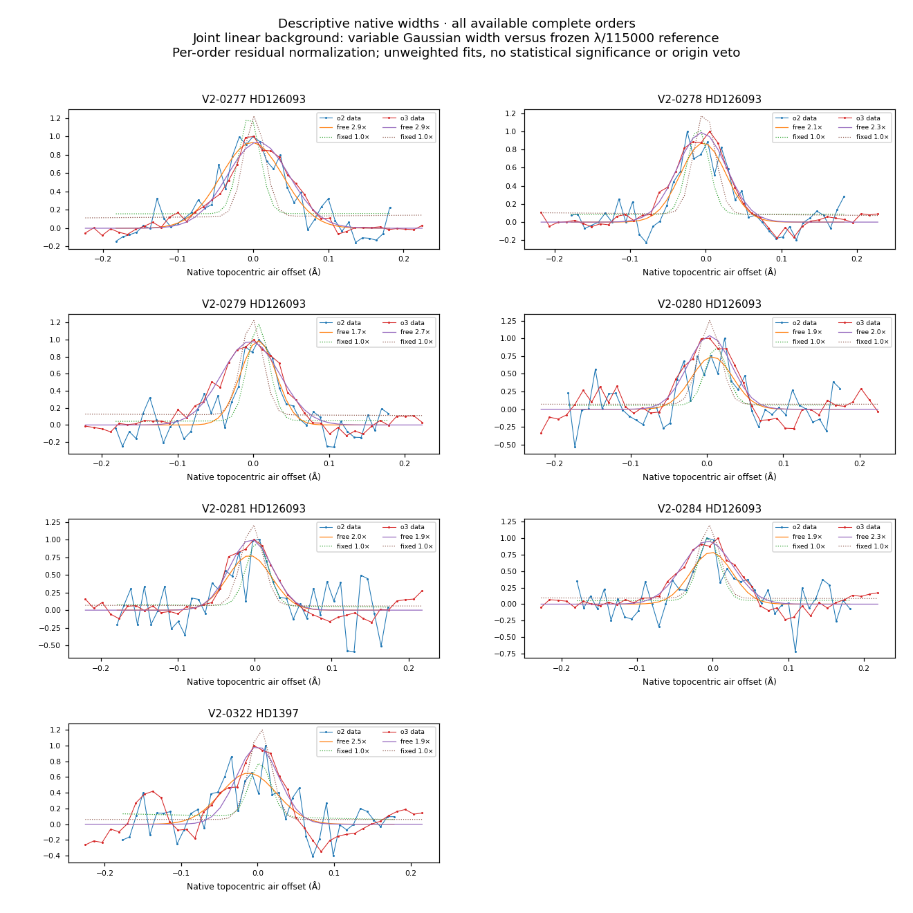

# Native profilbredder for de 31 yderligere spektraltræf

Efter den udvidede billedkobling kunne 31 tidligere usikre fund undersøges som spektralstrukturer. Den samme faste breddeundersøgelse som for de første 64 fund er nu anvendt på alle deres 58 komplette native ordener. Udvalget og indstillingerne ligger i [PLAN.json](PLAN.json). Dataene var allerede kendte, så undersøgelsen er efterfølgende og beskrivende.

For **12 af de 31** er den tilpassede positive struktur bredere end to gange λ/115.000 i samtlige komplette ordener og med begge lineære baggrundsmodeller. Ingen af disse fit rammer bredde- eller centrumgrænsen. Sammen med de første 64 er resultatet **50 af 95 fund**, undersøgt i **156 komplette ordener**. Den antagne referencebredde er ikke en målt instrumental profil; et bredt eller blandet maksimum kan stadig indeholde en smal komponent.

[Alle orden- og metodeværdier](ORDER_WIDTHS.csv) · [hændelser](EVENT_WIDTHS.json) · [resultat](SUMMARY.json) · [kode](analyze.py) · [skalar-efterkontrol](SCALAR_CHECK.json).

Efterkontrollen genfinder samme optimum og SSE for første, midterste og sidste komplette orden med direkte mindste kvadraters beregning i en frisk proces. Dette er hovedagentens numeriske kontrol, ikke uafhængig forskervalidering. Ingen oprindelig status, søgegrænse eller katalogværdi er ændret.

