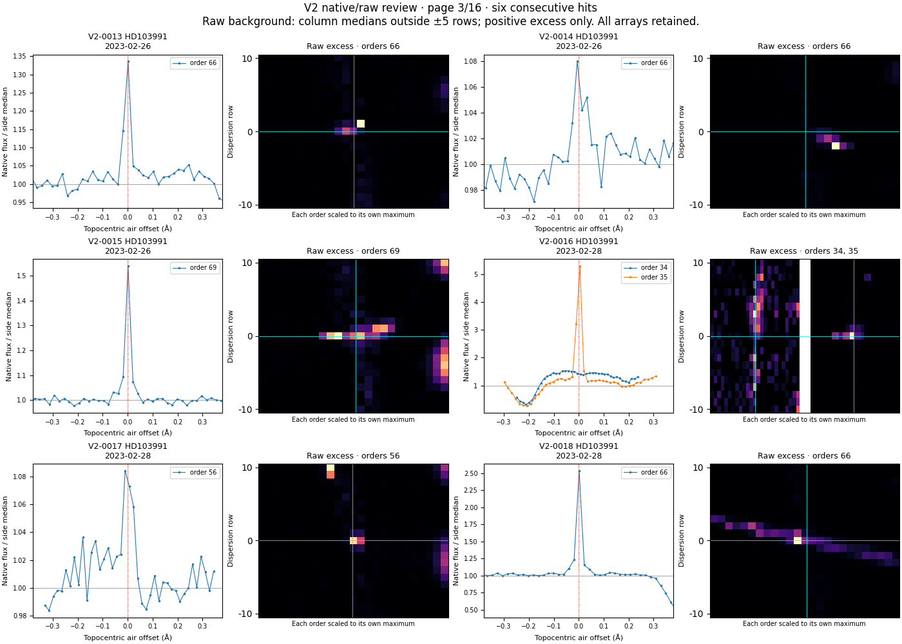
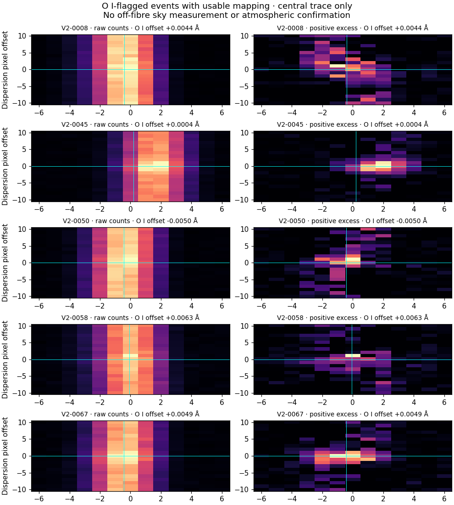

# Første gennemgang af 96 V2 hits

**De første 96 af 333 V2-hits er nu gennemgået i native spektralordener og råbilleder.** Den foreløbige vurdering er 56 sandsynlige detektorartefakter, 10 forenelige med atmosfæriske iltlinjer, 24 uafklarede spektralstrukturer og seks hændelser med utilstrækkelig råbilledkortlægning. Ingen er identificeret som laser. De øvrige 237 hits er endnu ikke gennemgået.

| Foreløbig status | Antal | Hvad vurderingen bygger på |
|---|---:|---|
| Sandsynlig detektorartefakt | 56 | Skrå ladningsspor, meget kompakte pixeltræffere eller en skarp top i kun den ramte af to overlappende ordener. |
| Forenelig med atmosfærisk O I | 10 | Bølgelængdesammenfald, native linjeprofil og overskud på det observerede fiberspor. Særskilt skybekræftelse mangler. |
| Uafklaret spektralstruktur | 24 | Bredere, ofte sammensatte profiler med lys på fibersporet. De er ikke ophavsbestemt. |
| Utilstrækkelig råbilledkortlægning | 6 | Fire har svag referencekorrelation; to andre har et lokalt fiberspor forskudt fra den beregnede position. |
| I alt gennemgået | 96 | Alle er bevaret i den oprindelige 333-hitliste. |

Vurderingerne er hovedagentens visuelle første gennemgang, ikke et uafhængigt forskerreview eller endelige ophavsbestemmelser. De ændrer ikke den fastlåste detektor, dens følsomhedstest eller den oprindelige katalogstatus. [Dispositioner med begrundelser](FOLLOWUP_DISPOSITIONS.csv) · [resultat og afgrænsning](SUMMARY.json) · [samtlige figurer](FIGURES.md).

## Udvalg og nye kontroldata

Udvalget er de første 96 rækker i det allerede gemte atlasindeks: samtlige V2-hits fra de første fem stjerner, HD103991, HD106515A, HD109833, HD112410 og HD114082. Det er valgt efter tabelrækkefølge og ikke efter profilernes udseende eller styrke. Det omfatter 24 eksponeringer. Alle 24 råfiler og 24 ancillary-arkiver er hentet, i alt 620.439.242 bytes. Hashes, rå-ID, observationsdato og native BERV er kontrolleret.

Der er udtrukket 116 fulde ordreudsnit. Yderligere to dækkende ordener rammer randen og er markeret `EDGE_TRUNCATED`; disse mangler en fuld overlapkontrol. Hændelserne V2-0005 og V2-0070 er bevaret med den begrænsning. Der er ingen nye stjerneeksponeringer i hovedregnskabet: dækningen er fortsat **200 eksponeringer af 20 stjerner og 46,750 timers summeret eksponering**.

## Hvad råkontrollen viste

Mange native toppe består af ganske få punkter, selv om resampling får dem til at ligne en jævn linje i 1D-produktet. Flere har et tydeligt spor på tværs af fibren. Ved eksempelvis V2-0016, V2-0033, V2-0042, V2-0055, V2-0056, V2-0059, V2-0081, V2-0086 og V2-0087 findes toppen i kun den ramte af de overlappende ordener. Dette er konkret evidens for en detektorforstyrrelse; ikke enhver enkeltstående linje afvises alene, fordi den ikke gentager sig.

De 10 O I-vurderinger ligger 0,0004–0,0154 Å fra enten 5577,339 eller 6300,304 Å i den omtrentlige topocentriske luftframe. Antallet af decimaler er beregningspræcision, ikke kalibreret nøjagtighed. Fokusfigurerne viser den centrale fiber uden den stærke nabofiber, som ellers kan dominere farveskalaen. De er kompatible med atmosfærisk emission; der er ikke udført en særskilt måling af himmelbaggrunden eller kalibreringskontamination.

For 21 af de 24 uafklarede spektralstrukturer findes et andet allerede registreret V2-hit fra samme stjerne inden for ±0,03 Å i barycentrisk luftframe på en anden eksponering. Det er en efterfølgende nærhedskontrol i hitlisten, ikke en undersøgelse af al fotometri eller en identifikation af stjernelinjer. Gentagelsen er grund til at undersøge stabile spektralstrukturer nærmere; den beviser hverken naturligt eller teknologisk ophav. [Alle gentagelsesmatch](REPEAT_PROXIMITY.json).

## Kortlægning og uafklarede tilfælde

Råorienteringen sammenlignes med et fast interval i native orden 50, pixels 1000–1399. Det første udtræk blev afbrudt efter 11 eksponeringer uden traceback. De næste forsøg viste, at en antagelse om én fælles polynomiekonvention ikke holdt for hele udvalget, og at en eksponering havde referencekorrelation 0,566 under den uændrede grænse 0,8. Forsøgene og deres kode er bevaret.

Den afsluttede udtrækning bruger den bedst understøttede orientering pr. eksponering og markerer usikker kortlægning. V2-0062–0065 har utilstrækkelig referencekorrelation. Desuden viste lokal kontrol, at fibersporet for V2-0046 og V2-0047 ligger over seks pixels fra den beregnede position, selv om referenceintervallet gav 0,865. **En god korrelation ét sted validerer ikke automatisk alle ordener og positioner.** Der udledes ingen råbilledbaseret ophavsforklaring for disse seks. V2-0063 har et O I-bølgelængdeflag, men tælles ikke blandt de ti atmosfæriske vurderinger.

[Kortlægningsdata](NATIVE_MAPPING.json) · [lokal sporkontrol](LOCAL_TRACE_AUDIT.json). De 56 artefaktvurderinger er fortsat kvalitative og foreløbige; der er ingen ny fuld instrumentreduktion eller kalibreret automatisk partikelklassifikation.

## Reproduktion og gemte filer

De nye rå- og native input ligger i to selvstændige arkiver, som pakkes ud med `work_harps_20261101` som rod. De kan udpakkes i samme mappe; fælles metadata er identiske.

| Inputarkiv | Bytes | SHA-256 |
|---|---:|---|
| [Del 1](https://chatgpt.com/library?file_id=libfile_3770b869169481918e1fcd1fd6b413ed&account_id=personal) | 289.440.501 | `2a7d423dec2e9829ad98cf8607e50a528f37b95e073e8eaf4ec5107ce0f9e032` |
| [Del 2](https://chatgpt.com/library?file_id=libfile_4cc2e27d2a48819193928d8b28533c4e&account_id=personal) | 277.363.918 | `2cc726bd11252c03c581c0da8ed5b14d307e9f7c58c03da62c89fcd50a854414` |

Den første samlede pakke kunne ikke klargøres til lagring; begge mindre pakker er efterfølgende gemt og deres lokale metadata registreret. Alle medlemmers bytes er kontrolleret ved pakningen. [Inputoversigt](INPUT_CHECKPOINTS.json).

Native arrays, komplette metadata, kode og vurderinger ligger også i `TRIAGE01_EVIDENCE.zip`, med hashes i [arkivmanifestet](EVIDENCE_ARCHIVE.json). Figurerne er publiceret separat. Fra projektmappen: `python v2/triage_batch01/extract_native.py`, `python v2/triage_batch01/plot_native.py` og `python v2/triage_batch01/focused_checks.py`. Brug en arbejdskopi, så gemte resultater bevares. `finalize_review.py` samler de eksplicitte visuelle noter og kontrollerer regnskabet; det udfører ikke selv en visuel klassifikation. Afhængigheder følger [V2-rapporten](../README.md).

Næste trin er V2-0097 og frem, samt separat afklaring af de seks kortlægningsproblemer og de 24 spektralstrukturer. Ingen af disse bør forsvinde fra køen, blot fordi næste gruppe analyseres. HARPS-ugen er stadig delvis; Rubin er endnu ikke analyseret.
