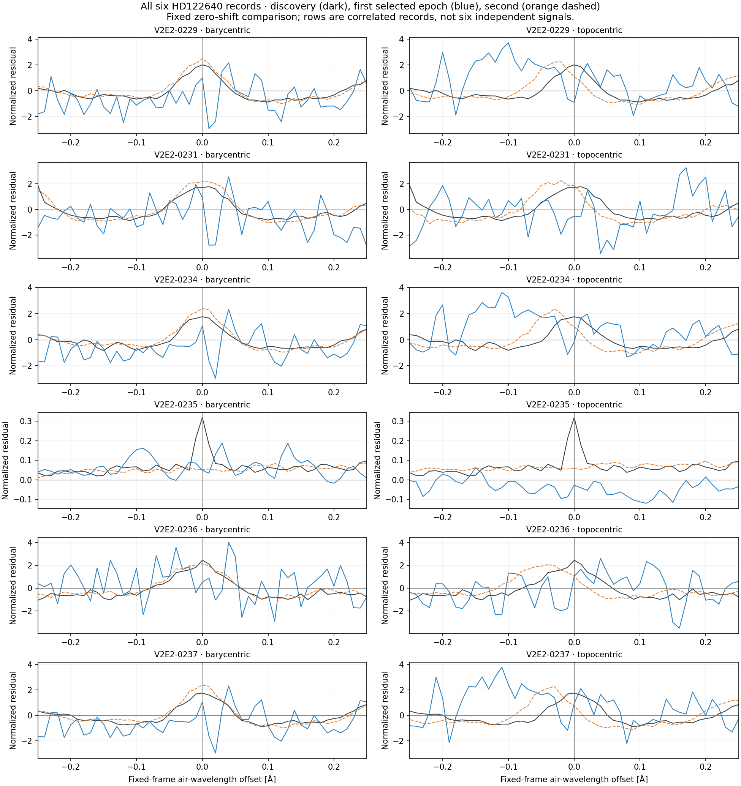

# Fixed HARPS BERV comparison — completed 2026-11-02

Two newly retrieved archival HD122640 exposures were compared with the six fixed HD122640 event records in both declared frames: **12 event/epoch pairs, 24 measured profiles, zero blocked profiles**. The ten-record queue remains intact; the four HD135204 records have no newly selected epoch. Twenty existing discovery profiles were reused, and the original 100-exposure comparison was not rerun. All ten U classifications remain unchanged. These are descriptive follow-up measurements with no origin assignments or repeat classifications.

The 2018 exposure agrees more closely with the discovery profiles in the barycentric frame for all five records near 3867–3881 Å: zero-shift correlations are **0.961–0.974**, versus **0.505–0.723** in the topocentric frame. The 2017 exposure supplies the large BERV displacement, but all five short-wavelength records are flagged low-continuum in both frames. Thus the wider geometric baseline does not establish an equally strong, clean comparison at both BERV extremes. The 5548.09 Å record has low correlations in both new epochs and frames; this alone establishes neither physical transience nor a detection limit.

## Selected archival inputs

| Product ID | Observation UTC | Recorded BERV (km/s) | Exposure (s) |
|---|---|---:|---:|
| `ADP.2017-05-23T01:01:52.459` | 2017-05-22T05:20:05.415 | -11.081666435344 | 1199.9983 |
| `ADP.2018-01-21T01:01:37.761` | 2018-01-20T08:50:34.270 | +29.281812285614 | 899.9982 |

Both inputs passed the frozen identity/progenitor, single-exposure, BARYCENT air-angstrom/ADU, nominal resolution 115000 and HEFS=False checks, and both report HARPS_3.8. This high-resolution compatibility check does not require a literal `INS MODE=HAM`. The [payload header record](PAYLOAD_HEADER_VALIDATION.json) preserves the evidence. Header and input archives were published at commit `3e5f38f15da4306d11d443f1e4cc89de925e2ddc` before the released comparison accessed their spectral arrays.

The new HD122640 BERV span is **40.3634787209574 km/s**, compared with **2.2379098704629 km/s** across its 14 previously included exposures. The inherited planning scale is c/R = 2.606890939 km/s. Relative to each discovery exposure, the 2017 displacement is 14.36–14.70 nominal resolution elements; the cleaner 2018 displacement is only 0.78–1.13. Passing the geometric span gate therefore does not by itself demonstrate adequate sensitivity or resolve physical origin.

## Every measured event/epoch pair

B and T denote barycentric and topocentric comparisons. `r` is the fixed, zero-shift Pearson correlation of residuals in the ±0.25 Å core. `A` is the signed narrow-template amplitude in locally normalized flux; it is not a signal-to-noise ratio, calibrated line flux or measured linewidth. Values are rounded here; the [JSON](ALL_COMPARISON_MEASUREMENTS.json) and [CSV](ALL_COMPARISON_MEASUREMENTS.csv) preserve all 24 full-precision frame records, broad-template amplitudes, residual RMS values, integrated excesses, masks and provenance. The low-continuum flag below agrees across both frames.

| Event / full-window figure | Observation date | r B | r T | A B | A T | Low continuum B/T |
|---|---|---:|---:|---:|---:|---|
| [V2E2-0229](figures/V2E2-0229_PROFILE_COMPARISON.png) | 2017-05-22 | +0.126 | -0.084 | +0.078 | -0.780 | Yes / Yes |
| [V2E2-0229](figures/V2E2-0229_PROFILE_COMPARISON.png) | 2018-01-20 | +0.974 | +0.719 | +3.220 | +1.849 | No / No |
| [V2E2-0231](figures/V2E2-0231_PROFILE_COMPARISON.png) | 2017-05-22 | +0.107 | -0.266 | +0.651 | -0.489 | Yes / Yes |
| [V2E2-0231](figures/V2E2-0231_PROFILE_COMPARISON.png) | 2018-01-20 | +0.972 | +0.723 | +3.265 | +2.689 | No / No |
| [V2E2-0234](figures/V2E2-0234_PROFILE_COMPARISON.png) | 2017-05-22 | +0.144 | -0.184 | +0.232 | -0.569 | Yes / Yes |
| [V2E2-0234](figures/V2E2-0234_PROFILE_COMPARISON.png) | 2018-01-20 | +0.968 | +0.604 | +3.225 | +1.588 | No / No |
| [V2E2-0235](figures/V2E2-0235_PROFILE_COMPARISON.png) | 2017-05-22 | -0.040 | -0.118 | +0.020 | -0.018 | No / No |
| [V2E2-0235](figures/V2E2-0235_PROFILE_COMPARISON.png) | 2018-01-20 | +0.157 | +0.022 | +0.002 | -0.011 | No / No |
| [V2E2-0236](figures/V2E2-0236_PROFILE_COMPARISON.png) | 2017-05-22 | +0.209 | +0.086 | +0.011 | +0.379 | Yes / Yes |
| [V2E2-0236](figures/V2E2-0236_PROFILE_COMPARISON.png) | 2018-01-20 | +0.965 | +0.629 | +3.058 | +1.490 | No / No |
| [V2E2-0237](figures/V2E2-0237_PROFILE_COMPARISON.png) | 2017-05-22 | +0.204 | -0.134 | +0.232 | -0.215 | Yes / Yes |
| [V2E2-0237](figures/V2E2-0237_PROFILE_COMPARISON.png) | 2018-01-20 | +0.961 | +0.505 | +3.225 | +1.151 | No / No |

Every new profile has 201 valid grid samples, zero gap-masked samples and zero finite positive ERR samples. For the ten 2017 short-wavelength frame profiles, the local median divided by the inherited first-difference noise proxy is only 0.655–0.728. The existing low-continuum rule is median ≤ 3 × that proxy; it was not changed after seeing these results. V2E2-0235 is not low-continuum in either epoch, but its core correlation remains weak (2017: −0.040/−0.118; 2018: +0.157/+0.022). Its discovery central excursion is not comparably aligned in the displayed new epochs; no binary non-repetition decision or exclusion limit is assigned.

| Event | Fixed barycentric air center (Å) | Discovery observation UTC | Discovery BERV (km/s) |
|---|---:|---|---:|
| V2E2-0229 | 3868.9275 | 2023-02-20T07:24:43.232 | +27.241183696 |
| V2E2-0231 | 3881.2050 | 2023-02-20T07:24:43.232 | +27.241183696 |
| V2E2-0234 | 3868.9250 | 2023-02-22T07:40:53.531 | +26.784888419 |
| V2E2-0235 | 5548.0900 | 2023-02-22T07:40:53.531 | +26.784888419 |
| V2E2-0236 | 3866.9600 | 2023-02-24T07:25:10.837 | +26.348673412 |
| V2E2-0237 | 3868.9250 | 2023-02-24T07:25:10.837 | +26.348673412 |

The exact discovery product IDs, input hashes and both archived profile hashes are in [EVENTS.json](../EVENTS.json). V2E2-0229, V2E2-0234 and V2E2-0237 belong to the same previously identified wavelength neighborhood, and two have identical barycentric centers. The five short-wavelength records occupy three pre-existing neighborhoods; all six HD122640 records occupy four. The rows cannot be counted as six independent phenomena.

HD135204 records **V2E2-0303, V2E2-0305, V2E2-0308 and V2E2-0309** have zero selected new epochs and remain explicit in [EVENT_RESULTS.json](EVENT_RESULTS.json). No inference about the completeness of the wider archive follows from this bounded acquisition.

## Figures and unchanged method

The overview includes all six records and both frames. Dark curves show discovery; blue shows 2017-05-22; dashed orange shows 2018-01-20. The six linked individual figures also show the complete ±1 Å window. Corresponding axes share their scale between frames for each event, including every finite curve value with fixed padding. No profile, center, lag or display range was selected to improve agreement. All six full-window figures were visually checked for labels, complete curves and layout; the overview received a separate [independent visual review](../../comparison_independent_audit/OVERVIEW_VISUAL_AUDIT.json). Figure hashes and the declared plotting rules are in [PLOT_INDEX.json](PLOT_INDEX.json) and [PLOT_PLAN.json](../PLOT_PLAN.json).

The comparison reused the frozen inherited functions: a 0.01 Å grid over ±1 Å, positive local median normalization over ±2 Å, linear background from the fixed |offset| ≥ 0.60 Å sidebands, and the ±0.25 Å zero-shift correlation core. Signed Gaussian templates have fixed FWHM λ/115000 and three times that width, each with its own fitted constant and slope. Topocentric coordinates use the recorded BERV and the inherited first-order transformation with c = 299792.458 km/s. There is no fitted shift, stellar radial-velocity correction or newly tuned threshold.

## Verification and scientific limits

The [independent numerical audit](../../comparison_independent_audit/NUMERICAL_AUDIT.json) reconstructed all 24 profiles directly from the two acquired inputs without importing the production functions: **2,065 checks and 29,712 scalar comparisons passed**. Its maximum scalar metric difference was 3.56 × 10⁻¹⁵; maximum raw-flux difference was 9.10 × 10⁻¹³ ADU. All 30 scientific output hashes in [OUTPUT_HASHES.json](OUTPUT_HASHES.json) were rechecked after plotting and reporting and remain unchanged. This report and the figures are additional presentation artifacts; they do not replace the frozen numeric outputs.

The measurements remain limited by post-detection event selection, correlated records, the low-continuum 2017 blue profiles, and unavailable positive ERR samples in both new spectra and the discovery references. The fits are unweighted and no formal detection significance, false-alarm rate, survey completeness, calibrated line flux or non-detection sensitivity is supplied. Fixed Gaussian widths are templates rather than measured linewidths.

Compatible units, nominal resolution and the same pipeline version do not calibrate instrument-era changes, extraction/blaze/background, the line-spread function or wavelength zero-points. Barycentric wavelength is not a stellar rest frame, and stellar radial-velocity changes remain a possible confounder. Greater barycentric agreement does not identify an astrophysical or extraterrestrial source; greater topocentric agreement would likewise not establish terrestrial origin. The added epochs are historical archival observations, not newly commissioned independent telescope observations. No event label, scientific search threshold or origin assignment changed.
