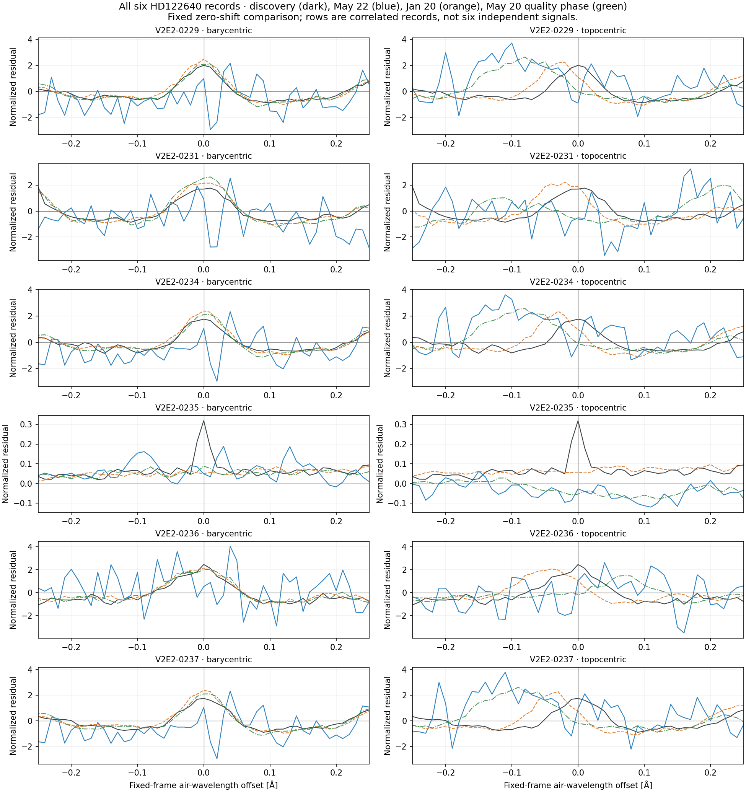

# Post-hoc May-quality follow-up — completed 2026-11-02

The single fixed May 20 archival exposure produced **six event/epoch pairs and twelve measured frame profiles, with zero blocked slots**. All twelve profiles pass the inherited local-continuum flag. The five short-wavelength records have barycentric core correlations **0.956–0.979**, compared with **−0.313 to +0.153** in the topocentric frame, at **13.884–14.227 nominal resolution elements** of BERV displacement from discovery. This adds a locally usable large-displacement frame comparison to the earlier results. It is descriptive frame coherence, with no physical-origin assignment or event reclassification.

This is a **separate post-hoc quality phase**: the candidate was chosen for the highest average metadata SNR among unused May exposures in the saved pool after the earlier May 22 blue profiles proved low-continuum. The new header and comparison method were frozen before acquiring this input. The closed prior 24-profile result remains unchanged and is shown as context; it was not replaced or rerun. This follow-up is not an independent blinded validation.

## Input, quality and scope

| Field | Recorded value |
|---|---|
| Product | `ADP.2017-05-21T01:01:50.278` |
| Raw progenitor | `HARPS.2017-05-20T02:21:45.847` |
| Observation UTC | 2017-05-20T02:21:45.846 |
| Exposure | 1199.9982 s |
| Recorded BERV | −9.84628486624399 km/s |
| Representation | BARYCENT air angstrom; ADU flux; one exposure |
| Instrument metadata | HARPS; nominal R=115000; HEFS=False; HARPS_3.8 |
| Local profile samples | 201 valid; zero gap-masked, in all twelve profiles |
| Low-continuum flags | False in all twelve profiles |
| Finite positive ERR samples | Zero in all twelve profiles and in the native input |

The inherited low-continuum rule compares the local median with three times the first-difference noise proxy. For the five blue records the barycentric normalization is approximately 92–115 ADU and the proxy 17–23 ADU, compared with the prior May 22 normalization of roughly 8–10 ADU and proxy 12–14 ADU. Passing this descriptive flag does not supply a formal error model or detection significance.

All six discovery-to-new BERV displacements exceed the predeclared 10×c/R gate (26.0689093913 km/s). Payload and header evidence were public at commit `318b4201273aad853899c52dfe2a3e025bb686e6` before new arrays were interpreted. [PAYLOAD_HEADER_VALIDATION.json](PAYLOAD_HEADER_VALIDATION.json) records the exact compatibility checks. The [summary](SUMMARY.json) binds this run to the prospective plan and comparison release.

## Every new event/epoch pair

B/T denotes barycentric/topocentric. Correlations are fixed zero-shift Pearson values over the ±0.25 Å residual core. Amplitudes are signed narrow-template coefficients in locally normalized flux, not SNR or calibrated line flux. All twelve low-continuum flags are false.

| Event / complete figure | Fixed barycentric center (Å) | r B | r T | Narrow A B | Narrow A T | BERV displacement (c/R) |
|---|---:|---:|---:|---:|---:|---:|
| [V2E2-0229](figures/V2E2-0229_PROFILE_COMPARISON.png) | 3868.9275 | +0.977223 | +0.022075 | +3.062040 | -0.222556 | 14.227 |
| [V2E2-0231](figures/V2E2-0231_PROFILE_COMPARISON.png) | 3881.2050 | +0.979149 | -0.312911 | +3.728078 | -0.929948 | 14.227 |
| [V2E2-0234](figures/V2E2-0234_PROFILE_COMPARISON.png) | 3868.9250 | +0.955933 | -0.095625 | +3.028752 | -0.372634 | 14.052 |
| [V2E2-0235](figures/V2E2-0235_PROFILE_COMPARISON.png) | 5548.0900 | +0.475244 | -0.298943 | +0.016878 | -0.035139 | 14.052 |
| [V2E2-0236](figures/V2E2-0236_PROFILE_COMPARISON.png) | 3866.9600 | +0.963874 | +0.153460 | +3.038185 | +0.193115 | 13.884 |
| [V2E2-0237](figures/V2E2-0237_PROFILE_COMPARISON.png) | 3868.9250 | +0.967117 | -0.183633 | +3.028752 | -0.591194 | 13.884 |

The [full-precision JSON](ALL_COMPARISON_MEASUREMENTS.json) and [CSV](ALL_COMPARISON_MEASUREMENTS.csv) preserve all twelve frame records, including the wider fixed template, residual RMS, integrated excess, masks and input/profile hashes. No threshold was fitted to these six pairs.

In the blue profiles, the new May 20 curve follows the broad central structure and much of the surrounding ±1 Å pattern more closely in barycentric coordinates. It shifts relative to the discovery structure in the topocentric plots. These are correlated features in resampled spectra; the comparison does not establish their atomic identity or physical source.

**V2E2-0235 at 5548.09 Å remains a distinct case.** Its core correlation is +0.475244 barycentric and −0.298943 topocentric, and the new narrow amplitudes are only +0.016878/−0.035139. The full-window barycentric spectrum follows the surrounding shape, including the broad absorption structure, but the discovery’s sharp central excursion is not present at comparable displayed amplitude in the new profile. The positive whole-core correlation must not be interpreted as replication of that narrow excursion. No transient, artifact, repeat/non-repeat label or exclusion limit is assigned.

## All three archival follow-up epochs

The table below copies the two closed prior correlations alongside this new result. Each cell is **r B / r T**; no earlier measurement is recomputed. May 22 remains low-continuum for all five blue records in both frames; January 20 and this May 20 phase have no low-continuum flags. V2E2-0235 is not low-continuum in any of these epochs.

| Event | 2017-05-22 — closed prior phase | 2018-01-20 — closed prior phase | 2017-05-20 — new post-hoc phase |
|---|---:|---:|---:|
| V2E2-0229 | +0.126 / -0.084 | +0.974 / +0.719 | +0.977 / +0.022 |
| V2E2-0231 | +0.107 / -0.266 | +0.972 / +0.723 | +0.979 / -0.313 |
| V2E2-0234 | +0.144 / -0.184 | +0.968 / +0.604 | +0.956 / -0.096 |
| V2E2-0235 | -0.040 / -0.118 | +0.157 / +0.022 | +0.475 / -0.299 |
| V2E2-0236 | +0.209 / +0.086 | +0.965 / +0.629 | +0.964 / +0.153 |
| V2E2-0237 | +0.204 / -0.134 | +0.961 / +0.505 | +0.967 / -0.184 |

The prior BERV values are −11.0816664353436 km/s (May 22) and +29.2818122856138 km/s (January 20). The new −9.84628486624399 km/s epoch lies within their existing 40.3634787209574 km/s span: it improves the local quality of the large-displacement comparison rather than extending that geometric span. The original January 20 discovery displacement remains only 0.78–1.13 c/R. The [closed prior report](../../../work_harps_20261102_berv_followup/prospective_comparison/results/README.md) retains its original limits and results.

Dark curves show discovery; blue is May 22, dashed orange is January 20, and green dash-dot is this May 20 quality phase. Every individual figure above shows both full ±1 Å windows and ±0.25 Å cores. Corresponding axes share their limits between frames and include all finite curve values. The overview and all six individual figures were visually inspected for complete curves, readable labels and consistency with the saved measurements. [PLOT_INDEX.json](PLOT_INDEX.json) lists every displayed profile and all seven figure hashes. No new statistics or prior profiles were calculated by the plotting script.

## Verification and remaining limits

The [independent numerical audit](../../comparison_audit/NUMERICAL_AUDIT.json) reconstructed all twelve new profiles and correlations without production-function imports: **1,571 checks and 15,096 scalar comparisons passed**. Maximum metric/summary discrepancy was 2.75×10⁻¹⁵ and correlation discrepancy 3.33×10⁻¹⁶. Both the current scientific output manifest and all thirty files in the prior scientific output manifest were verified after plotting and reporting. Frozen code, plans, references and prior results remain unchanged.

HD135204 records **V2E2-0303, V2E2-0305, V2E2-0308 and V2E2-0309** still have no newly selected epoch and remain explicit in [EVENT_RESULTS.json](EVENT_RESULTS.json). All ten original U labels remain unchanged. The six HD122640 records occupy four prior wavelength neighborhoods; V2E2-0229/0234/0237 share a neighborhood. They are not six independent signals.

The phase remains limited by post-detection and post-hoc quality selection, one added historical exposure, correlated records and unavailable positive ERR values. Fits are unweighted; fixed Gaussian widths are templates rather than measured linewidths. No formal significance, false-alarm probability, calibrated sensitivity, completeness or physical line flux is supplied.

Compatible units, nominal resolution and the same pipeline version do not calibrate instrument-era, extraction/blaze/background, line-spread-function or wavelength-zero-point differences. Barycentric coordinates are not a stellar rest frame, and no stellar-RV or drift correction was introduced. The result describes greater barycentric profile coherence at a large recorded BERV displacement. It does not identify astrophysical, terrestrial or extraterrestrial origin.
