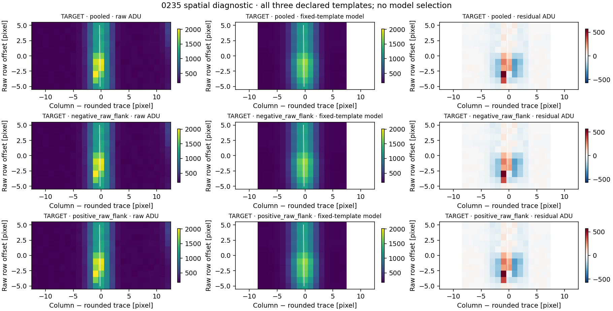

# V2E2-0235 spatial-support result

The fixed empirical trace template leaves a larger, more concentrated residual in the target window than in any of the eight coordinate-selected controls, consistently under all three declared templates. The mismatch is **mainly within the fixed ±3-pixel trace band**: only 15.5–16.0% of target residual L1 lies outside it. The maps show a compact mixed-sign residual near the trace, concentrated toward negative raw-row offsets. This quantifies a local shape mismatch; it does not establish charge-deposit, photon or mixed origin. **V2E2-0235 remains U.**

The one-shot analysis completed at 2026-11-02T12:38:45.637193Z after public freeze `8193e79cefabc32ec4a08230b2f77468905a5eee`. All 232 declared training rows were usable, both 116-row flank subsets passed, and all **27 template/window combinations and 297 row fits** completed without blocked slots. Exactly 8,275 native pixels were retained with their coordinates. The target, controls and background pixels were excluded from training by the frozen row partition.

## Target under all three fixed templates

L1 means the sum of absolute model residuals. Off-trace means 3 < |d| ≤ 8 pixels, where d is native column minus the unrounded inherited trace. The analysis has 66 on-trace and 110 off-trace pixels in every window; mean absolute residual per pixel is included because these areas differ. No template was chosen after the result.

| Template | Total residual L1 (ADU) | Off-trace L1 | Largest pixel / L1 | Mean absolute residual, on / off (ADU) | Positive-residual centroid Δcolumn / Δrow (pixel) |
|---|---:|---:|---:|---:|---:|
| Pooled | 8633.1 | 15.70% | 6.52% | 110.27 / 12.32 | -0.354 / -1.445 |
| Negative raw flank | 8445.3 | 15.55% | 6.62% | 108.06 / 11.94 | -0.295 / -1.455 |
| Positive raw flank | 8902.7 | 15.99% | 6.39% | 113.32 / 12.94 | -0.439 / -1.428 |

For the pooled template, the signed residual totals are **+2,903.6 ADU positive and −5,729.5 ADU negative**, giving −2,825.9 ADU net. Its L1 centroid is Δcolumn −0.087 pixel and Δrow −1.130 pixels. Thus the residual is not an isolated positive excess: the fitted profile has both excesses and deficits. The positive-residual centroid is a descriptive location of positive model discrepancies, not a photon or charge centroid.

## Every held-out control

Each template cell reports **total residual L1 in ADU / off-trace L1 percentage**. Control centers are relative raw-row coordinates; each window contains its center ±5 rows. Exact metrics, signed sums and centroids for all 27 rows are retained in [WINDOW_METRICS.json](results/WINDOW_METRICS.json) and [CSV](results/WINDOW_METRICS.csv).

| Window | Relative raw-row center | Pooled | Negative raw flank | Positive raw flank |
|---|---:|---:|---:|---:|
| TARGET | +0 | 8633.1 / 15.70% | 8445.3 / 15.55% | 8902.7 / 15.99% |
| C01 | -255 | 2758.5 / 36.97% | 2585.5 / 36.91% | 3043.5 / 36.70% |
| C02 | -205 | 4024.9 / 29.74% | 3858.5 / 30.29% | 4261.2 / 29.33% |
| C03 | -155 | 3771.5 / 29.09% | 3633.4 / 29.82% | 3963.7 / 28.54% |
| C04 | -105 | 3896.6 / 30.31% | 3740.1 / 30.57% | 4128.0 / 30.06% |
| C05 | +106 | 3120.6 / 34.58% | 2984.9 / 35.15% | 3315.6 / 33.91% |
| C06 | +156 | 2574.9 / 31.67% | 2476.4 / 32.24% | 2727.0 / 31.21% |
| C07 | +206 | 3382.9 / 36.57% | 3273.6 / 37.19% | 3542.4 / 35.90% |
| C08 | +256 | 2249.8 / 38.81% | 2163.7 / 39.95% | 2377.3 / 37.64% |

Under every template, **0/8 controls** reach the target’s total residual L1, largest-pixel L1 concentration or positive residual sum. Conversely, **8/8 controls** have a higher off-trace L1 fraction than the target. These are the predeclared [empirical counts](results/EMPIRICAL_CONTEXT.json), not p-values. In the pooled result, control largest-pixel fractions are 2.08–2.72%, versus target 6.52%; control off-trace fractions are 29.09–38.81%, versus target 15.70%. Concentration near the trace therefore remains distinct from a clean fit to its empirical spatial shape.

| Window | Pooled fitted amplitude sum (ADU) | Median background (ADU) | Median outer MAD proxy (ADU) |
|---|---:|---:|---:|
| TARGET | 50360.9 | 198.0 | 14.08 |
| C01 | 45795.1 | 197.5 | 11.86 |
| C02 | 46533.3 | 200.5 | 13.34 |
| C03 | 46088.3 | 201.5 | 19.27 |
| C04 | 45095.2 | 199.5 | 14.08 |
| C05 | 35663.9 | 196.0 | 12.60 |
| C06 | 38475.6 | 199.0 | 15.57 |
| C07 | 37265.5 | 200.0 | 16.31 |
| C08 | 33338.7 | 199.5 | 19.27 |

The controls are selected by coordinate and are not brightness-matched: their pooled amplitude sums span about 33,339–46,533 ADU, while the target is 50,361 ADU. Spectral variation, amplitude and local template mismatch limit direct residual comparisons. The MAD proxy is descriptive and is not used as a calibrated uncertainty or significance.

## Maps and coordinate convention

[All target/control maps](results/figures_readable/ALL_WINDOWS_POOLED.png) retain all eight controls on the same residual color scale. [Templates and control context](results/figures_readable/TEMPLATES_AND_CONTROL_CONTEXT.png) display all three sensitivity templates and the fixed L1 metrics. All six original/readable figure files were visually inspected; the three readable versions have complete labels and all declared panels.

The map horizontal axis is native column minus the **rounded** per-row trace location. The white curve marks the **unrounded** inherited trace; scientific band boundaries and centroids use true offset d from that curve. The vertical axis is raw row minus each window center. Lower image rows are negative raw-row offsets. Images use native pixels without smoothing; white regions outside the fitted aperture are not missing observations. Raw/model pairs share a scale within each window, while residual maps share one symmetric scale across every window and template.

The original frozen plot script produced overlapping long y-axis labels. A separate [layout-only renderer](results/render_layout_only.py) shortened those labels while retaining the exact data, scales, windows and templates. The frozen script and original figures remain unchanged. [READABLE_PLOT_INDEX.json](results/READABLE_PLOT_INDEX.json) records the amendment and image hashes; the template/control-context image is byte-identical to its original.

## Verification and limits

The [independent numerical audit](../independent_audit/NUMERICAL_AUDIT.json) passed **13,779 checks and 86,442 scalar comparisons**. It decoded the 8,275 selected pixels independently from FITS bytes and reconstructed all three templates, 297 fits, 27 window records and empirical counts without importing production functions. Maximum model/residual discrepancy was 2.28×10⁻¹⁰ ADU; maximum window-metric discrepancy was 1.36×10⁻¹⁰. All 79 frozen source hashes and the original numeric output manifest remain exact.

The full observed [native pixel matrix](results/SELECTED_NATIVE_PIXELS.npz), fitted [spatial arrays](results/SPATIAL_ARRAYS.npz), [training dispositions](results/TRAINING_DISPOSITIONS.json), [signed templates](results/TEMPLATES.json) and [per-row diagnostics](results/ROW_METRICS.csv) are preserved. The original raw/ancillary identities, order 50 / native pixel 956, orientation and trace polynomial were not changed.

Background asymmetry remains material: every target row has a higher positive-outer median than negative-outer median (positive 202–232 ADU; negative 186–196 ADU). The known fiber-B order-49 FP trace is roughly +16.35 pixels away, so its wings may affect the +9…+12 background band. This asymmetry does not prove FP contamination, and no correction or alternative background fit was introduced. Fiber B is not sky.

This is a post-hoc diagnostic of one already ambiguous event with eight dependent, same-order controls. The empirical template can mismatch the real profile through fractional sampling, training interpolation, curvature, spectral structure or instrumental response; both flank-only sensitivities are shown without selecting a winner. Raw ADU data have no modeled gain/read-noise/Poisson/bias/flat uncertainty. Neither residual fractions nor control ranks identify physical origin or supply calibrated significance. The historical extraction, both temporal phases and all U labels remain unchanged.
