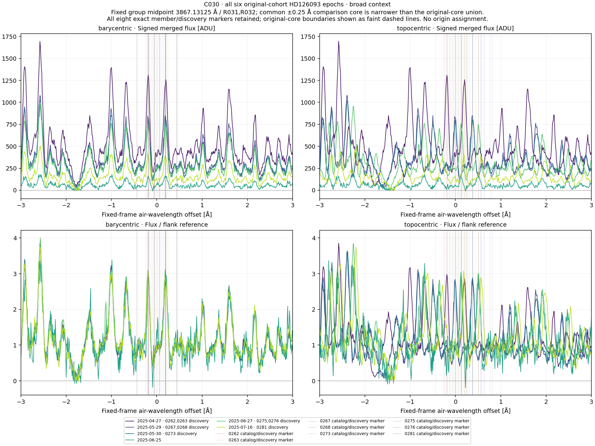
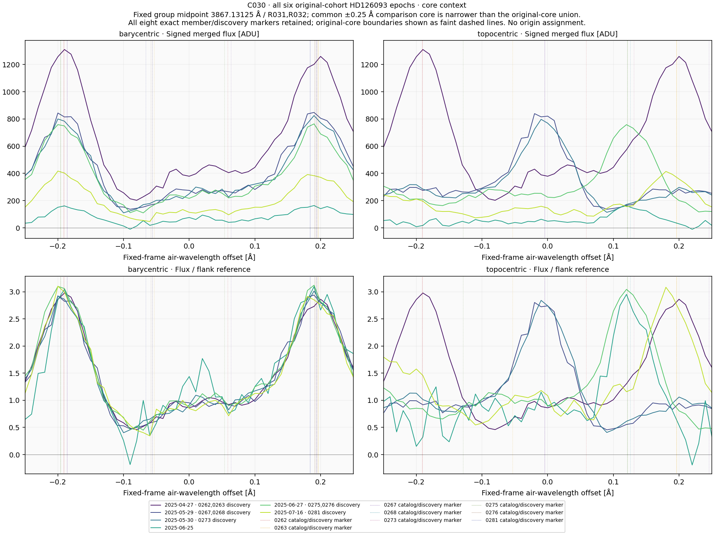
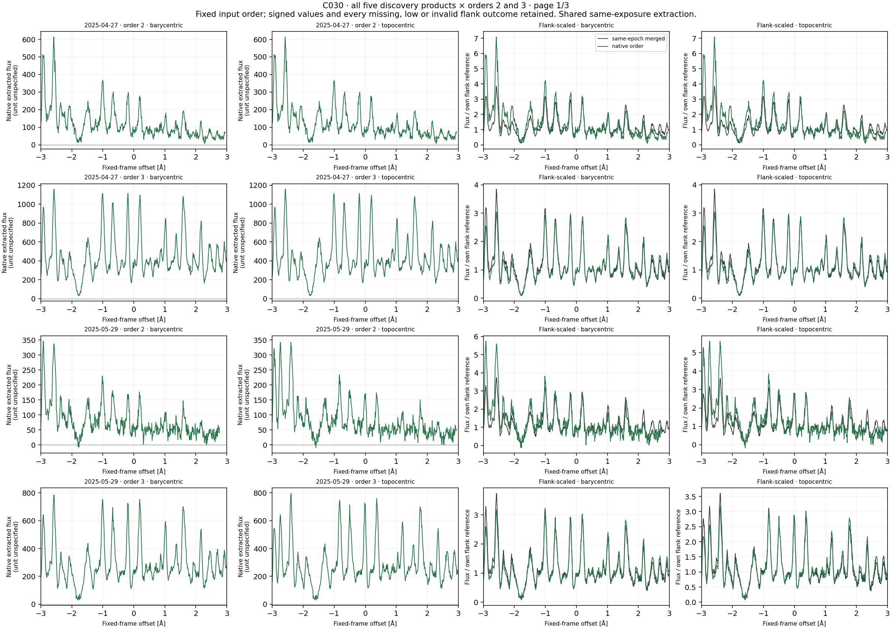
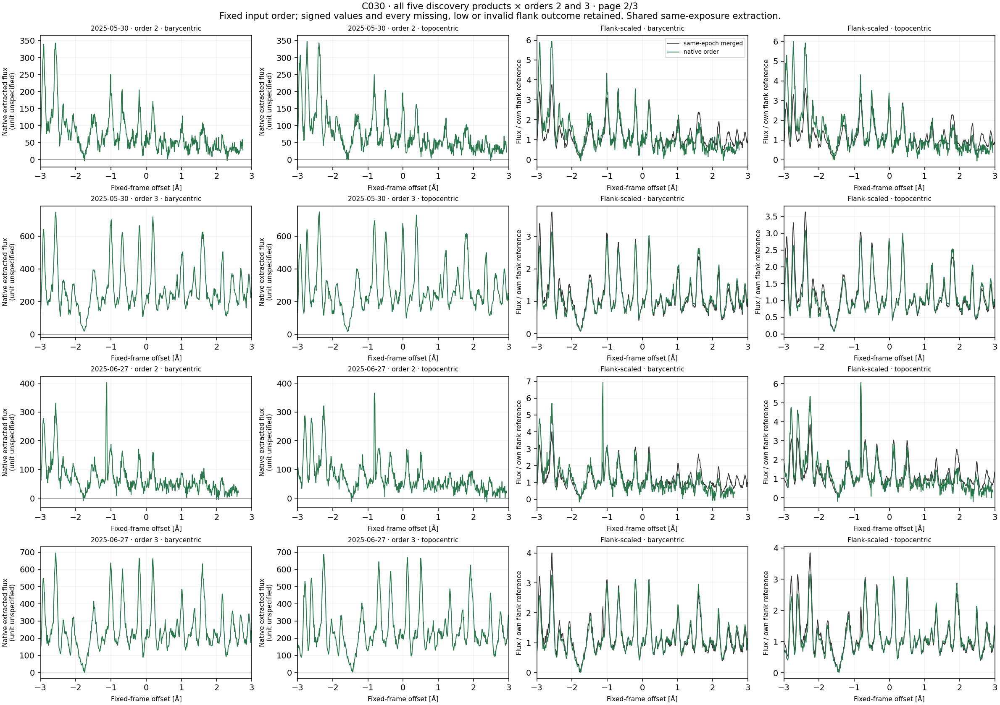
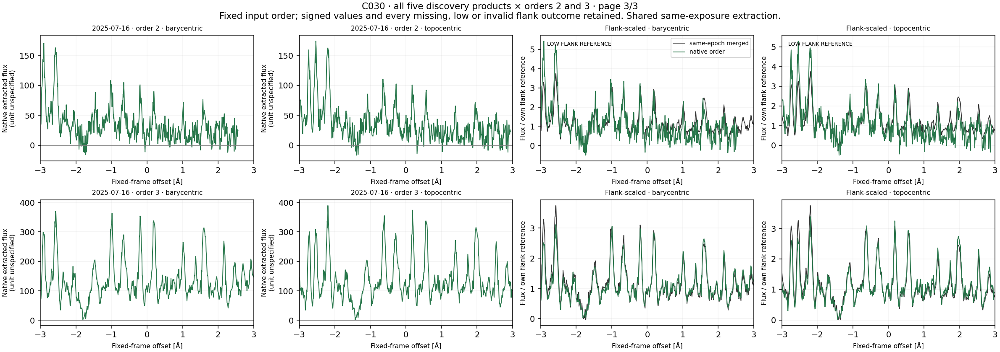
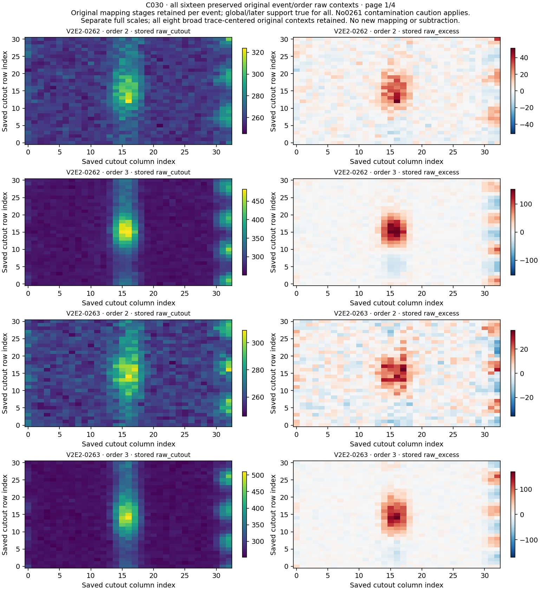
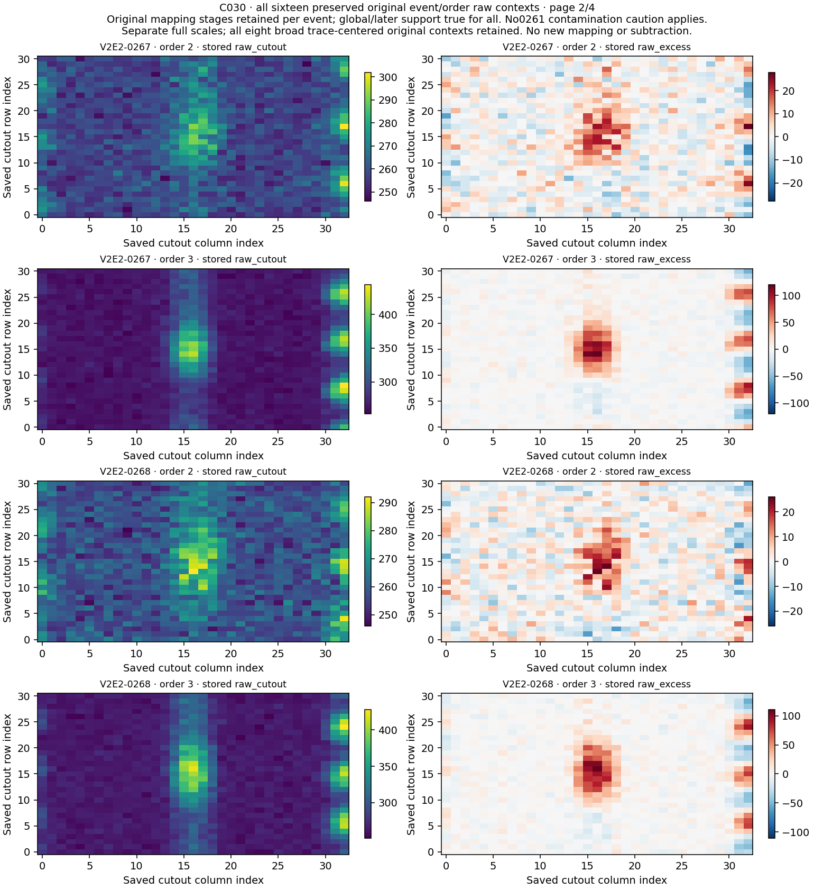
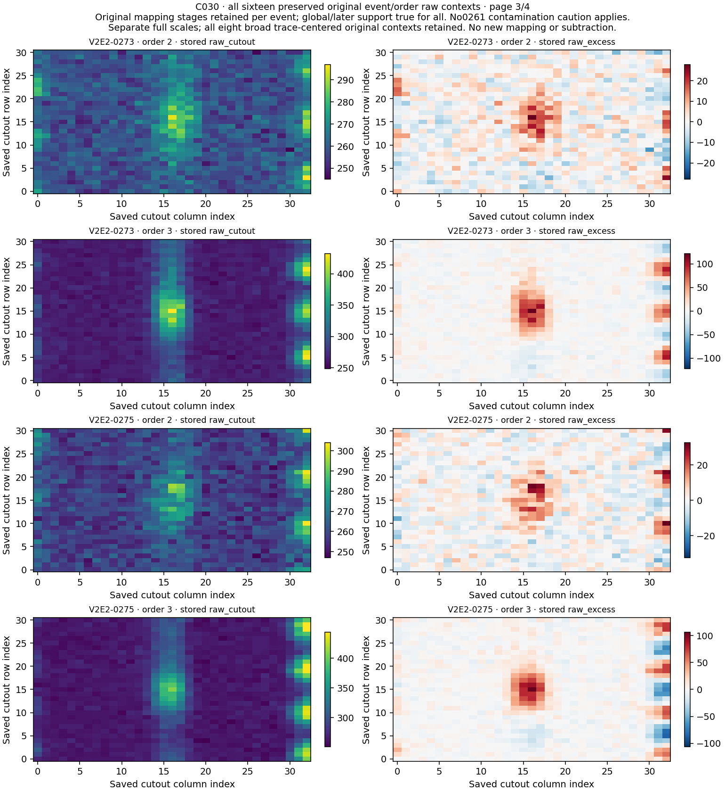
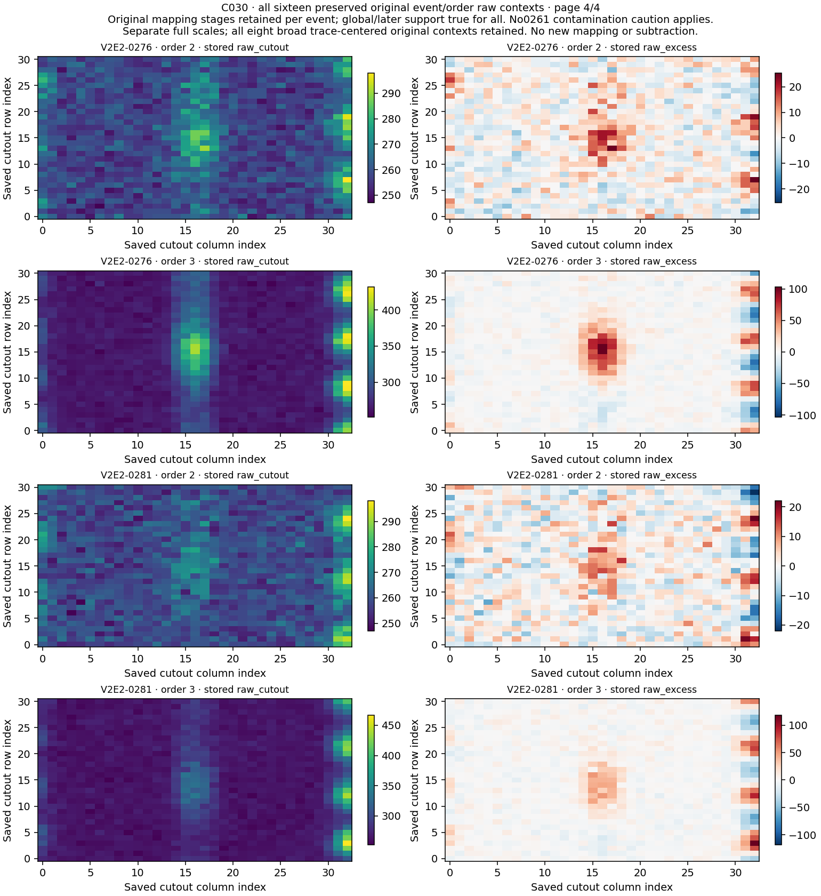

# C030 / HD126093 common-context follow-up

**Eight records, five discovery references and six existing observations are complete: 32 profiles and 160 comparisons. All eight records remain U; no qualified laser candidate or physical-origin assignment.**

The separate scalar reconstruction passes 930 checks over 127,836 values. All 70 frozen source bindings remain exact. All 64 NPZ containers decode, and all 9 fixed figures were viewed and decoded. Separate arithmetic and visual review were performed by the same assistant,without independent human or separate-agent review.

## Result and scope

In each region, 24 of 25 directed nonself comparisons have higher barycentric raw Pearson; all 25 have lower barycentric normalized RMS. The 25 rows represent 15 unordered observation relationships with 10 reciprocal discovery pairs,using only six observations. Twenty identical-product self rows remain labelled across frames/regions. Native/merged comparisons share exposures and extractions. These repeated relationships are not independent confirmations.

| Region | Frame | Nonself rows | r min | r median | r max | RMS min | RMS median | RMS max |
| --- | --- | --- | --- | --- | --- | --- | --- | --- |
| core | barycentric | 25 | 0.90802109 | 0.98755251 | 0.99124272 | 0.11420473 | 0.14260002 | 0.35790824 |
| core | topocentric | 25 | -0.36409316 | -0.2046711 | 0.98063231 | 0.12168467 | 1.016537 | 1.2494732 |
| broad_pattern | barycentric | 25 | 0.89878925 | 0.97407962 | 0.98922988 | 0.089883537 | 0.14004741 | 0.28954465 |
| broad_pattern | topocentric | 25 | -0.1013913 | 0.010043717 | 0.9812968 | 0.12295527 | 0.87243657 | 0.95605868 |

The complete exceptions are retained rather than described as universal barycentric preference:

| Region | Quantity | Observation | Reference | Barycentric | Topocentric |
| --- | --- | --- | --- | --- | --- |
| core | raw_pearson | 2025-06-25 | 2025-06-27 | 0.90802109 | 0.91162027 |
| broad_pattern | raw_pearson | 2025-06-25 | 2025-06-27 | 0.89878925 | 0.90057658 |

The broader pattern aligns more closely in barycentric coordinates in most of this fixed diagnostic. This is consistent with persistent spectral structure but does not establish an astrophysical,artificial,detector or charge origin. The fixed template width from earlier work is not a measured intrinsic linewidth.

## Original cores and fixed common geometry

The metadata midrange 3867.13125 Å defines common core [3866.88125, 3867.38125] and context [3864.13125, 3870.13125]. Every original member core differs from this common core; their union is [3866.685, 3867.5775]. Parts of original cores occur in the surrounding region. The 160 comparison rows therefore do not claim full-original-core correlations.

| Record | Discovery | Resolution group | Original center Å | Original core Å | Offset from group Å |
| --- | --- | --- | --- | --- | --- |
| V2E2-0262 | 2025-04-27 | R031 | 3866.94 | [3866.69, 3867.19] | -0.19125 |
| V2E2-0263 | 2025-04-27 | R032 | 3867.3275 | [3867.0775, 3867.5775] | 0.19625 |
| V2E2-0267 | 2025-05-29 | R031 | 3866.9449999999997 | [3866.6949999999997, 3867.1949999999997] | -0.18625 |
| V2E2-0268 | 2025-05-29 | R032 | 3867.3250000000003 | [3867.0750000000003, 3867.5750000000003] | 0.19375 |
| V2E2-0273 | 2025-05-30 | R032 | 3867.3250000000003 | [3867.0750000000003, 3867.5750000000003] | 0.19375 |
| V2E2-0275 | 2025-06-27 | R031 | 3866.935 | [3866.685, 3867.185] | -0.19625 |
| V2E2-0276 | 2025-06-27 | R032 | 3867.3225 | [3867.0725, 3867.5725] | 0.19125 |
| V2E2-0281 | 2025-07-16 | R032 | 3867.315 | [3867.065, 3867.565] | 0.18375 |

The [member-core support table](../independent_audit/MEMBER_CORE_SUPPORT.json) retains all 256 profile/member slots. Each original member core has 50 nominal centers on this fixed 0.01 Å grid; all 50 are finite in raw and normalized data in every slot. This support-only count adds no fits,correlations or significance. Topocentric original markers/bounds use each discovery BERV; they are not fitted feature locations in other observations.

## Coverage, signed values and reference quality

All 32 pooled flank references are positive and usable; 2frame-profile rows are explicitly low relative to their descriptive first-difference proxy. There are 0 raw-only and 0 blocked profiles. All 160 Pearson and 160 scaled-RMS values meet their own support gates. There are 22 full 601-center profiles and 10 partial profiles; no extrapolation is used.

Order 2 is geometrically truncated in all five products/both frames. Its barycentric finite counts are 595, 577, 576, 563, 557 in date order; all topocentric counts are 595. The common core remains fully covered; order 2 native-to-merged surrounding comparisons retain 506–544 common samples,above the fixed 440 gate. Positive-flank finite source counts remain 121–164 for order 2,above the 20 per-side requirement. Partial geometric coverage does not imply invalid normalization.

July 16 order 2 is explicitly LOW FLANK REFERENCE in both frames. All signed nonpositive samples remain: 12 frame-profile rows from five observing products contain nonpositive originals. No clipping,sign reversal,background fit or moved flank is applied. Positive finite ERR coverage is zero; the merged header declares ERR unavailable. Normalization and noise proxies are descriptive,not calibrated SNR,significance,false-alarm probability,physical flux ratio or survey sensitivity.

| Source | Date | Order | Frame | Finite grid | Left finite | Right finite | Pooled reference | Low | Nonpositive original fraction |
| --- | --- | --- | --- | --- | --- | --- | --- | --- | --- |
| merged | 2025-04-27 | - | barycentric | 601 | 150 | 150 | 439.92433 | False | 0 |
| merged | 2025-04-27 | - | topocentric | 601 | 150 | 150 | 439.92433 | False | 0 |
| merged | 2025-05-29 | - | barycentric | 601 | 150 | 150 | 288.42337 | False | 0 |
| merged | 2025-05-29 | - | topocentric | 601 | 150 | 150 | 299.40695 | False | 0 |
| merged | 2025-05-30 | - | barycentric | 601 | 150 | 150 | 273.84073 | False | 0 |
| merged | 2025-05-30 | - | topocentric | 601 | 150 | 150 | 280.50458 | False | 0 |
| merged | 2025-06-25 | - | barycentric | 601 | 150 | 150 | 52.975338 | False | 0.01 |
| merged | 2025-06-25 | - | topocentric | 601 | 150 | 150 | 54.89201 | False | 0.01 |
| merged | 2025-06-27 | - | barycentric | 601 | 150 | 150 | 244.71835 | False | 0 |
| merged | 2025-06-27 | - | topocentric | 601 | 150 | 150 | 249.00264 | False | 0 |
| merged | 2025-07-16 | - | barycentric | 601 | 150 | 150 | 134.42886 | False | 0.0033333333 |
| merged | 2025-07-16 | - | topocentric | 601 | 150 | 150 | 134.44814 | False | 0.0033333333 |
| native | 2025-04-27 | 2 | barycentric | 595 | 162 | 164 | 86.605732 | False | 0 |
| native | 2025-04-27 | 2 | topocentric | 595 | 162 | 164 | 86.605732 | False | 0 |
| native | 2025-04-27 | 3 | barycentric | 601 | 132 | 136 | 380.5835 | False | 0 |
| native | 2025-04-27 | 3 | topocentric | 601 | 132 | 136 | 380.5835 | False | 0 |
| native | 2025-05-29 | 2 | barycentric | 577 | 162 | 143 | 60.357933 | False | 0.0094043887 |
| native | 2025-05-29 | 2 | topocentric | 595 | 162 | 164 | 60.995222 | False | 0.009118541 |
| native | 2025-05-29 | 3 | barycentric | 601 | 133 | 137 | 247.95882 | False | 0 |
| native | 2025-05-29 | 3 | topocentric | 601 | 132 | 136 | 251.16344 | False | 0 |
| native | 2025-05-30 | 2 | barycentric | 576 | 163 | 143 | 57.699852 | False | 0.0062695925 |
| native | 2025-05-30 | 2 | topocentric | 595 | 162 | 164 | 57.844004 | False | 0.0060790274 |
| native | 2025-05-30 | 3 | barycentric | 601 | 133 | 136 | 236.88409 | False | 0 |
| native | 2025-05-30 | 3 | topocentric | 601 | 132 | 136 | 242.88758 | False | 0 |
| native | 2025-06-27 | 2 | barycentric | 563 | 163 | 128 | 58.089745 | False | 0.0096153846 |
| native | 2025-06-27 | 2 | topocentric | 595 | 162 | 164 | 60.36808 | False | 0.009118541 |
| native | 2025-06-27 | 3 | barycentric | 601 | 133 | 137 | 213.16819 | False | 0 |
| native | 2025-06-27 | 3 | topocentric | 601 | 132 | 136 | 216.99599 | False | 0 |
| native | 2025-07-16 | 2 | barycentric | 557 | 163 | 121 | 31.387113 | True | 0.05834684 |
| native | 2025-07-16 | 2 | topocentric | 595 | 162 | 164 | 32.860865 | True | 0.054711246 |
| native | 2025-07-16 | 3 | barycentric | 601 | 133 | 137 | 118.86164 | False | 0 |
| native | 2025-07-16 | 3 | topocentric | 601 | 132 | 137 | 115.07407 | False | 0 |

## All discovery references

| Reference date | Region | Frame | Other observations | Median raw r | Median scaled RMS |
| --- | --- | --- | --- | --- | --- |
| 2025-04-27 | core | barycentric | 5 | 0.98939542 | 0.12241417 |
| 2025-05-29 | core | barycentric | 5 | 0.98461742 | 0.14733227 |
| 2025-05-30 | core | barycentric | 5 | 0.98755251 | 0.12772386 |
| 2025-06-27 | core | barycentric | 5 | 0.98755251 | 0.14506692 |
| 2025-07-16 | core | barycentric | 5 | 0.98740672 | 0.14260002 |
| 2025-04-27 | core | topocentric | 5 | -0.18959 | 1.1947049 |
| 2025-05-29 | core | topocentric | 5 | -0.23070891 | 1.016537 |
| 2025-05-30 | core | topocentric | 5 | -0.26517629 | 1.0299512 |
| 2025-06-27 | core | topocentric | 5 | -0.17548177 | 1.0530722 |
| 2025-07-16 | core | topocentric | 5 | 0.034820678 | 0.96629272 |
| 2025-04-27 | broad_pattern | barycentric | 5 | 0.98015484 | 0.12228838 |
| 2025-05-29 | broad_pattern | barycentric | 5 | 0.97645374 | 0.13500155 |
| 2025-05-30 | broad_pattern | barycentric | 5 | 0.97923211 | 0.12682695 |
| 2025-06-27 | broad_pattern | barycentric | 5 | 0.97645374 | 0.13500155 |
| 2025-07-16 | broad_pattern | barycentric | 5 | 0.97045949 | 0.14739813 |
| 2025-04-27 | broad_pattern | topocentric | 5 | 0.11377456 | 0.84259171 |
| 2025-05-29 | broad_pattern | topocentric | 5 | -0.0032843421 | 0.90363714 |
| 2025-05-30 | broad_pattern | topocentric | 5 | -0.0038268964 | 0.91177036 |
| 2025-06-27 | broad_pattern | topocentric | 5 | 0.14955749 | 0.8231268 |
| 2025-07-16 | broad_pattern | topocentric | 5 | 0.11377456 | 0.84259171 |

## Original raw morphology and mapping history

All 16 original event/order raw containers remain byte exact. All eight original primary/secondary/adopted chains remain U/U/U. Broad diffuse trace-centered structure appears in both orders,with differing/noisier order2contexts. No 0261-specific off-trace contamination caution is transferred. Original local/baseline support is true for 0267/0268/0273, false for 0262/0263/0275/0276/0281; global and later support is true throughout. These stages remain separate,and no original extraction or registration is rerun.

| Record | Original primary | Original secondary | Adopted | Secondary evidence |
| --- | --- | --- | --- | --- |
| V2E2-0262 | U | U | U | o2 and o3 both show a broad native enhancement and a smooth trace-confined excess patch; no isolated charge morphology explains the shared broad structure. |
| V2E2-0263 | U | U | U | o2/o3 show rounded broad native peaks and trace-centered, multi-row raw patches in both orders. Physical origin remains unresolved. |
| V2E2-0267 | U | U | U | o2/o3 have broad somewhat asymmetric multi-sample native enhancements with centered raw patches. Neither order supplies a clear isolated charge explanation. |
| V2E2-0268 | U | U | U | o2/o3 show broad rounded native features and smooth trace-centered raw excess; the broad structure remains unresolved. |
| V2E2-0273 | U | U | U | o2/o3 show a broad centered native enhancement and diffuse trace-following raw patches in both orders. |
| V2E2-0275 | U | U | U | o2/o3 display a coherent broad native enhancement and trace-centered raw patches, preserving unresolved broad spectral structure. |
| V2E2-0276 | U | U | U | o2/o3 display a broad rounded enhancement and diffuse centered excess in both covering orders; origin is unresolved. |
| V2E2-0281 | U | U | U | o2/o3 show broad weak structure with noisier narrow substructure in o2. Enlargements show noisy multi-row trace-centered excess in o2 and a clearer broad centered patch in o3, without a clear detached charge deposit. |

## Shared inputs and prior exposure

The exact [source-index audit](../independent_audit/SOURCE_PIXEL_DEPENDENCY_AUDIT.json) finds 12 shared C029 source windows:all six merged and six April/May native/order windows. Four additional June 27/July 16 native/order windows use existing observations. Full-source hashes and original index intersections are verified without opening prior C029 arrays. All current original member cores were already inside the C029 broad window; prior epoch/raw values were already exposed. This is dependent follow-up,not blind validation or new observing time.

| Kind | Date | Order | Shared original indices |
| --- | --- | --- | --- |
| merged | 2025-04-27 | - | 501 |
| merged | 2025-05-29 | - | 520 |
| merged | 2025-05-30 | - | 520 |
| merged | 2025-06-25 | - | 532 |
| merged | 2025-06-27 | - | 533 |
| merged | 2025-07-16 | - | 539 |
| native | 2025-04-27 | 2 | 552 |
| native | 2025-04-27 | 3 | 448 |
| native | 2025-05-29 | 2 | 572 |
| native | 2025-05-29 | 3 | 465 |
| native | 2025-05-30 | 2 | 573 |
| native | 2025-05-30 | 3 | 465 |

## Validation and preservation

The [public prospective method receipt](../PROSPECTIVE_PUBLICATION_RECEIPT.json) verifies 24 files exactly before the current arithmetic. Byte/header custody passes 3,344 checks, including 360 fresh native header-order records. Compact synthetic checking passes 132 checks; the separate scalar preflight passes 1,449 checks over 73,014 values. Established sampling/profile/comparison functions remain AST-identical to C015.

Observed reconstruction passes 930 checks over 127,836 values. Signed input flux,original indices,ERR and full-source spacing match exactly; maximum reconstructed raw-profile difference is 3.08e-09, and comparison difference is 2.56e-13. All 70 frozen source bindings and every original numerical-output hash remain intact. One successful production execution; no observed variant or retry.

## Next route

The original queue selects C031 at row 66 before current values: four original records,four discovery references,six existing observations,proposed metadata midpoint 3868.1499999999996 Å. [Full next metadata](../scientific_review/NEXT_GROUP_METADATA.json). Freeze its own original/common core geometry,restore its own native/raw contexts and freshly assess every header,partial flank and reference. Do not inherit C030 coverage,quality,mapping stages or contamination flags. Completed exact routes stay closed despite physical U.

Survey totals remain 300 main exposures / 20 targets / 255148.743 seconds; V2 has 200 exposures / 669 events and unchanged codes 403 A, 46 O, 185 U, 35 M, 0 N. Qualified laser count remains 0. Rubin remains STOPPED_LIMITED_FEASIBILITY_MINIMUM50_UNMET with 2 primary / 4 secondary (including primary) from 190 objects. No background search is configured.

## All fixed figures

Six reused observations and all original member markers/edges in broad context,both frames.

Fixed common comparison core. Original member cores extend beyond it; use broad panel and explicit bounds for full member context.

April 27 and May 29 native orders2/3; partial order 2 broad coverage retained.

May 30 and June 27 native orders2/3; no source-order substitution.

July 16 native orders2/3; LOW FLANK REFERENCE explicitly displayed for order 2 in both frames.

All preserved event/order raw pixels with separate full scales and original mapping/history distinctions.

All preserved event/order raw pixels with separate full scales and original mapping/history distinctions.

All preserved event/order raw pixels with separate full scales and original mapping/history distinctions.

All preserved event/order raw pixels with separate full scales and original mapping/history distinctions.

