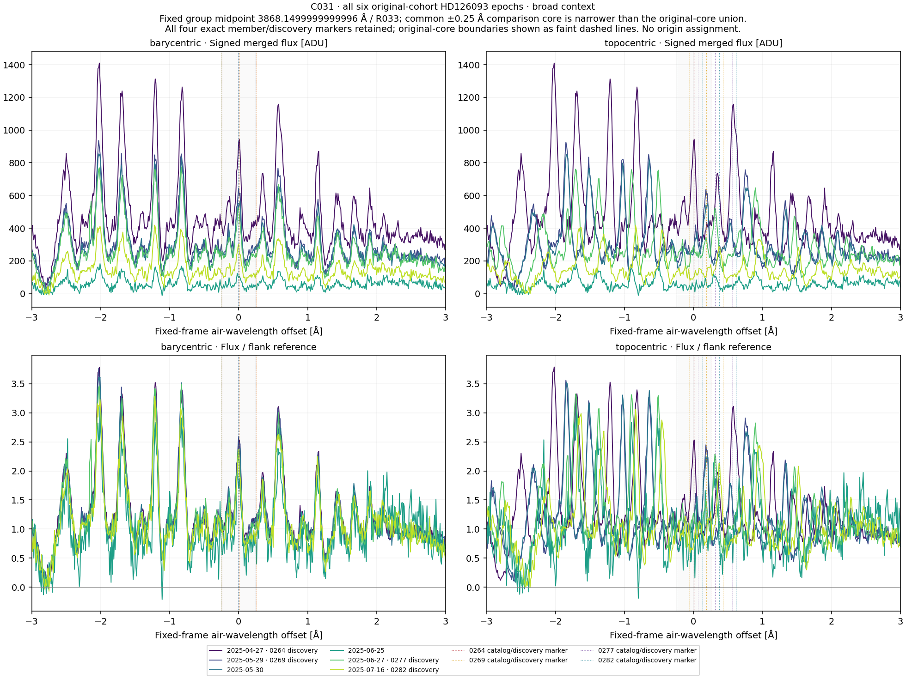
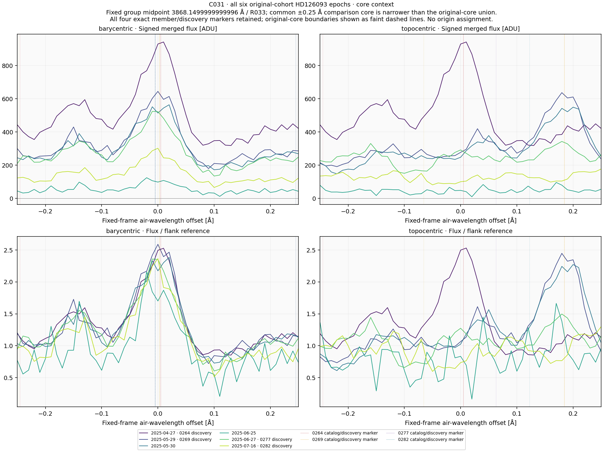
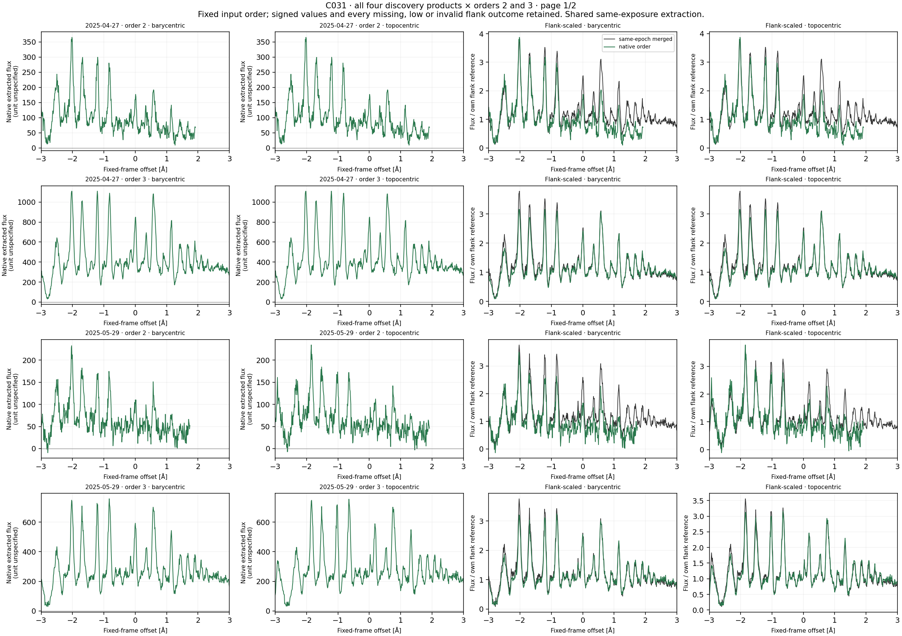
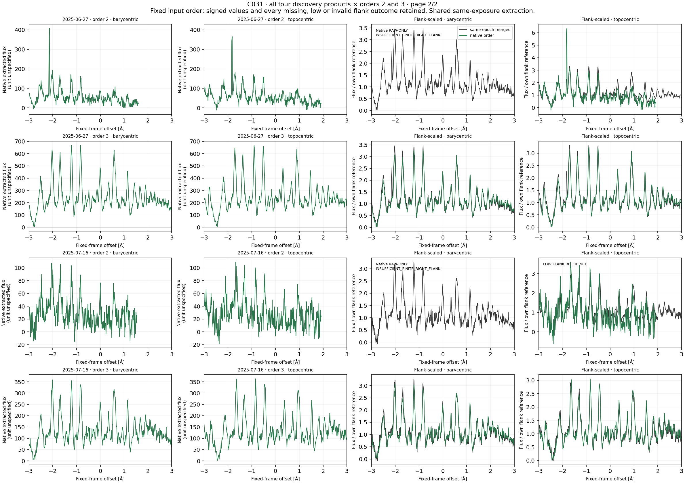
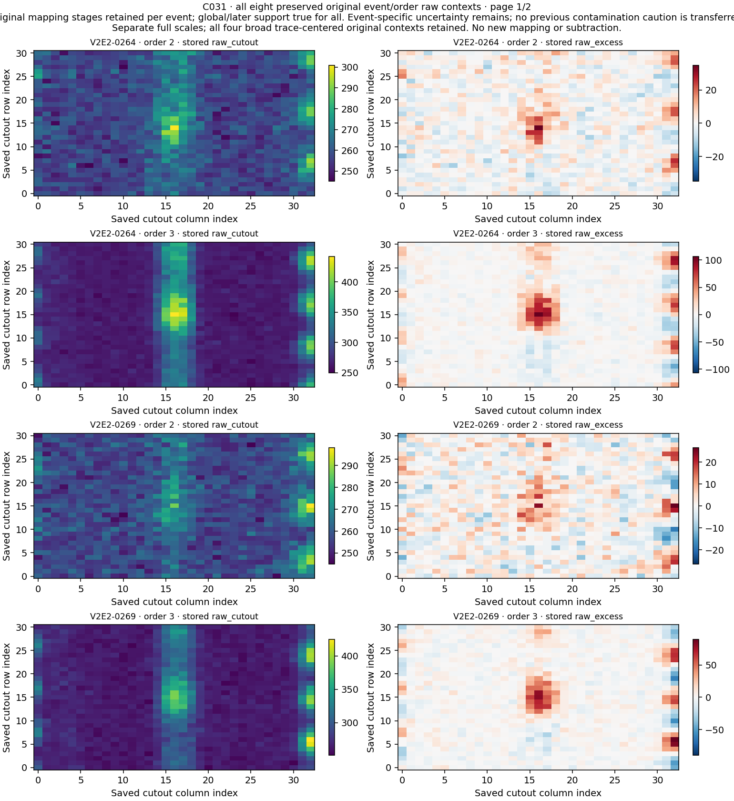
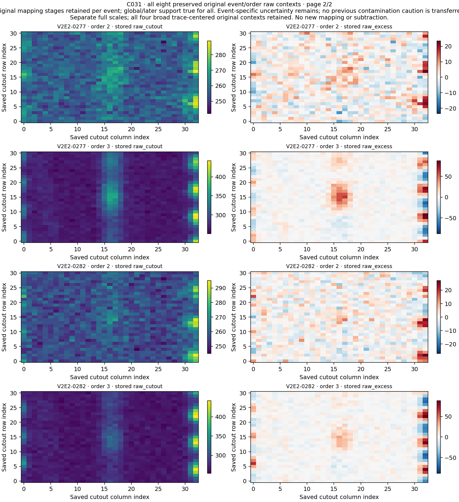

# C031 / HD126093: fixed joint context

**All four original records remain U. No qualified laser candidate or physical origin is established.**

Four discovery references and six existing April–July 2025 observations produced 28 profiles and 128 comparisons. The common midpoint is 3868.1499999999996 air Å. No observations or observing time were added.

## Frame comparisons

Each row below describes 20 directed nonself comparisons. They represent 14 distinct unordered observation relationships with six reciprocal discovery pairs among only six observations. Sixteen identical-product self comparisons remain labeled separately across frames and regions.

| Region | Higher barycentric raw correlation | Lower barycentric normalized RMS |
|---|---:|---:|
| core | 19/20 | 19/20 |
| broad_pattern | 19/20 | 19/20 |

In the common core, the May 30 observation compared with the May 29 discovery has better topocentric raw correlation and normalized RMS. In the surrounding pattern, the June 25 observation compared with the June 27 discovery has better topocentric values. Both exceptions are retained; they are different directed relationships.

| Exception | Barycentric raw r | Topocentric raw r | Barycentric RMS | Topocentric RMS |
|---|---:|---:|---:|---:|
| core | 0.958910348 | 0.960717884 | 0.137300097 | 0.122856127 |
| broad_pattern | 0.834510869 | 0.841911762 | 0.387308749 | 0.363901810 |

The fixed pattern generally aligns better barycentrically, but this dependent descriptive result does not identify its physical cause. No stellar radial velocity, center, lag, width, continuum, background or mask was fitted.

## Coverage and signed references

8 order-2 frame profiles retain partial broad support, with [455, 461, 475, 493] finite samples out of 601. The other 20 profiles have all 601 finite raw samples.

The June 27 and July 16 barycentric order-2 profiles have insufficient finite right-flank support and remain RAW_ONLY. Their raw cores remain available. The July 16 topocentric order-2 reference is positive but explicitly flagged LOW FLANK REFERENCE. No reference outcome is transferred between frames.

Raw Pearson is evaluable in 125/128 rows; normalized RMS in 123/128. The three unevaluable raw correlations are barycentric order-2 surrounding comparisons with 424,410 and404 common samples,below the fixed 440 gate. The two raw-only barycentric cores also lack normalized RMS. All missing results and reasons remain in the complete tables.

10 profiles retain nonpositive original samples. ERR has no positive finite support. Structured flanks and first-difference noise proxies do not establish calibrated significance, false-alarm probability, linewidth or sensitivity.

## Original member cores and raw evidence

The common ±0.25 Å core is not the union of the four original member cores. Exact original centers are 3868.1549999999997,3868.1525,3868.145 and3868.145 air Å. Every marker,boundary and own discovery BERV remains. The surrounding region can contain original-core edges.

All 112 profile/member support records are retained,with nominal counts [50]. All original cores have full finite raw support; 8 support records have no normalized samples because their parent profiles are raw-only. No extra member-specific correlation or fit was added.

All eight original event/order raw containers remain byte-exact. Original local/baseline mapping is true only for0277/order3 and0282/order3; global/later support is true for all eight. Four original U/U/U chains and event-specific noisy morphology/additional uncertainty remain. No0261-specific contamination caution transfers.

All 14 current bounded source windows share original indices with C030. The dependency audit reads prior index metadata,not prior arrays. No blind or source-pixel-independent validation is claimed.

## Validation and publication status

Input custody/header checks: 2,845 across 288 native header-order records. Compact synthetic checks: 118. Separate scalar preflight: 1,449 checks over 73,014 values. Observed reconstruction: 791 checks over 109,709 values. All 50 NPZ containers and 6 fixed scientific PNGs decode. Separate scalar implementation and visual inspection are by the same assistant;no independent human or separate-agent review.

The analysis was frozen and byte-verified in a **local Git commit before current arithmetic**. Automatic approval review blocked public GitHub disclosure. This is **not public preregistration**. The complete C031 package remains unpublished pending direct user approval. C030 PR27 was already merged and its previous work branch synchronized.

## Next original route

C033/R035 begins at original queue row 67: four records 0265/0270/0274/0279 and four own discovery references,metadata midpoint 3880.35 air Å. It was selected before C031 values by original queue order. C032 remains pending later in that order; it is not silently skipped. Restore own native/raw inputs,scan all 72 orders per product and freeze its separate method. Completed exact diagnoses remain closed despite physical U. Rubin remains limited feasibility with minimum 50 unmet.

## Fixed figures

