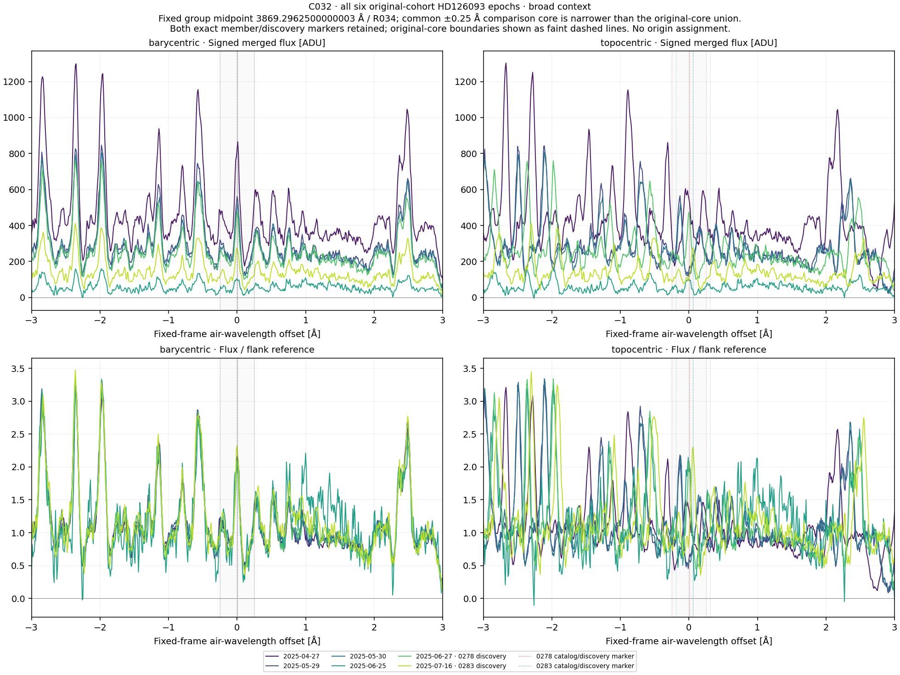
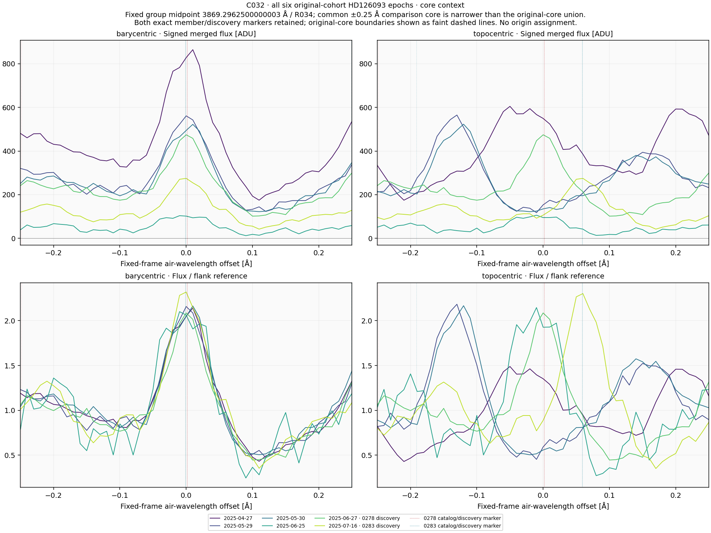
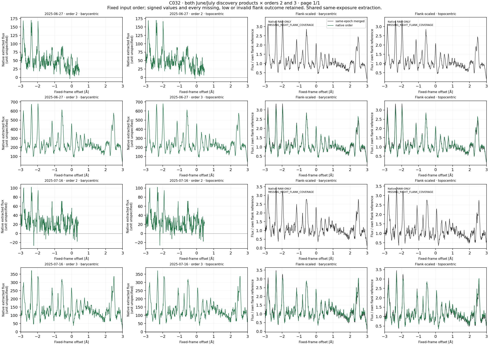
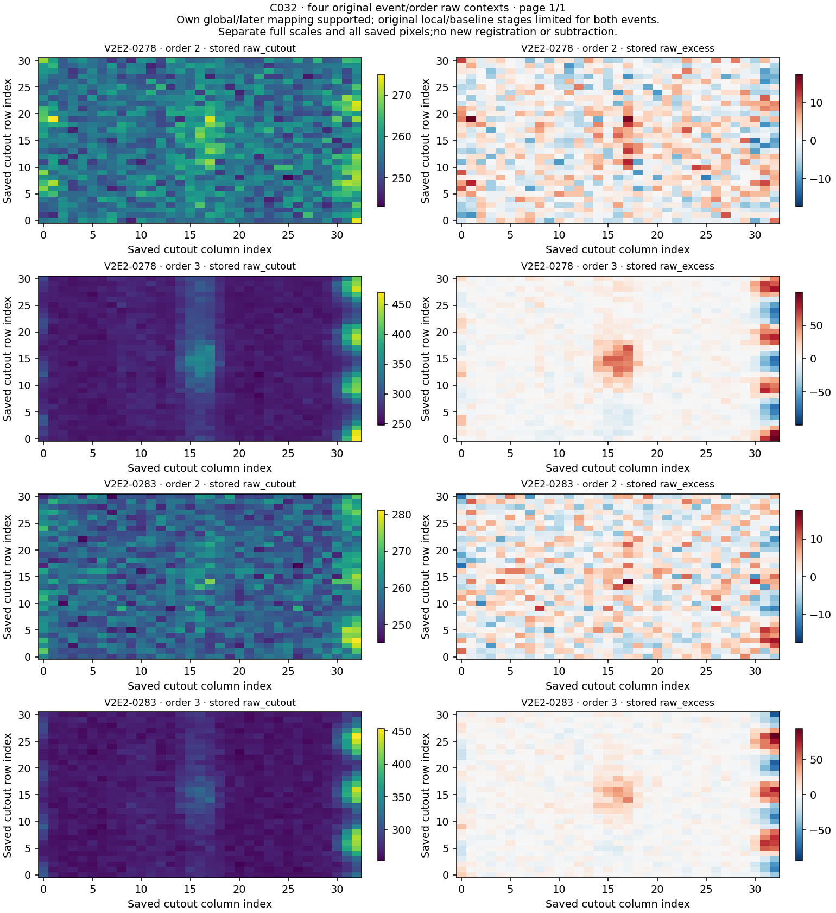

# C032 / HD126093: completed joint profile context

**Both V2E2-0278 and V2E2-0283 remain U. No qualified laser candidate or physical origin is established.**

Six existing April–July 2025 observations and two own June 27/July 16 discovery references produced **20 profiles and 64 comparison slots**. Both original centers, 3869.2975 and 3869.295 air Å, and all four original order 2/3 raw contexts remain. No observing time was added.

## Frame comparisons

| Region | Higher barycentric raw Pearson r | Lower barycentric normalized RMS |
|---|---:|---:|
| core | 10/10 | 10/10 |
| broad_pattern | 10/10 | 10/10 |

Per region and frame these 10 directed nonself rows represent **nine unordered observation relationships with one reciprocal discovery pair**, among only six observations. Eight identical-product self rows remain labeled across frames/regions. The 16 same-exposure native-to-merged rows do not add independent confirmation.

The common core and surrounding pattern both align better barycentrically. This is consistent with stable stellar spectral structure; it does not identify a transition, establish the origin of every component, measure a linewidth or qualify a laser. The two original physical U labels remain unchanged. Full values are preserved in COMPARISONS.csv/JSON.

## Missing support and raw-only profiles

| Own discovery / order | Frame | Finite raw grid samples | Finite normalized samples | Core raw correlation | Surrounding raw support |
|---|---|---:|---:|---|---:|
| 2025-06-27 / 2 | barycentric | 347 | 0 | evaluable on 51 centers | 296/550 |
| 2025-06-27 / 2 | topocentric | 347 | 0 | evaluable on 51 centers | 296/550 |
| 2025-07-16 / 2 | barycentric | 341 | 0 | evaluable on 51 centers | 290/550 |
| 2025-07-16 / 2 | topocentric | 347 | 0 | evaluable on 51 centers | 296/550 |

All four order-2 frame profiles lack the positive reference flank. They remain raw-only: **no normalized RMS is supplied for their eight rows**. Their four core correlations retain full common raw support; their four surrounding correlations fail the unchanged 440/550 support gate. Four low-reference flags are undefined, rather than false.

The other 16 profiles have 601 finite raw and normalized samples with positive references and no low-reference flag. Across all 64 slots, 60 raw correlations and 56 normalized RMS values are evaluable. Six profile/frame windows retain nonpositive original flux samples, including the noisy June 25 merged product and all order-2 contexts. No sign clipping or replacement was performed. ERR has no positive finite support.

Signed structured flanks are not certified continua. Merged flux is uncalibrated ADU; native units are unspecified and use their own positive divisors when available. Noise proxies and quality flags do not provide calibrated significance, sensitivity, physical flux ratios or linewidth.

## Original geometry, mapping and dependencies

The common midpoint is 3869.2962500000003 air Å. The June 27 discovery BERV of -18.8519268910592 km/s fixes the common topocentric anchor at 3869.539579260973 air Å. The common barycentric core differs from both original cores and is slightly narrower than their union. All 40 profile/member support records retain the original barycentric and discovery-topocentric bounds: each has 50 nominal grid centers and full raw support; eight lack normalized support because their parent profile is raw-only. No original-core-union or member-specific correlation was added.

Fresh scans covered all 144 native order headers. Both own products cover original centers in orders 2 and 3. The original global and later mapping stages are supported, while the original local and baseline stages are false for all four event/order records. These distinct stages remain unchanged. Both secondary reviews retain additional low-blue uncertainty and no recorded blend caution. All original U/U/U review chains and four raw containers remain byte exact.

Against C031, all 10 current physical source windows share original indices, totaling 4,599 source-index occurrences across the 10 windows. Against C034, the six merged sources recur but their windows are disjoint, and four native/order contexts are additional reused sources. This audit reads old index metadata only. Shared observations and already exposed epoch/raw values prevent blind or independent-validation claims.

## Validation and preserved presentation failure

Input/header checks: 331 over 144 orders. Synthetic preflight: 108 checks. Separate scalar preflight: 1,449 checks over 73,008 values. Observed reconstruction: **2,100 checks over 76,691 numerical values**. All 34 scientific NPZ containers and four final PNGs decode. The same assistant inspected all four figures; no independent agent or human review is claimed.

All 20 public method files were compared byte for byte and their Git blob identities verified before current arithmetic. All 52 frozen source bindings and numerical output hashes remain exact. The numerical production calculation ran once.

One native PNG changed and became truncated after its complete-render hash was recorded; the cause was not established. The failed bytes and original index are preserved under presentation_recovery. Rerendering with the identical frozen plot script restored **all four exact originally recorded figure hashes**, without rerunning numerical production, fitting or changing presentation rules. The recovery receipt and final decoding checks are retained.

## Exact next original route

**C035 on HD128582**, original queue row 85, singleton V2E2-0289 at 5758.2675 air Å. It uses its own six January–July 2025 observations and March 30 discovery ADP.2025-03-31T01:04:04.493, with BERV +18.1525360721304 km/s. This is a metadata handoff selected before current C032 values. Restore its own native/raw products, scan all 72 orders and freeze its own geometry and quality; do not transfer the HD126093 cohort, June anchor, order 2/3 scope or current outcomes.

C035 and C037 are the remaining unfinished routes in the original queue. Completed diagnoses stay closed despite physical U. Rubin remains STOPPED_LIMITED_FEASIBILITY_MINIMUM50_UNMET. No background science job is running.

## Fixed scientific figures

