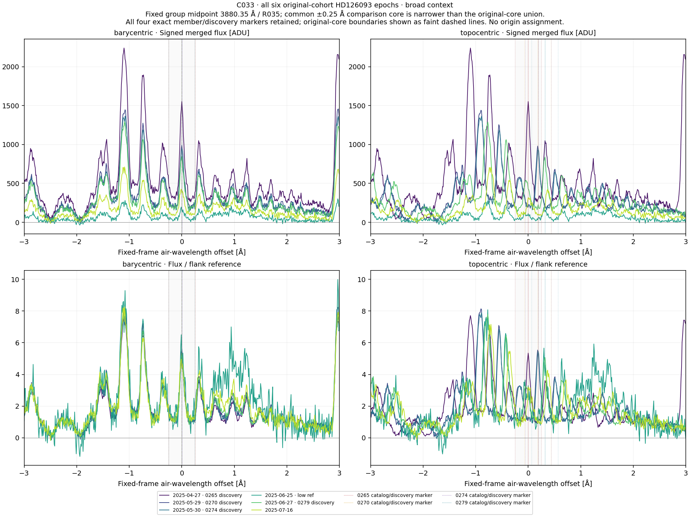
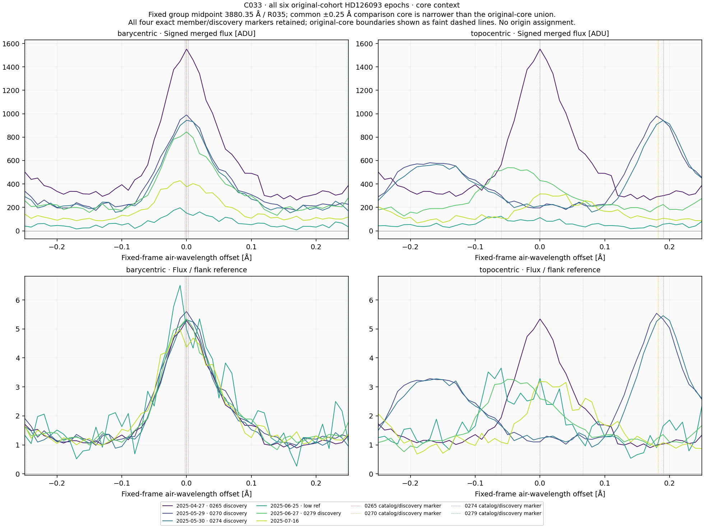
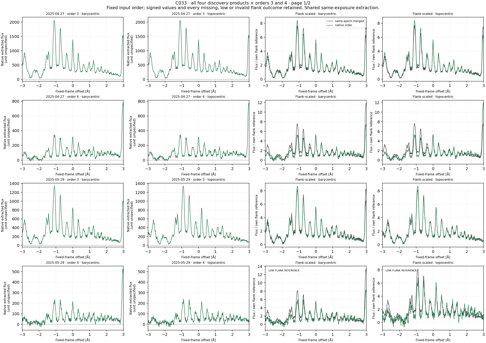
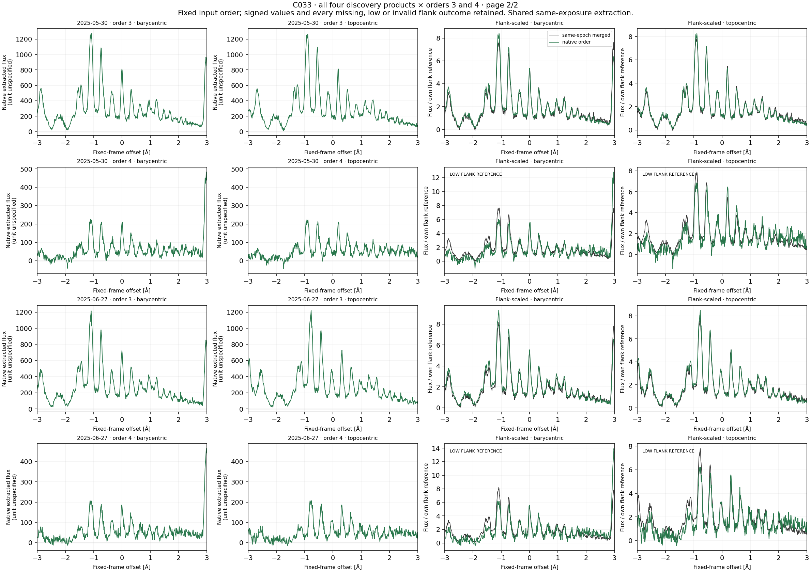
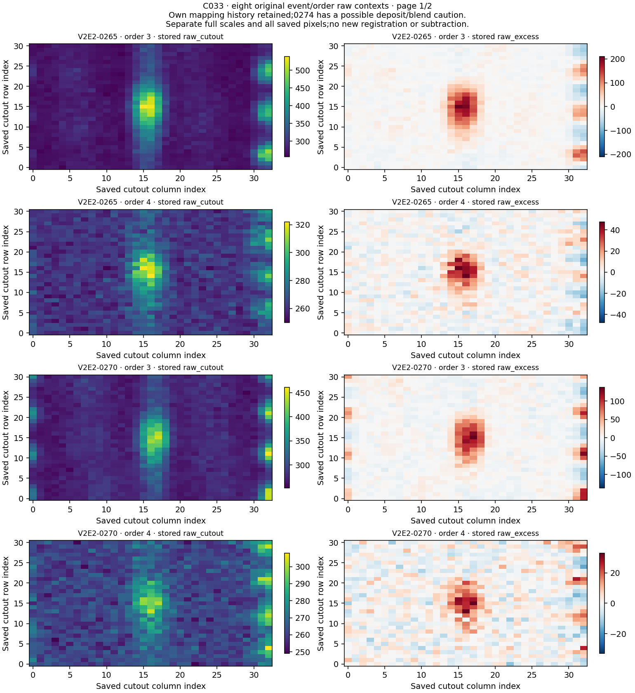
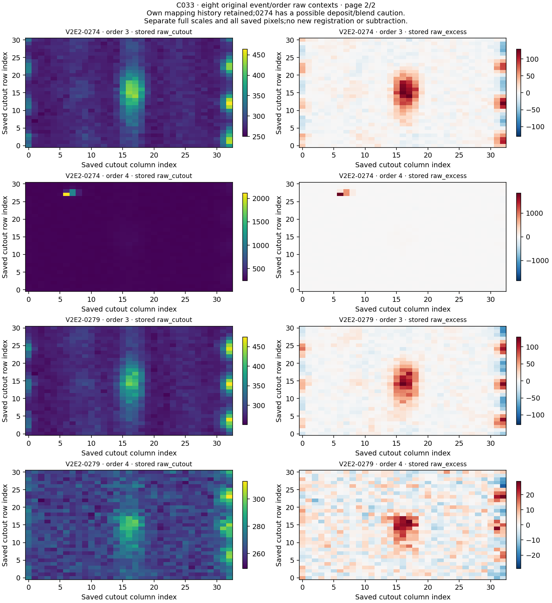

# C033 / HD126093: completed fixed joint context

**All four original records remain U. No qualified laser candidate or physical origin is established.**

Four original C033/R035 records, four own discovery references and six existing April–July 2025 observations produced 28 profiles and 128 comparisons. The fixed common midpoint is 3880.35 air Å. No observing time or new telescope observations were added.

## Frame comparisons

The table describes 20 directed nonself comparisons per region. They represent 14 distinct unordered relationships with six reciprocal discovery pairs among only six observations. Sixteen identical-product self rows remain labeled separately across frames and regions. Native-to-merged comparisons use the same exposure.

| Region | Higher barycentric raw Pearson r | Lower barycentric normalized RMS |
|---|---:|---:|
| core | 20/20 | 19/20 |
| broad_pattern | 20/20 | 17/20 |

Raw correlation and normalized RMS answer different questions. Preserve every metric disagreement. The surrounding May 29–May 30 RMS exception appears in both directions and is one unordered relationship. The June 25-to-June 27 exception occurs in both regions. No new selection, recentering, lag, width, continuum, mask or background fit was introduced.

| Region | Quantity | Observation → own reference | Barycentric | Topocentric |
|---|---|---|---:|---:|
| core | normalized_rms | 2025-06-25 → 2025-06-27 | 0.628043946 | 0.460783516 |
| broad_pattern | normalized_rms | 2025-05-29 → 2025-05-30 | 0.233870158 | 0.202802808 |
| broad_pattern | normalized_rms | 2025-05-30 → 2025-05-29 | 0.233870158 | 0.202802808 |
| broad_pattern | normalized_rms | 2025-06-25 → 2025-06-27 | 1.069038203 | 0.867642447 |

## Coverage, references and signed samples

All 28 profiles have 601 finite raw and normalized grid samples. All 128 raw-correlation and normalized-RMS rows are evaluable. There are no raw-only or blocked slots. These are current C033 outcomes, independently checked rather than inherited from C031.

Eight frame profiles have a positive but low flank reference: the June 25 merged product in both frames, and native order 4 for the May 29, May 30 and June 27 discoveries in both frames. All remain explicit. Fourteen profiles retain nonpositive original source samples; no sign clipping or replacement was performed. ERR has no positive finite support.

| Kind | Observation | Order | Frame | Flank reference | Difference-noise proxy |
|---|---|---:|---|---:|---:|
| merged | 2025-06-25 | — | barycentric | 30.228617 | 16.330462 |
| merged | 2025-06-25 | — | topocentric | 34.144754 | 15.386525 |
| native | 2025-05-29 | 4 | barycentric | 39.305323 | 16.124983 |
| native | 2025-05-29 | 4 | topocentric | 35.208649 | 15.249080 |
| native | 2025-05-30 | 4 | barycentric | 37.669632 | 14.368718 |
| native | 2025-05-30 | 4 | topocentric | 32.474899 | 13.993017 |
| native | 2025-06-27 | 4 | barycentric | 33.329460 | 13.310389 |
| native | 2025-06-27 | 4 | topocentric | 33.385975 | 13.623237 |

Structured signed flanks are not calibrated continua. Merged flux is uncalibrated ADU; native units are unspecified. Each uses its own positive divisor. Low-reference flags and first-difference proxies do not establish false-alarm probabilities, calibrated significance, sensitivity, physical flux ratios or linewidth.

## Original cores, mapping and raw evidence

Original centers are 3880.35, 3880.35, 3880.3525 and 3880.3475 air Å for 0265, 0270, 0274 and 0279 respectively. Two original cores coincide with the common core and two differ. The original-core union [3880.0975, 3880.6025] is slightly wider than the common core [3880.10, 3880.60]. Each original marker and own discovery BERV remains explicit.

All 112 profile/member support records have full finite raw and normalized support on their nominal fixed-grid centers. Nominal counts are [49, 50, 51] after the exact original bounds and discovery-frame transformation are applied. These counts reflect fixed-grid geometry; no new per-member correlations, fitted locations or member-specific statistic was added.

All eight original global/local/baseline/later mapping chains are true and remain separately recorded. Four original U/U/U review chains remain. The 0274 secondary review retains a possible compact off-trace deposit/blend in order 4, distinct from its broader trace-centered component. The full stored raw panel shows that bright deposit setting the color scale; all pixels and the original full scale are preserved. This caution is not transferred to other events and does not dispose of the broad component.

Nine physical source IDs are also present in C031, but none of the nine current windows shares original indices with its C031 window. Five native/order source IDs are additional reused products/orders. The dependency audit reads prior index metadata only. The observations are still the same six, and earlier C033 epoch/raw values were exposed. Disjoint C031 windows do not establish blind or independent validation.

## Validation and publication

Input custody and header audit: 2,845 checks over 288 native header-order records. Compact synthetic preflight: 119 checks. Separate scalar preflight: 1,449 checks over 73,014 values. Observed reconstruction: 791 checks over 110,049 values. All 50 NPZ containers and six fixed scientific PNGs decode, and all figures were inspected by the same assistant. No separate-agent or human review is claimed.

All 25 public method files were retrieved and compared byte for byte before ROOT_RELEASE and the single production execution. The established numerical helpers match C031/C015 structurally. The public method freeze does not make previously exposed observations blind. Original scientific outputs and completed earlier diagnostics remain unchanged.

C031 PR #28 is merged and both main and the optical work branch were synchronized before this method freeze. Current C033 results are published and integrated only after exact result-tree verification and successful final-head CI.

## Next original queue route

C034 begins at original queue row 73: V2E2-0271, exact original center 4312.202499999999 air Å. Its own discovery is ADP.2025-05-30T01:00:44.357 with BERV -8.31835117513205 km/s. It was selected before C033 values by original queue order. Restore its own sources, freshly scan all 72 orders, and freeze its own geometry/reference handling; do not inherit current orders, mapping stages, quality or caution flags. C032 remains pending later in original queue order. Rubin remains limited feasibility with minimum 50 unmet. No background science job is running.

## Fixed scientific figures

