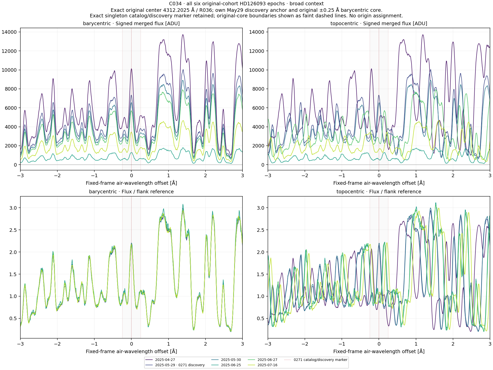
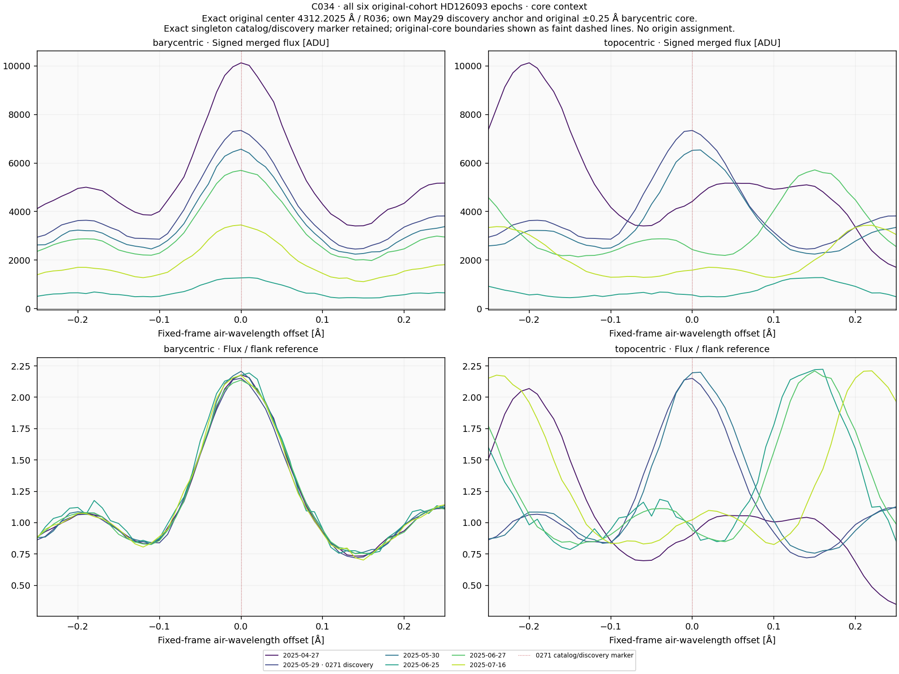
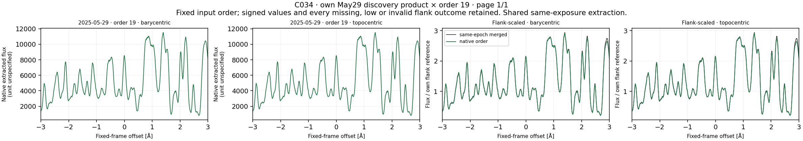
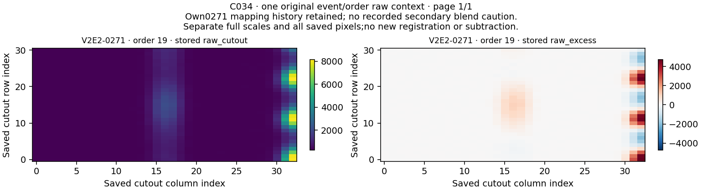

# C034 / HD126093: completed singleton profile context

**V2E2-0271 remains U. No qualified laser candidate or physical origin is established.**

Six existing April–July 2025 observations, one own May 29 discovery reference, native order 19 and the original raw 19 container produced **14 profiles and 28 comparisons**. Exact original center 4312.202499999999 air Å; own BERV -8.31835117513205 km/s fixes the topocentric anchor 4312.322154144395 air Å. No observing time was added.

## Frame comparison

| Region | Higher barycentric raw Pearson r | Lower barycentric normalized RMS |
|---|---:|---:|
| core | 5/5 | 5/5 |
| broad_pattern | 5/5 | 5/5 |

Per region/frame these are five different nonself observation/reference pairs among only six observations, with no reciprocal pairs. Four identical-product self rows and four same-exposure native-to-merged rows remain labeled in the full 28 rows. They do not add independent confirmation.

Both the rounded central feature and neighboring pattern align best barycentrically. This is consistent with stable stellar spectral structure; it does not identify a specific transition, establish the physical cause, measure a linewidth or qualify an artificial laser. All original U/U/U dispositions remain unchanged.

| Region | Observation product | Barycentric r | Topocentric r | Barycentric RMS | Topocentric RMS |
|---|---|---:|---:|---:|---:|
| core | ADP.2025-04-28T01:01:15.579 | 0.998425824 | -0.205677804 | 0.027864783 | 0.677024604 |
| core | ADP.2025-05-31T01:00:40.760 | 0.998767789 | 0.985904936 | 0.032461867 | 0.075510803 |
| core | ADP.2025-06-26T01:01:08.565 | 0.996213038 | -0.484645292 | 0.059793583 | 0.742357653 |
| core | ADP.2025-06-28T01:01:54.505 | 0.997697382 | -0.499013103 | 0.031367502 | 0.744957316 |
| core | ADP.2025-07-17T01:03:21.039 | 0.998242381 | -0.300797062 | 0.031411411 | 0.770764263 |
| broad_pattern | ADP.2025-04-28T01:01:15.579 | 0.999514902 | 0.150187618 | 0.024930669 | 0.921102180 |
| broad_pattern | ADP.2025-05-31T01:00:40.760 | 0.999466355 | 0.996109145 | 0.030138363 | 0.066466235 |
| broad_pattern | ADP.2025-06-26T01:01:08.565 | 0.997800843 | 0.265949090 | 0.064340564 | 0.872555463 |
| broad_pattern | ADP.2025-06-28T01:01:54.505 | 0.999450703 | 0.231034401 | 0.030457484 | 0.890481645 |
| broad_pattern | ADP.2025-07-17T01:03:21.039 | 0.999210478 | 0.040158228 | 0.032779962 | 0.979148703 |

## Coverage and original evidence

All 14 profiles have 601 finite raw and normalized grid samples, positive flank references and no low-reference flag. None of the current bounded windows contains nonpositive original flux samples. All 28 correlation and RMS rows are evaluable. ERR has no positive finite support. These are measured current outcomes, not quality inherited from C033.

Freshly scanning all 72 native order headers selects only order 19. Its original global/local/baseline/later mapping stages are true and remain separate. The original raw 19 container is preserved byte for byte. The own 0271 secondary review has no recorded blend caution; the C 0330274 caution is not transferred. Fourteen original-member support records retain the exact barycentric and discovery-topocentric core bounds.

Signed structured flanks are not certified continua. Merged flux is uncalibrated ADU; native units are unspecified. Separate divisors and difference-noise proxies do not supply calibrated significance, sensitivity, physical flux ratios or linewidth.

The six merged physical sources are shared with C033, but all current source-index windows are disjoint from their C033 windows. Native order 19 is an additional context from the already reused May exposure. Prior epoch/raw values were exposed; disjoint windows do not establish blind or independent validation.

## Verification and publication

Input/header audit:175 checks over 72 native orders. Synthetic preflight:101 checks. Separate scalar prospective checks:1449 over 73010 values. Observed reconstruction:**1184 checks over 55,139 numerical values**. All 22 NPZ containers and four fixed PNGs decode; the same assistant inspected every figure. No independent agent/human review is claimed.

All 20 public method files were compared byte for byte before current observed arithmetic, and the public tree blob identities were verified. The plan, release and all 46 source bindings remain unchanged. The scientific calculation ran once; original outputs refuse overwrite. Results and subsequent descriptive reporting do not turn earlier data into a blind experiment.

## Exact next original route

C032 is next by original queue row 80, with V2E2-0278 and 0283 and their own June 27/July 16 references. Original centers 3869.2975 and 3869.295 air Å remain separate; proposed metadata midpoint 3869.2962500000003 air Å is not a fitted or frozen next diagnostic. Restore their own native/raw products, fresh 72-order header scans and own geometry/quality handling. Do not transfer current order 19, support or anchor.

Completed routes remain closed despite physical U. Rubin remains STOPPED_LIMITED_FEASIBILITY_MINIMUM 50_UNMET. No background science job is running.

## Fixed scientific figures

