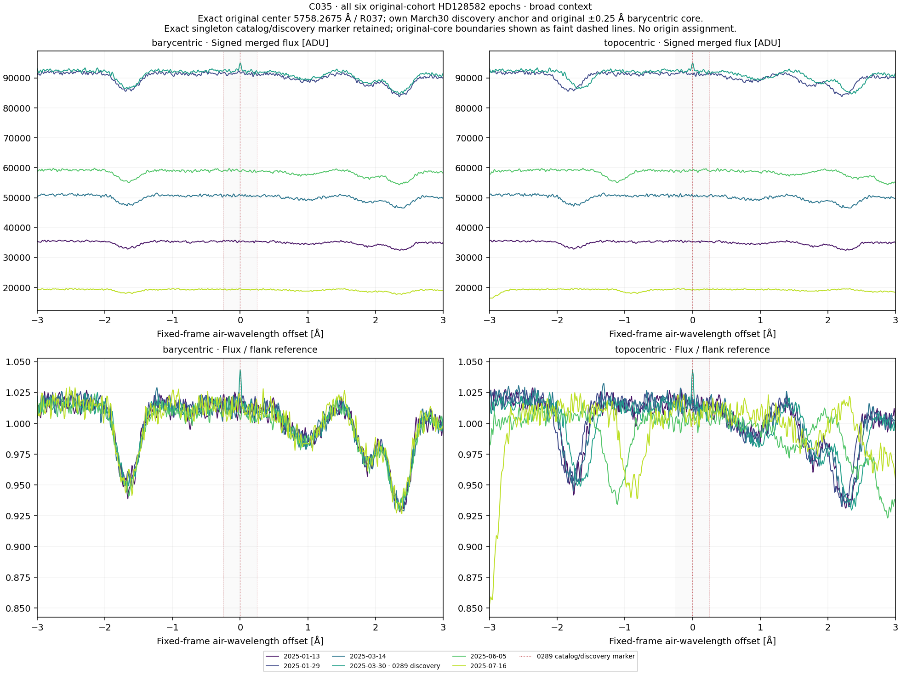
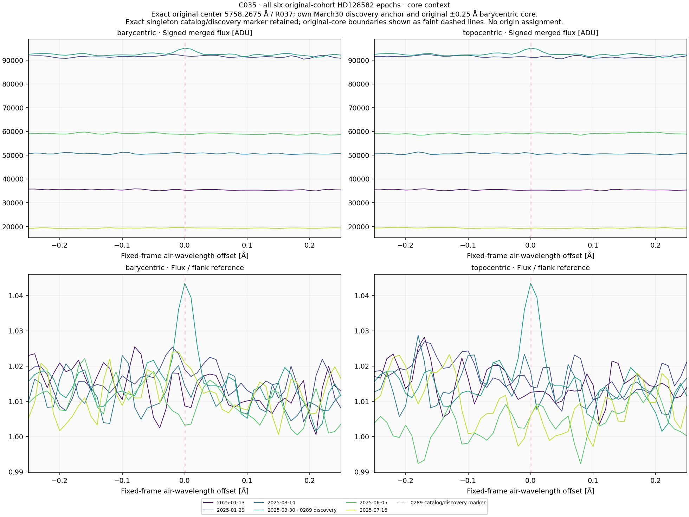
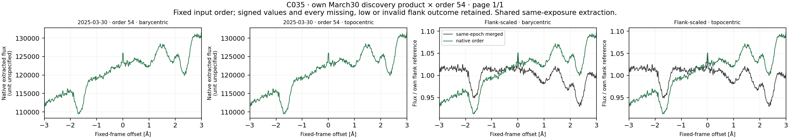
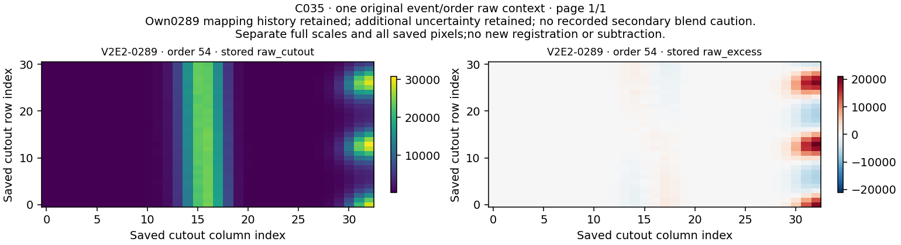

# C035 / HD128582: completed singleton profile context

**V2E2-0289 remains U. No qualified laser candidate or physical origin is established.**

Six existing January–July 2025 observations, the own March 30 discovery reference, native order 54 and original raw54 context produced **14 profiles and 28 comparisons**. The original center is 5758.2675 air Å. The own positive BERV of +18.1525360721304 km/s fixes the topocentric anchor at 5757.9188560400025 air Å. No observing time was added.

## Surrounding pattern and core give different results

| Region | Higher barycentric raw Pearson r | Higher topocentric raw Pearson r | Lower barycentric normalized RMS | Lower topocentric normalized RMS |
|---|---:|---:|---:|---:|
| core | 3/5 | 2/5 | 3/5 | 2/5 |
| broad_pattern | 5/5 | 0/5 | 5/5 | 0/5 |

The surrounding absorption pattern favors barycentric coordinates in all five comparisons by both quantities. The fixed core is mixed: both quantities favor barycentric coordinates in three of five, but **the winning observations are not the same**. There are no ties. The broad stellar-context result does not establish a stable repeat of the discovery feature or identify that feature’s physical origin.

| Region | Other observation | Barycentric r | Topocentric r | Barycentric RMS | Topocentric RMS |
|---|---|---:|---:|---:|---:|
| core | 2025-01-13 | -0.011244904 | 0.032470744 | 0.009680228 | 0.008986849 |
| core | 2025-01-29 | 0.358210081 | -0.073902119 | 0.007345655 | 0.009303214 |
| core | 2025-03-14 | 0.270332555 | 0.264469423 | 0.008739304 | 0.008055571 |
| core | 2025-06-05 | -0.061068398 | 0.010044846 | 0.010961606 | 0.014776880 |
| core | 2025-07-16 | 0.512940051 | -0.159938145 | 0.007638052 | 0.012816385 |
| broad_pattern | 2025-01-13 | 0.966258031 | 0.846592399 | 0.005743403 | 0.012432310 |
| broad_pattern | 2025-01-29 | 0.977783189 | 0.738457228 | 0.005036069 | 0.016250991 |
| broad_pattern | 2025-03-14 | 0.964667204 | 0.884744746 | 0.005989459 | 0.011127986 |
| broad_pattern | 2025-06-05 | 0.970749020 | 0.047139526 | 0.005493817 | 0.030500141 |
| broad_pattern | 2025-07-16 | 0.947177301 | -0.210044410 | 0.007234251 | 0.037814364 |

For the March 14 core, raw correlation is slightly higher barycentrically while RMS is lower topocentrically. For June 5 the preferences reverse. January 13 favors topocentric coordinates by both quantities; January 29 and July 16 favor barycentric coordinates by both. These are descriptive fixed-window comparisons, not calibrated significance or an origin test.

Per region/frame the five nonself rows are five distinct observation/reference relationships among only six observations, without reciprocal pairs. Four identical-product self rows and four same-exposure native-to-merged rows are retained and labeled. The native and merged discovery extractions do not add an independent exposure.

## Coverage, original samples and own raw evidence

All 14 profiles have 601 finite raw and normalized samples, positive fixed-flank references, no low-reference flag and no raw-only or blocked slot. All 28 correlation and normalized-RMS rows are evaluable. No current frame-window original flux samples are nonpositive. ERR has no positive finite support. These are current HD128582 outcomes, not quality transferred from HD126093.

The fresh 72-order header scan selects only order 54. Its original global/local/baseline/later mapping stages are all supported and remain separately recorded. The original U/U/U review chain is unchanged. The secondary review retains additional uncertainty without a recorded blend caution: the weak flat-topped native feature and trace/background residuals do not securely establish a charge deposit or photon-shaped line. The original raw container is preserved byte for byte.

The native profile retains a broad slope different from the merged profile. Fixed flank normalization does not remove that shape difference, and no additional response/continuum fit is introduced. Signed structured flanks are not certified continua. Merged ADU and unspecified native units use separate divisors; noise proxies do not calibrate significance, sensitivity, physical flux ratios or linewidth.

All 14 original-member support records have full raw and normalized support. Nominal counts are 51 in the original barycentric core and 49 in its discovery-topocentric transform, reflecting the own positive BERV and fixed-grid centers. The fixed comparison core still uses 51 centers in each frame. No member-specific fit, measured width or new statistic follows.

The seven physical source IDs differ from the recent C032 HD126093 sources. The six HD128582 observations and earlier epoch/raw values were already exposed; this target change does not establish new observing time, blind validation or independent confirmation. Only old index metadata was read for that source-identity check.

## Validation and heading correction

Input/header audit: 176 checks over all 72 native orders. Synthetic preflight: 101 checks. Separate scalar preflight: 1,449 checks over 73,014 values. Observed reconstruction: **1,182 checks over 54,774 numerical values**. All 22 NPZ containers and all five PNG files decode: four original scientific figures plus one corrected raw-figure heading. The same assistant inspected the four figure contents and the corrected heading; no independent agent or human review is claimed.

All 20 public method files were compared byte for byte and verified by Git blob identity before current arithmetic. All 46 frozen source bindings and original numerical output hashes remain exact. The scientific numerical production ran once.

The original frozen raw figure correctly labels its data axes V2E2-0289 but inherited Own0271 in the heading. Its source and original PNG remain preserved. A separate post-run version changes only that heading to Own0289: every changed pixel lies in the heading box [317,29,340,43], above the data axes; the other three figures are byte exact. The correction script, original/corrected hashes and pixel-difference check are retained. No calculation, statistic, scale, crop or mask was changed.

## Last unfinished original route

**C037 on HD1397**, original queue row 90, singleton V2E2-0319 at 3872.375 air Å. Use that target’s own six epochs and July 25, 2024 discovery ADP.2024-07-26T01:01:40.049, with BERV +4.62262137764828 km/s. The metadata handoff was selected before current C035 values. Restore its own native/raw products, scan all 72 orders and freeze its own geometry and quality; do not transfer the HD128582 cohort, March anchor, order 54 or current outcomes.

C037 is the sole unfinished route in the original queue. Completed diagnoses stay closed despite physical U. Rubin remains STOPPED_LIMITED_FEASIBILITY_MINIMUM50_UNMET. No background science job is running.

## Fixed scientific figures

