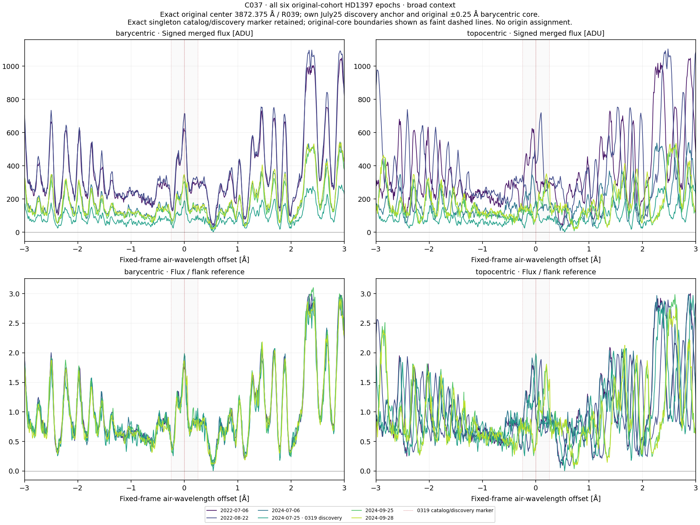
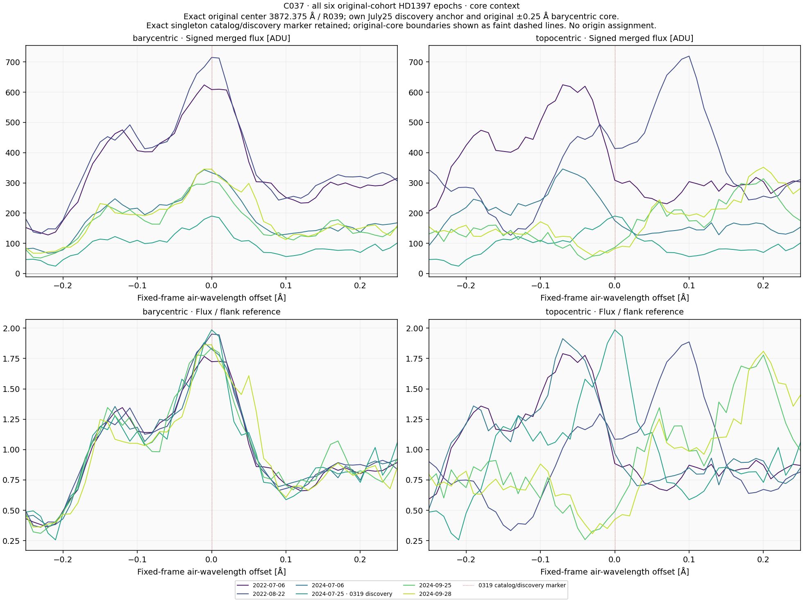
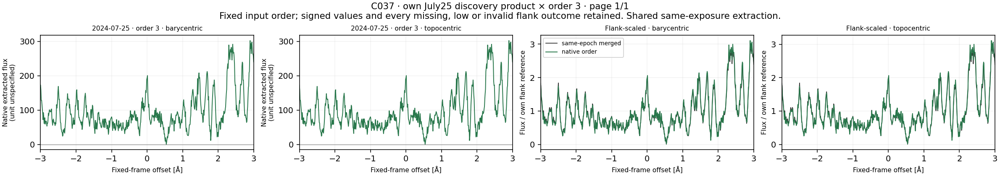
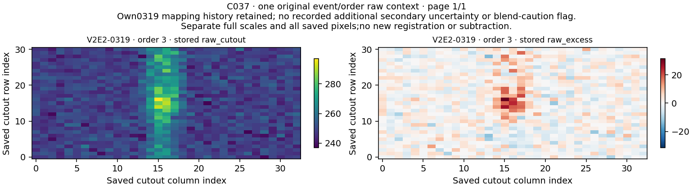

# C037 / HD1397: complete, original follow-up queue covered

**V2E2-0319 remains U. No qualified laser candidate or physical origin is established.**

Six existing observations from 2022 and 2024, the own July 25, 2024 discovery reference, native order 3 and original raw3 container produced **14 profiles and 28 comparisons**. The original center is 3872.375 air Å. The own BERV +4.62262137764828 km/s fixes the topocentric anchor at 3872.3152912015685 air Å. No observing time was added.

## Fixed frame comparisons

| Region | Higher barycentric raw Pearson r | Lower barycentric normalized RMS |
|---|---:|---:|
| core | 5/5 | 5/5 |
| broad_pattern | 5/5 | 5/5 |

The central broad structure and surrounding pattern both align better barycentrically in every fixed nonself comparison. This is consistent with stable stellar spectral structure; it does not identify a transition, establish the origin of each component, measure a linewidth or qualify an artificial laser. Epoch-dependent normalized shape/amplitude differences remain.

| Region | Other observation | Barycentric r | Topocentric r | Barycentric RMS | Topocentric RMS |
|---|---|---:|---:|---:|---:|
| core | 2022-07-06 | 0.957909763 | 0.344383556 | 0.113653040 | 0.426392857 |
| core | 2022-08-22 | 0.971859780 | 0.021662431 | 0.101127998 | 0.554827744 |
| core | 2024-07-06 | 0.971073167 | 0.319219496 | 0.095902715 | 0.436687845 |
| core | 2024-09-25 | 0.957876295 | -0.444277765 | 0.115186424 | 0.664984858 |
| core | 2024-09-28 | 0.928169193 | -0.458502086 | 0.150930169 | 0.668861348 |
| broad_pattern | 2022-07-06 | 0.981159034 | 0.653030805 | 0.121277673 | 0.503196343 |
| broad_pattern | 2022-08-22 | 0.980252402 | 0.364707254 | 0.136026746 | 0.659104549 |
| broad_pattern | 2024-07-06 | 0.975320610 | 0.635454746 | 0.134190434 | 0.509902910 |
| broad_pattern | 2024-09-25 | 0.975627709 | 0.289517293 | 0.141983715 | 0.684087079 |
| broad_pattern | 2024-09-28 | 0.976305644 | 0.314080453 | 0.130125729 | 0.665758911 |

Per region/frame these are five distinct nonself observation/reference relationships among six observations, without reciprocal pairs. Four identical-product self rows and four same-exposure native-to-merged rows remain labeled. Repeated extraction from one exposure is not independent confirmation.

## Own coverage and historical evidence

All 14 profiles have 601 finite raw and normalized samples, positive fixed-flank references, no low-reference flags and no raw-only or blocked slots. All 28 correlation and RMS rows are evaluable. Four frame profiles from the own July 25 discovery exposure—merged and native, in both frames—retain nonpositive original samples. They are signed source samples, not four independent observations, and were neither clipped nor replaced. ERR has no positive finite support.

The fresh all-72-order scan selects only native order 3. Own original global/local/baseline/later mapping stages are all supported and retained separately. Both secondary extra-uncertainty and blend-caution flags are false; the physical U label and unresolved weak broad blue/raw structure remain. False additional flags do not establish a charge or photon origin. The original raw container is byte exact.

All 14 original-member support rows retain full raw and normalized support: 51 nominal grid centers in the original barycentric core and 49 in its discovery-topocentric transform. The fixed comparison core still has 51 centers in each frame. No per-member statistic or fitted width was added.

Signed structured flanks are not certified continua. Merged ADU and unspecified native units use separate divisors. No fitted center, lag, width, stellar RV, continuum, mask, background or new subtraction was introduced. Noise proxies and relative scaling do not provide calibrated significance, sensitivity, physical flux ratios or linewidth.

Seven physical source IDs differ from recent C035 HD128582 context. The HD1397 epochs and earlier raw/epoch values were already exposed, so the target change does not establish blind data, new observing time or independent validation. Only prior source-index metadata was read.

## Verification

Input/header audit: 176 checks over all 72 orders. Synthetic preflight: 104 checks. Separate scalar preflight: 1,449 checks over 73,010 values. Observed reconstruction: **1,188 checks over 55,299 numerical values**. All 22 NPZ containers and four scientific PNGs decode and were inspected by the same assistant through proportional display copies. No independent agent or human review is claimed.

All 22 public method files were compared byte for byte and their Git blob identities verified before current arithmetic. All 49 frozen source bindings and original numerical output hashes remain exact. The scientific calculation ran once.

## Original 90-row follow-up routing queue

| Routing category | Rows |
|---|---:|
| Previously completed bounded diagnostics, including C035 | 79 |
| Exact prior baseline diagnoses preserved by their proof | 10 |
| Current C037 diagnostic | 1 |
| Uncovered or unfinished original rows | 0 |

The ledger covers 90 unique original event IDs across 37 core groups: 32 explicit completed groups and five groups handled by the ten exact prior-baseline records. The ledger is source-bound to the original ACTION_QUEUE, previous completion state, exact baseline proof and the current passing C037 run. It verifies routing coverage; it does not independently rerun or recertify every earlier analysis.

The prior baseline proof covers six HD122640 BERV/May-quality records and four HD135204 bounded searches with no newly selected epoch. Those zero rows are not archive-wide absence. Original physical labels remain unchanged. Completing this bounded queue is not resolution of all U cases, calibrated sensitivity, a survey null or completion of every project objective.

[Queue completion summary](../ORIGINAL_QUEUE_REPORT.md) · [Machine-readable source-bound ledger](../scientific_review/ORIGINAL_QUEUE_CLOSURE.json).

## Next work

The original queue is empty. Review the existing optical/Rubin week plan and consolidate full-sample hit dispositions, coverage, controls/recovery and limitations before choosing a fresh-data or specifically calibrated follow-up route. Any next cohort needs its own metadata selection, exclusions and frozen method before values. Retain 0 DKK spending, no paid account/contact step, and all previous samples. Rubin remains a limited feasibility result: the recorded 190-object study did not meet the minimum 50 evaluable primary objects. No next-dataset arithmetic or background science job is running.

## Four fixed scientific figures

