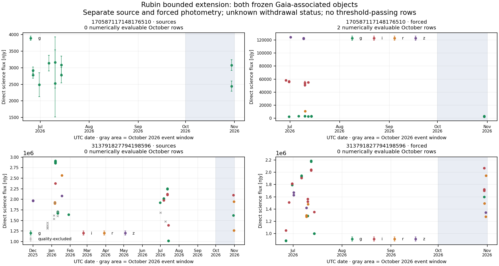

# Rubin bounded extension — two objects, no additional primary evaluability

**The two frozen additional Gaia-associated objects were retrieved and analyzed with the unchanged method. Neither supplies a usable primary-stream baseline. One supplies two numerically evaluable forced-photometry visits; neither passes the fixed dimming criteria.** The original 188-object study remains unchanged. Across both studies, 190 selected objects yield two primary-stream and four secondary-stream numerically evaluable objects. The required minimum of 50 is not reached, and this remains a limited feasibility study with no qualified null result.

The extension selection, acquisition scripts and unchanged scientific method were published and read back before extension flux access: [commit c9f3752](https://github.com/andersenmartin-blip/setisearch/commit/c9f375268ee628088d808842afbd7445def7c9b6). [ROOT_RELEASE.json](../extension_main_acquisition/ROOT_RELEASE.json) records that checkpoint. The sample comes from the single prospectively bounded one-degree metadata extension; only two of its 104 temporal/quality prerequisite objects survived the fixed Gaia and prior-sample counterpart criteria. Both satisfy the proper-motion criterion but have uncertain distance. No threshold or target changed after flux inspection, and no further field expansion was performed.

## Complete extension accounting

| Quantity | Primary source-position science flux | Secondary object-position forced science flux |
|---|---:|---:|
| Selected and returned objects | 2 | 2 |
| Unique full-history measurements | 54 | 53 |
| Full-history measurements admitted by fixed rules | 43 | 53 |
| October measurements | 6 | 10 |
| October measurements rejected by quality/numeric rules | 0 | 0 |
| October measurements lacking a usable baseline | 6 | 8 |
| Numerically evaluable October measurements | 0 | 2 |
| Objects with numerically evaluable October measurements | 0 | 1 |
| Rows passing both dimming conditions | 0 | 0 |
| Fully quality-vetted evaluable objects | 0 | 0 |

Both API jobs succeeded on their first attempt, returning 106,216 bytes. All four object-by-stream records are retained in [OBJECT_ELIGIBILITY.csv](OBJECT_ELIGIBILITY.csv), including every failed baseline. No duplicate source or forced identities occurred. Full-history source exclusions affect 11 unique rows; flag counts overlap and must not be added as independent measurements.

The metadata-only prerequisite could establish visit/date counts and explicit quality flags, but not baseline precision. Three primary g-band October measurements meet temporal requirements yet have baseline-to-scale ratios below the required 10 (approximately 7.36 for object `170587117148176510`, 5.89 for `313791827794198596`). The remaining three primary October measurements lack enough earlier same-band visits. These are baseline eligibility failures, not dimming detections or physical variability classifications.

The two numerically evaluable forced measurements belong to `170587117148176510`, both in g on 29 October 2026 UTC, approximately 19.4 seconds apart. They share the same earlier baseline and must not be interpreted as two independent physical events. The baseline uses seven visits on five dates and ends approximately 107.7 days before the test measurements.

| Forced measurement ID | Flux / baseline | Inferred dimming, mag | Conservative deficit score | Fixed trigger |
|---|---:|---:|---:|---|
| `171141211890909196` | 0.98707 | 0.01413 | 0.12909 | No |
| `171141212025126924` | 0.77869 | 0.27158 | 2.22937 | No |

The fixed conditions require a ratio at most 0.7585775750 and a conservative deficit score at least 5. The score is not a calibrated Gaussian significance. No rule was adjusted for either measurement.

The figure includes both prospectively selected objects in their frozen order. Streams remain in separate panels, colors distinguish filters, error bars are quoted measurement errors, and gray crosses mark source measurements excluded by the fixed rules. The gray interval is the October 2026 event window. All saved history is shown, including dates in 2025; only the preceding 180 days can enter the detector baseline. [FIGURE_PROVENANCE.json](FIGURE_PROVENANCE.json) records the input and figure hashes. This descriptive display does not alter any eligibility or event decision.

## Limits, image work and independent verification

The API omitted the explicitly requested withdrawal field for all 107 rows. All rows retain unknown withdrawal status; all 53 forced rows also retain unavailable measurement-quality flags. Source and forced fluxes are measured at different centroid choices and remain separate. Science flux is used directly; difference and template flux are not added to reconstruct it. Long gaps do not establish local quiescence, and the sample is conditional on alert availability, metadata cadence/quality and Gaia criteria.

All trigger and association files are explicitly empty. [The cutout acquisition record](../extension_main_cutout_review/ACQUISITION.json) therefore records zero requests and zero image classifications. No main-image morphology or physical-origin conclusion is assigned.

[Independent numerical verification](../extension_main_independent_audit/AUDIT.json) passed 2,972 comparisons with zero numerical differences and no discrepancies. It used a separate implementation, verified that all 54 source identities already appeared in the pre-flux metadata, and checked that the original main outputs remained byte-identical. [The independent Gaia audit](../extension_gaia/independent_review/MATCHING_AUDIT.json) separately verified the two-object selection. These checks establish reproducibility, not independent telescope observations or calibrated survey sensitivity.

## Saved outputs and combined denominators

The same complete output schema as the original study is preserved: `SOURCES_NORMALIZED.json`, `FORCED_NORMALIZED.json`, `*_SCORED.json`, `*_DUPLICATES.json`, `*_TRIGGERS.json`, `ALL_TRIGGERS.json`, `CUTOUT_ASSOCIATIONS.json`, [SUMMARY.json](SUMMARY.json), [OBJECT_ELIGIBILITY.csv](OBJECT_ELIGIBILITY.csv) and [OUTPUT_HASHES.json](OUTPUT_HASHES.json). Raw response bytes, original attempts and exact hashes are in [the acquisition manifest](../extension_main_acquisition/MANIFEST.json). Presentation artifacts are hashed separately after the numerical audit.

Across the unchanged original study and this non-overlapping extension, the totals are **861 source measurements and 130 forced measurements**, including **323 source and 35 forced October rows**. There are **7 primary numerical rows from 2 objects** and **16 secondary numerical rows from 4 objects**, with zero triggers in either stream. The two primary objects are included among the four secondary objects, so these counts cannot be added into six distinct stars. All 23 numerical rows have baseline gaps exceeding 30 days and unresolved quality information.

This completes the authorized single extension. Achieving a scientifically useful larger sample would require a separately specified prospective study with a richer cadence or a separately validated association strategy; it is not justified to weaken the fixed baseline or quality rules to inflate the count.
