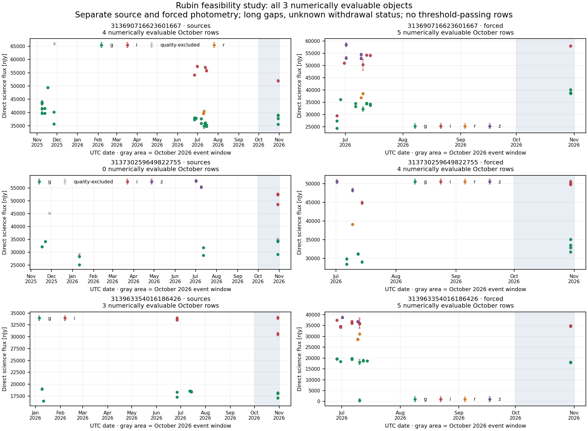

# Rubin October screen — completed as a limited feasibility study

**The frozen screen retrieved all 188 selected Gaia-associated Rubin objects, but only two objects supplied numerically evaluable primary-stream measurements. No row passed both fixed dimming thresholds.** The required minimum of 50 evaluable object histories was not reached. This result is a feasibility study with explicit coverage limits, not a qualified null result or an exclusion of unusual stellar dimming.

The primary October 2026 window, all 188 target identities, quality rules, archival baseline and thresholds were fixed and published before main photometry was opened: [commit 541357e](https://github.com/andersenmartin-blip/setisearch/commit/541357ebea3548836285857b548777723744ae15). Root independently read back all 49 published files. [ROOT_RELEASE.json](../main_acquisition/ROOT_RELEASE.json) binds the exact selection, acquisition code, detector/configuration and method hashes. The later analysis did not adjust thresholds or replace failed/unsuitable targets.

## Actual coverage

| Quantity | Primary: source-position science flux | Secondary: object-position forced science flux |
|---|---:|---:|
| Selected objects, preserved in accounting | 188 | 188 |
| Objects with returned measurements | 188 | 10 |
| Unique full-history measurements | 807 | 77 |
| October measurements | 317 | 25 |
| October rows excluded by quality/numeric rules | 242 | 0 |
| October rows without usable prior baseline | 68 | 11 |
| Numerically evaluable October measurements | 7 | 14 |
| Objects contributing evaluable measurements | 2 | 3 |
| Rows passing both fixed thresholds | 0 | 0 |
| Fully quality-vetted evaluable objects | 0 | 0 |

These columns are separate measurement streams. The three secondary objects include the two primary objects; they must not be added into five distinct stars. The 21 numerical rows also must not be counted as independent physical events or independent telescope exposures.

All eight bounded API jobs succeeded on the first attempt, returning **1,327,231 bytes**. Every selected object remains in the 376-row [OBJECT_ELIGIBILITY.csv](OBJECT_ELIGIBILITY.csv), once per stream. In the primary stream, 130 objects have all October measurements rejected by the fixed quality rules, 56 have no usable baseline, and two are numerically evaluable with unresolved quality information. In the forced stream, 178 objects have no returned data, seven lack a usable baseline, and three are numerically evaluable with unresolved quality information.

Every numerically evaluable measurement has an archival baseline gap exceeding 30 days: approximately 107.7 days for the g-band cases and 111.8 days for the secondary i-band cases. These comparisons cannot establish what a star was doing immediately before the October exposure. Missing observations do not establish constant brightness.

The figure includes every object with a numerically evaluable row in either stream, ordered by exact object ID. Source and forced measurements remain in separate panels; filters retain separate colors, error bars show quoted measurement errors, and gray crosses indicate quality-excluded source measurements. All saved history is displayed, including dates in 2025; only the preceding 180 days can enter the fixed detector baseline. [FIGURE_PROVENANCE.json](FIGURE_PROVENANCE.json) records the input and image hashes.

## Fixed detector and interpretation

The detector uses direct `scienceFlux/scienceFluxErr` in nJy, within the same band and within one stream. It never reconstructs science flux by adding difference and template measurements. The baseline is the median of earlier same-band measurements within 180 days, excluding the tested UTC date. It requires at least five distinct visits on three earlier dates and a positive baseline at least ten times its conservative scale. The scale is the larger of 1.4826×MAD and the median quoted flux error, without division by the square root of the number of measurements.

Both event conditions must hold: flux ratio at most **0.7585775750** (at least 0.3 mag dimmer when the ratio is positive) and conservative deficit score at least **5**. That score is not a calibrated Gaussian significance. The complete configuration is in [CONFIG.json](../method_review/CONFIG.json); original and derived rows are retained, including exclusions and failed baselines.

One primary observation has a deficit score of approximately 5.09 but only 0.082 mag inferred dimming, so it does not meet the fixed 0.3 mag condition. This is retained in `SOURCES_SCORED.json`; no threshold was lowered to promote it. No other interpretation is assigned to that numerical fluctuation.

The API omitted `timeWithdrawnMjdTai` even though it was explicitly requested. All 807 source and 77 forced rows therefore retain `WITHDRAWAL_STATUS_UNKNOWN`. Forced rows also retain `FORCED_MEASUREMENT_FLAGS_UNAVAILABLE`. Source flags are enforced only when explicitly false; missing critical flags are excluded. Dipole, centroid and science-fit edge/failure flags account for most primary exclusions. Flag reason counts can overlap and must not be summed as distinct rejected observations.

## Recovery controls and image work

Before main photometry, the final method was tested with **36 frozen development injections**: depths 0.3, 0.6 and 1.0 mag, durations 60 seconds, one hour and one day, four cases per combination. Eighteen observation-centered cases were sampled and recovered; eighteen longest-gap cases had no sampled exposure and were missed. This is an intentionally mixed, dependent control design on seven development objects, not a random-phase duty-cycle estimate or a 50% survey sensitivity. It tests this light-curve processing conditional on supplied measurements, not Rubin's image/alert pipeline. See [RECOVERY_SUMMARY.json](../method_review/RECOVERY_SUMMARY.json).

There are zero trigger rows in [ALL_TRIGGERS.json](ALL_TRIGGERS.json) and both stream-specific trigger files. Consequently no main trigger cutout was requested: [the explicit zero-request record](../main_cutout_review/ACQUISITION.json) retains this fact. No main image morphology or physical-origin classification is claimed. The six readable science/template/difference FITS products from the separate development pilot establish representative API availability only.

## Independent numerical audit

[The independent audit](../independent_main_audit/AUDIT.json) passed **33,609 comparisons**, with maximum numerical difference **9.09×10⁻¹³** and no discrepancies. It used a separate implementation and did not import detector functions. It verified all 188×2 object-accounting rows, exact source identity/provenance, both streams, scored quantities and empty trigger lists. The 807 main source IDs exactly match the selected IDs already present in the metadata-only pre-flux inventory: no source IDs are missing or added between those snapshots.

This validates reproducibility of the numerical work; it does not provide independent observations, human peer review, image validation or calibrated physical-origin significance.

## Files and continuation

- `SOURCES_NORMALIZED.json` and `FORCED_NORMALIZED.json`: all unique retained measurements, reasons and exact raw-row lineage.
- `SOURCES_SCORED.json` and `FORCED_SCORED.json`: every October row, including exclusions and insufficient baselines.
- `*_DUPLICATES.json`: duplicate-handling records; no duplicate IDs occurred in this acquisition.
- `*_TRIGGERS.json`, `ALL_TRIGGERS.json` and `CUTOUT_ASSOCIATIONS.json`: complete empty trigger/association lists, not omitted files.
- [SUMMARY.json](SUMMARY.json), [OBJECT_ELIGIBILITY.csv](OBJECT_ELIGIBILITY.csv), [OUTPUT_HASHES.json](OUTPUT_HASHES.json): exact accounting and reproducibility hashes.
- [Acquisition manifest](../main_acquisition/MANIFEST.json): original request attempts, all canonical response hashes and each selected object's availability.
- [Fixed analysis wrapper](../main_acquisition/run_main.py): deterministic application of the unchanged detector to the saved canonical responses.

The wrapper intentionally refuses to overwrite an existing `STARTED.json` checkpoint. To reproduce, use a separate copy with saved inputs and preserve this published result; the independent audit can verify the existing outputs without changing them.

The next useful scientific step is metadata-led selection with more same-band visits on separate nights, or a separately frozen investigation of Rubin object-association fragmentation. Existing scores must not be used to cherry-pick replacements or weaken the baseline. October remains the analyzed event window; broadening the month or changing association/quality rules would require a distinct, prospectively documented study. This small field is alert-selected and does not represent all nearby stars or complete Rubin coverage.
